# Hadoop Ecosystem


HDFS architecture, YARN, the classic ecosystem tools, and when to reach for cloud object storage instead.

## What is Hadoop?

**Apache Hadoop** is the open-source framework that made distributed storage and processing of petabyte-scale data practical on commodity hardware. It introduced the pattern that every modern Big Data platform still follows: split data into blocks across many machines, replicate for durability, and move compute to the data.

Hadoop has three core components, each a different layer of concern:

| Component | Layer | Role |
|-----------|-------|------|
| **HDFS** | Storage | Distributed, replicated block storage across the cluster |
| **MapReduce** | Compute | Programming model for parallel batch processing |
| **YARN** | Resource management | Allocates CPU and memory to applications on the cluster |

In modern deployments, **Spark replaces MapReduce** as the compute engine, **Kubernetes often replaces YARN**, and **cloud object storage replaces HDFS** — but the architectural pattern Hadoop pioneered remains the foundation.

## HDFS Architecture

**HDFS (Hadoop Distributed File System)** follows a strict **master-worker** architecture. One master coordinates metadata; many workers store the actual data blocks.

```mermaid
flowchart TB
    CLIENT["Client\n(Spark / Hive / MR / CLI)"] -->|1. Metadata ops| NN
    subgraph NN["NameNode (Master)"]
        FS["FsImage\nfilesystem snapshot"]
        EL["Edit Log\nin-progress operations"]
        BM["Block Map\nfile -> block -> DataNode"]
    end
    CLIENT -->|2. Read/write blocks directly| DN1
    CLIENT -->|2. Read/write blocks directly| DN2
    CLIENT -->|2. Read/write blocks directly| DN3
    subgraph DN1["DataNode 1 (Worker)"]
        B1["Block A1\nBlock B2\nBlock C1"]
    end
    subgraph DN2["DataNode 2 (Worker)"]
        B2["Block A2\nBlock B1\nBlock C3"]
    end
    subgraph DN3["DataNode 3 (Worker)"]
        B3["Block A3\nBlock B3\nBlock C2"]
    end
    DN1 -.->|Heartbeat + Block Report| NN
    DN2 -.->|Heartbeat + Block Report| NN
    DN3 -.->|Heartbeat + Block Report| NN
    NN -.->|Checkpoint FsImage + EditLog| SNN["Secondary NameNode\n(checkpointing only)"]
    style NN fill:#0f1923,stroke:#a855f7
    style DN1 fill:#0f1923,stroke:#a855f7
    style DN2 fill:#0f1923,stroke:#a855f7
    style DN3 fill:#0f1923,stroke:#a855f7
    style SNN fill:#3a1a3a,stroke:#a855f7
```



### NameNode — The Master

The NameNode is the brain of the cluster. It holds the entire filesystem metadata **in memory** for low-latency lookups:

- Directory tree (`/user/alice/data.csv`)
- File-level metadata (owner, permissions, replication factor, modification time)
- File-to-block mapping (`data.csv` -> blocks `blk_001`, `blk_002`, ...)
- Block-to-DataNode mapping (`blk_001` is on nodes DN3, DN7, DN12)

Metadata persistence uses two files on local disk:

- **FsImage** — a point-in-time snapshot of the entire namespace
- **Edit Log** — an append-only log of changes since the last FsImage

On restart, the NameNode loads FsImage then replays the Edit Log to reconstruct current state.

!!! warning "The NameNode is a Single Point of Failure (SPOF) in classic HDFS"
    Without **HA NameNode**, if the NameNode process or its host dies, the entire HDFS cluster becomes unreadable — even though every DataNode is up and holding your data. This is because clients cannot find blocks without the metadata the NameNode holds.

### DataNode — The Worker

DataNodes do the heavy lifting of actually storing block data. Each DataNode:

- Stores blocks on local disks as regular files (`blk_1073741825`, `blk_1073741825.meta`)
- Serves read requests directly to clients (data does **not** flow through the NameNode)
- Pipelines write replicas to peer DataNodes
- Sends a **heartbeat** to the NameNode every 3 seconds
- Sends a **block report** every 6 hours (and incrementally on changes)

If the NameNode misses 10 consecutive heartbeats (~30 seconds), the DataNode is marked dead and its blocks are **re-replicated** from other replicas to maintain the replication factor.

### Secondary NameNode — The Most Misleadingly Named Component in Hadoop

!!! danger "The Secondary NameNode is NOT a hot standby"
    This is the #1 Hadoop interview trap. The Secondary NameNode does **not** take over if the primary NameNode dies. It cannot serve metadata requests. It is a **checkpointing helper**, nothing more.

What it actually does:

1. Periodically fetches the current FsImage and Edit Log from the primary NameNode
2. Merges them into a new, compacted FsImage
3. Pushes the merged FsImage back to the primary NameNode
4. This prevents the Edit Log from growing unbounded and speeds up NameNode restart

Think of it as a **log compaction service**, not a failover node. For true failover you need **HA NameNode** (see below).

### HA NameNode — The Real Failover Solution

Modern HDFS deployments run **two NameNodes**: one Active, one Standby. Both receive block reports from DataNodes. The Standby stays in sync with the Active via a shared Edit Log stored in a **JournalNode** quorum (typically 3 JournalNodes using Paxos-style consensus). **ZooKeeper** mediates automatic failover using leases and health checks.

| Role | What it does |
|------|--------------|
| **Active NameNode** | Serves all client requests |
| **Standby NameNode** | Reads Edit Log from JournalNodes, maintains hot in-memory state |
| **JournalNodes (3+)** | Durable, quorum-written Edit Log |
| **ZooKeeper (3+)** | Elects Active, detects failure, triggers failover |
| **ZKFC (ZK Failover Controller)** | Monitors local NameNode health, participates in election |

With HA, NameNode failover completes in **tens of seconds** and clients retry transparently.

## HDFS Defaults

| Property | Default | Rationale |
|----------|---------|-----------|
| **Block size** | 128 MB | Large enough to amortize seek cost; small enough for parallelism |
| **Replication factor** | 3 | 1 primary + 2 fault-tolerant copies, placed across racks |
| **Heartbeat interval** | 3 seconds | Fast enough to detect failures, infrequent enough to not DDoS NameNode |
| **DataNode dead timeout** | 10.5 minutes (10 missed heartbeats + stale window) | Avoid flapping on transient network issues |
| **Checkpoint interval** | 1 hour or 1M transactions | Keeps NameNode restart time bounded |

### Why 128 MB blocks?

A single HDFS block is **far larger** than a typical filesystem block (4-64 KB). The reasoning:

- **Reduce metadata on NameNode** — each block is one entry in the block map. 1 TB in 128 MB blocks = 8192 entries; in 4 MB blocks = 262 144 entries.
- **Amortize disk seek cost** — spinning disks seek in ~10ms. Reading 128 MB sequentially at 100 MB/s takes 1.3s. Seek overhead is < 1% of read time.
- **Match the unit of parallelism** — each map task processes one block. 128 MB is a good single-task workload.

| Block size | Pros | Cons |
|------------|------|------|
| **Smaller (32-64 MB)** | More parallelism; more map tasks | More NameNode metadata; more scheduling overhead |
| **128 MB (default)** | Balanced | — |
| **Larger (256-512 MB)** | Less metadata; fewer tasks; better for huge files | Less parallelism; stragglers hurt more |

## Rack Awareness and Replica Placement

HDFS does not just replicate blocks three times — it places replicas **intelligently across physical racks** to survive rack-level failures (network switch outage, power loss to a rack, cooling failure).

```mermaid
flowchart LR
    W["Write Request\nreplication = 3"] --> R1
    subgraph RACK1["Rack 1"]
        R1["Replica 1\nLocal DataNode (if client is on cluster)\nor random DataNode"]
    end
    subgraph RACK2["Rack 2"]
        R2["Replica 2\nRemote rack DataNode"]
        R3["Replica 3\nSame rack as Replica 2, different node"]
    end
    R1 -->|Pipeline write| R2
    R2 -->|Pipeline write| R3
    style RACK1 fill:#0f1923,stroke:#a855f7
    style RACK2 fill:#0f1923,stroke:#a855f7
```



The default placement policy for replication factor 3:

1. **Replica 1** — on the local DataNode (if the client is on a DataNode) or a random DataNode
2. **Replica 2** — on a DataNode in a **different rack**
3. **Replica 3** — on a DataNode in the **same rack as Replica 2**, but a different node

### Why this specific pattern?

- **Not all three on one rack** — a rack failure would lose all copies
- **Not one per rack across three racks** — doubles cross-rack network traffic during writes
- **Two on one remote rack** — survives a rack failure (one replica remains locally) while minimizing write-time network cost

Rack topology is configured via `net.topology.script.file.name` in `core-site.xml`, which maps each DataNode IP to a rack identifier.

!!! info "Replication protects against node failure; Rack awareness protects against rack failure"
    Together, they let HDFS survive the loss of an entire rack (dozens of nodes) without data loss or unavailability.

## HDFS Write Path

Writing a file to HDFS involves the client, the NameNode (for metadata), and a **pipeline of DataNodes** (for actual block data).

```mermaid
flowchart TB
    START["Client calls\nfs.create('/path/file.csv')"] --> S1
    S1["1. Client -> NameNode\nCREATE request"] --> S2
    S2["2. NameNode\nCreates file in namespace\nChecks permissions, quotas"] --> S3
    S3["3. NameNode returns\nblock ID + 3 DataNode locations\n(rack-aware)"] --> S4
    S4["4. Client splits file\ninto 128 MB blocks\nStreams first block to DN1"] --> S5
    S5["5. DN1 forwards packets to DN2\nDN2 forwards to DN3\n(write pipeline)"] --> S6
    S6["6. DN3 -> DN2 -> DN1 -> Client\nACK pipeline back"] --> S7
    S7["7. Repeat for each block\nNameNode updates block map"] --> S8
    S8["8. Client calls fs.close()\nNameNode commits final state"] --> END["Write complete"]
    style S1 fill:#0f1923,stroke:#a855f7
    style S3 fill:#0f1923,stroke:#a855f7
    style S5 fill:#0f1923,stroke:#a855f7
    style S8 fill:#0f1923,stroke:#a855f7
```



### Key properties of the write path

- **Pipeline write, not parallel broadcast** — the client writes once to DN1; DN1 forwards to DN2; DN2 forwards to DN3. This maximizes client bandwidth use.
- **ACKs flow backwards** — only when DN3 acknowledges does DN2 ACK, and so on. The client only sees success when all three replicas confirm.
- **Failure during write** — if a DataNode in the pipeline fails, the remaining nodes form a shorter pipeline and the NameNode schedules re-replication later to restore RF=3.
- **Writes are append-only** — HDFS does not support arbitrary in-place updates. You can append to a file, but you cannot `UPDATE row` or `DELETE row`. This is what Delta Lake adds on top.

## HDFS Read Path

Reads are **direct from DataNodes** — the NameNode only serves metadata.

```mermaid
flowchart TB
    START["Client calls\nfs.open('/path/file.csv')"] --> R1
    R1["1. Client -> NameNode\nREAD request for file"] --> R2
    R2["2. NameNode checks permissions\nReturns ordered list of blocks\n+ DataNode locations per block"] --> R3
    R3["3. NameNode sorts DataNodes\nby topological distance from client\n(local > same rack > remote rack)"] --> R4
    R4["4. Client connects to\nnearest DataNode\nfor Block 1"] --> R5
    R5["5. DataNode streams\nblock data to client\n(no NameNode involvement)"] --> R6
    R6["6. On DataNode failure\nclient retries next replica\n(fail-fast + transparent retry)"] --> R7
    R7["7. Client moves to\nnext block, repeat"] --> END["Read complete"]
    style R1 fill:#0f1923,stroke:#a855f7
    style R3 fill:#0f1923,stroke:#a855f7
    style R5 fill:#0f1923,stroke:#a855f7
```



### Key properties of the read path

- **NameNode is not in the data path** — this is critical for scalability. 10 000 concurrent readers do not overload the NameNode because it only answers metadata questions.
- **Topology-aware routing** — the client reads from the closest replica (local disk > same rack > remote rack), minimizing network traffic.
- **Transparent failover** — if a DataNode fails mid-read, the client silently retries with the next replica in the list.
- **Checksum verification** — every block has a CRC32C checksum. The client verifies on read; mismatches trigger reads from alternate replicas and corrupt-replica reporting to the NameNode.

## YARN — Yet Another Resource Negotiator

**YARN** is Hadoop's resource manager. It decides which application gets how much CPU and memory on which nodes. Before YARN, MapReduce had its own resource manager tightly coupled to the MapReduce job model. YARN decoupled resource management from the application framework, enabling Spark, Flink, Tez, and others to run on the same cluster.

```mermaid
flowchart TB
    CLIENT["Client submits\nSpark/MR/Flink application"] --> RM
    subgraph RM["ResourceManager (per cluster)"]
        SCH["Scheduler\n(Capacity / Fair)"]
        ASM["ApplicationsManager\naccepts submissions,\nspawns AMs"]
    end
    RM -->|1. Allocates AM container| N1
    subgraph N1["NodeManager 1"]
        AM["ApplicationMaster\n(per application)"]
        C1["Container\n(Spark Executor / Mapper)"]
    end
    subgraph N2["NodeManager 2"]
        C2["Container\n(Spark Executor / Mapper)"]
    end
    subgraph N3["NodeManager 3"]
        C3["Container\n(Spark Executor / Reducer)"]
    end
    AM -->|2. Requests more containers| RM
    RM -->|3. Grants containers on N2, N3| AM
    AM -->|4. Launches tasks| C2
    AM -->|4. Launches tasks| C3
    N1 -.->|Heartbeat + resource status| RM
    N2 -.->|Heartbeat + resource status| RM
    N3 -.->|Heartbeat + resource status| RM
    style RM fill:#0f1923,stroke:#a855f7
    style N1 fill:#0f1923,stroke:#a855f7
    style N2 fill:#0f1923,stroke:#a855f7
    style N3 fill:#0f1923,stroke:#a855f7
```



### YARN Components

| Component | Scope | Role |
|-----------|-------|------|
| **ResourceManager (RM)** | One per cluster | Global resource arbiter. Accepts applications, allocates containers to the scheduler's rules. |
| **NodeManager (NM)** | One per worker node | Launches and monitors containers on its node. Reports resource usage to RM. |
| **ApplicationMaster (AM)** | One per application | Negotiates resources from RM, coordinates task execution. For Spark, this is the Spark driver (in cluster mode). |
| **Container** | Many per node | A fixed slice of CPU + memory where a task actually runs (a Spark executor, a mapper, a reducer). |

### Why the ApplicationMaster matters

The AM is the key insight of YARN. Instead of the ResourceManager doing per-task scheduling (which does not scale), it delegates that to each application's AM. The RM only hands out coarse container grants; the AM figures out which specific tasks run in which containers. This makes the RM a lightweight global broker rather than a per-task bottleneck.

### Schedulers

- **FIFO** — first-in-first-out. Simple but starves small jobs behind big ones. Not production use.
- **Capacity Scheduler** — hierarchical queues with guaranteed capacity. Favored for multi-tenant clusters (one queue per team).
- **Fair Scheduler** — divides resources evenly among running jobs; preempts to maintain fairness. Favored for ad-hoc workloads.

## Hadoop Ecosystem Tools

The Hadoop ecosystem grew around HDFS + MapReduce to make the platform usable. Many of these tools are legacy today, but their modern cloud equivalents follow the same patterns.

| Tool | Original Purpose | Modern Equivalent |
|------|------------------|-------------------|
| **Hive** | SQL-like querying of HDFS data (`HiveQL -> MapReduce`) | Databricks SQL, Spark SQL, Trino, Snowflake |
| **HBase** | Low-latency NoSQL key-value store on HDFS (CP in CAP) | DynamoDB, Cosmos DB, Bigtable, Lakebase |
| **Pig** | Dataflow scripting language (Pig Latin) over MapReduce | Spark DataFrames, dbt |
| **Sqoop** | Bulk transfer between RDBMS and HDFS | Lakeflow Connect, Azure Data Factory, AWS Glue, Fivetran, Airbyte |
| **Flume** | Log and event ingestion into HDFS | Kafka, Kinesis, Event Hubs, Fluentd / Vector |
| **Oozie** | Workflow scheduler for Hadoop jobs | Databricks Workflows, Airflow, Dagster, Prefect |
| **ZooKeeper** | Distributed coordination (leader election, config) | Still ZooKeeper, or etcd, Consul |
| **Mahout** | Machine learning on MapReduce | Spark MLlib, Databricks ML, SageMaker |
| **Impala** | Fast SQL on HDFS (bypasses MapReduce) | Trino, Databricks SQL, Snowflake |

!!! tip "Hive is the pattern that stuck"
    Hive's two biggest contributions outlived MapReduce: the **Hive Metastore** (table catalog) is still the de facto standard metadata catalog, used by Spark, Trino, Presto, and Flink. And **HiveQL** showed that SQL-on-Big-Data was the right UX, which drove every modern engine (Spark SQL, DBSQL, BigQuery, Snowflake).

## HDFS CLI Commands

Both `hadoop fs` and `hdfs dfs` work — they are aliases. `hdfs dfs` is the modern preferred form.

### Listing and navigation

```bash
# List directory contents
hdfs dfs -ls /user/alice

# Recursive list with human-readable sizes
hdfs dfs -ls -R -h /user/alice

# Show disk usage by directory
hdfs dfs -du -h /user/alice

# Overall cluster disk free
hdfs dfs -df -h /
```

### Creating directories and files

```bash
# Create a directory tree
hdfs dfs -mkdir -p /user/alice/data/bronze

# Create an empty file
hdfs dfs -touchz /user/alice/data/_SUCCESS
```

### Uploading and downloading

```bash
# Local -> HDFS (upload)
hdfs dfs -put /local/path/data.csv /user/alice/data/

# Alternative with explicit intent
hdfs dfs -copyFromLocal /local/path/data.csv /user/alice/data/

# Move from local into HDFS (deletes local source)
hdfs dfs -moveFromLocal /local/path/data.csv /user/alice/data/

# HDFS -> Local (download)
hdfs dfs -get /user/alice/data/data.csv /local/path/

# Alternative with explicit intent
hdfs dfs -copyToLocal /user/alice/data/data.csv /local/path/
```

### Viewing content

```bash
# Print entire file to stdout
hdfs dfs -cat /user/alice/data/data.csv

# First few lines
hdfs dfs -cat /user/alice/data/data.csv | head -20

# Last lines
hdfs dfs -tail /user/alice/data/data.csv
```

### Copying and moving within HDFS

```bash
# Copy within HDFS
hdfs dfs -cp /user/alice/source /user/alice/dest

# Move / rename within HDFS
hdfs dfs -mv /user/alice/old-name /user/alice/new-name
```

### Deletion

```bash
# Remove a file (goes to trash by default)
hdfs dfs -rm /user/alice/data/old.csv

# Remove recursively
hdfs dfs -rm -r /user/alice/data/old-dir

# Skip trash (permanent, immediate)
hdfs dfs -rm -r -skipTrash /user/alice/data/old-dir
```

### Permissions and ownership

```bash
# Change permissions (octal)
hdfs dfs -chmod 755 /user/alice/data/script.sh

# Change owner (requires superuser)
hdfs dfs -chown alice:data-eng /user/alice/data

# Recursive chmod
hdfs dfs -chmod -R 750 /user/alice/data
```

### Block and replication inspection

```bash
# Check file block locations and replica placement
hdfs fsck /user/alice/data/large.parquet -files -blocks -locations

# Change replication factor on a file
hdfs dfs -setrep -w 5 /user/alice/data/critical.parquet

# Cluster health report
hdfs dfsadmin -report
```

!!! warning "chmod 777 is a production anti-pattern"
    Granting read/write/execute to everyone is almost never correct. Use the principle of least privilege: `chmod 750` (owner full, group read+execute, others nothing) is the sensible default for data directories.

## HDFS vs Cloud Object Storage

The single most important architectural change in Big Data over the last decade is the move from HDFS to **cloud object storage** (S3, ADLS Gen2, GCS). The pattern they replace is **tightly-coupled compute and storage**; the pattern they enable is **independently-scaled compute and storage**.

| Dimension | HDFS | Cloud Object Storage (S3 / ADLS Gen2) |
|-----------|------|---------------------------------------|
| **Storage model** | Blocks within files | Objects (opaque blobs + metadata) |
| **Scaling model** | Scale the cluster | Scale storage and compute independently |
| **Compute coupling** | Compute lives next to storage | Compute is remote from storage |
| **Operational burden** | You run the NameNode, DataNodes, HA, upgrades | Fully managed by the cloud provider |
| **Durability** | 3x replication (~99.999% within DC) | 11 nines (replicated across AZs) |
| **Multi-cluster access** | Hard — one cluster owns the data | Trivial — many engines read the same bucket |
| **Latency (first byte)** | ~5-10 ms | ~20-100 ms (higher) |
| **Throughput per client** | Very high (local disk / rack network) | High, but network-bound |
| **Cost per TB** | High (replicated SSD/HDD + ops) | Low ($15-25/TB/month S3 Standard) |
| **Elasticity** | Scale by adding nodes (minutes-hours) | Infinite, instant |
| **Consistency** | Strong | Strong (S3 since Dec 2020; always on ADLS Gen2) |
| **File ops** | Rename is O(1), atomic | Rename is O(n) copy+delete (not atomic) |
| **Append / update** | Append supported, no in-place update | No append, no update (object replace only) |
| **Access model** | POSIX-like filesystem | REST API (GET/PUT/DELETE) |

### When to use each

**HDFS is still the right choice when:**

- You run fully on-premises with no cloud connectivity
- You need the absolute lowest-latency local reads (co-located Spark on HDFS)
- You have an established Hadoop cluster with existing ops skills and compliance footprint
- Regulatory requirements prohibit cloud storage

**Cloud object storage is the right choice when:**

- You are on any public cloud (default answer)
- You want to scale compute and storage independently (seasonal load, bursty analytics)
- You need multi-engine access (Databricks + Snowflake + Trino on the same data)
- You want zero ops burden on storage
- You need geographic replication for DR

### The rename problem

The one real gotcha with object storage is that **renames are not atomic**. On HDFS, `hdfs dfs -mv dir1 dir2` is an O(1) metadata operation. On S3, renaming a "directory" means **copying every object and deleting the original** — O(n) in time, non-atomic, and can leave partial state on failure. This is why **Delta Lake, Iceberg, and Hudi exist**: they add a transaction log on top of object storage to provide atomic commits that renames alone cannot deliver.

!!! tip "In modern cloud architectures, HDFS is largely replaced by cloud object storage + Delta Lake"
    The classic Hadoop stack (HDFS + MapReduce + YARN) is giving way to a lakehouse stack:
    
    - **Storage** -> cloud object store (S3 / ADLS Gen2 / GCS)
    - **Table format** -> Delta Lake / Iceberg (ACID on top of object storage)
    - **Compute** -> Spark / Databricks / Snowflake / Trino
    - **Resource manager** -> Kubernetes / cloud-managed (serverless)
    - **Catalog** -> Unity Catalog / AWS Glue Data Catalog / Hive Metastore
    
    HDFS still runs in production at many organizations, but new builds almost always go cloud-native.

## Data Locality

**Data locality** is the principle of moving compute to the data rather than moving data to the compute. On a classic HDFS cluster this is dramatic: reading 128 MB from a local disk at 500 MB/s takes 0.25 s; shipping it across a 1 Gbps network takes 1 s or more, plus serialization overhead and switch contention.

YARN schedules map tasks with locality preference in this order:

1. **NODE_LOCAL** — task runs on a node holding a replica of the input block
2. **RACK_LOCAL** — task runs on the same rack as a replica
3. **ANY** — any available node

Spark follows the same hierarchy (`PROCESS_LOCAL`, `NODE_LOCAL`, `RACK_LOCAL`, `ANY`) and prefers to launch executors on nodes holding the data.

!!! note "Data locality is largely obsolete in the cloud"
    When compute and storage are separate (Spark on EC2 reading from S3), *there is no local data*. Every read is a network read. Modern cloud platforms compensate with:
    
    - High-bandwidth internal networks (25-100 Gbps)
    - Aggressive **disk caching** on local SSD (Databricks Disk Cache / IO Cache)
    - **Column pruning** and **predicate pushdown** via Parquet / Delta (read 1% of the file, not the whole thing)
    - **Z-ordering** and **data skipping** to avoid reading irrelevant files entirely

## Key Takeaways

!!! success "Hadoop in one page"
    1. **HDFS = block storage** (NameNode metadata + DataNode data + 3x replication + rack awareness).
    2. **NameNode is a SPOF** in classic HDFS. Use HA NameNode (JournalNodes + ZooKeeper) in production.
    3. **Secondary NameNode is a checkpointer, not a hot standby.** Do not confuse these.
    4. **YARN = resource manager** (RM + NM + per-app AM + Containers).
    5. **Reads are direct from DataNodes.** NameNode is never in the data path.
    6. **Modern cloud deployments replace HDFS with object storage + Delta Lake.** Same pattern, lower cost, zero ops.
