# Big Data Fundamentals


The 5 Vs, data types, OLTP vs OLAP, distributed systems, CAP theorem, and the core requirements that shape every modern data platform.

## What is Big Data?

**Big Data** refers to data that is too large, too fast, or too complex to be efficiently stored and processed by a single conventional computing system. The term is not about raw size alone — a 2 TB table on a well-tuned PostgreSQL instance is not Big Data. What qualifies something as Big Data is a combination of five dimensions, known as the **5 Vs**, each of which forces a specific architectural choice.

```mermaid
flowchart TB
    SRC["Data Sources\nApps / IoT / Logs / APIs / Files"] --> ING
    subgraph ING["Ingestion"]
        I1["Batch (ETL)"]
        I2["Streaming (Kafka / Kinesis)"]
        I3["CDC (Debezium / Lakeflow Connect)"]
    end
    ING --> STO
    subgraph STO["Distributed Storage"]
        ST1["HDFS (on-prem)"]
        ST2["Object Storage\nS3 / ADLS Gen2 / GCS"]
        ST3["Delta Lake / Iceberg"]
    end
    STO --> COMP
    subgraph COMP["Distributed Compute"]
        C1["MapReduce (legacy)"]
        C2["Apache Spark"]
        C3["Flink / Trino / Presto"]
    end
    COMP --> ANA
    subgraph ANA["Analytics & Serving"]
        A1["BI / Dashboards"]
        A2["ML / AI"]
        A3["Low-latency APIs"]
    end
    style ING fill:#0f1923,stroke:#a855f7
    style STO fill:#0f1923,stroke:#a855f7
    style COMP fill:#0f1923,stroke:#a855f7
    style ANA fill:#0f1923,stroke:#a855f7
```



## The 5 Vs of Big Data

Each V is not a definition to memorize — it is a *forcing function* that drives a different piece of your architecture.

| V | Core Challenge | Architectural Consequence |
|---|----------------|---------------------------|
| **Volume** | Data exceeds what one machine can store or scan | Distributed storage (HDFS / object stores) + horizontal scaling of compute |
| **Velocity** | Data arrives continuously, decisions needed in seconds | Streaming engines (Kafka, Structured Streaming), micro-batch vs continuous |
| **Variety** | Mix of structured, semi-structured, unstructured formats | Schema-on-read, Lakehouse formats, flexible serialization (Parquet, Avro, JSON) |
| **Veracity** | Data is dirty, late, duplicated, or wrong | Data quality frameworks (Great Expectations, DLT expectations), MERGE/upserts |
| **Value** | Storage and compute cost real money | Medallion / tiered storage, cost attribution, data product thinking |

### Volume — Driving Distributed Storage

A single machine today can hold 10s of TB, but petabyte-scale data from clickstreams, IoT fleets, or financial transactions blows past that. Volume forces a **shared-nothing distributed storage** design: data is split into blocks and spread across many machines, with replication for durability. This is what HDFS invented and what cloud object stores (S3, ADLS Gen2) now provide as a managed service.

!!! info "The volume threshold is not fixed"
    "Big Data" is relative to current hardware. A 1 TB dataset was Big Data in 2005. Today a laptop can hold it. The practical trigger for distributed systems is: *can one node ingest, store, and query it inside the latency SLA?* If not, distribute.

### Velocity — Driving Batch vs Streaming Choice

Velocity determines **how fresh the result needs to be**. This single decision splits an entire data platform:

| Freshness Requirement | Pattern | Technology |
|-----------------------|---------|------------|
| Hours to days | Scheduled batch | Workflows / Airflow + Spark |
| Minutes | Incremental batch | Auto Loader with `trigger(availableNow)` |
| Seconds | Micro-batch streaming | Structured Streaming + Kafka |
| Sub-second | True streaming / event-driven | Flink, Spark Real-Time Mode, native stream processors |

!!! tip "Match freshness to business value"
    Streaming is 3–10x more expensive than batch for the same volume. Only pay for freshness the business actually consumes. A dashboard refreshed every hour does not need a 1-second pipeline feeding it.

### Variety — Driving Schema Flexibility

Traditional RDBMSs force **schema-on-write** — you declare the schema up front, and the engine rejects anything that does not fit. Variety breaks this model. A single pipeline today may handle:

- Relational rows from an OLTP database (strict schema)
- Nested JSON from a REST API (semi-structured, evolving)
- Clickstream events from Kafka (semi-structured, high-cardinality)
- PDF documents, images, audio (unstructured)

Modern lakehouses handle variety with **schema-on-read**: land the raw payload first, apply schema at query or transformation time. Delta Lake and Iceberg layer schema enforcement back on top where you need it.

### Veracity — Driving Data Quality Frameworks

Dirty data is the number-one reason data products get mistrusted. Veracity forces explicit quality controls:

- **Expectations / assertions** at pipeline boundaries (DLT `@expect`, Great Expectations, dbt tests)
- **Quarantine tables** for records that fail validation (so the pipeline does not silently drop them)
- **Idempotent upserts** via `MERGE` to tolerate retries and late arrivals
- **Lineage** so bad data can be traced back to its source and fixed once

### Value — Driving Cost-Aware Design

The last V is the one business pays for. Storing exabytes of unused clickstream is a liability. Value-aware design means:

- Tiered storage (hot / warm / cold)
- Retention policies with hard deletes
- The **Medallion** pattern (Bronze -> Silver -> Gold) so only the refined, high-value layer carries expensive query optimizations
- Chargeback / showback so teams see what their pipelines cost

## Types of Data

### Structured Data

Follows a **fixed, declared schema** — rows and columns, strongly typed. Lives in relational databases.

- **Examples:** MySQL / PostgreSQL / Oracle tables, mainframe records
- **Engineering implication:** Easiest to query (SQL), hardest to evolve (schema migrations are risky)
- **Storage format of choice:** Parquet (columnar, compressed, strongly typed)

### Semi-Structured Data

Has *some* organizational structure (keys, nesting, tags) but no rigid tabular schema. Fields can be optional or nested arbitrarily.

- **Examples:** JSON (REST APIs, Kafka events), XML, CSV, YAML, Avro
- **Engineering implication:** Flexible to produce, painful to query at scale. Nested JSON requires explode / lateral views.
- **Storage format of choice:** Parquet with nested types, or raw JSON in a Bronze layer

### Unstructured Data

No predefined schema — the content is the data.

- **Examples:** Images, video, audio, PDFs, free-text logs, Word docs
- **Engineering implication:** Cannot be queried by SQL directly. Needs feature extraction, OCR, embeddings, or ML inference to become analyzable.
- **Storage format of choice:** Object storage (raw blobs) + metadata table pointing at them

!!! note "The modern reality: everything lands as semi-structured first"
    Even "structured" source data increasingly arrives as JSON from REST APIs or Kafka. The Bronze layer treats it as semi-structured, Silver flattens and enforces schema, Gold presents a clean relational view.

## OLTP vs OLAP

Two fundamentally different workloads with opposite design priorities. Confusing them is one of the most common root causes of slow data systems.

| Dimension | OLTP — Online Transaction Processing | OLAP — Online Analytical Processing |
|-----------|--------------------------------------|-------------------------------------|
| **Purpose** | Run the business (orders, payments, inventory) | Understand the business (reports, dashboards, ML) |
| **Write pattern** | Many small writes, high concurrency | Infrequent bulk loads (ETL / ELT) |
| **Read pattern** | Point lookups by primary key, small result sets | Large scans with aggregations, GROUP BY, joins |
| **Row count per query** | 1 - 100 rows | Thousands to billions |
| **Latency SLA** | Milliseconds | Seconds to minutes |
| **Schema** | Highly normalized (3NF) to avoid update anomalies | Denormalized (star / snowflake) for scan efficiency |
| **Storage layout** | Row-oriented (fetch whole record cheaply) | Columnar (scan one column of billions of rows cheaply) |
| **Indexing** | B-tree indexes on PK and FKs | Partition pruning, Z-ordering, bloom filters |
| **Consistency** | Strong (ACID required) | Eventual / snapshot is usually acceptable |
| **Concurrency** | Thousands of simultaneous users | Dozens of analysts and dashboards |
| **Typical systems** | PostgreSQL, MySQL, Oracle, SQL Server, Lakebase | Snowflake, BigQuery, Redshift, Databricks SQL, Synapse |
| **File format** | Proprietary B-tree pages | Parquet / ORC / Delta |

### Why this matters in practice

Running analytics against your OLTP database is one of the fastest ways to take down production. A single `SELECT ... GROUP BY ... JOIN` scan that an OLAP system handles in 3 seconds can lock pages, blow out the buffer pool, and freeze the application for everyone else.

The standard pattern is to **replicate OLTP data into an OLAP store** via CDC (Lakeflow Connect, Debezium, Fivetran) and let analytics run there. Keep OLTP for the application; keep OLAP for the questions.

!!! tip "HTAP is the exception, not the rule"
    Hybrid Transactional/Analytical Processing (HTAP) systems like SingleStore and Lakebase let you do both on one engine. They work well for specific use cases (operational dashboards, feature serving) but are not a replacement for a dedicated analytical store at petabyte scale.

## Monolithic vs Distributed Systems

A **monolithic system** runs on a single large machine. Scaling means making that machine bigger (**vertical scaling**). A **distributed system** runs across many smaller machines coordinating over a network. Scaling means adding more machines (**horizontal scaling**).

| Feature | Monolithic | Distributed |
|---------|------------|-------------|
| **Architecture** | Single node, all resources local | Cluster of networked nodes |
| **Scaling** | Vertical (bigger CPU / RAM / disk) | Horizontal (more nodes) |
| **Upper bound** | Hardware ceiling of one machine | Effectively unlimited (add nodes) |
| **Failure mode** | Entire system down if the machine fails | Degraded performance; other nodes continue |
| **Complexity** | Simple to reason about, debug, deploy | Network partitions, consensus, replication, consistency |
| **Cost curve** | Super-linear — top-tier hardware is 10x the price for 2x the capacity | Near-linear — commodity nodes added at fixed unit cost |
| **Software required** | Standard OS and app | Cluster manager, distributed FS, consensus protocol |

### CAP Theorem — Required Reading for Distributed Systems

The **CAP theorem** (Brewer, 2000) states that any distributed data system can simultaneously provide at most **two of three** guarantees in the presence of a network partition:

- **C — Consistency.** Every read receives the most recent write or an error.
- **A — Availability.** Every request receives a non-error response (not necessarily the most recent write).
- **P — Partition tolerance.** The system continues to operate even when network messages between nodes are lost or delayed.

Because real networks always partition eventually, **P is non-negotiable**. The real choice is between **CP** and **AP**:

| Category | Behavior under partition | Example systems |
|----------|--------------------------|-----------------|
| **CP** (Consistency + Partition tolerance) | Reject requests on the partitioned side rather than return stale data | HBase, HDFS NameNode, ZooKeeper, etcd, traditional RDBMS clusters |
| **AP** (Availability + Partition tolerance) | Serve possibly stale data on both sides; reconcile later | Cassandra, DynamoDB (default), S3, most eventually-consistent stores |

!!! info "CAP is a snapshot, PACELC is the full picture"
    CAP only describes behavior *during* a partition. **PACELC** extends it: in the absence of a partition (Else), the system still chooses between Latency and Consistency. Spanner is CP+EL (consistent and low-latency, at huge engineering cost); Cassandra is AP+EL (available and low-latency, with tunable consistency).

### Horizontal vs Vertical Scaling Trade-offs

| Dimension | Vertical (scale up) | Horizontal (scale out) |
|-----------|---------------------|------------------------|
| **How** | Add CPU / RAM / disk to one node | Add more nodes to the cluster |
| **Code changes** | None — same app runs on bigger box | Significant — app must be distribution-aware |
| **Fault tolerance** | None inherent — the box is a SPOF | Built in — nodes can die without full outage |
| **Hardware cost** | Super-linear (premium parts) | Linear (commodity) |
| **Software cost** | Lower (simple stack) | Higher (cluster manager, orchestration) |
| **Operational complexity** | Low | High (monitoring N nodes, rebalancing, upgrades) |
| **Scaling limit** | Hardware ceiling (TBs of RAM, dozens of cores) | Thousands of nodes |
| **Downtime to scale** | Usually requires reboot | Usually zero-downtime (rolling) |
| **Best for** | OLTP, small analytical databases, developer workstations | Big Data, cloud-native services, globally distributed systems |

!!! tip "Pick the one you can grow out of"
    Start vertical when workloads are small — it is simpler and cheaper. Switch to horizontal *before* you hit the ceiling, not after. A forced migration under production pressure is one of the hardest engineering projects a team can do.

## Core Requirements of Modern Big Data Systems

Any system calling itself a Big Data platform must deliver five capabilities. If one is missing, you will hit a wall.

### 1. Distributed Storage

Store data across many machines so capacity grows by adding nodes, not by buying bigger disks. Must handle:

- **Horizontal scale** — add nodes, add capacity
- **Durability** — survive disk, node, and rack failures (replication or erasure coding)
- **Throughput** — serve many concurrent readers in parallel
- **Cost efficiency** — commodity hardware or managed object storage

Examples: HDFS, Amazon S3, Azure ADLS Gen2, Google Cloud Storage.

### 2. Distributed Compute

Process data in parallel across many machines so query time grows sub-linearly with data size. Must handle:

- **Parallelism** — split work into independent tasks
- **Shuffle** — redistribute data between stages when needed (joins, aggregations)
- **Data locality** — run compute where the data already is, not pull data to compute
- **Fault tolerance** — restart failed tasks without restarting the whole job

Examples: MapReduce (legacy), Apache Spark, Flink, Trino, Presto, Dask.

### 3. Scalability

Expand horizontally with near-linear cost and performance. A system that scales to 100 nodes but gets 50x faster (not 100x) is actually scaling — true linear scaling is rare, but *sub-linear* is still a win. A system that stops improving beyond 20 nodes is **not** scalable.

Measure scalability with the **speedup curve**: plot throughput vs node count. The ideal is a 45-degree line; the real-world is a curve that bends due to coordination overhead (Amdahl's Law).

### 4. Fault Tolerance

Hardware fails. In a 1000-node cluster running 24/7, a disk fails every few hours. The system must:

- **Detect failures** quickly (heartbeats, timeouts)
- **Recover automatically** without operator intervention (replication, re-execution)
- **Preserve data integrity** — no silent corruption, no lost writes
- **Preserve in-flight work** — a failed task is retried, not failed to the user

Mechanisms: block replication (HDFS, S3), RDD lineage (Spark), write-ahead logs (Delta, Kafka), consensus protocols (ZooKeeper, Raft).

### 5. Schema Flexibility

The data variety problem demands storage that does not force schema up front:

- **Schema-on-read** for Bronze — raw JSON / Avro / CSV lands as-is
- **Schema enforcement** at Silver / Gold — Delta Lake and Iceberg validate on write once the shape stabilizes
- **Schema evolution** — add nullable columns without rewriting history
- **Nested / semi-structured types** — maps, arrays, structs are first-class

Modern lakehouses give you both: start flexible, enforce when ready.

## Database vs Data Warehouse vs Data Lake

Three categories that often get conflated. They are **not** interchangeable.

| Feature | Database | Data Warehouse | Data Lake |
|---------|----------|----------------|-----------|
| **Primary use** | Running transactions | Analytics & BI | Big Data storage & analytics |
| **Workload** | OLTP | OLAP | Analytics / Data Science / ML |
| **Data type** | Structured only | Primarily structured | Raw: structured, semi-structured, unstructured |
| **Schema timing** | Schema-on-write | Schema-on-write | Schema-on-read |
| **Load pattern** | Transactional writes | ETL (Extract -> Transform -> Load) | ELT (Extract -> Load -> Transform) |
| **Storage format** | Proprietary (B-tree, heap) | Proprietary columnar | Open (Parquet, Delta, Iceberg) |
| **Scale** | GB - low TB | TB - low PB | PB - EB |
| **Cost per TB** | $$$ | $$ | $ |
| **Query engine** | Built-in | Built-in | Pluggable (Spark, Trino, DBSQL, Athena) |
| **Examples** | PostgreSQL, MySQL, Oracle, Lakebase | Teradata, Redshift, Snowflake, BigQuery | HDFS, S3, ADLS Gen2 + Delta / Iceberg |

### The Lakehouse Synthesis

Historically teams ran a two-tier architecture: Data Lake for raw + ML, Data Warehouse for BI. This forced duplicated storage, duplicated pipelines, and divergent semantics. The **Lakehouse** (Delta Lake, Iceberg, Hudi) unifies the two: lake-cheap storage, warehouse-strong semantics (ACID, schema, time travel). Databricks, Snowflake Iceberg, and Fabric all converge on this pattern.

## The Eight Fallacies of Distributed Computing

Any Big Data system is a distributed system, which means it is subject to the **Eight Fallacies of Distributed Computing** (Peter Deutsch, Sun Microsystems). Every one of these is a false assumption that will eventually bite you.

| # | Fallacy | Reality | Engineering consequence |
|---|---------|---------|-------------------------|
| 1 | The network is reliable | Packets drop. Links flap. | Retries, idempotency, circuit breakers |
| 2 | Latency is zero | Cross-DC RTT is 50-200 ms. | Avoid chatty protocols; batch calls |
| 3 | Bandwidth is infinite | Shuffle fills a 10 Gbps link in seconds. | Combiners, broadcast joins, columnar formats |
| 4 | The network is secure | Internal networks get breached. | mTLS, Unity Catalog ACLs, Private Link |
| 5 | Topology does not change | AZs fail. Nodes come and go. | Rack awareness, replica placement, HA |
| 6 | There is one administrator | Teams make conflicting changes. | IaC (Terraform, DABs), review processes |
| 7 | Transport cost is zero | Serialization is expensive. | Parquet / Delta, columnar formats, pushdown |
| 8 | The network is homogeneous | Different clouds, different NICs. | Abstractions over transports, avoid baking in assumptions |

Treat these as a checklist when you design a pipeline. If you cannot answer "what happens when the network fails here?" the pipeline is not production-ready.

## Common Big Data Anti-Patterns

!!! danger "Anti-pattern 1: Running analytics against the OLTP database"
    "It is just one dashboard, how bad can it be?" Very bad. One `GROUP BY` on a 100M-row OLTP table can lock pages, blow out buffer pool, and freeze your checkout flow for every user. Replicate via CDC into an OLAP store and query there.

!!! danger "Anti-pattern 2: Thousands of tiny files"
    Each file carries fixed metadata overhead (file listing, open, close, Parquet footer parse). A table with 1 million 10 KB files is 10-100x slower to scan than the same data in 1000 x 10 MB files. **Compact aggressively** with `OPTIMIZE` on Delta or regular compaction jobs on raw lakes.

!!! danger "Anti-pattern 3: Collecting large results to the driver"
    `rdd.collect()` or `df.toPandas()` on a billion-row DataFrame pulls all data to a single JVM / Python process and OOMs. Always sample or aggregate first.

!!! danger "Anti-pattern 4: Reading all columns of a wide table"
    `SELECT * FROM huge_table` on a 300-column Parquet file reads all 300 columns. Projecting only the 5 you need cuts scan time ~60x. Always list columns explicitly in production jobs.

!!! danger "Anti-pattern 5: Writing to Gold directly from source"
    Skipping Bronze means you lose the audit trail. When a transformation bug ships to Gold, you cannot replay from clean raw data. **Always land raw first**, even if the transformations seem trivial today.

!!! danger "Anti-pattern 6: Hard-coded credentials and paths"
    Secrets in notebooks. Table names baked into transformation code. Both make the pipeline impossible to promote across environments. Use **secret scopes** / Key Vault and **parameterize** every environment-specific value.

## Data Engineering Workflow

A data engineer sits between **data producers** (apps, databases, event streams, SaaS APIs) and **data consumers** (analysts, BI dashboards, ML models, data products). The job is to move data reliably through a sequence of refinement stages.

```mermaid
flowchart LR
    SRC["Sources\nOLTP DBs / APIs\nFiles / Streams"] --> ING
    ING["Ingestion\nCDC / Batch / Stream"] --> LAKE
    LAKE["Data Lake\nRaw (Bronze)"] --> PROC
    PROC["Processing\nClean / Transform\n(Silver)"] --> SERVE
    SERVE["Serving Layer\nAggregates (Gold)\nFeature Store / Warehouse"] --> CONS
    CONS["Consumers\nBI / ML / APIs\nData Products"]
    style ING fill:#0f1923,stroke:#a855f7
    style LAKE fill:#6b3a00,stroke:#ffa657
    style PROC fill:#1a3a1a,stroke:#51cf66
    style SERVE fill:#3a3a00,stroke:#ffd700
    style CONS fill:#0f1923,stroke:#a855f7
```



### Technology mapping across environments

| Layer | On-Premise | Azure | AWS | GCP |
|-------|-----------|-------|-----|-----|
| **Ingestion** | Sqoop, NiFi, Flume | Azure Data Factory, Lakeflow Connect | AWS Glue, DMS, Kinesis Firehose | Dataflow, Pub/Sub, Datastream |
| **Data Lake** | HDFS | ADLS Gen2 | S3 | GCS |
| **Table Format** | Hive tables | Delta / Iceberg | Delta / Iceberg / Hudi | Delta / Iceberg / BigLake |
| **Processing** | MapReduce / Spark / Hive | Databricks, Synapse | Databricks, EMR, Glue Spark | Databricks, Dataproc, BigQuery |
| **Orchestration** | Oozie, Airflow | ADF, Databricks Workflows | Step Functions, Workflows, MWAA | Composer, Workflows |
| **Serving** | Hive, HBase, Impala | Synapse Dedicated, Azure SQL, Cosmos DB | Redshift, DynamoDB, RDS | BigQuery, Spanner, Bigtable |
| **BI** | Tableau on Hive | Power BI, Databricks AI/BI | QuickSight, Tableau | Looker, Looker Studio |

### Where data engineers spend their time

In practice, the time allocation of a working data engineer breaks down roughly as:

- **~30%** — ingest, CDC, and schema evolution plumbing
- **~25%** — transformation logic (Silver -> Gold)
- **~20%** — data quality, testing, observability
- **~15%** — orchestration, CI/CD, infrastructure
- **~10%** — stakeholder discussions and spec

The transformation logic is often the smallest line-of-code count but the most domain-dependent. Everything else is **data platform engineering** — the glue that makes the pipeline reliable in production.

## Data Formats on the Lake

The file format you choose for Big Data storage is a load-bearing architectural decision — it determines scan speed, compression, update cost, and interoperability. The right default has evolved over time.

| Format | Type | Splittable | Compression | Schema | Columnar | Best for |
|--------|------|-----------|-------------|--------|----------|----------|
| **CSV** | Text | Yes (uncompressed) | Poor | Implicit | No | Human-readable interchange, tiny data |
| **JSON** | Text | Line-delimited only | Poor | Flexible | No | Nested events, Bronze landing zone |
| **XML** | Text | No | Poor | Verbose | No | Legacy B2B integration (SOAP), avoid for new work |
| **Avro** | Binary row | Yes | Good (Snappy) | Embedded + evolution | No | Streaming, Kafka message payload |
| **Parquet** | Binary columnar | Yes | Excellent (Snappy/Zstd) | Embedded | Yes | Analytics, OLAP, default lake format |
| **ORC** | Binary columnar | Yes | Excellent | Embedded + stats | Yes | Hive-centric stacks, similar to Parquet |
| **Delta** | Parquet + log | Yes | Excellent | Enforced + evolution | Yes | Lakehouse: ACID, time travel, upserts |
| **Iceberg** | Parquet + manifest | Yes | Excellent | Enforced + evolution | Yes | Lakehouse: open table format, hidden partitioning |

### The columnar advantage

A **row-oriented** format (CSV, JSON, Avro) stores all fields of a record contiguously. A query that reads one column of 300 scans the whole file.

A **columnar** format (Parquet, ORC) stores each column contiguously. A query that reads one column scans only that column's bytes. For typical analytical workloads with narrow projections, this is a **10-100x I/O reduction** before you even consider compression.

Columnar also compresses dramatically better because similar values cluster together — a `status` column with 10 distinct values across a billion rows compresses to kilobytes with dictionary + run-length encoding.

!!! tip "Parquet is the correct default for the lake"
    If you have no strong reason to pick something else, write Parquet. If you need ACID, upserts, schema enforcement, or time travel on top, write **Delta** or **Iceberg** — both of which are Parquet underneath plus a transaction log.

## The Lakehouse Evolution

The architectural pattern for Big Data has moved through three generations.

### Generation 1: The Classical Hadoop Stack (2006-2015)

```
Compute: MapReduce (then Spark)
Storage: HDFS, tightly coupled to the cluster
Metadata: Hive Metastore
Access: HiveQL for SQL, MapReduce / Spark for ETL
Deployment: On-premise, bare metal or VMs
```

Strengths: proved that commodity hardware could handle petabyte scale.

Weaknesses: compute and storage scale together, operational burden was enormous (DBA for the whole cluster), ACID was absent.

### Generation 2: The Cloud Two-Tier (2015-2020)

```
Data Lake: raw files on S3/ADLS Gen2, cheap, no schema
Data Warehouse: Snowflake / Redshift / BigQuery for curated analytics
ETL: Spark on EMR / Databricks moves data from Lake to Warehouse
```

Strengths: cheap storage, elastic compute, best-in-class SQL for BI.

Weaknesses: **two copies of the data** (one in the lake, one in the warehouse), two sets of pipelines, two sets of ACLs, divergent semantics between ML (reads lake) and BI (reads warehouse).

### Generation 3: The Lakehouse (2020-present)

```
Storage: S3 / ADLS Gen2 / GCS, as before
Table format: Delta Lake / Iceberg / Hudi — ACID, schema, time travel on top of object storage
Compute: Spark, Trino, Flink, DBSQL — anything that speaks the format
Catalog: Unity Catalog / Glue Catalog — one governance layer across all engines
```

Strengths: **one copy of the data**, warehouse-grade semantics, cheap storage, pluggable compute, multi-engine access via open formats.

The lakehouse is the current center of gravity. Databricks, Snowflake (via Iceberg), Microsoft Fabric, and AWS (Glue + Athena + Redshift Spectrum) all converge on this model.

## Serverless vs Serverful Compute

| Feature | Serverless | Serverful |
|---------|-----------|-----------|
| **Infrastructure** | Managed shared pool | Dedicated cluster you provision |
| **Pricing** | Pay per query / per DBU-second | Pay for provisioned uptime |
| **Startup time** | Seconds (warm pool) | Minutes (cluster boot) |
| **Idle cost** | Zero | Full cluster cost |
| **Peak concurrency** | Scales automatically | Capped by cluster size |
| **Best for** | Ad-hoc queries, unpredictable workloads, SQL analytics | Long-running jobs, predictable production pipelines, custom libraries |
| **Examples** | AWS Athena, BigQuery, Databricks SQL Serverless | EMR, Databricks Jobs on all-purpose cluster, Redshift provisioned |

## Choosing Between Batch, Micro-Batch, and Streaming

The three processing paradigms represent a trade-off curve between **latency** and **cost / complexity**. Pick the one that matches your business freshness need, not the one that sounds most impressive.

| Paradigm | Latency | Cost | Complexity | Typical technology |
|----------|---------|------|------------|--------------------|
| **Daily batch** | Hours | Lowest | Lowest | Spark on scheduled job |
| **Hourly / incremental batch** | ~1 hour | Low | Low | Auto Loader with `trigger(availableNow)` |
| **Micro-batch streaming** | Seconds to minutes | Medium | Medium | Spark Structured Streaming |
| **Continuous streaming** | Sub-second | High | High | Flink, Spark Real-Time Mode, Kafka Streams |

### How to decide

Ask the business consumer two questions:

1. **"If the data were an hour old, would any decision change?"** If no, batch is fine.
2. **"What is the cost of being wrong by 1 minute versus 10 minutes?"** If measurable, micro-batch. If critical, continuous.

!!! warning "Streaming is not a free upgrade"
    Streaming pipelines are harder to test (no fixed input), harder to debug (state is live), harder to replay (watermarks), and 3-10x more expensive. Only move to streaming when a stakeholder names a concrete business impact of lower freshness.

## When is Something Really "Big Data"?

A useful practitioner's heuristic: a workload is Big Data when **at least one** of the following is true, forcing a distributed design:

- **It does not fit on one disk** — modern cloud VMs top out at a few TB locally. Datasets above 10 TB essentially mandate distributed storage.
- **It does not fit in one machine's RAM** — critical for workloads that need in-memory joins or aggregations. A 2 TB working set does not fit on a single node without heavy spill.
- **Single-node compute cannot meet the SLA** — even if the data fits, a daily report that must run in 10 minutes against 500 GB may need parallel compute.
- **Multiple consumers need the same data concurrently** — a central dataset read by 20 analysts and 5 ML jobs needs the throughput of parallel storage.
- **The ingest rate exceeds single-node write throughput** — Kafka topics at 100k events/sec cannot be written to a single Postgres.

If **none** of these are true, you probably do not need a Big Data stack. A properly tuned Postgres on a large VM will outperform Spark on 100 GB of data every time, at a fraction of the cost.

## Key Takeaways

!!! success "The five rules"
    1. **Big Data is defined by challenges, not size.** If one node can handle it inside your SLA, you do not need a distributed system.
    2. **Horizontal scaling is the default for petabyte workloads.** Vertical scaling has a hardware ceiling; horizontal does not.
    3. **OLTP and OLAP are separate workloads.** Run analytics against production and you will take down production. Replicate via CDC.
    4. **CAP forces a choice.** Under partition, you pick consistency or availability. Know which your system picks.
    5. **Variety demands schema-on-read at ingest.** Enforce schema only when the shape is stable.
