# MapReduce


The programming model that made distributed processing mainstream, the optimizations that made it tolerable, and the limitations that gave rise to Spark.

## The MapReduce Programming Model

**MapReduce** is a programming model for processing large datasets in parallel across a cluster. It was introduced by Google in 2004 and popularized by Apache Hadoop. The idea is deceptively simple: express any batch computation as two user-defined functions — **map** and **reduce** — and let the framework handle parallelism, data distribution, failure recovery, and shuffle.

A MapReduce job has three phases:

1. **Map** — read input records, emit intermediate key-value pairs. Fully parallel across input splits.
2. **Shuffle & Sort** — group all values with the same key together on the reducer side. The most expensive stage.
3. **Reduce** — for each key, aggregate the grouped values into a final output.

```mermaid
flowchart TB
    IN["Input File on HDFS\n(split into blocks)"] --> RR1
    IN --> RR2
    IN --> RR3
    subgraph MAP["Map Phase — fully parallel, data-local"]
        RR1["RecordReader -> Mapper 1"]
        RR2["RecordReader -> Mapper 2"]
        RR3["RecordReader -> Mapper 3"]
    end
    RR1 --> C1["Combiner (optional)\nlocal aggregation"]
    RR2 --> C2["Combiner (optional)"]
    RR3 --> C3["Combiner (optional)"]
    C1 --> P["Partitioner\nhash(key) % numReducers"]
    C2 --> P
    C3 --> P
    P --> SH["Shuffle\nnetwork transfer\nMapper -> Reducer"]
    SH --> SORT["Sort & Group\nvalues collected per key"]
    SORT --> R1
    SORT --> R2
    subgraph REDUCE["Reduce Phase — one task per partition"]
        R1["Reducer 1\naggregate per key"]
        R2["Reducer 2\naggregate per key"]
    end
    R1 --> OUT["Output on HDFS\npart-r-00000, part-r-00001, ..."]
    R2 --> OUT
    style MAP fill:#0f1923,stroke:#a855f7
    style REDUCE fill:#0f1923,stroke:#a855f7
    style SH fill:#3a1a3a,stroke:#a855f7
    style P fill:#0f1923,stroke:#a855f7
```



### Phase 1 — Map

The **Map phase** is where parallelism happens. The input is split into **input splits** (one per HDFS block by default). Each split is read by a **RecordReader**, which converts bytes into key-value pairs. The user's **Mapper** function is applied to each pair, emitting zero or more intermediate key-value pairs.

Conceptually:

```
Input:          (K1, V1)
Mapper logic:   process(K1, V1) -> list of (K2, V2)
Output:         (K2, V2), (K2, V2), ...
```

Map tasks run **data-locally** — each is scheduled on the DataNode holding the input block so the read is from local disk, not the network.

### Phase 2 — Shuffle & Sort

The **Shuffle** phase is the most expensive and most important part of MapReduce. It is where intermediate data is physically moved across the network so that **all values for the same key end up on the same Reducer**.

- Each Mapper writes its output to local disk, partitioned by target reducer.
- Reducers pull their assigned partitions from every Mapper (an all-to-all network transfer).
- As partitions arrive, the Reducer merges and sorts them by key.
- The result is a stream of `(key, [list of values])` tuples passed to the Reducer function.

!!! warning "Shuffle is where MapReduce jobs die"
    Shuffle involves disk I/O on both sides, serialization, network transfer, and merge-sort. For a 1 TB intermediate dataset across 100 Mappers and 50 Reducers, that is 1 TB of network traffic and ~2 TB of disk I/O. Any optimization that reduces shuffle volume is a big win.

### Phase 3 — Reduce

The **Reduce phase** receives each key with all its values grouped together and produces the final output. The reducer function:

```
Input:          (K2, [V2a, V2b, V2c, ...])
Reducer logic:  aggregate([V2a, V2b, V2c, ...]) -> (K3, V3)
Output:         (K3, V3)
```

The number of Reducer tasks determines the number of output files (`part-r-00000`, `part-r-00001`, ...). This is also the number of partitions produced during shuffle — these two numbers are always equal.

## The Canonical WordCount Example

Every Big Data course starts with WordCount, because it is the smallest program that exercises every phase.

### Problem

Given a text file, count how many times each unique word appears.

### Pseudocode

```python
# Mapper: emit (word, 1) for every word in every line
def mapper(line):
    for word in line.split():
        emit(word, 1)

# Reducer: sum all 1s for each word
def reducer(word, counts):
    emit(word, sum(counts))
```

### Walkthrough with sample data

Input file (one line per block for illustration):

```
the quick brown fox
the lazy dog
the fox jumps
```

**After Map:**

```
Mapper 1: (the, 1), (quick, 1), (brown, 1), (fox, 1)
Mapper 2: (the, 1), (lazy, 1), (dog, 1)
Mapper 3: (the, 1), (fox, 1), (jumps, 1)
```

**After Shuffle & Sort** (assume 2 Reducers, hash partitioning):

```
Reducer 1: (brown, [1]), (fox, [1, 1]), (lazy, [1])
Reducer 2: (dog, [1]), (jumps, [1]), (quick, [1]), (the, [1, 1, 1])
```

**After Reduce:**

```
brown  1
dog    1
fox    2
jumps  1
lazy   1
quick  1
the    3
```

### Python WordCount with mrjob

```python
from mrjob.job import MRJob

class MRWordCount(MRJob):

    def mapper(self, _, line):
        for word in line.strip().split():
            yield (word.lower(), 1)

    def combiner(self, word, counts):
        # Local aggregation on the Mapper side — safe because sum is associative
        yield (word, sum(counts))

    def reducer(self, word, counts):
        yield (word, sum(counts))

if __name__ == "__main__":
    MRWordCount.run()
```

Run it:

```bash
# Local (for testing)
python wordcount.py input.txt > output.txt

# On a Hadoop cluster
python wordcount.py -r hadoop hdfs:///user/alice/input/*.txt \
    --output-dir hdfs:///user/alice/output/
```

### PySpark WordCount — The Modern Equivalent

Same algorithm, dramatically less boilerplate.

=== "PySpark"

    ```python
    from pyspark.sql import SparkSession

    spark = SparkSession.builder.appName("WordCount").getOrCreate()

    rdd = spark.sparkContext.textFile("hdfs:///user/alice/input/*.txt")

    counts = (
        rdd
        .flatMap(lambda line: line.split())        # Mapper
        .map(lambda w: (w.lower(), 1))             # Mapper
        .reduceByKey(lambda a, b: a + b)           # Combiner + Reducer
    )

    counts.saveAsTextFile("hdfs:///user/alice/output/")
    ```

=== "SQL"

    ```sql
    SELECT
      lower(word) AS word,
      COUNT(*)    AS cnt
    FROM (
      SELECT explode(split(line, ' ')) AS word
      FROM text_table
    )
    GROUP BY lower(word)
    ORDER BY cnt DESC;
    ```

## Combiners — Local Aggregation Before the Shuffle

A **Combiner** is a mini-reducer that runs on the Mapper side **before** data is shuffled across the network. Its job is to pre-aggregate the Mapper output locally, drastically reducing the volume of intermediate data sent to Reducers.

```mermaid
flowchart LR
    M["Mapper output\napple 1\napple 1\napple 1\napple 1\n(4 records, 4 x key size)"] --> NO
    M --> YES
    subgraph NO["Without Combiner"]
        NO1["Shuffle 4 records\nhigh network cost"]
    end
    subgraph YES["With Combiner"]
        YES1["Combiner: apple -> 4"]
        YES2["Shuffle 1 record\nlow network cost"]
        YES1 --> YES2
    end
    style NO fill:#3a0000,stroke:#a855f7
    style YES fill:#0f3a1a,stroke:#a855f7
```



### Example

Without a combiner, a Mapper emitting:

```
(apple, 1), (apple, 1), (apple, 1), (apple, 1)
```

Would send **4 records** across the network. With a combiner:

```
(apple, 4)
```

Only **1 record** is shuffled. For a dataset with billions of records and high key duplication, this can reduce shuffle volume by 10-100x.

### When combiners are safe

Combiners are **only safe for operations that are both commutative and associative**:

| Operation | Commutative? | Associative? | Combiner-safe? |
|-----------|--------------|--------------|----------------|
| **SUM** | Yes | Yes | Yes |
| **COUNT** | Yes | Yes | Yes (emit (key, 1), combine with SUM) |
| **MIN** | Yes | Yes | Yes |
| **MAX** | Yes | Yes | Yes |
| **AVG** | No (not associative) | **No** | **NO — directly unsafe** |
| **MEDIAN** | — | **No** | **NO** |
| **TOP-K** | — | **No** | **NO (unless carefully designed)** |

### Why average breaks

Consider computing the average of `[2, 4, 6, 8]` with two combiners each handling half:

```
Combiner 1: avg(2, 4) = 3
Combiner 2: avg(6, 8) = 7
Reducer:    avg(3, 7) = 5     <-- WRONG. True average is 5. Lucky here, but...

Consider [2, 4, 6] + [8]:
Combiner 1: avg(2, 4, 6) = 4
Combiner 2: avg(8) = 8
Reducer:    avg(4, 8) = 6     <-- WRONG. True average is 5.
```

To make average combiner-safe, you must emit **(sum, count) pairs** and compute the final average in the Reducer:

```python
def mapper(record):
    yield (key, (record.value, 1))        # (sum, count)

def combiner(key, pairs):
    total_sum = sum(p[0] for p in pairs)
    total_count = sum(p[1] for p in pairs)
    yield (key, (total_sum, total_count))

def reducer(key, pairs):
    total_sum = sum(p[0] for p in pairs)
    total_count = sum(p[1] for p in pairs)
    yield (key, total_sum / total_count)
```

!!! tip "The combiner contract"
    The framework is allowed to call your combiner **zero, one, or many times** on any subset of the mapper output. If your logic does not produce the same final result in all those cases, your combiner is buggy. Test by running with the combiner disabled and comparing output.

## Partitioners — Routing Keys to Reducers

A **Partitioner** decides which Reducer receives each intermediate key-value pair. The default is **hash partitioning**:

```
partition_number = hash(key) % number_of_reducers
```

This gives roughly uniform distribution for well-distributed keys, and crucially guarantees that **all values for the same key go to the same Reducer** (so Reducer logic sees the full set).

### Properties

- **Number of partitions always equals the number of Reducers.** 3 Reducers -> 3 partitions. You cannot have more partitions than Reducers.
- **Partitioning happens inside the Mapper**, before data is written to local disk. The partition index becomes part of the intermediate file structure.
- **Each Reducer pulls its partition from every Mapper** during shuffle (that is why shuffle is M x R connections for M mappers and R reducers).

### Custom Partitioners

The default hash partitioner is usually fine, but there are cases where you want to control routing:

- **Skew mitigation** — a few hot keys dominate; you want to route them specifically to avoid overloading one Reducer.
- **Range partitioning** — for sorted output (e.g., all words starting A-M go to Reducer 1, N-Z to Reducer 2) so each output file is sorted.
- **Co-location** — ensure that related keys land on the same Reducer for application-specific reasons.

```python
# Custom partitioner example: route short words and long words to different reducers
class WordLengthPartitioner:
    def partition(self, key, num_partitions):
        if len(key) < 4:
            return 0
        else:
            return 1
```

!!! warning "Skewed partitioning is the #1 cause of straggler reducers"
    If one key has 10 million values and every other key has 1000, that one Reducer handles 10 000x more work than the others. The whole job waits for it. Spark's **Adaptive Query Execution (AQE)** handles this automatically with skew-aware shuffle splitting; classic MapReduce leaves it to you.

## Input Splits vs HDFS Blocks

A subtle but important distinction that trips up many engineers.

| Concept | What it is | Where it lives |
|---------|-----------|----------------|
| **HDFS Block** | Physical unit of **storage**. Default 128 MB. One file is split into blocks when written. | On DataNode disks. |
| **Input Split** | Logical unit of **processing**. One Mapper = one Input Split. | Metadata only — computed by the InputFormat at job submission. |

### Why they are usually (but not always) the same

By default, the `InputFormat` sets one input split per HDFS block. This is intentional: it maximizes data locality (the Mapper runs on the DataNode holding that block). But the two concepts are decoupled:

- **Multiple blocks per split** — rare, used when you want fewer, larger Mappers.
- **Splits do not align with block boundaries** — common for line-oriented formats. A single logical record (a line) may span two HDFS blocks. The `LineRecordReader` handles this by reading past the block end into the next block to finish the current record, and skipping the partial first record of each non-initial block.

### Example

A 300 MB text file in HDFS with 128 MB blocks:

```
Block 1: bytes 0 - 128 MB  (on DataNode A, C, E)
Block 2: bytes 128 - 256 MB (on DataNode B, D, F)
Block 3: bytes 256 - 300 MB (on DataNode C, E, G)
```

Default input splits = 3, one per block. Three Mapper tasks launched, each scheduled near a replica of its block. If a line crosses from Block 1 into Block 2, the Mapper for Split 1 reads a few extra bytes from Block 2 to complete the line, and the Mapper for Split 2 skips the partial first line it finds.

!!! info "Non-splittable formats break this model"
    GZIP-compressed files are **not splittable** — you cannot decompress starting from the middle. The entire file becomes one input split with one Mapper, destroying parallelism. Use **BZIP2**, **LZO** (with index), or **Snappy inside a container format** (Parquet, Avro, ORC) instead.

## Data Locality — Moving Compute to Data

In a classical Hadoop cluster, reading a 128 MB block from a **local disk** is ~5x faster than reading it across a **1 Gbps network**, and uses no network bandwidth that could be contended by shuffle traffic. The MapReduce scheduler exploits this by placing Mapper tasks on nodes that **already hold a replica** of the input block.

### Locality levels, from best to worst

1. **NODE_LOCAL** — task runs on the node holding a block replica. Zero network for the input read.
2. **RACK_LOCAL** — task runs on the same rack as a replica. Single switch hop, no cross-rack bandwidth.
3. **OFF_SWITCH / ANY** — task runs anywhere; input is streamed over the core network.

Hadoop (and Spark) will **wait briefly** for a NODE_LOCAL slot to free up before falling back to RACK_LOCAL, and so on. This is tunable via `yarn.scheduler.capacity.node-locality-delay`.

### Why locality matters less in the cloud

With cloud object storage (S3, ADLS Gen2), **there is no local data** — the compute cluster is remote from storage. The entire premise of data locality disappears. Cloud platforms compensate with:

- Very high internal network bandwidth (25-100 Gbps between EC2 and S3)
- Local SSD **caching tiers** (Databricks Disk Cache, EMR local HDFS cache)
- Aggressive **predicate and projection pushdown** so you only read the bytes you need
- **Columnar formats** (Parquet, Delta) that let you skip 90%+ of data per query

## Tuning MapReduce Jobs

Even on modern Spark-first stacks, understanding MapReduce tuning levers is useful because the same ideas apply to Spark shuffle tuning.

### Number of Reducers

By default MapReduce uses **1 Reducer**, which is almost always wrong for anything but toy jobs. The right count is a balance:

| Reducer count | When to use | Trade-off |
|---------------|-------------|-----------|
| **0** | Map-only jobs (filter, transform, no aggregation) | Skips shuffle entirely — fastest option when applicable |
| **1** | Tiny jobs; need global ordering in a single output file | Serial bottleneck — do not use at scale |
| **~ N (num workers)** | Normal aggregation workload | Good default |
| **> N** | Large aggregation with heavy per-key work | More parallelism, more small output files |

Rule of thumb: target each Reducer to process **~1-5 GB of intermediate data**. If your intermediate dataset is 100 GB, start with 20-100 Reducers.

Set with:

```bash
hadoop jar my-job.jar MyMainClass \
    -D mapreduce.job.reduces=50 \
    input/ output/
```

### In-Mapper Combining

An optimization pattern that moves combiner logic **inside the Mapper**, aggregating in a hash map in Mapper memory before emitting. More efficient than a separate combiner because it skips serialization/deserialization overhead between Mapper and Combiner.

```python
class InMapperCombinerMapper:
    def setup(self):
        self.counts = {}

    def map(self, line):
        for word in line.split():
            self.counts[word] = self.counts.get(word, 0) + 1

    def cleanup(self):
        for word, count in self.counts.items():
            emit(word, count)
```

Trade-off: memory. If one Mapper sees enormous key cardinality, the in-memory map explodes. Guard with a size limit and periodic flush.

### Speculative Execution

A single straggler task can hold up an entire job. **Speculative execution** detects slow tasks and launches duplicate copies on other nodes. Whichever finishes first wins; the other is killed.

- `mapreduce.map.speculative = true`
- `mapreduce.reduce.speculative = true`

Caveat: for **non-idempotent** output operations (writing to a transactional database), speculation can cause duplicate side effects. Disable speculation for those tasks or make the operation idempotent.

### Compression

Compressing intermediate (Map output) data trades CPU for network and disk I/O. Almost always a win on modern hardware:

```xml
<property>
  <name>mapreduce.map.output.compress</name>
  <value>true</value>
</property>
<property>
  <name>mapreduce.map.output.compress.codec</name>
  <value>org.apache.hadoop.io.compress.SnappyCodec</value>
</property>
```

Codec choice:

- **Snappy / LZ4** — fast, moderate compression. Default for intermediate data.
- **Gzip** — high compression, slow, not splittable. Avoid for intermediate data.
- **BZIP2** — splittable but very slow. Niche.
- **Zstd** — modern replacement for Snappy; better ratio at similar speed.

## Fault Tolerance in MapReduce

MapReduce was designed for commodity hardware where failures are routine. Its fault tolerance model is **task re-execution**:

- **Mapper failure** — the ApplicationMaster re-launches the task on a different node, reading from any replica of the input block.
- **Reducer failure** — the task is re-launched, re-pulling partitions from Mappers. Mapper output is preserved on disk for exactly this reason — the Mapper does not have to re-run.
- **ApplicationMaster failure** — YARN re-launches the AM. The AM re-reads job progress from HDFS and resumes.
- **Node failure** — all tasks on that node are marked failed and re-executed elsewhere. HDFS block replication ensures input is still accessible.

The guarantee is **at-least-once execution per task**. For idempotent outputs (writing to HDFS, which commits via atomic rename), this is fine. For side-effecting operations (incrementing a database counter), it is not — hence why MapReduce is not suitable for exactly-once semantics without external coordination.

## Why MapReduce Lost to Spark

MapReduce was revolutionary, but by 2010 its limitations were painful enough that the field moved on. The pivot to Spark was not an incremental improvement — it was a 10x change on multiple axes.

### 1. Multiple disk round-trips per stage

Every MapReduce job writes **Map output to local disk**, then **Reducers read from disk over the network**, then the Reducer output goes to **HDFS (3x replicated)**. For a single pass that is three disk writes and two disk reads. If your workflow needs 5 chained jobs (common for ML), that is 15 writes and 10 reads of your entire dataset.

### 2. No in-memory iteration

Many algorithms are iterative — PageRank, k-means, logistic regression. In MapReduce, each iteration is a separate job that re-reads the same data from HDFS. A 20-iteration k-means on 1 TB reads 20 TB. In Spark, the dataset is cached in RAM once and reused — the same job reads 1 TB once.

### 3. Verbose, low-level API

A MapReduce WordCount in Java is ~60 lines across three classes (Mapper, Reducer, Driver). The equivalent in PySpark is 3 lines. Developer velocity on MapReduce was slow and the ceremony invited bugs.

### 4. No native support for interactive, streaming, or ML workloads

MapReduce is a pure batch model. There is no streaming equivalent, no interactive shell, no ML library. Spark bundles all four (Core, SQL, Streaming, MLlib) into one engine.

### MapReduce vs Apache Spark

| Dimension | MapReduce | Apache Spark |
|-----------|-----------|--------------|
| **Execution model** | 2-stage (Map -> Reduce) per job | Multi-stage DAG with lazy evaluation |
| **Intermediate storage** | Disk (always) | Memory (preferred), spill to disk when needed |
| **Speed on iterative workloads** | 1x baseline | 10-100x faster |
| **Speed on single-pass batch** | 1x baseline | 2-5x faster |
| **Primary API** | Low-level Mapper/Reducer in Java | High-level DataFrame + SQL (plus RDD low-level) |
| **Languages** | Java (native), Python via Hadoop Streaming | Python, Scala, Java, R, SQL |
| **Lines of code (WordCount)** | ~60 Java | ~3 PySpark |
| **Streaming support** | None (Hadoop + Storm as separate stack) | Native (Structured Streaming) |
| **ML / graph support** | External libraries (Mahout, Giraph) | Built-in (MLlib, GraphX) |
| **Interactive queries** | No | Yes (Spark shell, notebooks, Databricks SQL) |
| **Schema optimization** | None | Catalyst optimizer + Tungsten execution |
| **Resource manager** | YARN | YARN, Kubernetes, Mesos, standalone, serverless |
| **Fault tolerance mechanism** | Task re-execution | RDD lineage + task re-execution |
| **Code reuse across batch/stream** | No | Yes (same DataFrame API) |

!!! success "Spark replaces MapReduce as a compute engine — not the entire ecosystem"
    This is the key framing. Spark does not replace HDFS, YARN, Hive Metastore, or Oozie. It plugs into the existing Hadoop ecosystem as a drop-in compute replacement. You can run Spark on YARN, read Hive tables, write to HDFS — all without touching the rest of the stack. That compatibility is why the migration was so fast.

## When MapReduce Still Makes Sense

Despite everything above, MapReduce is not dead. There are specific scenarios where it is still the right tool:

- **Extremely large datasets that do not fit in memory on any realistic cluster.** MapReduce's disk-centric model does not degrade when memory is tight. A 500 PB sort runs the same way on 1000 nodes as it would on 100 — just slower.
- **One-time batch jobs where setup cost does not matter.** If the job runs twice a year, the extra hour from MapReduce vs Spark is irrelevant and you may already have the MapReduce tooling.
- **Compliance / regulated environments** where the stack is frozen at a specific Hadoop version and introducing Spark requires a multi-month security review.
- **Legacy pipelines that work and are not business-critical to modernize.** The rewrite risk may exceed the ongoing cost.
- **Very simple map-only jobs** (no reducer) — a straight transformation at scale with no aggregation. These run fine on MapReduce with zero reducers and skip shuffle entirely.

Everything else — any new build, any pipeline you touch frequently, anything iterative, anything interactive, anything streaming — should be Spark.

## Key Takeaways

!!! success "MapReduce in one page"
    1. **Map + Shuffle + Reduce.** Three phases, framework handles everything in between.
    2. **Combiners are mini-reducers on the Mapper side.** Safe only for commutative + associative operations. Not for averages.
    3. **Partitioners route keys to Reducers.** Default is hash partitioning; custom partitioners handle skew.
    4. **Input splits are logical; HDFS blocks are physical.** Usually 1:1 but not always.
    5. **Data locality** was the key MapReduce performance win. Mostly obsolete in the cloud.
    6. **Spark replaced MapReduce** because of memory, API, and iteration — not storage. HDFS is still fine.
    7. **MapReduce still has niches**: enormous data, frozen compliance stacks, legacy pipelines.
