# DataFrames & SparkSQL

A **DataFrame** is a distributed collection of rows organized into named columns with explicit data types — think of it as a distributed, lazily-evaluated SQL table. **SparkSQL** is the same engine addressable through pure SQL strings and views. Both share the Catalyst optimiser, both compile to the same physical plan, and both are the default surface area for every modern Spark workload.

## DataFrame vs RDD

| Property | RDD | DataFrame |
|----------|-----|-----------|
| **Schema** | None (opaque records) | Columns + types |
| **Optimiser** | None — you wrote it, Spark runs it | **Catalyst** — rule-based + cost-based |
| **Code generation** | No | **Whole-stage codegen** — operators fused into one Java method |
| **Memory layout** | Java objects on heap | **Tungsten** — off-heap, cache-friendly binary rows |
| **API** | Lambda-only | Columns, SQL, built-in functions |
| **Column pruning** | Impossible — Spark can't see columns | **Automatic** — only referenced columns read |
| **Predicate pushdown** | Impossible | **Automatic** — filters pushed into Parquet/JDBC |
| **Serialisation cost** | Pickled per element (PySpark) | Minimal — stays in JVM for built-in ops |
| **Error class** | Runtime | Analysis-time (unknown column, bad type) |
| **Typical speed vs RDD** | 1x baseline | 5x–20x on the same job |

The key insight: RDDs tell Spark **HOW** to process data; DataFrames tell Spark **WHAT** you want. By seeing the whole intent, the engine can rewrite the plan, prune unnecessary work, and generate specialised code.

```mermaid
flowchart LR
    DF["DataFrame API /<br/>SQL"] --> LP["Logical Plan"]
    LP --> OLP["Optimised Logical Plan<br/>(Catalyst rules)"]
    OLP --> PP["Physical Plan Candidates"]
    PP --> CBO["Cost-Based Optimiser"]
    CBO --> CG["Whole-Stage Codegen<br/>(one Java method per stage)"]
    CG --> RDD["RDD DAG"]
    RDD --> TASKS["Tasks on Executors"]
    style LP fill:#1a2a3a,stroke:#4a9eff
    style OLP fill:#1a3a1a,stroke:#51cf66
    style CG fill:#3a3a00,stroke:#ffd700
```



!!! info "Catalyst and Tungsten in one line each"
    **Catalyst** is the query optimiser — it understands your DataFrame plan and rewrites it (push filters down, prune columns, pick the cheapest join strategy). **Tungsten** is the execution engine — it stores rows as compact off-heap binary records and generates fused Java bytecode so each row touches memory once.

## SparkSession — The Single Entry Point

Before Spark 2.0 the entry points were split across `SparkContext` (RDDs), `SQLContext` (DataFrames), and `HiveContext` (metastore access). Modern Spark unifies them.

```python
from pyspark.sql import SparkSession

spark = (
    SparkSession.builder
        .appName("prod-pipeline")
        .config("spark.sql.warehouse.dir", "/user/warehouse")
        .config("spark.sql.shuffle.partitions", "200")
        .enableHiveSupport()                   # join a Hive/Unity metastore
        .master("yarn")                        # or k8s://, local[*], databricks (implicit)
        .getOrCreate()
)

# Still need the SparkContext? It hangs off the session.
sc = spark.sparkContext
```

| Capability | Via `SparkSession` |
|------------|-------------------|
| RDD API | `spark.sparkContext.parallelize(…)` |
| Read files | `spark.read.csv(…)` / `.parquet(…)` / `.json(…)` |
| Run SQL | `spark.sql("SELECT …")` |
| Access catalog | `spark.catalog.listTables()` |
| Create empty DF | `spark.createDataFrame([…], schema)` |
| Generate ranges | `spark.range(0, 1_000_000)` |
| Hive support | `.enableHiveSupport()` on the builder |

### One SparkContext, many sessions

A Spark application has **one** `SparkContext` (one driver, one executor pool) but can host **multiple** `SparkSession` objects. Each session has its own temp views, UDF registry, and conf overrides.

```python
primary  = SparkSession.builder.getOrCreate()
tenant_a = primary.newSession()     # isolated namespace, shared cluster
tenant_b = primary.newSession()
```

!!! note "On Databricks you don't build it"
    In a Databricks notebook, `spark` is pre-created and attached to the cluster. Calling `SparkSession.builder.getOrCreate()` returns that same session. Do not pass `.master(…)` on Databricks — the platform owns cluster assignment.

## Creating DataFrames

### From files

```python
# CSV with header + explicit schema (preferred for production)
orders_df = (
    spark.read.format("csv")
         .option("header", "true")
         .option("inferSchema", "false")
         .schema("order_id long, order_date string, "
                 "customer_id long, status string")
         .load("/data/retail_db/orders/*.csv")
)

# Format shortcuts
csv_df     = spark.read.csv("/data/orders/*.csv", header=True)
json_df    = spark.read.json("/data/events/*.json")
parquet_df = spark.read.parquet("/data/warehouse/orders/")
orc_df     = spark.read.orc("/data/legacy/orders/")
```

### From a Spark SQL table / view

=== "PySpark"

    ```python
    orders_df = spark.read.table("retail.orders")
    orders_df = spark.table("retail.orders")        # equivalent
    ```

=== "SQL"

    ```sql
    SELECT * FROM retail.orders;
    ```

### From a Python collection

```python
# List of tuples + inline DDL schema
rows = [
    (1, "2013-07-25", 11599, "CLOSED"),
    (2, "2013-07-25",   256, "PENDING_PAYMENT"),
]

orders_df = spark.createDataFrame(
    rows,
    schema="order_id long, order_date string, "
           "customer_id long, status string"
)

# List of dicts — Spark infers from the first row
dict_df = spark.createDataFrame([
    {"id": 1, "name": "Alice", "score": 92.5},
    {"id": 2, "name": "Bob",   "score": 88.0},
])
```

### From Pandas

```python
import pandas as pd

pdf = pd.read_csv("/local/customers.csv")
sdf = spark.createDataFrame(pdf)             # distributes the Pandas DF

# Spark → Pandas (brings everything to driver — small data only)
back_to_pandas = sdf.toPandas()
```

!!! warning "spark.createDataFrame(pandas_df) copies via Arrow"
    Enable `spark.conf.set("spark.sql.execution.arrow.pyspark.enabled", "true")` for a 10x–100x speed-up on Pandas ↔ Spark conversions. Without Arrow, each row is pickled individually in Python and reconstructed in the JVM.

### From a numeric range

```python
# Produces an id column: 0, 2, 4, 6, 8
ids = spark.range(0, 10, step=2)
```

## Schema: StructType and DDL Strings

A **schema** is the ordered list of columns, their names, their types, and whether they allow nulls. Spark offers two syntaxes.

### DDL string — compact, SQL-flavoured

```python
schema_ddl = "order_id long, order_date date, customer_id long, status string"
```

### Programmatic `StructType` — explicit, composable

```python
from pyspark.sql.types import (
    StructType, StructField,
    LongType, IntegerType, StringType, DateType, DoubleType, BooleanType
)

schema_struct = StructType([
    StructField("order_id",    LongType(),   nullable=False),
    StructField("order_date",  DateType(),   nullable=True),
    StructField("customer_id", LongType(),   nullable=True),
    StructField("status",      StringType(), nullable=True),
])
```

### Nested schema — structs inside structs

```python
nested = StructType([
    StructField("customer_id", LongType()),
    StructField("fullname", StructType([
        StructField("firstname", StringType()),
        StructField("lastname",  StringType()),
    ])),
    StructField("city", StringType()),
])
```

Or in DDL form:

```python
nested_ddl = (
    "customer_id long, "
    "fullname struct<firstname:string, lastname:string>, "
    "city string"
)
```

### `inferSchema` vs explicit — the trade-off

| Approach | Pros | Cons |
|----------|------|------|
| `inferSchema=true` | Zero config; useful for exploration | **Two full data scans** (one to sample types, one to read); may guess wrong (date → string, long → int) |
| Explicit schema | **Single scan**; type safety; faster | Must be written and maintained |

```python
# Exploration — ok to infer, with sampling for speed
df = (spark.read.format("csv")
            .option("header", "true")
            .option("inferSchema", "true")
            .option("samplingRatio", 0.1)         # only sample 10% for inference
            .load("/data/exploratory/"))

# Production — always explicit
df = (spark.read.format("csv")
            .option("header", "true")
            .schema(schema_ddl)
            .load("/data/prod/orders/*"))
```

### Inspecting a schema

```python
df.printSchema()
# root
#  |-- order_id: long (nullable = false)
#  |-- order_date: date (nullable = true)
#  |-- customer_id: long (nullable = true)
#  |-- status: string (nullable = true)

df.schema                 # StructType object
df.dtypes                 # list of (col_name, dtype_string) tuples
df.columns                # list of column names
```

!!! tip "Read corrupt data without crashing the job"
    Pair an explicit schema with the right **read mode**:
    `.option("mode", "permissive")` (default) sets bad fields to null; `.option("mode", "dropmalformed")` drops the row; `.option("mode", "failfast")` throws immediately. For data pipelines, `permissive` + a `_corrupt_record` string column lets you quarantine bad rows into a parallel Bronze table.

## Writing DataFrames

### Formats, modes, and partitioning

=== "PySpark"

    ```python
    (orders_df.write
        .format("parquet")                   # delta, parquet, orc, csv, json, avro
        .mode("overwrite")                   # append | overwrite | ignore | errorifexists
        .partitionBy("order_date")           # physical directory partitioning
        .option("compression", "snappy")
        .save("/data/warehouse/orders/"))
    ```

=== "SQL"

    ```sql
    CREATE TABLE retail.orders
      USING parquet
      PARTITIONED BY (order_date)
      LOCATION '/data/warehouse/orders/'
    AS SELECT * FROM staging.orders;
    ```

### Save modes

| Mode | If path/table exists | If it doesn't |
|------|---------------------|---------------|
| `append` | Add new files alongside existing data | Create new |
| `overwrite` | **Delete existing** then write | Create new |
| `ignore` | No-op (silent) | Create new |
| `errorifexists` *(default)* | **Throws** `AnalysisException` | Create new |

### Save as table (metastore-registered)

=== "PySpark"

    ```python
    (orders_df.write
        .format("delta")
        .mode("overwrite")
        .partitionBy("order_date")
        .saveAsTable("retail.orders"))
    ```

=== "SQL"

    ```sql
    CREATE TABLE retail.orders
      USING delta
      PARTITIONED BY (order_date)
    AS SELECT * FROM staging.orders;
    ```

!!! warning "partitionBy and over-partitioning"
    Physical partitioning (writing files into `/order_date=2024-10-24/`) only helps when queries filter on that column AND partitions are large (ideally 1 GB+ each). Partitioning by a high-cardinality column like `order_id` creates millions of tiny files and destroys read performance. Prefer **Z-ordering** (Delta) or **Liquid Clustering** for high-cardinality join keys.

## Managed vs External Tables

When you save a DataFrame as a table, Spark creates two things: **metadata** (schema + location) in the metastore, and **physical files** (Parquet/Delta/ORC) on storage. Who owns the files is what distinguishes managed from external.

```mermaid
flowchart TB
    MT["Managed Table"] --> MM["Metadata<br/>→ Metastore"]
    MT --> MD["Data<br/>→ Spark warehouse dir"]
    MT2["DROP TABLE"] --> MR["Metadata DELETED<br/>+ Data DELETED"]
    ET["External Table"] --> EM["Metadata<br/>→ Metastore"]
    ET --> ED["Data<br/>→ User-specified LOCATION"]
    ET2["DROP TABLE"] --> ER["Metadata DELETED<br/>Data PRESERVED"]
    style MR fill:#3a0000,stroke:#e60028
    style ER fill:#1a3a1a,stroke:#51cf66
```



| Feature | Managed Table | External Table |
|---------|---------------|----------------|
| **Data ownership** | Spark owns metadata **and** data | Spark owns metadata only |
| **Storage location** | Default warehouse (`spark.sql.warehouse.dir`) | Explicit `LOCATION '...'` |
| **CREATE** | `CREATE TABLE t (...)` | `CREATE TABLE t (...) LOCATION '/path'` |
| **DROP** | Deletes metadata **and physical files** | Deletes metadata only — files survive |
| **Typical use** | Dedicated pipelines, derived tables | Shared enterprise data, raw landing zones |

=== "PySpark"

    ```python
    # Managed — files live wherever Spark's warehouse dir points
    (df.write.format("delta").saveAsTable("retail.orders"))

    # External — explicit path, data survives DROP
    (df.write.format("delta")
         .option("path", "/mnt/datalake/retail/orders/")
         .saveAsTable("retail.orders_external"))
    ```

=== "SQL"

    ```sql
    -- Managed
    CREATE TABLE retail.orders (
      order_id BIGINT,
      customer_id BIGINT,
      status STRING
    ) USING delta;

    -- External
    CREATE TABLE retail.orders_external (
      order_id BIGINT,
      customer_id BIGINT,
      status STRING
    ) USING delta
      LOCATION '/mnt/datalake/retail/orders/';
    ```

!!! tip "Default to external for raw data; managed for derived"
    Raw Bronze data should almost always be external — the data is the source of truth and must survive accidental `DROP TABLE`. Silver and Gold derived tables are safe to manage: the pipeline can regenerate them from Bronze.

## DataFrame Actions vs Transformations

Same lazy semantics as RDDs. A transformation returns a new DataFrame and records the operation; an action triggers the plan.

| Transformation (lazy) | Action (eager) |
|-----------------------|----------------|
| `select`, `filter`, `where`, `withColumn`, `drop`, `groupBy().agg()`, `orderBy`, `limit`, `join`, `union`, `distinct`, `dropDuplicates`, `pivot`, `withColumnRenamed` | `show`, `count`, `collect`, `take`, `head`, `first`, `toPandas`, `write.save`, `foreach`, `foreachPartition` |
| Utilities | `printSchema`, `explain`, `cache`, `persist`, `unpersist`, `createOrReplaceTempView` |

```python
df.show(20, truncate=False)        # print 20 rows; action
df.count()                          # row count; action
df.explain("extended")              # print plans; utility (no job)
df.cache()                          # mark for caching; action triggers on next action
```

!!! warning "show() can trigger multiple jobs"
    `df.show(n)` runs `limit(n)` first, which may launch a quick job just to find enough rows. On a plan with aggregations, you can see 2–3 small jobs per `show()`. Don't scatter `show()` calls through production code.

## SparkSQL — The Table Interface

Every DataFrame can be registered as a **view** and queried with pure SQL. Views are lazy — they don't materialise data, they alias a logical plan.

### Temporary views

=== "PySpark"

    ```python
    orders_df.createOrReplaceTempView("orders")        # session-scoped

    top_customers = spark.sql("""
        SELECT customer_id, COUNT(*) AS orders
        FROM   orders
        GROUP  BY customer_id
        ORDER  BY orders DESC
        LIMIT  15
    """)
    ```

=== "SQL"

    ```sql
    -- Already registered as a view via createOrReplaceTempView('orders')
    SELECT customer_id,
           COUNT(*) AS orders
    FROM   orders
    GROUP  BY customer_id
    ORDER  BY orders DESC
    LIMIT  15;
    ```

### View variants

| Method | Scope | Replaces existing? |
|--------|-------|-------------------|
| `createTempView("v")` | Current session | **No** — throws if exists |
| `createOrReplaceTempView("v")` | Current session | Yes |
| `createGlobalTempView("v")` | All sessions in the application (accessed as `global_temp.v`) | **No** |
| `createOrReplaceGlobalTempView("v")` | All sessions | Yes |

### Mixing DataFrame API and SQL

They are interchangeable. The output of `spark.sql(...)` is a DataFrame; the input to `createOrReplaceTempView` is any DataFrame.

```python
# Start in the DataFrame API
cleaned = (orders_df
             .filter("status = 'CLOSED'")
             .withColumn("order_date", to_date("order_date")))

# Hand off to SQL for a complex aggregation
cleaned.createOrReplaceTempView("closed_orders")

monthly = spark.sql("""
    SELECT date_trunc('month', order_date) AS month,
           COUNT(*)                        AS orders,
           COUNT(DISTINCT customer_id)     AS customers
    FROM   closed_orders
    GROUP  BY date_trunc('month', order_date)
    ORDER  BY month
""")

# Continue in the DataFrame API
monthly.filter("orders > 1000").write.saveAsTable("retail.monthly_summary")
```

### The DataFrame API and SQL produce identical plans

Catalyst parses SQL into the same logical plan the DataFrame API builds. The optimised physical plan is byte-identical. Choose the syntax that reads most clearly for the task:

- **DataFrame API** — better when transformations are chained, column logic is dynamic (built from variables), or you want IDE-level autocomplete and compile-time checks.
- **SQL** — better for complex multi-join analytics, when business users will read the code, and for anything that already lives in a `.sql` file.

=== "PySpark"

    ```python
    active = (orders_df
                .select("customer_id")
                .distinct()
                .count())
    ```

=== "SQL"

    ```sql
    SELECT COUNT(DISTINCT customer_id) AS active_customers
    FROM   orders;
    ```

## The Catalog API — Metadata-Driven Pipelines

Every metastore-registered database, table, view, column, function, and partition is accessible programmatically through `spark.catalog`. Essential for building metadata-driven frameworks, migration scripts, and lineage tooling.

```python
# Databases
spark.catalog.listDatabases()
spark.catalog.currentDatabase()
spark.catalog.setCurrentDatabase("retail")

# Tables
spark.catalog.listTables("retail")                # tables in a database
spark.catalog.tableExists("retail.orders")        # bool
spark.catalog.getTable("retail.orders")           # Table metadata object

# Columns of a specific table
spark.catalog.listColumns("retail.orders")

# Functions (built-in + user-defined)
spark.catalog.listFunctions()

# Cache management (table-level)
spark.catalog.cacheTable("retail.orders")
spark.catalog.uncacheTable("retail.orders")
spark.catalog.isCached("retail.orders")
spark.catalog.clearCache()

# Partition recovery (after writing partitions out-of-band)
spark.catalog.recoverPartitions("retail.orders")

# Metadata refresh (after external changes to the files)
spark.catalog.refreshTable("retail.orders")
```

### A real-world catalog pattern: automated schema drift report

```python
from pyspark.sql.functions import lit

def column_profile(database: str) -> "DataFrame":
    rows = []
    for t in spark.catalog.listTables(database):
        for c in spark.catalog.listColumns(f"{database}.{t.name}"):
            rows.append((database, t.name, c.name, c.dataType, c.nullable))
    return spark.createDataFrame(
        rows,
        "database string, table string, column string, "
        "data_type string, nullable boolean"
    )

(column_profile("retail")
    .write.format("delta").mode("overwrite")
    .saveAsTable("meta.column_profile_snapshot"))
```

That table, snapshotted daily, is the raw material for drift detection, documentation generators, and lineage dashboards.

## DML on CSV/Parquet vs Delta Lake

Standard file-based tables (CSV, Parquet, JSON, ORC) support only append-style DML in open-source Spark. For in-place `UPDATE`, `DELETE`, and `MERGE`, you need a transactional table format.

| Operation | CSV / Parquet tables | Delta Lake / Iceberg / Hudi |
|-----------|---------------------|-----------------------------|
| `SELECT` | Yes | Yes |
| `INSERT INTO` | Yes | Yes |
| `UPDATE` | **No** | Yes |
| `DELETE` | **No** | Yes |
| `MERGE` | **No** | Yes |
| Time travel | **No** | Yes |
| ACID transactions | **No** | Yes |

=== "PySpark"

    ```python
    # Delta MERGE (upsert) — the modern replacement for the Hive INSERT OVERWRITE dance
    from delta.tables import DeltaTable

    target = DeltaTable.forName(spark, "retail.customers")

    (target.alias("t")
           .merge(updates_df.alias("s"), "t.customer_id = s.customer_id")
           .whenMatchedUpdateAll()
           .whenNotMatchedInsertAll()
           .execute())
    ```

=== "SQL"

    ```sql
    MERGE INTO retail.customers AS t
    USING updates           AS s
      ON t.customer_id = s.customer_id
    WHEN MATCHED THEN UPDATE SET *
    WHEN NOT MATCHED THEN INSERT *;
    ```

!!! info "Why this matters for production"
    If your Bronze/Silver/Gold layers are Parquet, every update is "write a new partition, drop the old one" — awkward, non-atomic, and unsafe under concurrent reads. Delta Lake was built specifically to solve this; it's the default table format on Databricks and is the baseline assumption for the rest of this guide.

## Where to Go Next

- **[Spark Transformations & Functions](transformations.md)** — the catalogue of column, string, date, join, window, and UDF functions that make up 90% of real pipeline code.
- **[RDDs](rdds.md)** — the low-level API, when and why to drop down.
