# Apache Spark Core

Apache Spark is the de-facto unified engine for large-scale data processing. This module covers the architectural foundations every Spark engineer must internalize before touching production workloads — the execution model, the DAG scheduler, deployment topologies, and the entry-point APIs that evolved from `SparkContext` into the modern `SparkSession`.

## Spark vs Hadoop MapReduce

Hadoop MapReduce was the first widely adopted framework that let commodity clusters crunch terabytes of data by combining HDFS (storage) with a map-shuffle-reduce execution model. It worked, but every intermediate step was materialised to disk, every job ran as a separate JVM, and the API offered only two primitives: `map` and `reduce`. Spark was built in 2009 at UC Berkeley's AMPLab specifically to fix those pain points.

| Dimension | Hadoop MapReduce | Apache Spark |
|-----------|------------------|--------------|
| **Intermediate storage** | Disk (HDFS) after every stage | Memory (RAM) between stages |
| **Programming model** | Only `map` + `reduce` | 100+ transformations & actions |
| **Execution planner** | Rigid stage sequence | DAG scheduler with optimisation |
| **Evaluation** | Eager, per-job | Lazy — plan built then optimised |
| **Fault tolerance** | Replicated intermediate files | Lineage-based recomputation |
| **JVM reuse** | New JVM per task | Long-lived executor JVMs |
| **Latency** | High (disk I/O dominated) | Low (memory + pipelined ops) |
| **Workloads** | Batch only | Batch, streaming, SQL, ML, graph |
| **Typical speedup** | 1x baseline | 10x–100x for iterative workloads |

### Why Spark is faster — the three big levers

1. **In-memory execution.** Intermediate datasets live in the executor's heap (and off-heap, with Tungsten) until an action forces a write. MapReduce rematerialises everything to HDFS between stages — a 128 MB block becomes a 128 MB read + 128 MB write cycle for every hop. Spark skips both legs when the data fits in memory.
2. **DAG execution with whole-pipeline optimisation.** Spark builds a Directed Acyclic Graph of the entire computation before launching a single task. It can then fuse narrow transformations into a single pipelined stage, push filters down into the data source, and prune columns that no downstream operator needs.
3. **Lazy evaluation.** Transformations only *describe* work; the plan is not executed until an action is invoked. This gives the optimiser the whole picture — it will never materialise a column that is dropped three steps later.

!!! info "Spark did not kill Hadoop"
    Spark replaced the MapReduce execution engine, not the Hadoop ecosystem. Many production Spark clusters still run on YARN with HDFS underneath. On modern cloud-native platforms (Databricks, EMR, Dataproc) HDFS is replaced by object storage (S3, ADLS, GCS) and YARN is replaced by Kubernetes or a managed scheduler, but the Hadoop file formats (Parquet, ORC, Avro) and the Hive metastore remain central.

## Cluster Architecture

A Spark application is a distributed system with three logical roles — a **Driver** that owns the plan, a **Cluster Manager** that hands out resources, and a fleet of **Executors** on worker nodes that run tasks. The driver never processes partitions itself; its job is to translate your code into a DAG, schedule tasks, and collect results.

```mermaid
flowchart TB
    USER["User Code<br/>(PySpark / Scala / SQL)"] --> DRIVER
    subgraph DRIVER["Driver Process"]
        SS["SparkSession"]
        DAG["DAG Scheduler"]
        TS["Task Scheduler"]
        BM["Block Manager Master"]
    end
    DRIVER -->|"Request executors"| CM
    subgraph CM["Cluster Manager<br/>(YARN / K8s / Standalone / Databricks)"]
        RA["Resource Allocation"]
    end
    CM -->|"Launch executors"| W1
    CM -->|"Launch executors"| W2
    CM -->|"Launch executors"| W3
    subgraph W1["Worker Node 1"]
        E1["Executor<br/>• Task slots<br/>• Block manager<br/>• Cache"]
    end
    subgraph W2["Worker Node 2"]
        E2["Executor<br/>• Task slots<br/>• Block manager<br/>• Cache"]
    end
    subgraph W3["Worker Node 3"]
        E3["Executor<br/>• Task slots<br/>• Block manager<br/>• Cache"]
    end
    DRIVER <-->|"Tasks / results / heartbeats"| E1
    DRIVER <-->|"Tasks / results / heartbeats"| E2
    DRIVER <-->|"Tasks / results / heartbeats"| E3
    style DRIVER fill:#1a2a3a,stroke:#4a9eff
    style CM fill:#2a1a3a,stroke:#b366ff
```



### The Driver

The driver is the JVM that runs your `main()` method (or your notebook cell). It holds the `SparkSession`, builds the DAG, schedules tasks, tracks executor state, and coordinates shuffles. Its memory sizing matters because `collect()`, broadcast variables, and the DAG itself live there.

### The Cluster Manager

A pluggable resource negotiator. Spark asks for executors ("I need 10 containers with 5 cores and 20 GB each"); the cluster manager finds free capacity on worker nodes and launches them. Spark is agnostic to which manager you choose.

### Executors

Long-lived JVMs on worker nodes. Each executor exposes a configurable number of **task slots** (usually one slot per core) and a block manager that stores cached partitions, broadcast variables, and shuffle output. Executors communicate directly with each other during shuffles — the driver orchestrates but doesn't proxy the data.

### Tasks

The smallest unit of work. One task processes **one partition** of data within one stage. Tasks are serialised closures (plus the partition reference) that the driver ships to executor slots.

!!! tip "Executor sizing: the balanced-executor rule"
    On a worker with 16 cores and 64 GB RAM, reserve 1 core + 1 GB for the OS/node daemons, then target **5 cores per executor**. That gives you 3 executors per worker, each with roughly 21 GB of raw heap (minus ~7% memory overhead for off-heap and container overhead ≈ 19 GB usable). Fewer, fatter executors suffer GC pauses; many thin executors lose broadcast efficiency and multithreading.

## Execution Model: Application → Jobs → Stages → Tasks

Spark's execution hierarchy is strict. Learn these four boundaries and most "why is it slow?" questions become answerable from the Spark UI alone.

```mermaid
flowchart TB
    APP["Spark Application<br/>(one SparkSession → one driver → many executors)"]
    APP --> J1["Job 1<br/>(triggered by action: count)"]
    APP --> J2["Job 2<br/>(triggered by action: write)"]
    J1 --> S1["Stage 1<br/>(narrow: read + filter + map)"]
    J1 --> S2["Stage 2<br/>(after shuffle: reduceByKey + sort)"]
    S1 --> T1A["Task 1 → Partition 1"]
    S1 --> T1B["Task 2 → Partition 2"]
    S1 --> T1C["Task 3 → Partition 3"]
    S2 --> T2A["Task 1 → Partition 1"]
    S2 --> T2B["Task 2 → Partition 2"]
    style APP fill:#0f1923,stroke:#e60028
    style J1 fill:#1a2a3a,stroke:#4a9eff
    style J2 fill:#1a2a3a,stroke:#4a9eff
```



| Boundary | What triggers it | What creates a new one |
|----------|-----------------|------------------------|
| **Application** | `SparkSession.builder.getOrCreate()` | A new Spark process (one driver, isolated executors) |
| **Job** | Any **action** (`count`, `collect`, `write`, `show`, `take`) | Each action = a separate job |
| **Stage** | Any **wide transformation** (shuffle required) | Each shuffle boundary = a new stage |
| **Task** | A partition inside a stage | One task per partition per stage |

### Simplified counting rules

- **Jobs per query**: usually 1 per action — but `show()` on a complex plan may trigger extra jobs (one for the schema, one for the sample).
- **Stages per job**: ≈ *(number of shuffle boundaries) + 1*.
- **Tasks per stage**: equals the number of input partitions for that stage.

!!! note "Reading the Spark UI"
    Open `http://<driver>:4040` (or the Databricks Spark UI tab). The **Jobs** tab lists each action. Click a job → the **Stages** tab shows the shuffle boundaries. Click a stage → you see every task's duration, GC time, shuffle read/write, and locality. 90% of Spark debugging happens on the stage detail page.

## The DAG: Logical, Physical, and Optimised Plans

When you chain transformations, Spark doesn't execute anything — it builds a **Directed Acyclic Graph** of operators. On the first action, Catalyst (for DataFrames) or the DAGScheduler (for RDDs) walks that graph through three refinement passes:

```mermaid
flowchart LR
    USER["User Query<br/>DataFrame / SQL / RDD"] --> LP
    LP["Logical Plan<br/>(unresolved AST)"] --> RLP
    RLP["Resolved Logical Plan<br/>(columns & types bound)"] --> OLP
    OLP["Optimised Logical Plan<br/>(Catalyst rules applied)"] --> PP
    PP["Physical Plan<br/>(candidate strategies)"] --> CBO
    CBO["Cost-Based Optimiser<br/>(pick cheapest plan)"] --> EXEC["Executed Plan<br/>(RDD DAG → tasks)"]
    style LP fill:#1a2a3a,stroke:#4a9eff
    style OLP fill:#1a3a1a,stroke:#51cf66
    style EXEC fill:#3a3a00,stroke:#ffd700
```



- **Logical plan** — the operator tree exactly as you wrote it. No optimisation yet.
- **Analysed / resolved logical plan** — column names are checked against the catalog; types are resolved.
- **Optimised logical plan** — Catalyst applies rule-based optimisations: predicate pushdown, column pruning, constant folding, filter re-ordering, join reordering, Boolean simplification.
- **Physical plan** — operator-level choices: broadcast join vs sort-merge join, hash aggregation vs sort aggregation, which codegen stage to fuse.
- **Executed plan** — the chosen physical plan is compiled to a DAG of RDD operations that the DAGScheduler splits into stages and dispatches as tasks.

```python
# Inspect every layer with explain(mode="extended")
df.explain("extended")

# Just the final physical plan
df.explain()

# Shows cost estimates and chosen strategies (CBO)
df.explain("cost")
```

## Lazy Evaluation

Every transformation (`map`, `filter`, `join`, `withColumn`, …) returns a new RDD or DataFrame object that only *records* the operation. Nothing runs until an **action** forces materialisation. This is what unlocks optimisation.

| Property enabled by lazy evaluation | How it saves work |
|-------------------------------------|-------------------|
| **Predicate pushdown** | Filter conditions are pushed into the file reader so Parquet row groups outside the range are never read. |
| **Projection pruning** | Only the columns actually referenced downstream are materialised — the rest are never deserialised. |
| **Operator fusion (whole-stage codegen)** | Multiple narrow operators are fused into a single generated Java function; the data touches memory once. |
| **Constant folding** | `col * 1 + 0` collapses to `col`. |
| **Filter reordering** | Cheap, highly selective filters run before expensive ones. |

!!! warning "Debug prints are not free in a lazy world"
    If you insert `df.count()` or `df.show()` between transformations "just to check progress", you are **triggering an entire job each time** — re-reading from source unless the DataFrame is cached. In production code, remove debug actions or cache the intermediate DataFrame before invoking them repeatedly.

## Deployment Modes

Spark can be launched in three deployment modes. The driver's location is the defining difference.

### Local mode

The driver and all "executors" run as threads inside a single JVM on your laptop. Trigger with `--master local[4]` (four worker threads) or `local[*]` (one per core). Perfect for unit tests and local development; useless for scale.

### Client mode

The driver runs on the machine that submitted the job — typically a gateway/edge node or your laptop. Executors run on the cluster. This is the default for interactive sessions: Jupyter, `pyspark` shell, Databricks notebooks (where the driver is the notebook kernel).

```mermaid
flowchart LR
    DEV["Developer Laptop /<br/>Gateway Node"] --> DRV["Driver Process<br/>(stays on client)"]
    DRV -->|"request executors"| CM["Cluster Manager<br/>YARN / K8s"]
    CM --> E1["Executor"]
    CM --> E2["Executor"]
    CM --> E3["Executor"]
    DRV <-.->|"ship tasks<br/>collect results"| E1
    DRV <-.->|"ship tasks<br/>collect results"| E2
    DRV <-.->|"ship tasks<br/>collect results"| E3
    style DRV fill:#1a2a3a,stroke:#4a9eff
```



**Pros**: easy interactive feedback, logs stream to the client terminal, drive via REPL.
**Cons**: if the client disconnects, the driver dies and the job is killed; driver bandwidth is bounded by the client machine's network.

### Cluster mode

The driver runs **inside the cluster** (inside the YARN ApplicationMaster container, or a dedicated K8s driver pod). The submitter can disconnect and the job continues. This is the production default.

```mermaid
flowchart LR
    DEV["Submitter<br/>(spark-submit / API call)"] -->|"submits & disconnects"| CM
    subgraph CM["Cluster Manager + Worker Nodes"]
        DRV["Driver Container<br/>(inside cluster)"]
        E1["Executor"]
        E2["Executor"]
        E3["Executor"]
    end
    DRV <-.-> E1
    DRV <-.-> E2
    DRV <-.-> E3
    style DRV fill:#1a2a3a,stroke:#4a9eff
```



**Pros**: client disconnection doesn't kill the job; low-latency driver-to-executor networking (same datacenter / VPC); production-grade isolation.
**Cons**: harder to debug interactively; must retrieve logs through the cluster manager.

| Mode | Driver location | Primary use | Survives client disconnect? |
|------|----------------|-------------|-----------------------------|
| **Local** | Same JVM as "cluster" | Unit tests, development | N/A |
| **Client** | Submission host | Interactive dev, notebooks | No — driver dies |
| **Cluster** | Inside the cluster | Production batch jobs | Yes — driver inside cluster |

## Cluster Manager Options

Spark is agnostic to the resource negotiator. Pick based on your platform.

| Manager | When to use | Notes |
|---------|-------------|-------|
| **YARN** | Existing Hadoop clusters, on-prem data lakes | Default on Cloudera/Hortonworks/EMR. Queue-based multi-tenancy. |
| **Kubernetes** | Cloud-native, container-first platforms | Native Spark operator; works well with ephemeral storage + object stores. |
| **Standalone** | Dedicated Spark clusters, dev/test | Shipped with Spark; simple master+workers; no multi-tenancy. |
| **Mesos** | Legacy mixed-workload clusters | Deprecated from Spark 3.5; avoid for new deployments. |
| **Databricks Managed** | Databricks platform | Hidden from the user — Databricks' Cluster Manager wraps a cloud VM pool and handles elastic scaling, pool reuse, and spot-instance recovery. |

!!! info "Databricks: the cluster manager you don't see"
    On Databricks, you choose "cluster size" and "autoscaling" in the UI; the platform's internal resource manager handles VM provisioning, spot-fallback-to-on-demand, pool-based warm starts, and photon vectorisation. You never touch YARN or Kubernetes directly, but a Databricks cluster is still just a driver JVM + executor JVMs under the hood.

## SparkContext vs SparkSession

Spark's entry point has evolved. Understanding the history prevents confusion when reading older examples.

### Before Spark 2.0 — three contexts

```python
from pyspark import SparkContext, SparkConf
from pyspark.sql import SQLContext, HiveContext

conf = SparkConf().setAppName("legacy").setMaster("yarn")
sc   = SparkContext(conf=conf)           # RDD API
sqlc = SQLContext(sc)                    # DataFrame API
hive = HiveContext(sc)                   # Hive metastore access
```

Each context owned a slice of functionality. Developers had to juggle three objects, pass them around, and remember which one to use.

### Spark 2.0+ — unified `SparkSession`

```python
from pyspark.sql import SparkSession

spark = (
    SparkSession.builder
        .appName("prod-pipeline")
        .config("spark.sql.warehouse.dir", "/user/warehouse")
        .enableHiveSupport()
        .master("yarn")
        .getOrCreate()
)

# RDD API is still reachable:
sc = spark.sparkContext

# DataFrames, SQL, Hive, and the catalog all hang off the session:
df      = spark.read.parquet("/data/orders")
sqlDf   = spark.sql("SELECT * FROM orders LIMIT 10")
tables  = spark.catalog.listTables()
```

| Feature | `SparkContext` (legacy) | `SparkSession` (modern) |
|---------|------------------------|------------------------|
| RDD API | Yes | Yes (via `spark.sparkContext`) |
| DataFrame API | Needs `SQLContext` | Native |
| Hive metastore | Needs `HiveContext` | `.enableHiveSupport()` |
| SQL execution | Needs `SQLContext` | `spark.sql(...)` |
| Catalog | Needs `HiveContext.catalog` | `spark.catalog` |
| Multiple isolated views | Not supported | `spark.newSession()` |

### One `SparkContext`, many sessions

A Spark application can host **only one `SparkContext`** (one driver JVM, one set of executors) but **multiple `SparkSession` objects**. Each session has its own temporary views, configuration overrides, and UDF registrations while sharing the underlying cluster.

```python
primary   = SparkSession.builder.getOrCreate()
tenant_a  = primary.newSession()   # isolated temp views & conf
tenant_b  = primary.newSession()   # another isolated namespace
```

!!! tip "Current best practice"
    Always start with `SparkSession.builder.getOrCreate()`. Only drop to `spark.sparkContext` when you specifically need an RDD-only API like `broadcast`, `accumulator`, `parallelize`, or `textFile`. Everything structured — reads, writes, SQL, catalog — lives on the session.

## Memory Model Inside an Executor

An executor JVM carves its heap into regions. The modern unified memory manager (Spark 1.6+) splits the heap after a small reservation:

```mermaid
flowchart LR
    HEAP["Executor Heap<br/>(spark.executor.memory)"] --> RES["Reserved<br/>~300 MB"]
    HEAP --> USR["User Memory<br/>(1 - 0.6) × usable"]
    HEAP --> UNI["Unified Pool<br/>0.6 × usable"]
    UNI --> STO["Storage<br/>cached blocks<br/>broadcasts"]
    UNI --> EXE["Execution<br/>shuffle buffers<br/>sort / join / agg"]
    STO <-.->|"borrows if free"| EXE
    EXE <-.->|"evicts when needed"| STO
    style HEAP fill:#1a2a3a,stroke:#4a9eff
    style UNI fill:#1a3a1a,stroke:#51cf66
```



| Region | Default fraction | What lives there |
|--------|------------------|------------------|
| **Reserved** | ~300 MB fixed | Spark internals; not usable |
| **User memory** | 40% of (heap − reserved) | Your Python/JVM objects, UDFs, accumulators |
| **Unified pool** | 60% of (heap − reserved) | Shuffle buffers, cached partitions |
| └─ **Storage** | Dynamic within unified | Cached DataFrames/RDDs, broadcast variables |
| └─ **Execution** | Dynamic within unified | Shuffle write/read buffers, sort/hash tables |

Storage and execution borrow from each other. If execution needs more and storage has free blocks, cached blocks are evicted (unless pinned with `MEMORY_ONLY`). This fluid boundary is why one knob — `spark.executor.memory` — controls both caching capacity and shuffle headroom.

!!! warning "Off-heap and overhead are separate budgets"
    `spark.executor.memory` is the **heap**. The container also reserves **memory overhead** (`spark.executor.memoryOverhead`, default `max(384 MB, 0.1 × executorMemory)`) for off-heap buffers, Python workers (PySpark), and native allocations. A worker with 64 GB RAM minus 1 GB for OS equals 63 GB available — divided across 3 executors is 21 GB total per container. Subtract the overhead (~1.5 GB) → ~19 GB usable heap. Setting `spark.executor.memory=21g` would overshoot the container and get OOM-killed.

## The Shuffle — Where Spark Jobs Live or Die

Every wide transformation triggers a **shuffle**: the upstream stage writes partitioned bytes to local disk; the downstream stage fetches those bytes over the network, grouped by the destination partition's key.

```mermaid
flowchart LR
    subgraph UP["Upstream Stage (Map side)"]
        M1["Task 1<br/>writes shuffle file<br/>per reduce id"]
        M2["Task 2<br/>writes shuffle file<br/>per reduce id"]
        M3["Task 3<br/>writes shuffle file<br/>per reduce id"]
    end
    M1 --> D1["Local Disk<br/>spark.local.dir"]
    M2 --> D1
    M3 --> D1
    D1 -->|"fetch over network"| DN
    subgraph DN["Downstream Stage (Reduce side)"]
        R1["Task 1<br/>reads blocks<br/>for its reduce id"]
        R2["Task 2"]
        R3["Task 3"]
    end
    style UP fill:#1a3a1a,stroke:#51cf66
    style DN fill:#1a3a1a,stroke:#51cf66
    style D1 fill:#3a1a1a,stroke:#e60028
```



Shuffle cost comes from three sources:

1. **Serialisation** — every record is encoded to bytes before writing and decoded after reading.
2. **Disk I/O** — map output is written to `spark.local.dir` on the executor's node; the external shuffle service reads it back.
3. **Network** — reducers pull their portion from every map output, so bisection bandwidth matters.

Common knobs:

| Property | Default | Role |
|----------|---------|------|
| `spark.sql.shuffle.partitions` | 200 | Reduce-side partition count for DataFrame ops |
| `spark.default.parallelism` | cluster-wide cores | Default parallelism for RDD ops |
| `spark.sql.adaptive.enabled` | true (3.2+) | **Adaptive Query Execution** — coalesces post-shuffle partitions, switches join strategy, handles skew |
| `spark.sql.adaptive.skewJoin.enabled` | true | Splits skewed partitions into subtasks |
| `spark.shuffle.compress` | true | LZ4/Zstd shuffle file compression |

!!! tip "AQE changed shuffle tuning forever"
    Pre-Spark 3.0, `spark.sql.shuffle.partitions=200` was a hand-tuned constant per job. With **Adaptive Query Execution** (default on from 3.2), Spark picks the right number of post-shuffle partitions at runtime by looking at the actual map-output sizes, splits skewed partitions, and may even swap sort-merge joins for broadcast joins when it discovers the build side is small. Leave AQE on; set `spark.sql.shuffle.partitions` to a generous ceiling (e.g. 1000) and let AQE coalesce.

## Spark on Databricks — What's Different

Databricks runs the same open-source Spark engine, but wraps it with a managed platform. The implications when you move from vanilla Spark to Databricks:

| Topic | Open-Source Spark | Databricks |
|-------|-------------------|------------|
| Cluster manager | YARN / K8s / Standalone | Managed VM pool (hidden) |
| Driver creation | `SparkSession.builder.getOrCreate()` | `spark` pre-created in notebook |
| Metastore | External Hive / Glue | **Unity Catalog** (3-level: catalog.schema.table) |
| Default table format | Parquet | **Delta Lake** |
| Query engine | Catalyst → JVM codegen | Catalyst → **Photon** (vectorised C++) |
| Autoscaling | Add-on | Native |
| Serverless | None | Serverless SQL + Serverless Jobs |
| Streaming | Spark Structured Streaming | Spark Structured Streaming + **Delta Live Tables** |

Photon in particular changes the performance picture: it is a vectorised execution engine written in C++ that drops into Spark's query plan transparently. Nothing in your DataFrame or SQL code changes; Photon kicks in for the operators it supports (most of them, by Spark 3.5+) and typically delivers a 2–3x throughput improvement on scan + filter + join + aggregate pipelines.

!!! info "The engine is the same; the platform is not"
    Everything you learn in this module — partitions, stages, tasks, DAG, shuffle, caching — applies identically on Databricks. The platform-specific knowledge (Unity Catalog, Delta, Workflows, DLT, Photon) sits on top. Master the core first; the platform wrapper then feels like an upgrade rather than a new tool.

## A Worked Example — Tracing an Action to Tasks

Walk through what Spark actually does when you call a single action. Suppose you run:

```python
(spark.read.parquet("/data/orders/")                  # 1
     .filter("status = 'CLOSED'")                     # 2
     .groupBy("customer_id")                          # 3
     .agg(F.count("*").alias("n"))                    # 4
     .orderBy(F.col("n").desc())                      # 5
     .limit(10)                                       # 6
     .show())                                         # 7 — ACTION
```

### Step 1 — The driver builds the logical plan

Nothing is executed yet. Each operator (`Scan`, `Filter`, `Aggregate`, `Sort`, `Limit`) is added to the plan tree. The action in step 7 triggers compilation.

### Step 2 — Catalyst optimises

- **Column pruning:** only `customer_id` and `status` are read from Parquet; every other column is dropped at the scanner.
- **Predicate pushdown:** `status = 'CLOSED'` is pushed into the Parquet reader; row groups with max/min excluding `CLOSED` are skipped entirely.
- **Partial aggregation:** the `count(*)` becomes two phases — map-side partial counts, reduce-side merge.

### Step 3 — Physical planning picks strategies

- The aggregate becomes `HashAggregate (partial) → ShuffleExchange → HashAggregate (final)`.
- The sort + limit becomes `TakeOrderedAndProject(10)` — Spark pushes the limit into the sort so each partition only emits its local top-10.

### Step 4 — DAGScheduler splits into stages

| Stage | Operators | Boundary reason |
|-------|-----------|-----------------|
| **Stage 0** | Scan Parquet → Filter → HashAggregate (partial) | Ends in a shuffle write (groupBy) |
| **Stage 1** | HashAggregate (final) → TakeOrderedAndProject | Reads shuffle output; produces final 10 rows |

### Step 5 — TaskScheduler ships tasks

Stage 0 gets one task per input Parquet file split (say 200 tasks). Stage 1 gets `spark.sql.shuffle.partitions` tasks (default 200 — AQE may coalesce to e.g. 20 at runtime). The tasks run on executor slots; results stream back.

### Step 6 — The result returns to the driver

`show()` collects 10 rows (and a bit of schema) to the driver and prints them. Jobs: 1. Stages: 2. Tasks: ~220.

!!! info "You can see this in the Spark UI"
    Open the Spark UI, click the latest job, then click into each stage. You will see exactly: input bytes read (way below the raw Parquet size thanks to pushdown), shuffle write/read sizes, GC time, and per-task duration. If a stage is slow, the UI tells you whether it's I/O, GC, serialisation, or compute.

## Essential Configuration

A short list of properties that matter in nearly every production job:

```python
spark = (SparkSession.builder
    # Shuffle
    .config("spark.sql.shuffle.partitions", "400")
    .config("spark.sql.adaptive.enabled", "true")
    .config("spark.sql.adaptive.coalescePartitions.enabled", "true")
    .config("spark.sql.adaptive.skewJoin.enabled", "true")

    # Broadcast threshold (10 MB default; bump if you have >=10 GB executors)
    .config("spark.sql.autoBroadcastJoinThreshold", "100MB")

    # Arrow (fast Python ↔ JVM transfer)
    .config("spark.sql.execution.arrow.pyspark.enabled", "true")

    # Dynamic allocation (requires external shuffle service on YARN)
    .config("spark.dynamicAllocation.enabled", "true")
    .config("spark.dynamicAllocation.minExecutors", "2")
    .config("spark.dynamicAllocation.maxExecutors", "40")

    # Delta Lake session extensions (when using open-source Delta)
    .config("spark.sql.extensions", "io.delta.sql.DeltaSparkSessionExtension")
    .config("spark.sql.catalog.spark_catalog",
            "org.apache.spark.sql.delta.catalog.DeltaCatalog")

    .getOrCreate()
)
```

## Where to Go Next

- **[Resilient Distributed Datasets (RDDs)](rdds.md)** — the low-level, schema-less API that still powers unstructured workloads and custom partitioners.
- **[DataFrames & SparkSQL](dataframes.md)** — structured data with Catalyst optimisation; the default API for all new work.
- **[Spark Transformations & Functions](transformations.md)** — the function reference you'll use every day: columns, dates, strings, joins, windows, UDFs.
