# Resilient Distributed Datasets (RDDs)

The **Resilient Distributed Dataset** is Spark's original data abstraction and the engine beneath everything else. Even when you write DataFrames or Spark SQL, Catalyst compiles the final physical plan down to an RDD graph before the DAGScheduler dispatches tasks. Modern engineers rarely write raw RDD code — but understanding RDDs is non-negotiable for debugging, for the handful of workloads where they are still the right tool, and for interviews.

## What is an RDD?

An RDD is an **immutable, lazily-evaluated, partitioned collection of elements that can be operated on in parallel across a cluster**. Three words carry most of the meaning:

- **Resilient** — Spark remembers the lineage (the sequence of transformations) that produced an RDD. If an executor dies and a partition is lost, Spark re-computes only that partition from its parents. No replication, no checkpointing required by default.
- **Distributed** — the elements are split into **partitions**, each of which lives on one executor. Operations run in parallel across partitions.
- **Dataset** — a strongly-typed collection of records. In Python, every element is a Python object; in Scala/Java, it is a typed object with the full JVM type system.

### The five properties every RDD exposes

Every concrete RDD subclass (`MapPartitionsRDD`, `ShuffledRDD`, `HadoopRDD`, …) implements the same five properties. Reading `rdd.toDebugString` prints them.

| # | Property | What it is | Example |
|---|----------|-----------|---------|
| 1 | **Partitions** | The list of logical splits (one per unit of parallelism) | `[Partition(0), Partition(1), …]` |
| 2 | **Compute function** | How to produce the elements of a given partition | `lambda split: iter(split.read().filter(...))` |
| 3 | **Dependencies** | Which parent RDD partitions this one depends on | Narrow (1:1) or wide (shuffle) |
| 4 | **Partitioner** *(optional)* | For key-value RDDs: how keys map to partitions | `HashPartitioner(200)` |
| 5 | **Preferred locations** *(optional)* | Nodes where the data already lives (data locality) | `["worker-7.company.com", "worker-11.company.com"]` |

```python
rdd = sc.textFile("/data/orders")
print(rdd.getNumPartitions())      # property 1
print(rdd.toDebugString())         # all five, printed as an indented tree
```

!!! info "RDDs are the compile target"
    Even if you only ever write DataFrames, every Spark job eventually becomes an RDD DAG. When the Spark UI shows "ShuffleMapStage" or "ResultStage", those are RDD-level concepts. Catalyst does the optimisation; the RDD DAG is what the scheduler actually runs.

## Creating RDDs

### From a Python collection — `sc.parallelize`

Perfect for development and tests. The collection must fit on the driver (because the driver chunks it into partitions and ships each chunk to an executor).

```python
sc = spark.sparkContext

words = ["big", "Data", "Is", "SUPER", "Interesting",
         "BIG", "data", "IS", "A", "Trending", "technology"]

words_rdd = sc.parallelize(words, numSlices=4)   # 4 partitions
print(words_rdd.getNumPartitions())              # 4
```

### From files — `sc.textFile` and friends

The workhorse for raw unstructured input. Each line becomes one string element.

```python
# One file
lines_rdd = sc.textFile("/data/orders/orders.csv")

# Glob — matches all orders files
all_orders_rdd = sc.textFile("/data/orders/*")

# Whole-file reading (small files; each (path, content) is a pair)
whole_files_rdd = sc.wholeTextFiles("/data/configs/*.json")

# Binary / sequence files
seq_rdd    = sc.sequenceFile("/data/legacy/kv.seq")
binary_rdd = sc.binaryFiles("/data/images/*.png")
```

The number of partitions defaults to the number of input splits (`fileSize / blockSize`, clamped by `spark.default.parallelism` and `defaultMinPartitions`, usually 2).

### From another RDD

Every transformation returns a new RDD — this is the normal way to build pipelines.

```python
customer_ids = (
    orders_rdd
      .map(lambda line: line.split(","))
      .filter(lambda cols: cols[3] == "CLOSED")
      .map(lambda cols: cols[2])
      .distinct()
)
```

## RDD Transformations (Lazy)

A **transformation** returns a new RDD; it does not run until an action is invoked. Here is the reference set every engineer should know, grouped by behavior.

### Element-wise narrow transformations

```python
# map: 1-to-1
squared = nums_rdd.map(lambda x: x * x)

# flatMap: 1-to-many, then flatten
words = lines_rdd.flatMap(lambda line: line.split(" "))

# filter: keeps only records matching the predicate
closed = orders_rdd.filter(lambda line: "CLOSED" in line)

# mapPartitions: operates on an iterator per partition (open a connection once)
def enrich_partition(iterator):
    client = HttpClient()                          # one per partition
    for row in iterator:
        yield client.enrich(row)
    client.close()

enriched = raw_rdd.mapPartitions(enrich_partition)

# mapPartitionsWithIndex: like above but gets the partition id too
def tag_with_partition(idx, it):
    for x in it:
        yield (idx, x)

tagged = nums_rdd.mapPartitionsWithIndex(tag_with_partition)
```

### Set-like transformations

```python
# distinct: deduplicate (wide: shuffles)
unique_customers = customer_ids_rdd.distinct()

# union: concatenate two RDDs (narrow)
all_orders = jan_orders.union(feb_orders)

# intersection: elements in both (wide)
repeat_customers = jan_customers.intersection(feb_customers)

# subtract: elements in a but not b (wide)
new_customers = feb_customers.subtract(jan_customers)

# cartesian: all pairs (DANGEROUS — N × M)
pairs = products_rdd.cartesian(stores_rdd)
```

!!! warning "cartesian is a cluster-killer"
    `cartesian` produces `|A| × |B|` records with no partition filtering. A 1M × 1M cross-product is 1 trillion rows. Only use it for small-small combinations (feature grids, parameter sweeps) and verify both sides have a manageable count first.

### Key-value (PairRDD) transformations

Any RDD of `(key, value)` tuples gains access to the PairRDD API — the aggregation and join primitives.

```python
pairs = orders_rdd.map(lambda line: (line.split(",")[3], 1))   # (status, 1)

# reduceByKey: merge values per key with local combiner (PREFERRED)
counts = pairs.reduceByKey(lambda a, b: a + b)

# groupByKey: shuffle all values to the reducer — generally AVOID
grouped = pairs.groupByKey()   # (status, Iterable[int])

# aggregateByKey: more general — different combine + merge functions
# (seqOp runs on each partition; combOp merges partition results)
sums_counts = pairs.aggregateByKey(
    (0, 0),                                        # zero value: (sum, count)
    lambda acc, v: (acc[0] + v, acc[1] + 1),       # within partition
    lambda a, b: (a[0] + b[0], a[1] + b[1])        # across partitions
)

# sortByKey: global sort by key (wide)
sorted_counts = counts.sortByKey(ascending=False)

# sortBy: sort by any key extractor
top_by_count = counts.sortBy(lambda kv: kv[1], ascending=False)
```

### Joins

All join variants on PairRDDs are wide (they shuffle).

```python
# Inner join: only matching keys
orders_x_customers = orders_pairs.join(customer_pairs)

# Outer joins
left  = orders_pairs.leftOuterJoin(customer_pairs)
right = orders_pairs.rightOuterJoin(customer_pairs)
full  = orders_pairs.fullOuterJoin(customer_pairs)

# cogroup: group matching keys from both sides
grouped = orders_pairs.cogroup(customer_pairs)   # (key, (Iter[v1], Iter[v2]))
```

### Partition-management transformations

```python
# repartition: full shuffle, can go up OR down
balanced = skewed_rdd.repartition(200)

# coalesce: no shuffle (local merge), only down
compact = filtered_rdd.coalesce(10)
```

!!! tip "reduceByKey over groupByKey"
    If you can express your logic as a commutative-associative reduction, use `reduceByKey` (or `aggregateByKey`). It runs a **map-side combiner** before the shuffle: each partition pre-aggregates locally, so only one value per key crosses the network per partition. `groupByKey` shuffles every raw value — which is both expensive and risks OOM when a key has millions of values on one reducer.

## RDD Actions (Eager)

An **action** triggers execution. It evaluates the DAG, dispatches tasks, and returns a value to the driver (or writes to storage).

```python
# Return everything to the driver — DANGEROUS on large RDDs
all_rows = rdd.collect()

# Row count
n = rdd.count()

# First element
first = rdd.first()

# First N elements (not sorted — just the first N encountered)
sample = rdd.take(10)

# First N sorted by a key
top10 = rdd.takeOrdered(10, key=lambda x: -x[1])

# Reduce to a single value (commutative + associative)
total = nums_rdd.reduce(lambda a, b: a + b)

# Fold with a zero value
sum_with_zero = nums_rdd.fold(0, lambda a, b: a + b)

# Count by key (PairRDD) — returns dict to driver
by_status = orders_pairs.countByKey()

# Count by value — returns dict to driver
status_hist = statuses_rdd.countByValue()

# Save to text files (one file per partition)
rdd.saveAsTextFile("/output/orders_processed/")

# Save as sequence/object/pickle files
rdd.saveAsSequenceFile("/output/kv/")
rdd.saveAsPickleFile("/output/pickle/")

# Side-effect per element — e.g. push to a sink
rdd.foreach(lambda row: send_to_kafka(row))

# Side-effect per partition — amortise connection setup
def push_partition(iterator):
    producer = KafkaProducer()
    for row in iterator:
        producer.send("topic", row)
    producer.flush()

rdd.foreachPartition(push_partition)
```

!!! danger "collect() will OOM your driver"
    `collect()` pulls **every record** across the network to the driver's heap. On anything larger than a few hundred megabytes it either crashes with `OutOfMemoryError` or hangs for minutes. Use `take(n)`, `takeSample`, or write to storage and query from the output table instead.

## Narrow vs Wide Transformations

The single most important performance concept in Spark.

### Narrow transformation

Each output partition depends on a **small, fixed** number of input partitions — usually one. No network shuffle required. Spark can fuse multiple narrow transformations into a single pipelined stage and run them task-local.

```mermaid
flowchart LR
    subgraph INPUT["Parent RDD"]
        P1["Partition 1"]
        P2["Partition 2"]
        P3["Partition 3"]
    end
    subgraph OUTPUT["Child RDD (narrow)"]
        O1["Partition 1"]
        O2["Partition 2"]
        O3["Partition 3"]
    end
    P1 --> O1
    P2 --> O2
    P3 --> O3
    style INPUT fill:#1a3a1a,stroke:#51cf66
    style OUTPUT fill:#1a3a1a,stroke:#51cf66
```



**Examples:** `map`, `flatMap`, `filter`, `mapPartitions`, `union`, `coalesce` (decreasing).

### Wide transformation

Output partitions depend on **many** input partitions. Spark must redistribute data across the network — a **shuffle**. The shuffle writes intermediate files to local disk on each executor and triggers a **new stage** on the downstream side.

```mermaid
flowchart LR
    subgraph INPUT["Parent RDD"]
        P1["Partition 1<br/>(A,B,A)"]
        P2["Partition 2<br/>(B,C,A)"]
        P3["Partition 3<br/>(C,C,B)"]
    end
    subgraph SHUFFLE["Shuffle (network + disk)"]
        SH["Partitioner routes<br/>each key by hash"]
    end
    subgraph OUTPUT["Child RDD (wide)"]
        O1["Partition 1<br/>(all A)"]
        O2["Partition 2<br/>(all B)"]
        O3["Partition 3<br/>(all C)"]
    end
    P1 --> SH
    P2 --> SH
    P3 --> SH
    SH --> O1
    SH --> O2
    SH --> O3
    style INPUT fill:#1a3a1a,stroke:#51cf66
    style SHUFFLE fill:#3a1a1a,stroke:#e60028
    style OUTPUT fill:#1a3a1a,stroke:#51cf66
```



**Examples:** `reduceByKey`, `groupByKey`, `join`, `distinct`, `sortBy`, `repartition`, `cogroup`.

### Comparison

| Property | Narrow | Wide |
|----------|--------|------|
| Shuffle | None | Yes — writes to disk, reads over network |
| Stage boundary | No | **Yes — every wide op = new stage** |
| Fault recovery cost | Cheap (recompute from parent) | Expensive (may need to rerun upstream stage) |
| Partition count | Inherited | Controlled by partitioner (default `spark.sql.shuffle.partitions`, 200) |
| Typical cost | Milliseconds per task | Seconds-to-minutes per task |

**The mantra:** *Wide transformation = Shuffle = Stage Boundary.*

## Lineage: How Fault Tolerance Works

Spark does **not** replicate RDD partitions by default. Instead, every RDD knows its parents — this chain is the **lineage graph**. If a partition is lost (executor dies, disk fails, pod gets evicted), Spark walks the lineage back to the nearest surviving ancestor and re-computes only the missing partition.

```python
# Build a chain
raw      = sc.textFile("/data/orders")              # HadoopRDD
cleaned  = raw.filter(lambda l: l.strip())          # MapPartitionsRDD → parent: raw
mapped   = cleaned.map(lambda l: l.split(","))      # MapPartitionsRDD → parent: cleaned
counted  = mapped.map(lambda c: (c[3], 1))          # MapPartitionsRDD → parent: mapped
reduced  = counted.reduceByKey(lambda a, b: a + b)  # ShuffledRDD      → parent: counted

print(reduced.toDebugString().decode())
# Shows the full indented lineage tree
```



```mermaid
flowchart TB
    SRC["HadoopRDD<br/>/data/orders"] --> F["MapPartitionsRDD<br/>filter non-empty"]
    F --> M1["MapPartitionsRDD<br/>split by comma"]
    M1 --> M2["MapPartitionsRDD<br/>(status, 1)"]
    M2 --> SH["ShuffledRDD<br/>reduceByKey"]
    style SRC fill:#1a2a3a,stroke:#4a9eff
    style SH fill:#3a1a1a,stroke:#e60028
```

If a task on `ShuffledRDD` fails because an executor crashed, Spark re-runs the chain from the most recent persisted (or checkpointed) RDD — or from the source if nothing is cached.

!!! warning "Lineage can get very long"
    In iterative algorithms (ML training loops, graph algorithms), the lineage grows one step per iteration. After 100 iterations, a failure may require 100 recomputations. For such workloads, **checkpoint periodically** with `rdd.checkpoint()` — this writes the RDD to reliable storage (HDFS/S3) and truncates the lineage.

## Persistence Levels

Transformations are lazy. If an RDD is used by multiple actions, Spark will **re-compute it from source each time** unless you cache or persist it.

```python
# Without caching: three full re-computations
cleaned = raw.filter(...).map(...)       # lazy
cleaned.count()                          # job 1: compute from source
cleaned.first()                          # job 2: compute from source AGAIN
cleaned.collect()                        # job 3: compute from source AGAIN

# With caching: compute once, reuse twice
cleaned = raw.filter(...).map(...).cache()
cleaned.count()                          # job 1: compute + cache
cleaned.first()                          # job 2: read from cache
cleaned.collect()                        # job 3: read from cache
```

### Storage levels

| Level | Memory | Disk | Serialized | Replicated | Use when |
|-------|--------|------|-----------|------------|----------|
| `MEMORY_ONLY` | Yes | No | Objects | 1x | RDD fits in RAM, fastest access; default for `cache()` on RDDs |
| `MEMORY_ONLY_SER` | Yes | No | Bytes | 1x | Save heap by paying CPU for ser/deser (useful on JVM; Python already uses pickled bytes) |
| `MEMORY_AND_DISK` | Yes | Spill | Objects | 1x | Larger than RAM — spills partitions to local disk when heap fills |
| `MEMORY_AND_DISK_SER` | Yes | Spill | Bytes | 1x | Larger than RAM AND memory-pressured — serialised form uses less space |
| `DISK_ONLY` | No | Yes | Bytes | 1x | Partitions are huge and only read occasionally |
| `MEMORY_ONLY_2`, `MEMORY_AND_DISK_2`, … | varies | varies | varies | **2x** | Replicate cached partitions to a second executor for faster failure recovery |
| `OFF_HEAP` | Off-heap | No | Bytes | 1x | Avoid JVM GC overhead; needs `spark.memory.offHeap.enabled=true` |

```python
from pyspark import StorageLevel

rdd.persist(StorageLevel.MEMORY_AND_DISK)
rdd.persist(StorageLevel.MEMORY_AND_DISK_SER)
rdd.persist(StorageLevel.MEMORY_ONLY_2)      # 2x replicated

# Release cached blocks
rdd.unpersist()
```

## `cache()` vs `persist()`

Both mark an RDD for in-memory reuse. The difference is **control over the storage level**.

| Method | Equivalent to | Configurable? |
|--------|--------------|----------------|
| `rdd.cache()` | `rdd.persist(StorageLevel.MEMORY_ONLY)` | **No** — hard-coded level |
| `rdd.persist()` | `rdd.persist(StorageLevel.MEMORY_ONLY)` | No argument = default; **pass any `StorageLevel`** to override |

```python
# These two are identical
rdd.cache()
rdd.persist()

# This is the escape hatch for larger-than-memory RDDs
rdd.persist(StorageLevel.MEMORY_AND_DISK)
```

!!! note "DataFrame cache is different"
    `DataFrame.cache()` defaults to `MEMORY_AND_DISK` (not `MEMORY_ONLY`) because DataFrames are more frequently larger-than-RAM. Don't carry the RDD-era `cache = MEMORY_ONLY` mental model into the DataFrame API.

## When to Use RDDs vs DataFrames

In 2026, **DataFrames are the default**. Reach for RDDs only when the structured API genuinely cannot express what you need. The honest short list:

| Use RDDs when… | Why DataFrames fall short |
|----------------|---------------------------|
| **Unstructured data** (free-text logs, binary blobs, custom protocols) | DataFrames assume rows + columns + types |
| **Custom serialization** (Thrift/Protobuf/Avro with internal invariants) | DataFrames deserialise into Row — you lose typed access |
| **Fine-grained control** of partitioning strategy (custom `Partitioner`) | DataFrames use hash/range partitioning only |
| **Complex Python objects in UDFs** (NetworkX graphs, PyTorch tensors) | DataFrame UDFs serialise each value — RDDs can hold objects across tasks |
| **Interoperating with existing RDD APIs** (GraphX, legacy MLlib `RDD[Vector]`) | Those APIs predate DataFrames |

For **everything else** — reading files, filtering, joining, aggregating, writing to tables — use DataFrames. You get:

- Catalyst optimisation (predicate pushdown, column pruning, join reordering)
- Whole-stage code generation (one fused Java function per stage)
- Tungsten off-heap memory layout (lower GC pressure)
- Automatic schema evolution and type coercion
- Rich built-in functions (dates, strings, windows) that run as JVM code

### A worked RDD example: top 10 customers by order count

```python
orders_rdd = sc.textFile("/data/retail_db/orders/*")

top10 = (
    orders_rdd
      .map(lambda line: (line.split(",")[2], 1))     # (customer_id, 1)
      .reduceByKey(lambda a, b: a + b)               # (customer_id, total)
      .sortBy(lambda kv: kv[1], ascending=False)
      .take(10)
)

for customer_id, cnt in top10:
    print(f"{customer_id}: {cnt}")
```

### The same problem as a DataFrame — note the brevity, schema and optimisation

```python
from pyspark.sql.functions import col, count

orders_df = (
    spark.read.csv("/data/retail_db/orders/*",
                   schema="order_id long, order_date string, "
                          "customer_id long, status string")
)

top10 = (
    orders_df
      .groupBy("customer_id")
      .agg(count("*").alias("orders"))
      .orderBy(col("orders").desc())
      .limit(10)
)
top10.show()
```

Both produce the same answer. The DataFrame version lets Catalyst push the file reader to only load the `customer_id` column (projection pruning), broadcast if the output is small, and generate fused Java code. The RDD version is schema-less — Spark sees opaque Python tuples and must execute every step exactly as you wrote it.

!!! tip "The rule of thumb"
    If your data has a schema, **use DataFrames**. If your data is opaque to Spark (free text, binaries, Python-only objects, custom partitioning), **use RDDs** — but keep the RDD section of your pipeline as short as possible, converting to a DataFrame as soon as you have structured records.

## Shared Variables: Broadcasts and Accumulators

RDDs are read-only, but Spark gives you two first-class patterns for sharing state with executors.

### Broadcast variables — read-only, cached per executor

A broadcast variable ships a value to every executor **once** and caches it. Subsequent tasks reuse the cached copy without re-shipping. Perfect for lookup tables, config dictionaries, and small reference datasets used in a map-side join.

```python
# Driver builds the lookup
country_lookup = {"US": "United States", "DE": "Germany", "JP": "Japan"}
countries_bc   = sc.broadcast(country_lookup)

# Executors read via .value
def enrich(row):
    code = row.split(",")[2]
    return f"{row},{countries_bc.value.get(code, 'Unknown')}"

enriched = raw_rdd.map(enrich)

# Release when done
countries_bc.unpersist()
```

Without broadcast, the closure capture would ship the dict **with every task** — on a 10,000-partition job that's 10,000 copies. With broadcast it's one copy per executor.

!!! tip "Broadcast is also the basis of the DataFrame broadcast join"
    When Catalyst picks a broadcast hash join, Spark broadcasts the smaller side as a `Broadcast[HashedRelation]`. The underlying mechanism is identical to `sc.broadcast(dict)` — only the data structure differs.

### Accumulators — write-only aggregators

Accumulators give executors a safe way to **add** to a shared counter that only the driver can read. Think "distributed counter for metrics or debug tracking".

```python
bad_rows = sc.accumulator(0)

def parse(line):
    cols = line.split(",")
    if len(cols) != 4:
        bad_rows.add(1)
        return None
    return cols

parsed = raw_rdd.map(parse).filter(lambda x: x is not None)
parsed.count()                          # action forces execution

print(f"Malformed rows: {bad_rows.value}")
```

Accumulators are **not** meant for aggregations you'd otherwise do with `reduce` — they are a side-channel for lightweight metrics. Values are only reliably observable after an action completes.

!!! warning "Accumulators and task re-execution"
    If a task fails and Spark retries it, the accumulator may be incremented twice for the same input (speculative execution has the same risk). Accumulators are **best-effort** for metrics, not exact aggregates. For exact counts, use a transformation.

## Partitioners

For PairRDDs, you can control the key-to-partition mapping. Three strategies ship with Spark; you can also write your own.

| Partitioner | Behaviour | Use when |
|-------------|-----------|----------|
| `HashPartitioner(n)` | `hash(key) % n` | Default for `reduceByKey`, `join`, etc. |
| `RangePartitioner(n, rdd)` | Keys are sampled, split into n sorted ranges | `sortByKey`, range queries |
| Custom `Partitioner` | Any mapping you define | Known skewed distributions; co-locating related keys |

```python
from pyspark import SparkContext
from pyspark.rdd import portable_hash

# Explicit hash partitioning (200 partitions)
pairs_hashed = pairs.partitionBy(200)

# Custom partitioner — route hot keys to dedicated reducers
def custom_part(key):
    hot_keys = {"CLOSED": 0, "PENDING_PAYMENT": 1}
    if key in hot_keys:
        return hot_keys[key]
    return 2 + (portable_hash(key) % 198)

pairs_custom = pairs.partitionBy(200, custom_part)
```

### Co-located joins — avoiding a shuffle

If two RDDs share the **same partitioner**, Spark can join them without shuffling — a *narrow* dependency on the join. This is the RDD-era version of what DataFrames achieve with bucketed tables.

```python
A = raw_a.partitionBy(200)          # HashPartitioner(200)
B = raw_b.partitionBy(200)          # same partitioner

A.join(B)                           # no shuffle — both sides already partitioned by key
```

## Checkpointing — Truncating Lineage

Caching holds an RDD in memory but keeps the full lineage. If memory is evicted or a node dies, Spark replays the lineage. In iterative algorithms (ML loops, graph algorithms) the lineage grows without bound and recovery becomes a disaster.

**Checkpointing** writes an RDD to reliable storage (HDFS, S3, DBFS) and **replaces the lineage with a pointer to that file**. Recovery is instant.

```python
sc.setCheckpointDir("/mnt/checkpoints/myjob/")

rdd = raw.filter(...).map(...).join(other)
rdd.checkpoint()                   # mark — happens on the next action
rdd.count()                        # action triggers the checkpoint write

# Now rdd's lineage is: "read from /mnt/checkpoints/myjob/..."
```

!!! tip "cache before checkpoint, always"
    Checkpoint triggers a separate full computation of the RDD (it needs the data to write it). Without a prior `.cache()` or `.persist()`, you compute the RDD twice — once for the action and once for the checkpoint. Call `rdd.cache()` first, then `rdd.checkpoint()`, then an action.

## Repartition and Coalesce

The RDD-level partition management primitives have exactly the semantics covered in the Core Architecture page, so briefly:

| Operation | Shuffle? | Direction | Use when |
|-----------|----------|-----------|----------|
| `rdd.repartition(n)` | **Yes** — full | Up or down | You need to **increase** partitions, or evenly redistribute skewed data |
| `rdd.coalesce(n)` | **No** (local merge) | **Only decrease** | After a heavy `filter` has shrunk data; before writing out to reduce output file count |

```python
# After filtering 1B → 1M rows, 200 partitions is overkill
small = big.filter(predicate).coalesce(10)

# Even up skewed partitions
balanced = skewed.repartition(400)
```

## Quick Reference

| Operation | Type | Narrow / Wide | Notes |
|-----------|------|---------------|-------|
| `map` / `flatMap` / `filter` | Transformation | Narrow | Element-wise |
| `mapPartitions` | Transformation | Narrow | Iterator per partition — share connection setup |
| `distinct` | Transformation | Wide | Shuffle |
| `union` | Transformation | Narrow | Appends partitions |
| `intersection` / `subtract` | Transformation | Wide | Shuffle |
| `reduceByKey` | Transformation | Wide | **Map-side combiner — PREFER** |
| `groupByKey` | Transformation | Wide | Shuffles raw values — avoid if possible |
| `aggregateByKey` | Transformation | Wide | General — different seqOp + combOp |
| `sortByKey` / `sortBy` | Transformation | Wide | Global sort |
| `join` / `cogroup` | Transformation | Wide | Shuffles both sides |
| `repartition` | Transformation | Wide | Full reshuffle |
| `coalesce` | Transformation | Narrow (down only) | Local merge |
| `collect` | Action | — | **OOM risk** on large RDDs |
| `count` / `first` / `take` | Action | — | Safe |
| `reduce` / `fold` | Action | — | Driver-side aggregation |
| `countByKey` / `countByValue` | Action | — | Returns dict to driver |
| `saveAsTextFile` | Action | — | One output file per partition |
| `foreach` / `foreachPartition` | Action | — | Side effects |

## Where to Go Next

- **[DataFrames & SparkSQL](dataframes.md)** — the schema-aware, Catalyst-optimised API you'll use for 95% of work.
- **[Spark Transformations & Functions](transformations.md)** — the built-in function catalog that replaces most Python UDFs.
