# Caching & Persistence

Spark builds a lineage of transformations and runs them lazily — every action replays the whole chain. Caching breaks that loop by **materializing an intermediate dataset in memory (or on disk)** so downstream actions reuse it instead of recomputing from scratch.

## Why Caching Exists

Spark transformations are lazy: `filter`, `select`, `join`, `groupBy` do not execute when you call them — they just build a logical plan. Only an **action** (`count`, `write`, `collect`, `show`) triggers execution. If the same intermediate DataFrame is used by multiple actions, Spark happily recomputes it from the source every single time.

```mermaid
flowchart LR
    SRC["Source data\n(expensive scan)"] --> T1
    T1["Transformation 1\n(filter / join)"] --> T2
    T2["Transformation 2\n(groupBy)"] --> A1["Action 1\ncount()"]
    T2 --> A2["Action 2\nwrite()"]
    T2 --> A3["Action 3\nshow()"]

    style T2 fill:#3a0000,stroke:#e60028
```



Without caching at `T2`, that whole pipeline runs three times. Cache `T2` and it runs once.

```python
# Without caching: pipeline runs 3 times
df_clean = raw.filter("amount > 0").join(dim, "key")
df_clean.count()              # computes from source
df_clean.write.parquet(...)   # computes from source AGAIN
df_clean.show()               # computes from source AGAIN

# With caching: pipeline runs once; results reused twice
df_clean = raw.filter("amount > 0").join(dim, "key").cache()
df_clean.count()              # computes + caches
df_clean.write.parquet(...)   # reads cache
df_clean.show()               # reads cache
```

!!! info "Caching is lazy, too"
    Calling `df.cache()` does **not** load the DataFrame into memory. It only marks it for caching. The data materializes on the next action. If you want to force immediate materialization, follow `cache()` with a cheap action like `df.count()`.

## `cache()` vs `persist()`

Both methods tell Spark to keep an intermediate dataset around for reuse. The difference is control:

| Method | What it does | Storage level |
|--------|--------------|---------------|
| `df.cache()` | Shortcut with default level | DataFrame → `MEMORY_AND_DISK` <br> RDD → `MEMORY_ONLY` |
| `df.persist(level)` | You choose the storage level | Any `StorageLevel` |

```python
# These two lines are equivalent for a DataFrame
df.cache()
df.persist(StorageLevel.MEMORY_AND_DISK)

# For an RDD, cache() means MEMORY_ONLY
rdd.cache()
rdd.persist(StorageLevel.MEMORY_ONLY)
```

### Why the RDD and DataFrame defaults differ

- **RDD** holds raw Java/Python objects. If a partition does not fit in memory, Spark can recompute it from lineage — the fallback is **cheap**. `MEMORY_ONLY` is safe.
- **DataFrame** stores columnar binary (Tungsten) data that is more expensive to recompute (full Catalyst pipeline, codegen, filesystem scan). The safer default is `MEMORY_AND_DISK` — if memory fills, spill rather than throw it away.

## Storage Levels

A `StorageLevel` is a 5-tuple: `(useDisk, useMemory, useOffHeap, deserialized, replication)`. The named constants cover almost every real-world combination.

| Storage Level | Memory | Disk | Serialized | Replicated | Notes |
|---------------|--------|------|------------|------------|-------|
| `MEMORY_ONLY` | Yes | No | No (JVM objects) | 1 | Fastest. Partitions that don't fit are **evicted** (RDD) or recomputed. |
| `MEMORY_AND_DISK` | Yes | Spill | No | 1 | **DataFrame default.** Memory first; spills to disk if full. Safe. |
| `MEMORY_ONLY_SER` | Yes (binary) | No | Yes | 1 | Less memory, more CPU. Useful when GC pressure is high. |
| `MEMORY_AND_DISK_SER` | Yes (binary) | Spill | Yes | 1 | The most memory-efficient general-purpose choice. |
| `DISK_ONLY` | No | Yes | Yes | 1 | Rarely useful — you lose the whole point of caching unless the source is remote and slow. |
| `OFF_HEAP` | Off-heap | No | Yes | 1 | Avoids JVM GC entirely. Requires `spark.memory.offHeap.enabled=true`. |
| `_2` variants (e.g., `MEMORY_ONLY_2`) | — | — | — | **2** | Replicated across nodes. Trades memory for resilience against executor loss. |

```python
from pyspark.storagelevel import StorageLevel

df.persist(StorageLevel.MEMORY_AND_DISK)        # DataFrame default
df.persist(StorageLevel.MEMORY_AND_DISK_SER)    # best memory efficiency
df.persist(StorageLevel.DISK_ONLY)              # tiny memory, slow
df.persist(StorageLevel.MEMORY_ONLY_2)          # replicated

df.unpersist()                                   # release cache
```

### Serialized vs Deserialized — the trade-off

| Property | Deserialized (`MEMORY_ONLY`) | Serialized (`MEMORY_ONLY_SER`) |
|----------|------------------------------|--------------------------------|
| Representation | Java/Python objects | Compact binary byte stream |
| Memory usage | Higher (object headers) | Lower |
| CPU usage | Lower (direct access) | Higher (deserialize per read) |
| Access speed | Faster | Slower |

!!! tip "Rule of thumb"
    - Fits comfortably in memory → **`MEMORY_AND_DISK`** (default).
    - Memory tight but CPU to spare → **`MEMORY_AND_DISK_SER`**.
    - GC is the bottleneck → **`OFF_HEAP`**.
    - Executor loss is a real concern (long-running job, flaky nodes) → `_2` replication.

## When to Cache

Cache when **all three** are true:

1. The dataset is **reused by 2+ downstream actions** (or iterated over, as in ML training).
2. The transformations producing it are **expensive** (big scan, join, UDF, groupBy).
3. The cached data **fits in cluster storage** (memory + disk) without starving executors.

### Classic cache-worthy patterns

- **Iterative ML**: gradient descent reads the same featurized DataFrame on every iteration.
- **Dashboard / exploration**: multiple queries over the same cleaned DataFrame.
- **Multi-sink write**: writing the same enriched DataFrame to Delta and to a BI mart in one job.
- **Broadcast-free lookups**: when a joinable dimension is slightly too big to broadcast but hot.

## When NOT to Cache

Caching is not free. Every cached partition consumes memory that could have been **execution memory** for shuffles and joins. Over-caching causes evictions, GC pressure, and sometimes OOM.

!!! warning "Avoid caching when…"
    - The DataFrame is used **only once** — zero benefit, pure overhead.
    - The DataFrame is **very large** — thrashes memory and triggers GC storms.
    - The source is already columnar and heavily optimized (Parquet with pushdown) — the re-read may be cheaper than materializing an in-memory copy.
    - You call `.cache()` on `df` then overwrite the variable with a transformed version — the original cache is orphaned and will be evicted eventually, but you paid for the write.

### Cache antipattern — the orphaned cache

```python
df = spark.read.parquet(...).cache()
df.count()                               # materializes cache

df = df.withColumn("x", lit(1))          # new DataFrame, old cache is orphaned
df.count()                               # recomputes from parquet
```

The lesson: `.cache()` attaches to a specific DataFrame object, not to a name. Always `.unpersist()` the previous version if you are going to rebind the variable.

## Cache Eviction — LRU and `unpersist()`

Spark manages the cache with a **Least Recently Used (LRU) policy**. When Storage Memory is full and a new partition needs caching:

1. The least recently used cached partition is evicted first.
2. If its storage level allows disk spill (`MEMORY_AND_DISK*`), it goes to disk.
3. If it's `MEMORY_ONLY`, it's simply dropped. The next action re-computes from lineage.

Dynamic eviction between Storage and Execution memory follows a one-way rule:

- **Execution can evict Storage** (needs memory for a shuffle/sort/join).
- **Storage cannot evict active Execution** (would corrupt in-progress work).

### Explicit cleanup with `unpersist()`

```python
df.unpersist()           # async: schedule removal
df.unpersist(blocking=True)   # wait until removed
```

Always `unpersist()` when a cached DataFrame is no longer needed. In long notebooks this is especially important — orphaned caches accumulate and starve subsequent stages.

!!! tip "Monitor the Storage tab"
    The **Storage** tab in the Spark UI lists every cached RDD/DataFrame with: fraction cached, memory size, disk size, replication. If **Fraction Cached < 100%**, your cache is being evicted — either the dataset is too big or there's memory pressure.

## Spark SQL Caching

Spark SQL has its own cache-management commands that operate on **registered tables and views**, not on DataFrames.

```sql
-- Eagerly cache a table (materializes immediately)
CACHE TABLE catalog.schema.orders;

-- Lazily cache a table (marks for caching; materializes on first use)
CACHE LAZY TABLE catalog.schema.orders;

-- Cache with a subquery (named temp view)
CACHE TABLE hot_orders AS
SELECT * FROM catalog.schema.orders WHERE status = 'COMPLETE';

-- Release
UNCACHE TABLE catalog.schema.orders;

-- Release everything in the current session
CLEAR CACHE;
```

### `CACHE TABLE` vs `CACHE LAZY TABLE`

| Variant | Materialization | Use when |
|---------|-----------------|----------|
| `CACHE TABLE` | **Eager** — populates cache immediately | You know the table will be heavily reused and want to pay the cost upfront |
| `CACHE LAZY TABLE` | **Lazy** — marks the table; cache fills on first touch | You're not sure which columns/rows will be read; let Spark cache only what's actually requested |

### Cache invalidation — `REFRESH TABLE`

If files underlying a cached table are added/removed/modified **outside Spark** (e.g., another system writes to the same HDFS/S3 path), Spark's cache and metadata go stale. The explicit refresh is:

```sql
REFRESH TABLE catalog.schema.orders;
```

```python
spark.sql("REFRESH TABLE catalog.schema.orders")
# or
spark.catalog.refreshTable("catalog.schema.orders")
```

When data is modified **through Spark**, cache invalidation is automatic — no refresh needed.

## Dual-API Caching Example

=== "PySpark"

    ```python
    from pyspark.storagelevel import StorageLevel

    df = (spark.read.parquet("/data/orders")
                .filter("order_status IN ('CLOSED','COMPLETE')")
                .join(spark.table("dim_customer"), "cust_id"))

    df.persist(StorageLevel.MEMORY_AND_DISK_SER)
    df.count()  # force materialization

    # Reuse the cache
    df.groupBy("country").count().show()
    df.write.format("delta").saveAsTable("gold.orders_enriched")

    df.unpersist()
    ```

=== "SQL"

    ```sql
    -- Register a temp view and cache it eagerly
    CREATE OR REPLACE TEMP VIEW enriched AS
    SELECT o.*, c.country
    FROM orders o
    JOIN dim_customer c USING (cust_id)
    WHERE o.order_status IN ('CLOSED','COMPLETE');

    CACHE TABLE enriched;

    SELECT country, COUNT(*) FROM enriched GROUP BY country;

    INSERT INTO gold.orders_enriched SELECT * FROM enriched;

    UNCACHE TABLE enriched;
    ```

## Data Locality — Where Tasks Run Relative to Data

Spark tries to schedule each task on an executor that already has the data it needs. The scheduler ranks placement options by **locality level**:

| Locality Level | Where the data is | Cost of access |
|----------------|-------------------|----------------|
| `PROCESS_LOCAL` | In the executor's own JVM (cached partition) | **Fastest** — no I/O |
| `NODE_LOCAL` | On the same worker node, but another process or local disk | Disk read, no network |
| `RACK_LOCAL` | On another node in the same rack | Network, but short hop |
| `ANY` | Anywhere in the cluster | Network, full hop |

```mermaid
flowchart LR
    T["Task"] --> Q{"Data location?"}
    Q -->|"Same JVM"| PL["PROCESS_LOCAL\nFastest"]
    Q -->|"Same node"| NL["NODE_LOCAL\nFast"]
    Q -->|"Same rack"| RL["RACK_LOCAL\nMedium"]
    Q -->|"Other"| AN["ANY\nSlowest"]
    style PL fill:#1a3a1a,stroke:#51cf66
    style NL fill:#2a3a1a,stroke:#9ad165
    style RL fill:#3a3a1a,stroke:#ffa657
    style AN fill:#3a1a1a,stroke:#e60028
```



### Impact on scheduling

Spark waits a short time (`spark.locality.wait`, default **3s**) for a `PROCESS_LOCAL` slot to free up before falling back to `NODE_LOCAL`, then to `RACK_LOCAL`, then to `ANY`. This means a cached DataFrame is **substantially faster to iterate over** than one freshly read from HDFS, because every task hits `PROCESS_LOCAL`.

!!! tip "Locality in the Stages tab"
    Each task row in the Stages tab has a **Locality Level** column. In a healthy job over a cached DataFrame, almost every task should be `PROCESS_LOCAL`. If you see mostly `ANY`, cache was evicted or executors restarted.

## When Caching Hurts Performance

Caching is not a universal speed-up. There are at least four ways it can backfire.

### 1. Caching columnar data in a less efficient format

Parquet on disk already supports column pruning, predicate pushdown, dictionary and RLE encoding. When you cache it, Spark serializes it into its in-memory columnar format — which drops some of the Parquet-specific optimizations. For a selective query (`SELECT order_id WHERE date = ...`), reading from Parquet with pushdown may actually be **faster** than reading from cache.

### 2. Memory pressure cascading into execution

Every byte in Storage Memory is a byte unavailable to Execution Memory. If a downstream join needs 10 GB of execution memory and you've cached 8 GB of a DataFrame, Spark will evict parts of the cache *during the join* — causing partition recomputation mid-stage.

### 3. GC storms from a large deserialized cache

`MEMORY_ONLY` with Java objects means tens of millions of small objects live on the heap. The JVM garbage collector struggles with that. If you see executor GC time climbing above 20% in the Executors tab, serialize the cache (`MEMORY_ONLY_SER` / `MEMORY_AND_DISK_SER`) or move it off-heap.

### 4. Caching before pruning

```python
# BAD: caches the whole table, then filters
big = spark.table("orders").cache()
small = big.filter("date = '2026-10-24'")  # full cache in memory, small result

# GOOD: filter first, cache the small result
small = spark.table("orders").filter("date = '2026-10-24'").cache()
```

!!! warning "The caching golden rule"
    `cache()` ≠ "make it faster". Cache when **expensive computation + multiple reuse + reasonable size** are all true. Otherwise you are just moving pressure from CPU/IO to Memory/GC.

## Diagnostic Checklist

Before trusting a `cache()` call to help:

1. **Storage tab** — is the DataFrame actually there, 100% cached?
2. **Stages tab** — are downstream tasks running at `PROCESS_LOCAL`?
3. **Executors tab** — did GC time go up after the cache?
4. **SQL tab** — does the physical plan show `InMemoryTableScan` instead of `FileScan`?
5. **Timing** — did end-to-end wall clock actually drop?

If any of 1–4 is wrong, the cache is not doing what you think. If 5 is wrong, the cache is working but was the wrong tool for this problem.

!!! success "The one-line summary"
    Cache a DataFrame when (expensive to produce) × (used ≥ 2 times) × (fits in storage) is clearly positive. Prefer `MEMORY_AND_DISK_SER` for anything non-trivial. Always `unpersist()` when done.
