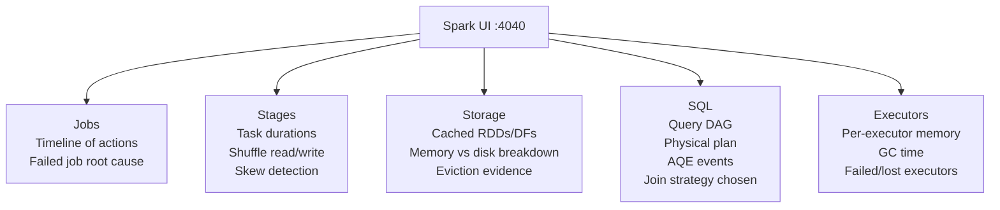

# Spark Performance

Partitioning, caching, join strategy, and memory tuning — the four levers that separate a 15-minute job from a 15-hour one, together with the diagnostic workflow for finding out which lever to pull.

## The Performance Problem in Spark

A Spark job that works correctly on a developer laptop can take hours (or fail outright with OOM) in production. The reasons are almost never bugs in the business logic — they are **physical execution choices** that Spark made on your behalf: how many partitions to produce, which join algorithm to pick, whether to cache, how to lay data out on disk, and how much memory to reserve for shuffles.

Performance tuning in Spark is the discipline of inspecting those physical choices through the Spark UI and the `explain()` plan, then correcting them with configuration, hints, caching, repartitioning, or a better file layout.

```mermaid
flowchart LR
    SYM["Symptom\nSlow job / OOM / skew"] --> DIAG
    subgraph DIAG["Diagnose"]
        D1["Spark UI\nStages / SQL / Executors / Storage"]
        D2["explain()\nphysical plan"]
    end
    DIAG --> LEV
    subgraph LEV["Apply the Right Lever"]
        L1["Partitioning\n& bucketing"]
        L2["Caching\n& persistence"]
        L3["Join strategy\n(BHJ / SMJ / SMB)"]
        L4["Memory tuning\n& file format"]
    end
    LEV --> VER["Re-run &\nverify in UI"]
    style DIAG fill:#1a2a3a,stroke:#4ab8ff
    style LEV fill:#2a1a3a,stroke:#b48aff
```



!!! info "The rule of thumb"
    Before changing any Spark config, you should be able to point at **one tab in the Spark UI** that shows the problem. Tuning without evidence just moves the bottleneck.

## The Four Levers of Spark Performance

Spark has thousands of configuration knobs. In practice, almost every real-world tuning problem reduces to one of four categories.

| Lever | What it controls | Reach for it when |
|-------|------------------|-------------------|
| **Partitioning & Bucketing** | How input data and shuffle data are split across tasks | Skew, too few/too many tasks, slow joins on huge tables |
| **Caching & Persistence** | Which intermediate datasets are kept in memory for reuse | A DataFrame is used by 2+ downstream actions, iterative ML |
| **Join Strategy** | Whether Spark broadcasts, shuffles, or merges when joining | A join dominates the stage timeline; one side is small |
| **Memory & File Format** | Executor memory layout, codec, columnar vs row | OOM, GC overhead, slow scans, small-file problems |

### Lever 1: Partitioning

Spark's parallelism unit is the **partition**. Too few partitions underuses the cluster; too many create scheduler overhead and tiny shuffle files. The two most important knobs:

- `spark.sql.files.maxPartitionBytes` (default **128 MB**) — target size when reading files
- `spark.sql.shuffle.partitions` (default **200**) — number of partitions after a shuffle

The default `200` is almost never right. For a 10 GB shuffle it produces 50 MB partitions (fine), but for a 100 GB shuffle it produces 500 MB partitions (OOM risk), and for a 1 GB shuffle it produces 5 MB partitions (overhead dominates).

See **[Partitioning & Bucketing](partitioning.md)** for the full treatment.

### Lever 2: Caching

Spark uses **lazy evaluation**. Each action recomputes the full DAG unless an intermediate result is cached. If the same DataFrame feeds two actions, you pay the computation cost twice — once per action.

```python
df_clean = raw.filter("amount > 0").join(dim, "key")  # expensive

df_clean.cache()               # mark for reuse
df_clean.count()               # materialize cache
df_clean.write.parquet(...)    # reuses cache
df_clean.groupBy("x").sum()    # reuses cache
```

Without `cache()`, the filter and join would run three times. See **[Caching & Persistence](caching.md)**.

### Lever 3: Join Strategy

Joins are the most expensive operation in a typical pipeline. Spark picks one of five strategies based on dataset size and query shape:

- **Broadcast Hash Join (BHJ)** — small table shipped to every executor, no shuffle. Fastest.
- **Sort-Merge Join (SMJ)** — default for two large tables. Both sides shuffled and sorted.
- **Shuffle Hash Join (SHJ)** — one side hashed in memory per partition, no sort.
- **Broadcast Nested Loop** — for non-equi joins. Cartesian in cost.
- **Sort-Merge-Bucket (SMB)** — the ultimate: pre-bucketed tables with no shuffle at all.

See **[Query Optimization (AQE & Joins)](optimization.md)**.

### Lever 4: Memory & File Format

Even with perfect partitioning and joins, a job can be dragged down by GC pressure, OOM, or a slow row-based scan. The remedies are tuning the **Unified Memory Manager** (`spark.memory.fraction`), using **columnar formats** (Parquet/ORC), picking an appropriate **compression codec** (Snappy, ZSTD), and fixing the **small-files problem**.

See **[Memory Management & File Formats](memory-formats.md)**.

## The Spark UI — Your Primary Diagnostic Tool

The Spark UI runs on `http://<driver-host>:4040` while the application is live. After the application finishes, the **Spark History Server** replays the same information from event logs.

| Property | Spark UI | Spark History Server |
|----------|----------|----------------------|
| Availability | During execution | After completion |
| Data source | Live `SparkContext` | Event logs on disk |
| Main use | Debug a running job | Post-mortem analysis |
| Tabs | Jobs, Stages, Storage, Executors, SQL | Same (historical) |

### The Five Tabs That Matter



#### Stages tab — where you spot skew

Each stage lists its tasks with duration, GC time, shuffle read, shuffle write, and spill. The most important signal: **the Max column vs the Median column** on task duration. If `Max = 10 × Median`, you have a straggler — usually partition skew. The histogram at the top of the stage page shows the task-duration distribution at a glance.

#### Storage tab — did caching actually happen?

Lists every cached RDD and DataFrame with its storage level, cached partitions count, memory size, and disk size. If you called `.cache()` but the Storage tab is empty, no action has materialized it yet. If you see `Fraction Cached < 100%`, cached data was evicted or spilled.

#### SQL tab — where the physical plan lives

Click a running SQL query and you see the full DAG with per-node row counts, time spent, and the chosen operator (`BroadcastHashJoin`, `SortMergeJoin`, `HashAggregate`, …). This is where you confirm AQE kicked in: look for the little `AdaptiveSparkPlan` wrapper and the `AQEShuffleRead` nodes.

#### Executors tab — memory and GC health

One row per executor with: cores, memory used / total, task count, input/shuffle bytes, **GC time**, and failed-task count. A healthy executor has **GC time < 10%** of total task time. If GC time is 30%+, the executor is thrashing and you need more memory or less data per executor.

#### Jobs tab — the timeline

Shows every action as a job with its stages, their status, duration, and failure cause. The event timeline (bottom of the page) is excellent for spotting idle gaps and executor churn.

!!! tip "The three-question diagnostic"
    Before changing anything:

    1. **Stages tab** — are task durations balanced, or is `Max / Median > 3`? (Partition skew)
    2. **SQL tab** — what join strategy was picked, and is it the right one for the sizes? (Join strategy)
    3. **Executors tab** — is GC time under 10%? Is any executor lost? (Memory)

    If all three are fine and the job is still slow, you have a real algorithmic problem — not a tuning problem.

## Reading an `explain()` Plan

`df.explain()` prints the **physical plan** — the actual operators Spark will execute. `df.explain(True)` or `df.explain("extended")` prints all four plans (parsed, analyzed, optimized logical, physical).

```python
orders.join(customers, "cust_id").filter("amount > 100").explain()
```

Example output:

```
== Physical Plan ==
AdaptiveSparkPlan isFinalPlan=false
+- Project [...]
   +- SortMergeJoin [cust_id#1], [cust_id#5], Inner
      :- Sort [cust_id#1 ASC NULLS FIRST], false, 0
      :  +- Exchange hashpartitioning(cust_id#1, 200)
      :     +- Filter (amount#3 > 100)
      :        +- FileScan parquet orders[...]
      +- Sort [cust_id#5 ASC NULLS FIRST], false, 0
         +- Exchange hashpartitioning(cust_id#5, 200)
            +- FileScan parquet customers[...]
```

### How to read it

- **Read bottom-up.** Leaves are data sources (`FileScan`), the root is the final operator.
- `FileScan parquet` — leaf scan. Look for `PushedFilters` and `ReadSchema` to confirm **predicate pushdown** and **column pruning** happened.
- `Filter` — a predicate that could not be pushed down. Investigate why.
- `Exchange hashpartitioning(...)` — a **shuffle**. The most expensive step; every one costs network and disk I/O.
- `SortMergeJoin` / `BroadcastHashJoin` / `ShuffleHashJoin` — the chosen join strategy. The expensive one is `SortMergeJoin`.
- `BroadcastExchange` — small table being broadcast. Always better than an `Exchange hashpartitioning`.
- `AdaptiveSparkPlan isFinalPlan=false` — AQE is enabled; the plan will change at runtime.
- `AQEShuffleRead` — AQE coalesced or skew-split a shuffle at runtime.

=== "PySpark"

    ```python
    df = (orders
          .join(broadcast(customers), "cust_id")
          .groupBy("country")
          .agg(sum("amount").alias("total")))

    df.explain("formatted")
    ```

=== "SQL"

    ```sql
    EXPLAIN FORMATTED
    SELECT country, SUM(amount) AS total
    FROM orders o
    JOIN customers c ON o.cust_id = c.cust_id
    GROUP BY country;
    ```

### The explain-plan checklist

When you look at a plan, confirm these things in order:

1. **Column pruning**: `ReadSchema` only lists the columns you need.
2. **Predicate pushdown**: `PushedFilters` lists the filters from your `.where(...)` clauses.
3. **Join strategy**: `BroadcastHashJoin` for small-large, `SortMergeJoin` for large-large.
4. **Shuffle count**: minimize `Exchange` nodes. Each one is a shuffle.
5. **AQE active**: `AdaptiveSparkPlan` wrapper is present.

!!! warning "Don't tune without `explain()`"
    Guessing at Spark configs without reading the plan is the #1 anti-pattern. Every tuning session starts with `df.explain("formatted")` and a trip to the SQL tab in the UI.

## When to Reach for Each Lever — Decision Matrix

| Symptom in Spark UI | Likely cause | First lever to try |
|---------------------|--------------|--------------------|
| One task in a stage takes 10× the median | Partition skew | Enable AQE skew handling, or salt the key |
| Thousands of tiny tasks, each < 1 s | Too many shuffle partitions | Lower `spark.sql.shuffle.partitions`, or coalesce |
| A few tasks, each many minutes | Too few partitions | `repartition()` before the heavy op |
| SQL tab shows `SortMergeJoin` with one small side | BHJ not triggered | Use `broadcast(df)` hint; raise `autoBroadcastJoinThreshold` |
| Storage tab shows frequent eviction | Over-caching or undersized cluster | `unpersist()` unused caches; use `MEMORY_AND_DISK_SER` |
| Executors tab shows GC time > 20% | Memory pressure | Increase `executor.memory`, lower `memory.fraction`, enable Tungsten off-heap |
| Many small files on write | Writing from many tasks without coalesce | `coalesce(n)` or `OPTIMIZE` (Delta) before/after write |
| Repeated large-large joins on same key | Reshuffling every run | **Bucketing** for SMB join |

## Module Map

- **[Caching & Persistence](caching.md)** — `cache()` vs `persist()`, storage levels, locality, SQL `CACHE TABLE`, when caching backfires.
- **[Partitioning & Bucketing](partitioning.md)** — input and shuffle partition sizing, `repartition()` vs `coalesce()`, skew remediation, write partitioning, bucketing for SMB joins.
- **[Query Optimization (AQE & Joins)](optimization.md)** — Catalyst phases, AQE's three tricks, every Spark join strategy and how to pick one, window-function performance.
- **[Memory Management & File Formats](memory-formats.md)** — Unified Memory Manager, Tungsten, hash vs sort aggregate, Parquet internals, codecs, schema evolution, the small-files problem.

!!! success "The one-line summary"
    **Measure first (Spark UI + `explain()`), then apply the smallest lever that fixes the specific symptom.** Blind tuning is slower than the slow job you started with.
