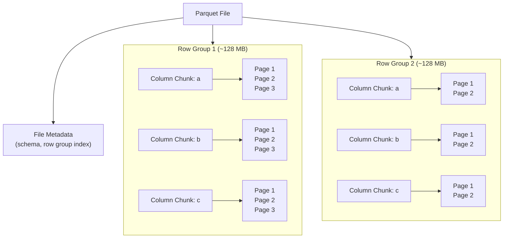

# Memory Management & File Formats

Two foundational decisions make or break a Spark job: how memory is split inside each executor, and what format the data is stored in on disk. Get either wrong and no amount of partitioning or AQE will save you.

## Executor Memory Architecture

When you request `--executor-memory 8G`, Spark does **not** give that whole 8 GB to your Python code or your cache. The JVM heap is sliced into four regions, and there is additional memory sitting outside the JVM entirely.

```mermaid
flowchart TB
    EC["Executor Container\n--executor-memory 8G\n+ memory overhead"] --> OH
    EC --> HEAP
    subgraph OH["Off-Heap / Memory Overhead"]
      OH1["OS overhead\nmax(384 MB, 10% × executor.memory)"]
      OH2["PySpark worker memory\n(if PySpark)"]
      OH3["Off-heap (Tungsten)\n(if enabled)"]
    end
    subgraph HEAP["JVM Heap (8 GB)"]
      RES["Reserved\n300 MB"]
      USR["User Memory\n(1 - memory.fraction) × usable\n~ 40%"]
      UNI["Unified Memory\nmemory.fraction × usable\n~ 60%"]
    end
    UNI --> STOR["Storage\n(cached DFs,\nbroadcast vars)"]
    UNI --> EXEC["Execution\n(shuffle, join,\nsort, agg)"]

    style RES fill:#3a1a1a,stroke:#e60028
    style USR fill:#2a2a3a,stroke:#9ad165
    style STOR fill:#1a3a3a,stroke:#4ab8ff
    style EXEC fill:#3a1a3a,stroke:#b48aff
```



### Reserved Memory

- **Fixed 300 MB.** Not configurable.
- Spark's internal engine uses this for runtime book-keeping.
- Never counted toward anything you can tune.

### User Memory

- Approximately **40%** of `(heap − 300 MB)` by default.
- Formula: `User Memory = (heap − 300 MB) × (1 − spark.memory.fraction)`
- Houses **user-defined data structures**, UDF variables, closures, and metadata needed for raw RDD transformations.

### Unified Memory

- Approximately **60%** of `(heap − 300 MB)` by default.
- Formula: `Unified Memory = (heap − 300 MB) × spark.memory.fraction`
- **Shared between Storage and Execution** according to a dynamic eviction policy.

#### Storage Memory

Holds:

- Cached DataFrames / RDDs (`.cache()` / `.persist()`)
- Persistent tables materialized in cache
- Broadcast variables

#### Execution Memory

Holds the working buffers for:

- Shuffle buffers
- Join hash tables
- Sort buffers
- Aggregation hash tables

### Memory Overhead

Memory outside the JVM heap:

- **OS overhead** — the container's non-JVM footprint.
- **PySpark worker memory** — Python processes attached to each executor task.
- **Off-heap allocations** — if Project Tungsten off-heap mode is enabled.

Formula: `Memory Overhead = max(384 MB, 10% × spark.executor.memory)`.

!!! info "Request this on top of executor memory"
    When sizing a container, add overhead on top: `--executor-memory 8G` with 10% overhead means **the container must have ≥ 8.8 GB**. YARN kills the executor if the container overshoots. Set `spark.executor.memoryOverhead` explicitly for PySpark-heavy jobs.

## The Unified Memory Manager (Spark 1.6+)

Before Spark 1.6, Storage and Execution were **statically partitioned** — you could have 2 GB of unused Storage sitting idle while a shuffle OOMed with 100 MB of Execution. The **Unified Memory Manager** lets the two regions **dynamically borrow from each other**:

### Dynamic Eviction Rules

| Scenario | Can borrow? | What happens |
|----------|-------------|--------------|
| **Execution needs more memory** than its quota | **Yes** — can evict Storage | Cached blocks are kicked out (spill to disk if `MEMORY_AND_DISK`, dropped if `MEMORY_ONLY`) |
| **Storage needs more memory** than its quota, Execution not using the overflow | **Yes** — temporarily borrow | Storage grows; released back when Execution needs it |
| **Storage needs more memory**, Execution is actively using it | **No** — cannot evict active Execution | Cache spills to disk or the cache attempt fails silently |

```mermaid
flowchart LR
    UM["Unified Memory\nspark.memory.fraction × usable"] --> ST["Storage\n(default 50%)"]
    UM --> EX["Execution\n(default 50%)"]
    EX -.->|"evict cache\nwhen needed"| ST
    ST -.->|"borrow idle\nexecution"| EX
    style EX fill:#3a1a3a,stroke:#b48aff
    style ST fill:#1a3a3a,stroke:#4ab8ff
```



!!! warning "The one-way rule"
    **Execution can evict Storage, but Storage cannot evict active Execution.** A shuffle will always kick out your cache. The reverse is impossible, because evicting an in-flight hash table would corrupt the computation.

## Key Memory Configurations

| Config | Default | What it controls |
|--------|---------|------------------|
| `spark.executor.memory` | 1 GB | Total JVM heap per executor |
| `spark.executor.memoryOverhead` | `max(384MB, 10% × executor.memory)` | Off-JVM overhead per container |
| `spark.memory.fraction` | **0.6** | Share of (heap − 300 MB) that becomes **Unified Memory** |
| `spark.memory.storageFraction` | **0.5** | Share of Unified Memory **initially** reserved for Storage |
| `spark.memory.offHeap.enabled` | false | Enable off-heap Tungsten allocations |
| `spark.memory.offHeap.size` | 0 | Size of off-heap region (bytes) |
| `spark.sql.autoBroadcastJoinThreshold` | 10 MB | Max side size for BHJ |

### Tuning example — a 16 GB executor

```
Heap             = 16 GB
Reserved         = 0.3 GB
Usable           = 15.7 GB
Unified          = 15.7 × 0.6 = 9.42 GB
  ├ Storage      = 9.42 × 0.5 = 4.71 GB (initial)
  └ Execution    = 9.42 × 0.5 = 4.71 GB (initial)
User Memory      = 15.7 × 0.4 = 6.28 GB
Overhead         = max(384 MB, 10% × 16 GB) = 1.6 GB
Container total  = 16 + 1.6 = 17.6 GB minimum
```

Lower `spark.memory.fraction` to **0.4** if your workload is light on cache/shuffle and heavy on big UDFs (needs User Memory). Raise it to **0.75** for shuffle-heavy jobs with no caching.

## OOM — Causes and Diagnosis

"OutOfMemoryError" in Spark almost never means "the cluster is too small". It means **one specific memory region overflowed under one specific pattern**.

### Diagnosing OOM

Open the Executors tab in the Spark UI. For each executor row look at:

- **Failed Tasks** column — nonzero means something crashed.
- **GC Time** column — if GC time > 20% of total task time, you have memory pressure.
- The executor's **stderr log** — search for `OutOfMemoryError`, `GC overhead limit exceeded`, `Container killed by YARN`, `Executor lost`.

### Common failure modes and fixes

| Symptom | Likely cause | Fix |
|---------|--------------|-----|
| `java.lang.OutOfMemoryError: Java heap space` during a shuffle | Shuffle partition too big → execution memory exhausted | Raise `spark.sql.shuffle.partitions`; or `repartition` before the shuffle |
| `GC overhead limit exceeded` | Too many small objects on heap | Enable Tungsten off-heap; switch cached data to serialized storage; shrink driver-collected data |
| `Container killed by YARN. Consider boosting spark.executor.memoryOverhead` | Off-JVM memory (PySpark workers / native libs) blew the container | Raise `spark.executor.memoryOverhead` (often needs 20–30% for PySpark) |
| Executor lost mid-stage, task retried | Transient OOM or JVM crash | Check logs; raise executor memory or lower per-task concurrency (`spark.executor.cores`) |
| Driver OOM on `.collect()` or `.toPandas()` | Dumping too much data to the driver | Don't collect large DataFrames; sample first; raise `spark.driver.memory` only as a last resort |
| Memory leak in a UDF | UDF accumulates state across rows | Rewrite UDF to be stateless, or move to a built-in function / Pandas UDF |

### UDFs and memory

Python UDFs are the single most common memory leak in Spark. Each UDF invocation serializes a row to the Python worker, deserializes it in Python, computes, and serializes back. State in global variables **persists across rows** and leaks across tasks.

```python
# BAD: global state grows unbounded across rows
_cache = {}
@udf
def enrich(x):
    _cache[x] = ...   # leaks forever
    return _cache[x]

# GOOD: stateless, or use broadcast + mapInPandas
```

!!! tip "Prefer Pandas UDFs"
    Pandas UDFs (vectorized UDFs) process batches of rows through Arrow instead of one Python row at a time. Much lower per-row overhead, far less GC pressure, and typically **10–100× faster** than row-at-a-time Python UDFs.

## Hash vs Sort Aggregation

The physical plan picks one of two aggregation operators. Which it picks has a direct memory impact.

| Aspect | `HashAggregate` | `SortAggregate` |
|--------|-----------------|-----------------|
| Mechanism | Hash table of (group key → agg buffer) | Sort by group key, merge consecutive rows |
| Complexity | **O(N)** | **O(N log N)** |
| Memory usage | Proportional to # distinct groups | Bounded (just sort buffer) |
| Speed | **Faster** when hash table fits | Slower, but fallback-safe |
| When Spark picks it | Standard aggregates + hashable key types | Non-mutable aggregates, unsupported key types, or memory pressure |

### How to encourage `HashAggregate`

- Use numeric or timestamp group keys over `String` where you can.
- Keep `spark.memory.fraction` high enough that the hash table stays resident.
- Watch for `SortAggregate` in the plan — if it appears for a standard `COUNT`/`SUM`, chase down why.

```python
# Encourage hash aggregation by casting a high-cardinality string to a numeric id
from pyspark.sql.functions import xxhash64
df.withColumn("gk", xxhash64("some_string_col")) \
  .groupBy("gk").count()
```

## Project Tungsten

Tungsten is the engine Spark uses to beat the JVM at its own game. Three core ideas:

### 1. Binary encoding

Instead of storing rows as Java objects (each row = many `Object` headers, pointer chasing, GC pressure), Tungsten stores them as **packed binary blobs** laid out contiguously in memory. One `Row` becomes 100 bytes of data instead of 800 bytes of objects.

### 2. Off-heap memory

With `spark.memory.offHeap.enabled = true`, Tungsten allocates its binary blobs **outside the JVM heap**. The GC never sees them. Pros: zero GC pressure, bigger effective memory per executor. Cons: harder to debug.

```python
spark.conf.set("spark.memory.offHeap.enabled", True)
spark.conf.set("spark.memory.offHeap.size", "4g")
```

### 3. Whole-stage code generation

Instead of interpreting operators with virtual function calls per row, Tungsten **fuses adjacent operators into a single tight Java loop** and JIT-compiles it. A `Scan → Filter → Project → Aggregate` becomes one method with no virtual dispatch. Visible in the physical plan as `*(1)`, `*(2)` codegen stage markers.

### 4. Cache-aware computation

Hash tables and sort buffers are laid out so hot data lives in CPU cache lines. Reduces cache misses by orders of magnitude on wide stages.

!!! success "Tungsten in practice"
    You get the binary encoding and codegen **for free** with any DataFrame operation. Off-heap mode is the extra you opt into for GC-heavy workloads. If GC time in the Executors tab is >20%, flip `offHeap.enabled` on and allocate 25–50% of `executor.memory` to `offHeap.size`.

---

## File Formats

Format choice has a bigger impact on performance than most other knobs combined. A single-core query over 100 GB of CSV may read 100 GB; the same query over 100 GB of Parquet may read 2 GB.

### Row-Based vs Columnar

```mermaid
flowchart LR
    subgraph ROW["Row-based (CSV, JSON, Avro)"]
      R1["R1: a1,b1,c1,d1,e1"]
      R2["R2: a2,b2,c2,d2,e2"]
      R3["R3: a3,b3,c3,d3,e3"]
    end
    subgraph COL["Columnar (Parquet, ORC)"]
      CA["Col A: a1,a2,a3"]
      CB["Col B: b1,b2,b3"]
      CC["Col C: c1,c2,c3"]
      CD["Col D: d1,d2,d3"]
      CE["Col E: e1,e2,e3"]
    end
    style ROW fill:#3a2a1a,stroke:#ffa657
    style COL fill:#1a2a3a,stroke:#4ab8ff
```



| Property | Row-based | Columnar |
|----------|-----------|----------|
| Layout | One record stored contiguously | One column stored contiguously |
| Good for | Row-at-a-time ingestion, OLTP-style writes, change capture | Analytical reads (SELECT a few columns, scan many rows) |
| Compression | Moderate (mixed types side by side) | Very high (same type repeats → RLE, dictionary) |
| Column pruning | No — must read full row | **Yes** — skip columns entirely |
| Predicate pushdown | Limited | **Yes** — min/max stats per row group |
| Typical examples | CSV, JSON, Avro | Parquet, ORC |

**When to use row-based**: landing zones, append-mostly logs, source-system CDC feeds, exchange with systems that don't speak Parquet.

**When to use columnar**: everything else. Any analytical table where queries read a subset of columns.

### Avro vs Parquet vs ORC

| Feature | Avro | Parquet | ORC |
|---------|------|---------|-----|
| Layout | Row-based | Columnar | Columnar |
| Primary use | **Ingestion**, event streams | **Spark analytics** | **Hive analytics** |
| Write performance | Fast | Slower | Slower |
| Read performance | Slower for selective reads | **Fast** | **Fast** |
| Compression ratio | Moderate | High | **Very High** |
| Schema evolution | Rich (reader/writer schema) | Supported (add columns) | Supported |
| Streaming-friendly | **Yes** | Not ideal | Not ideal |

**One-line guide**: **Avro → bronze landing / Kafka. Parquet → Spark analytics. ORC → Hive / legacy Hortonworks stacks.**

---

## Parquet Deep Dive

Parquet is the de facto standard for analytical data on cloud object storage. A Parquet file has three nested units of organization.



### Row Group

A **horizontal slice** of the table, typically ~128 MB. Each row group holds its own set of column chunks and its own min/max statistics. Reading one row group reads a contiguous byte range from storage — essential for S3/ADLS where random reads are expensive.

### Column Chunk

Inside a row group, all values of one column are stored contiguously as a **Column Chunk**. This is what makes Parquet columnar: Spark reads only the chunks for columns the query needs.

### Page

Column chunks are further sliced into **Pages** (~1 MB each). Each page carries its own encoding, compression, and min/max statistics. Pages are the unit of **predicate pushdown** — Spark can skip reading a page whose min/max doesn't overlap the filter.

### Metadata

The file footer contains the **schema**, the number of row groups, and per-column-chunk **statistics** (min, max, null count, distinct count estimate). The footer is small — Spark reads just the footer to decide which row groups and pages to read.

### Parquet Query Optimizations

#### Column Pruning

A table with 50 columns, a query asking for 3 → Spark reads only the 3 column chunks per row group. Everything else is **skipped at the storage layer**. Confirm with `ReadSchema` in `explain("formatted")`.

#### Predicate Pushdown

Each row group / page stores min and max per column. For `WHERE order_id = 50000`:

```
Row Group 1  min=1   max=20000     ← skip (max < 50000)
Row Group 2  min=20001 max=40000   ← skip
Row Group 3  min=40001 max=60000   ← READ (overlap)
Row Group 4  min=60001 max=80000   ← skip
```

Confirm with `PushedFilters` in `explain("formatted")`.

#### Encoding

Parquet applies **lightweight encodings** before general-purpose compression:

- **Dictionary encoding** — repeated values stored once as dictionary IDs. `['US','US','US','FR']` becomes `dict={1:US, 2:FR}, data=[1,1,1,2]`.
- **Run-Length Encoding (RLE)** — repeated consecutive values stored as `(value, count)`. `['A','A','A','A','B','B']` becomes `(A,4),(B,2)`.
- **Delta encoding** — monotonic sequences stored as differences. `[100,105,110,115]` becomes `[100,+5,+5,+5]`.
- **Bit packing** — integers use only the bits they need. A column of values 0–7 uses 3 bits each, not 32.

These compress **before** the codec stage, which is why Parquet files are typically **5–20× smaller than CSV** of the same data.

### Schema Evolution in Parquet

Compatible schema changes can be merged across files with the `mergeSchema` option:

```python
df = spark.read \
    .option("mergeSchema", "true") \
    .parquet("/data/orders/")
```

| Change | Safe? | Notes |
|--------|-------|-------|
| **Add a column** | **Yes** | New column shows as `NULL` for old files |
| **Remove a column** | Readers can tolerate, but downstream code expecting the column breaks | Prefer deprecating by nulling it out |
| **Rename a column** | **No** (without rewrite) | Parquet matches by name — renames look like drop + add |
| **Widen a type** (int32 → int64) | Limited | Spark can read with explicit schema; auto-promotion is unreliable |
| **Narrow a type** | **No** | Loss of data possible |
| **Change a non-nullable column to nullable** | Yes | Reverse is unsafe |

!!! warning "Avoid renames in Parquet"
    Column renames require a **full rewrite** of the dataset. In Delta Lake, enable `delta.columnMapping.mode = 'name'` for safe renames without rewrite. Plain Parquet has no equivalent.

---

## Compression Codecs

Compression codecs plug into Parquet, ORC, Avro, and raw text. Each is a different trade-off between speed, ratio, and splittability.

| Codec | Compression Speed | Decompression Speed | Ratio | Splittable Alone? | Typical use |
|-------|-------------------|---------------------|-------|-------------------|-------------|
| **Snappy** | Very fast | Very fast | Moderate | No standalone; **yes inside Parquet/ORC** | **Default for Parquet/ORC** |
| **GZIP** | Slow | Moderate | **High** | No standalone; yes inside Parquet | Storage-constrained archives |
| **LZ4** | Very fast | Very fast | Moderate | No alone | Low-latency pipelines |
| **ZSTD** | Fast (tunable) | Fast | **High** (near GZIP) | Yes inside containers | **Default in Delta Lake / modern Parquet** |
| **Brotli** | Slow | Fast | **Very high** | Yes inside Parquet | Static datasets where read is dominant |
| **Bzip2** | Very slow | Very slow | Very high | **Yes standalone** | Cold archival only |
| **LZO** | Very fast | Very fast | Moderate | Yes **with index file** | Legacy MapReduce stacks |

### Recommended defaults

| Scenario | Codec | Why |
|----------|-------|-----|
| New Delta/Parquet table (general) | **ZSTD** | Modern default; GZIP-level ratio at Snappy-level speed |
| Hot path, read-heavy, latency-sensitive | **Snappy** | Decompression is nearly free; the Spark default historically |
| Nightly cold batch, storage cost dominates | **GZIP** or **Brotli** | Highest compression; CPU is cheap during nightly windows |
| Bronze landing, streaming micro-batches | **Snappy** | Fastest write; recompress to ZSTD on OPTIMIZE if needed |

```python
# Set codec at write time (Parquet)
df.write.option("compression", "zstd").parquet(path)

# Session default
spark.conf.set("spark.sql.parquet.compression.codec", "zstd")
```

!!! info "Codec vs format — don't confuse them"
    Snappy, GZIP, ZSTD are **codecs**. Parquet, ORC, Avro are **formats**. You pick both — e.g., "Parquet with ZSTD compression". A standalone `.csv.gz` is a format (CSV) + codec (GZIP), and in that configuration **the whole file becomes non-splittable** — one task per file.

---

## The Small Files Problem

Possibly the single most common silent killer of Spark performance in production.

### Root causes

- **Streaming micro-batches** — a `trigger("1 minute")` job writes a tiny Parquet file every minute. After a month: 43 200 files per partition.
- **Over-partitioned writes** — `partitionBy("transaction_id")` with high cardinality.
- **Many tasks writing concurrently** — a 2000-task job with no coalesce writes 2000 files per output partition.
- **Daily appends without compaction** — year of daily writes → 365 small files.

### Impact

- **NameNode memory (HDFS)** or **S3/ADLS listing latency** scales with file count, not data volume.
- Query planning takes seconds to list 100 000 files, before any data read.
- Each file open costs a round trip; many small files multiplies that cost.
- Compression ratios suffer — codec dictionaries can't span files.
- Read tasks skew — one task per file means tiny file = underused task.

### Diagnosing

- Spark UI SQL tab shows **a very high FileScan task count relative to data size** (e.g., 50 000 tasks for 100 GB).
- A simple `SELECT COUNT(*)` takes minutes before the first byte reads.
- Delta `DESCRIBE DETAIL` shows `numFiles > 100 × numPartitions`.

### Solutions

| Technique | Where it fits |
|-----------|---------------|
| **`coalesce(N)` before write** | Simple batch writes — collapse 2000 tasks → N files |
| **`repartition(N)` before write** | When the data is skewed and coalesce would create one monster file |
| **`OPTIMIZE table`** (Delta Lake) | Compacts small files into target-sized files (`spark.databricks.delta.optimize.maxFileSize`, default 1 GB) |
| **`optimizeWrite` + `autoCompact` table properties** | Delta automatic small-file management |
| **Scheduled compaction job** | Non-Delta Parquet: periodic `read → coalesce → write` of each partition |
| **Avoid high-cardinality `partitionBy`** | Use Z-ordering (Delta) or bucketing instead |

### Delta Lake solution

```sql
-- Enable automatic small-file management on new writes
ALTER TABLE sales SET TBLPROPERTIES (
  'delta.autoOptimize.optimizeWrite' = 'true',
  'delta.autoOptimize.autoCompact'   = 'true'
);

-- Compact existing table (file size target ~ 1 GB)
OPTIMIZE sales;

-- Compact + co-locate related data
OPTIMIZE sales ZORDER BY (customer_id, transaction_date);
```

### Non-Delta Parquet solution

```python
# Repartition before write to target 128 MB files
num_files = max(1, total_size_bytes // (128 * 1024 * 1024))
df.coalesce(num_files).write.parquet(output_path)
```

!!! danger "Catching small files early"
    Any time a job writes more than ~10 files per GB of output, you have the small-files problem brewing. Build a monitoring check on `numFiles / sizeInBytes` for every production table. Fixing it later is painful; preventing it on write costs nothing.

---

## The Full-Picture Checklist

Before shipping a Spark job to production:

**Memory**

1. Executor memory sized so GC time < 10% in the Executors tab.
2. `spark.memory.fraction` tuned for the workload (default 0.6 is a good start).
3. `spark.executor.memoryOverhead` raised for PySpark-heavy jobs.
4. Off-heap enabled if GC time stays high.
5. Pandas UDFs instead of row-at-a-time Python UDFs.

**File format**

6. Parquet (or ORC) for every analytical table — not CSV, not JSON.
7. ZSTD or Snappy compression explicitly set.
8. Column pruning verified in `ReadSchema`.
9. Predicate pushdown verified in `PushedFilters`.
10. File count per table in a sane range — target 100 MB – 1 GB per file.
11. `OPTIMIZE` scheduled for Delta tables with frequent writes.

!!! success "The memory and format one-liner"
    The Unified Memory Manager handles the mechanics; your job is to **size the container**, **avoid row-based formats for analytics**, **set a modern codec**, and **keep file count sane**. Everything else is downstream of these four choices.
