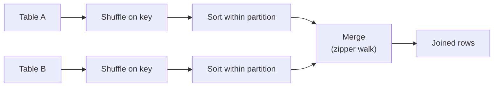

# Query Optimization (AQE & Joins)

Spark does not execute your DataFrame or SQL code directly — it compiles it through the **Catalyst optimizer** into a physical plan, applies runtime adjustments via **Adaptive Query Execution (AQE)**, and chooses one of five **join strategies** based on data sizes. Understanding each phase is the difference between a 10-minute job and a 10-hour job.

## The Catalyst Optimizer

Catalyst is Spark's query engine. It transforms a high-level DataFrame or SQL query through five stages before any task actually runs.

```mermaid
flowchart TB
    Q["DataFrame API\nor SQL query"] --> ULP
    ULP["1. Unresolved Logical Plan\n(syntax check only)"] --> ALP
    ALP["2. Analyzed Logical Plan\n(resolve tables, columns, types\nvia the Catalog)"] --> OLP
    OLP["3. Optimized Logical Plan\n(rule-based rewrites:\npredicate pushdown,\ncolumn pruning,\nconstant folding)"] --> PP
    PP["4. Physical Plan\n(choose SMJ vs BHJ vs SHJ,\nchoose HashAgg vs SortAgg)"] --> CG
    CG["5. Code Generation\n(whole-stage codegen\n→ optimized Java bytecode)"] --> EX["Execution"]

    style ULP fill:#2a2a3a,stroke:#9ad165
    style ALP fill:#2a2a3a,stroke:#9ad165
    style OLP fill:#1a3a3a,stroke:#4ab8ff
    style PP fill:#3a1a3a,stroke:#b48aff
    style CG fill:#3a2a1a,stroke:#ffa657
```



### 1. Unresolved Logical Plan

Parses the query. Checks structural syntax only. Does **not** yet know whether `orders` is a real table, whether `cust_id` is a real column, or what type any column is.

### 2. Analyzed Logical Plan

Uses the **Catalog** (Hive metastore / Unity Catalog) to resolve:

- Table and view names
- Column names
- Column data types
- Function signatures and overloads

If `SELECT custid FROM orders` has no `custid` column, the error (`AnalysisException: cannot resolve 'custid'`) is raised here.

### 3. Optimized Logical Plan — Rule-Based Rewrites

Catalyst applies dozens of rewrite rules that are **always safe to apply** regardless of data. The three that matter most:

#### Predicate pushdown

Move `WHERE` filters as close to the data source as possible so the scanner can skip rows (Parquet row-groups, Delta file-skipping, JDBC pushdown).

```sql
-- You wrote this:
SELECT * FROM (SELECT * FROM orders) WHERE amount > 100;

-- Catalyst rewrites to this:
SELECT * FROM orders WHERE amount > 100;
```

The `Filter` moves below any `Project`/subquery wrapping. For Parquet, this becomes a `PushedFilters: [GreaterThan(amount, 100)]` on the `FileScan` leaf.

#### Column pruning (projection pushdown)

Only columns actually used downstream are read from storage.

```sql
-- Table has 50 columns; query only needs 3
SELECT cust_id, amount FROM orders WHERE amount > 100;

-- FileScan reads only (cust_id, amount) — not the other 48 columns
```

Verify in `explain()`: `ReadSchema` lists just the needed columns.

#### Constant folding

Expressions involving only literals are evaluated at compile time.

```sql
WHERE amount > 10 * 100 + 50
-- becomes
WHERE amount > 1050
```

### 4. Physical Plan — Strategy Selection

The optimized logical plan still describes *what*, not *how*. The physical planner enumerates candidate physical operators and picks one:

| Logical op | Physical candidates |
|-----------|---------------------|
| Join | `BroadcastHashJoin`, `SortMergeJoin`, `ShuffleHashJoin`, `BroadcastNestedLoopJoin`, `CartesianProduct` |
| Aggregate | `HashAggregate`, `SortAggregate`, `ObjectHashAggregate` |
| Scan | `FileScan`, `InMemoryTableScan` |
| Shuffle | `Exchange hashpartitioning(...)`, `Exchange SinglePartition`, `Exchange rangepartitioning(...)` |

The choice uses **statistics** (file sizes, row counts, catalog hints) and configs (`autoBroadcastJoinThreshold`, `preferSortMergeJoin`).

### 5. Code Generation (Whole-Stage Codegen)

Instead of interpreting each operator with virtual function calls, Catalyst **fuses adjacent operators into a single tight Java loop** and compiles that loop to bytecode. Observable in the physical plan as `*(1)`, `*(2)` prefixes marking codegen stages.

!!! info "Why codegen matters"
    Interpreted operator chains touch many virtual method calls per row and have poor CPU cache locality. Whole-stage codegen collapses a `FileScan → Filter → Project → HashAggregate` sequence into one JIT-friendly loop, often giving a **5–10× single-core speedup** on CPU-bound stages.

## Adaptive Query Execution (AQE)

Catalyst picks the physical plan **once, up front**, using whatever statistics are available. For an exploratory query over fresh data, those statistics may be very wrong. AQE fixes this by **re-planning at runtime, using the actual data volumes observed between stages.**

- Introduced in Spark **3.0**
- **Enabled by default** in Spark **3.2+** (`spark.sql.adaptive.enabled = true`)

### What AQE Solves

Static planning has three recurring failure modes:

1. **`spark.sql.shuffle.partitions = 200` creates mostly-empty partitions** after a selective filter.
2. **A table that catalog stats think is 500 MB is actually 5 MB** after a filter — but Spark already chose a sort-merge join.
3. **One key dominates** the join output — one task gets 90% of the work.

AQE addresses each of these at runtime.

```mermaid
flowchart TB
    AQE["AQE enabled\n(spark.sql.adaptive.enabled)"] --> O1
    AQE --> O2
    AQE --> O3

    O1["1. Dynamic Coalescing\nof Shuffle Partitions\nCombine tiny / empty\nshuffle partitions"]
    O2["2. Dynamic Join Switch\nIf one side turns out tiny,\nreplan SMJ → BHJ"]
    O3["3. Dynamic Skew Handling\nDetect hot partition,\nsplit it into sub-tasks"]

    style AQE fill:#2a1a3a,stroke:#b48aff
```



### AQE Optimization 1: Dynamic Coalescing of Shuffle Partitions

**Without AQE** — a `groupBy("order_status")` with 9 distinct statuses still produces 200 shuffle partitions. 191 are empty; each empty task still pays scheduler and codegen launch overhead.

**With AQE** — after the shuffle completes, Spark looks at the actual byte size of each partition. Tiny neighboring partitions are coalesced into a smaller number of right-sized partitions. 200 → maybe 12.

Visible in the SQL tab as `AQEShuffleRead` → `coalesced number of partitions`.

### AQE Optimization 2: Dynamic Switch to Broadcast Join

**Without AQE** — Catalyst sees the catalog says `customers = 50 MB`, which is above the 10 MB `autoBroadcastJoinThreshold`. It plans a sort-merge join. But a `WHERE customers.country = 'FR'` filter cuts it to 2 MB at runtime — too late, the SMJ already fires.

**With AQE** — after the filter stage, Spark checks the actual byte size of the shuffle output. If it fits under `autoBroadcastJoinThreshold`, Spark **cancels the planned SMJ and replaces it with a Broadcast Hash Join** before the next stage starts.

### AQE Optimization 3: Dynamic Skew Handling

**Without AQE** — a `JOIN ON cust_id` where `cust_id = X` matches 80% of orders. One task gets 80% of the data and finishes 20 minutes after everyone else.

**With AQE** — Spark measures partition sizes after the shuffle. A partition is **skewed** when:

- Its size > `skewedPartitionFactor × median` **and**
- Its size > `skewedPartitionThresholdInBytes` (default 256 MB)

The skewed partition is **split** into sub-partitions, each joined independently against a duplicated matching slice of the other side.

### AQE Configuration

```python
# Master switch (default True in Spark 3.2+)
spark.conf.set("spark.sql.adaptive.enabled", True)

# Coalescing
spark.conf.set("spark.sql.adaptive.coalescePartitions.enabled", True)
spark.conf.set("spark.sql.adaptive.advisoryPartitionSizeInBytes", "128MB")

# Dynamic join switch
spark.conf.set("spark.sql.adaptive.localShuffleReader.enabled", True)

# Skew handling
spark.conf.set("spark.sql.adaptive.skewJoin.enabled", True)
spark.conf.set("spark.sql.adaptive.skewJoin.skewedPartitionFactor", 5)
spark.conf.set("spark.sql.adaptive.skewJoin.skewedPartitionThresholdInBytes", "256MB")
```

!!! tip "Verifying AQE kicked in"
    In the SQL tab, look at the physical plan: the wrapper is `AdaptiveSparkPlan isFinalPlan=true`. Below it, `AQEShuffleRead` nodes show whether coalescing or skew splitting fired, and whether a `SortMergeJoin` was replaced by a `BroadcastHashJoin`.

## Join Strategies in Spark

Spark has five physical join strategies. Catalyst picks one up front; AQE may swap it at runtime.

### 1. Broadcast Hash Join (BHJ) — the fast one

**When**: one side is small enough to fit in every executor's memory. Default threshold:

```
spark.sql.autoBroadcastJoinThreshold = 10 MB
```

**How it works**:

1. Driver collects the small side.
2. Driver broadcasts it to every executor.
3. On each executor, the broadcast builds an in-memory hash table.
4. The large side streams through — each row hashes into the lookup table. No shuffle on the large side.

```mermaid
flowchart LR
    S["Small DF (5 MB)"] --> D["Driver"]
    D -->|"Broadcast"| E1["Executor 1\nHash table"]
    D -->|"Broadcast"| E2["Executor 2\nHash table"]
    D -->|"Broadcast"| E3["Executor 3\nHash table"]
    L["Large DF (50 GB)"] --> E1
    L --> E2
    L --> E3
    E1 --> R["Joined rows"]
    E2 --> R
    E3 --> R
    style D fill:#2a1a3a,stroke:#b48aff
```



**Why it's fast**: the enormous large side never shuffles over the network. The only data movement is the small broadcast.

**When BHJ fails**:

- Small side too big → OOM on executors or driver.
- Full outer join (BHJ can't do `FULL OUTER` with broadcast on either side — it only broadcasts the build side).

```python
from pyspark.sql.functions import broadcast
large.join(broadcast(small), "key")
```

```sql
-- SQL hint
SELECT /*+ BROADCAST(small) */ *
FROM large JOIN small ON large.key = small.key;
```

### 2. Sort-Merge Join (SMJ) — the default workhorse

**When**: both sides too large to broadcast. The default for large-large joins.

**How it works**:

1. **Shuffle** both sides on the join key (`Exchange hashpartitioning`).
2. **Sort** each partition on both sides by the join key.
3. **Merge** by walking the two sorted streams in parallel.



**Scales well** to very large joins because memory per task is bounded (just the merge pointers). Pays shuffle + sort cost on both sides.

### 3. Shuffle Hash Join (SHJ)

**When**: one side is medium-sized (bigger than broadcast threshold but still fits in memory per partition). Both sides shuffle, but no sorting step.

**How it works**:

1. Shuffle both sides on the join key.
2. On each resulting partition, **build an in-memory hash table from the smaller side**.
3. Stream the larger side through the hash table.

**Trade-off vs SMJ**: faster if one side fits in per-partition memory (skips the sort). Less memory-safe than SMJ — can OOM if the "small" side isn't actually small per partition.

Disabled by default in favor of SMJ (`spark.sql.join.preferSortMergeJoin = true`).

### 4. Broadcast Nested Loop Join (BNLJ)

**When**: a **non-equi join** (`ON a.x < b.y`, `ON a.x LIKE b.y`) or a cross join with one tiny side. Any time there's no join key to shuffle on.

**How**: broadcast the small side; for every row in the large side, loop over every row in the broadcast. Cost: **O(small × large)**.

!!! danger "Watch for Broadcast Nested Loop Join"
    If `explain()` shows `BroadcastNestedLoopJoin`, you have an **O(n·m)** operation. For a 1M × 1M join that's 10^12 comparisons. Rewrite the predicate to an equi-join (bucket into ranges first) whenever possible.

### 5. Cartesian Product (`CROSS JOIN`)

**When**: no join predicate at all, or an explicit `CROSS JOIN`. Full `n × m` cross-product with shuffle.

!!! danger "The nuclear option"
    `CROSS JOIN` on anything larger than a few thousand rows per side will not finish. Guard with `spark.sql.crossJoin.enabled = false` in production (the default), which makes accidental cross-joins fail fast rather than hang.

### Join Strategy Comparison

| Strategy | Shuffle? | Sort? | Memory | Scales to | Use when |
|----------|----------|-------|--------|-----------|----------|
| **Broadcast Hash Join (BHJ)** | No (broadcast only) | No | Small side × N executors | ∞ × small | One side ≤ 10 MB (or `autoBroadcastJoinThreshold`) |
| **Sort-Merge Join (SMJ)** | Both sides | Both sides | Bounded (merge pointers) | ∞ × ∞ | Two large sides. The default. |
| **Shuffle Hash Join (SHJ)** | Both sides | No | Per-partition hash | Medium × large | Small-ish side fits per-partition, want to skip sort |
| **Broadcast Nested Loop** | No | No | Small × large | Tiny × large | Non-equi join (`<`, `>`, `LIKE`) |
| **Cartesian** | Full cross | No | Full cross | Tiny × tiny | Explicit `CROSS JOIN` only |

### Choosing a Strategy — Decision Table

| Left side size | Right side size | Catalyst picks | Hint to force |
|----------------|-----------------|----------------|----------------|
| ≤ 10 MB | Any | **BHJ** (broadcast left) | `BROADCAST(left)` |
| Any | ≤ 10 MB | **BHJ** (broadcast right) | `BROADCAST(right)` |
| ~ 1 GB | ~ 1 GB | **SMJ** | `MERGE(left)` |
| ~ 100 MB | ~ 10 GB | **SMJ** by default; **SHJ** if `preferSortMergeJoin=false` | `SHUFFLE_HASH(small)` |
| Non-equi `ON a.x BETWEEN b.lo AND b.hi` | — | **BNLJ** | Rewrite predicate first |

```sql
-- Join hints by name
SELECT /*+ BROADCAST(c) */   * FROM o JOIN c ON o.cid = c.cid;
SELECT /*+ MERGE(o, c) */    * FROM o JOIN c ON o.cid = c.cid;
SELECT /*+ SHUFFLE_HASH(c) */ * FROM o JOIN c ON o.cid = c.cid;
SELECT /*+ SHUFFLE_REPLICATE_NL(c) */ * FROM o JOIN c ON o.cid < c.cid;
```

### Join Types in PySpark (reference)

| Join type | PySpark keyword | Keeps rows with no match? |
|-----------|-----------------|---------------------------|
| Inner | `"inner"` | No |
| Left outer | `"left"` / `"left_outer"` | Yes, left side |
| Right outer | `"right"` / `"right_outer"` | Yes, right side |
| Full outer | `"full"` / `"full_outer"` | Yes, both sides |
| Left semi | `"left_semi"` | Yes if match exists (no right columns) |
| Left anti | `"left_anti"` | Yes if **no** match |

```python
inner  = o.join(c, "cust_id", "inner")
left   = o.join(c, "cust_id", "left")
semi   = o.join(c, "cust_id", "left_semi")   # like an EXISTS filter
anti   = o.join(c, "cust_id", "left_anti")   # like a NOT EXISTS filter
```

## Sort-Merge-Bucket Join — The Ultimate Join Optimization

When two very large tables repeatedly join on the same key, even SMJ pays an expensive shuffle + sort **every single run**. **Bucketing persists that work to disk**, so joins can skip both steps.

### Requirements

For Spark to pick the Sort-Merge-Bucket Join:

1. Both tables are **bucketed on the join key**.
2. Both tables use the **same number of buckets**.
3. Both tables are **sorted by the join key** (via `sortBy`).
4. The join predicate is **equi-join** on the bucketing columns.

### Setup

```python
# Bucket orders by cust_id, 8 buckets, sorted
(orders.write
    .mode("overwrite")
    .bucketBy(8, "cust_id")
    .sortBy("cust_id")
    .saveAsTable("db.orders_bucketed"))

# Bucket customers on the matching key with the SAME count
(customers.write
    .mode("overwrite")
    .bucketBy(8, "customer_id")
    .sortBy("customer_id")
    .saveAsTable("db.customers_bucketed"))
```

### The join — no shuffle

```sql
SELECT *
FROM db.orders_bucketed o
JOIN db.customers_bucketed c
  ON o.cust_id = c.customer_id;
```



```mermaid
flowchart LR
    OB1["orders bucket 1"] --> M1["Merge"]
    CB1["customers bucket 1"] --> M1
    OB2["orders bucket 2"] --> M2["Merge"]
    CB2["customers bucket 2"] --> M2
    OB3["orders bucket 3"] --> M3["Merge"]
    CB3["customers bucket 3"] --> M3
    OBn["orders bucket 8"] --> Mn["Merge"]
    CBn["customers bucket 8"] --> Mn
    style M1 fill:#1a3a1a,stroke:#51cf66
    style M2 fill:#1a3a1a,stroke:#51cf66
    style M3 fill:#1a3a1a,stroke:#51cf66
    style Mn fill:#1a3a1a,stroke:#51cf66
```

Because the data is pre-partitioned and pre-sorted on both sides, Spark reads bucket `i` from each table and merges directly. **No shuffle. No sort.** For nightly joins on terabyte-scale tables, this is the single biggest optimization available.

!!! warning "Bucket counts must match exactly"
    If one side has 8 buckets and the other has 16, Spark falls back to a full shuffle. Pick a bucket count that produces **~1 GB per bucket per partition** and stick with it across every table joined on this key.

## Window Functions and Aggregation Performance

Window functions (`row_number`, `rank`, `lag`, `sum() OVER`) and `groupBy` aggregations share the same physical operators — but choose between two very different implementations.

### Hash Aggregation

- **Mechanism**: build a hash table keyed by the group columns; update aggregate values in place.
- **Complexity**: approximately **O(N)**.
- **Memory**: proportional to **number of distinct groups**.
- **Preferred when**: group keys fit comfortably in memory as hash table entries.

Visible in the plan as `HashAggregate`.

### Sort Aggregation

- **Mechanism**: sort the data by the group columns, then walk the sorted stream merging consecutive rows with the same key.
- **Complexity**: **O(N log N)**.
- **Memory**: bounded (just the merge pointer).
- **Used when**: hash aggregation can't be used — e.g., unsupported key types, or when memory is too tight for the hash table.

Visible in the plan as `SortAggregate`.

### What makes Spark choose one over the other

Spark picks `HashAggregate` by default when:

- All aggregate functions support mutable buffer updates (`sum`, `count`, `min`, `max`, `avg`, …).
- Grouping key data types are hashable in a fixed-size buffer.

Spark falls back to `SortAggregate` when:

- The aggregate uses a non-mutable function (some `collect_list` scenarios).
- The grouping key is a type that can't live in Tungsten's fixed-size hash buffer.
- Memory pressure spills the hash table.

!!! tip "Boost hash aggregation"
    - Prefer numeric/timestamp group keys over strings — strings may push Spark toward sort aggregation.
    - If you see `SortAggregate` and the aggregates are standard, give the executor more memory (`spark.memory.fraction`), which lets the hash table stay resident.

### Window functions

Windows (`OVER (PARTITION BY ... ORDER BY ...)`) always involve a shuffle on the `PARTITION BY` columns (unless the data is pre-bucketed/sorted that way) and then a sort within each partition. Two optimizations:

1. **Partition the window on the same key you later join on**, so you don't double-shuffle.
2. **Pre-bucket** the source table on the partition key so the shuffle is skipped (same trick as SMB).

```python
from pyspark.sql.window import Window
from pyspark.sql.functions import row_number, sum as _sum

w = Window.partitionBy("country").orderBy("sales_date")

sales.withColumn("rn",  row_number().over(w)) \
     .withColumn("ytd", _sum("amount").over(w.rowsBetween(Window.unboundedPreceding, 0)))
```

## Putting It Together — The Full Optimization Flow

```mermaid
flowchart TB
    SQL["Your DataFrame / SQL"] --> C
    subgraph C["Catalyst"]
      C1["Analyze\n(resolve catalog)"] --> C2["Optimize\n(pushdown, pruning)"] --> C3["Plan\n(choose join + agg)"]
    end
    C --> CG["Whole-stage codegen\n→ JVM bytecode"]
    CG --> EX["Stage 1 runs"]
    EX --> AQE
    subgraph AQE["AQE replan between stages"]
      A1["Measure actual shuffle sizes"]
      A1 --> A2["Coalesce small partitions"]
      A1 --> A3["Switch SMJ → BHJ if small enough"]
      A1 --> A4["Split skewed partition"]
    end
    AQE --> EX2["Stage 2 runs with updated plan"]
    EX2 --> DONE["Final result"]
    style C fill:#1a2a3a,stroke:#4ab8ff
    style AQE fill:#2a1a3a,stroke:#b48aff
```



## The Optimization Checklist

Before trusting Spark to pick well, confirm these in `explain("formatted")`:

1. **`PushedFilters`** on every `FileScan` — predicate pushdown worked.
2. **`ReadSchema`** lists only needed columns — column pruning worked.
3. **No `BroadcastNestedLoopJoin` or `CartesianProduct`** unless intentional.
4. **BHJ instead of SMJ** when one side is small (hint if Catalyst missed it).
5. **`AdaptiveSparkPlan isFinalPlan=true`** — AQE is enabled.
6. **`HashAggregate` instead of `SortAggregate`** on your groupBys.
7. **Minimum number of `Exchange` nodes** — each is a shuffle.

!!! success "The optimization one-liner"
    Catalyst rewrites your logical plan; AQE adjusts the physical plan at runtime; join strategy decides whether a shuffle is needed; bucketing is how you remove shuffles permanently. Match each lever to the symptom in the Spark UI, not to a guess.
