# Partitioning & Bucketing

A **partition** is Spark's unit of parallelism — one partition becomes one task. Pick the wrong partition count or let partitions become skewed and the cluster sits idle while one task drags the stage. This page covers input partitioning, shuffle partitioning, repartitioning, skew remediation, write-time partitioning, and bucketing.

## Input Partitions — How Spark Splits a Read

When Spark reads files from HDFS, S3, ADLS, or GCS, it decides how many input partitions to create based on three things:

- `spark.sql.files.maxPartitionBytes` — target max size per partition. **Default: 128 MB.**
- The total size of the files being read.
- `spark.default.parallelism` — the cluster's natural task slot count (roughly `num_executors × cores_per_executor`).

### The formula

```
PartitionSize = min(maxPartitionBytes, totalFileSize / defaultParallelism)
NumPartitions = ceil(totalFileSize / PartitionSize)
```

### Example — 1.1 GB file, 2 cores

```
PartitionSize = min(128 MB, 1100 MB / 2) = min(128 MB, 550 MB) = 128 MB
NumPartitions = ceil(1100 / 128) ≈ 9
```

### Example — 1.1 GB file, 16 cores

```
PartitionSize = min(128 MB, 1100 MB / 16) = min(128 MB, 68.75 MB) ≈ 69 MB
NumPartitions = ceil(1100 / 69) ≈ 16
```

With a bigger cluster, Spark subdivides the input more aggressively to keep every core busy.

!!! info "The 128 MB target"
    128 MB matches the historical HDFS block size and is the sweet spot where (a) task scheduling overhead is amortized over enough work and (b) a task finishes fast enough to recover from a failure cheaply. Keep partitions in the **100–200 MB** range unless you have a specific reason.

### Splittable vs Non-Splittable Files

Not every file format can be sliced into multiple partitions. A **non-splittable** file forces Spark into **one task for the whole file** — a single-threaded bottleneck.

| Format | Splittable? | Notes |
|--------|-------------|-------|
| Parquet / ORC | **Yes** | Row-group / stripe boundaries |
| Avro | **Yes** | Sync markers in container |
| Uncompressed CSV / JSON / text | **Yes** | Split on line boundaries |
| `.csv.gz` / `.json.gz` | **No** | Gzip is not splittable |
| `.csv.bz2` | **Yes** (with cost) | Bzip2 is splittable but slow |
| `.csv.snappy` | **No** (standalone) | Snappy inside Parquet is fine |
| LZO | **Yes** (with index) | Requires an index file |

```mermaid
flowchart LR
    SF["Large Splittable File\n(Parquet, Avro)"] --> MP["Many Input Partitions"]
    MP --> MT["Many Tasks"]
    MT --> PAR["Parallel Processing"]

    NSF["Large Non-Splittable\nFile (.csv.gz)"] --> OP["One Input Partition"]
    OP --> OT["One Task"]
    OT --> BN["Single-threaded Bottleneck"]

    style PAR fill:#1a3a1a,stroke:#51cf66
    style BN fill:#3a0000,stroke:#e60028
```



!!! warning "`.gz` is a performance trap"
    If you receive gzipped CSV/JSON from a vendor, **unzip into splittable Parquet in a Bronze step before any analytics**. A single 20 GB `.csv.gz` will keep 100 cores idle while one task crawls through it.

## Shuffle Partitions — The 200 Problem

A **shuffle** is a wide transformation where data moves between executors — `groupBy`, `join`, `distinct`, `repartition`, window functions. After the shuffle, Spark splits the data into `spark.sql.shuffle.partitions` partitions. **The default is 200.**

200 is almost always wrong.

### Why 200 is often wrong

| Shuffle data volume | 200 partitions → partition size | Problem |
|---------------------|---------------------------------|---------|
| 1 GB | 5 MB each | Too many tiny tasks; scheduler overhead dominates |
| 25 GB | 128 MB each | Just right |
| 500 GB | 2.5 GB each | OOM, long GC, spill-to-disk |

### Right-sizing

Target **128–256 MB per shuffle partition**:

```
numPartitions = ceil(shuffleDataSize / 128 MB)
```

```python
# For a 50 GB shuffle, aim for ~400 partitions
spark.conf.set("spark.sql.shuffle.partitions", 400)
```

### The empty-partition problem

Suppose you `groupBy("order_status")` and there are only 9 distinct order statuses. The default 200 shuffle partitions means:

```
Partitions 1-9    → have data
Partitions 10-200 → empty
```

Those 191 empty tasks still cost **scheduler + task-launch overhead** on every stage. AQE's coalescing fixes this at runtime — see [Query Optimization](optimization.md).

!!! tip "The two-knob rule"
    `maxPartitionBytes` governs how big an **input** partition can get. `shuffle.partitions` governs how many **shuffle** partitions you produce. Set both consciously; don't accept defaults for data volumes outside the 10–50 GB range.

## `repartition()` vs `coalesce()`

Both change the number of partitions. They are not interchangeable.

| Operation | Shuffle? | Can increase? | Can decrease? | Balance? |
|-----------|----------|---------------|---------------|----------|
| `repartition(n)` | **Yes** (full shuffle) | Yes | Yes | **Even** partitions |
| `repartition(n, col)` | **Yes** (hash on col) | Yes | Yes | Even per-key |
| `coalesce(n)` | **No** (narrow) | **No** | Yes | **Possibly skewed** |

### `repartition()` — full shuffle, balanced output

```python
df.repartition(100)                 # 100 even partitions
df.repartition(100, "country")      # 100 hash-partitioned by country
df.repartition("country")           # defaults to spark.sql.shuffle.partitions
```

Use `repartition` when you need to **increase** parallelism, when partitions are **skewed and need rebalancing**, or when you want to co-partition two DataFrames before a join to avoid an extra shuffle.

### `coalesce()` — narrow, cheap, lossy

```python
df.coalesce(10)   # reduce to 10 partitions without shuffling
```

`coalesce` merges existing partitions by combining neighbors on the same executor. No network traffic — fast. But because it doesn't redistribute, the result can be **very skewed** if the input was skewed.

!!! info "The practical rule"
    - **Reducing** partition count (e.g., before `write`): use **`coalesce`**. Cheap, no shuffle.
    - **Increasing** partition count, or needing balance: use **`repartition`**. Full shuffle, even output.
    - **Writing one file per partition**: use `coalesce(1)` only for small outputs. For large outputs, prefer `repartition(1)` and accept the shuffle — otherwise everything funnels through one task.

### Example — before writing to a Delta table

```python
# BAD: 2000 partitions × 50 MB each = 2000 small Parquet files
df.write.format("delta").saveAsTable("gold.sales")

# GOOD: coalesce to a sensible count before write
df.coalesce(16).write.format("delta").saveAsTable("gold.sales")

# GOOD when the input is skewed and coalesce would create a hot partition:
df.repartition(16).write.format("delta").saveAsTable("gold.sales")
```

## Partition Skew — The Silent Job Killer

**Skew** is when one partition has dramatically more data than others. One task takes 10 minutes while the other 199 finish in 10 seconds. The whole stage waits for the straggler.

### How skew looks in the Spark UI

Open the slow stage. The task-duration **histogram** at the top of the page will show a long right tail. The task table will show `Max duration = 10 × Median duration`. The slowest task's **Shuffle Read Size** is far bigger than the median.

### Common causes

- **NULL keys** — millions of rows with `cust_id = NULL` all hash to the same partition.
- **Hot keys** — a dominant category: `country = 'US'` for a US-centric business.
- **Skewed source** — one source file is 100× bigger than its siblings.
- **Many-to-many joins** — one `cust_id` matches a million rows on both sides.

### Fix 1 — Filter NULLs before the join

```python
# NULL keys are useless for an inner join; drop them to kill one skew source
orders_clean = orders.filter("cust_id IS NOT NULL")
```

### Fix 2 — Enable AQE skew handling

```python
spark.conf.set("spark.sql.adaptive.enabled", True)
spark.conf.set("spark.sql.adaptive.skewJoin.enabled", True)
spark.conf.set("spark.sql.adaptive.skewJoin.skewedPartitionFactor", 5)
spark.conf.set("spark.sql.adaptive.skewJoin.skewedPartitionThresholdInBytes", "256MB")
```

AQE detects a skewed partition at runtime and splits it into smaller sub-partitions, each joined independently against the matching side. See [Optimization](optimization.md).

### Fix 3 — Salting (manual skew handling)

When AQE isn't enough (very hot single key, or a `groupBy` rather than a join), **salt** the key — add a random suffix so one logical key becomes N physical keys.

```python
from pyspark.sql import functions as F

N = 20  # salt cardinality

# Salt the big (skewed) side with a random 0..N-1
orders_salted = orders.withColumn(
    "salted_key",
    F.concat_ws("_", F.col("cust_id"), (F.rand() * N).cast("int"))
)

# Explode the small side across every salt value
salts = spark.range(N).toDF("salt")
customers_salted = (customers
    .crossJoin(salts)
    .withColumn("salted_key", F.concat_ws("_", F.col("cust_id"), F.col("salt")))
    .drop("salt"))

joined = orders_salted.join(customers_salted, "salted_key")
```

The hot `cust_id` is now spread across N partitions. The cost: the small side is duplicated N times. Choose N as the smallest value that balances the stage.

!!! warning "Salting is a surgical tool"
    Prefer AQE skew handling first. Reach for salting when (a) AQE skew-split isn't firing (check the SQL tab) or (b) the skew is in a `groupBy`/window, not a join.

## File Partitioning — `partitionBy()` at Write Time

Everything above is about **in-memory** partitioning. `partitionBy()` is different: it controls the **on-disk layout** of a write — creating one directory per unique value of the partition column.

```python
orders.write.format("parquet") \
    .partitionBy("order_status") \
    .save("/data/orders")
```

Resulting layout:

```
orders/
├── order_status=CANCELLED/
├── order_status=CLOSED/
├── order_status=COMPLETE/
└── order_status=PENDING/
```

Multi-level:

```python
customers.write.format("parquet") \
    .partitionBy("customer_state", "customer_city") \
    .save("/data/customers")

# customer_state=Karnataka/customer_city=Bangalore/part-*.parquet
# customer_state=Telangana/customer_city=Hyderabad/part-*.parquet
```

### Why do it: partition pruning

When a reader filters by the partition column, Spark **only lists the matching directories** — the other partitions never touch disk.

```sql
-- Reads only order_status=COMPLETE/ directory
SELECT * FROM orders WHERE order_status = 'COMPLETE';
```

### What to partition by

| Column cardinality | Partition by it? |
|--------------------|------------------|
| **Low** (2–100 distinct values) — country, status, year, year-month | **Yes** — ideal |
| **Medium** (100–10 000) — product_category, day | **Maybe** — check that each partition is ≥ 1 GB on disk |
| **High** (> 10 000) — user_id, order_id, timestamp | **No** — explodes into millions of tiny files |

!!! danger "Over-partitioning destroys read performance"
    `partitionBy("transaction_id")` on a billion-row table creates **a billion directories, each with a few KB of data**. File listing dwarfs actual I/O; your query takes 20 minutes to list files and 2 seconds to read them. Rule: **partition cardinality × average partition size must stay in the 100 MB – 10 GB range per partition.**

## Bucketing — `bucketBy()`

Bucketing solves the problem partitioning cannot: **high-cardinality columns**. Instead of one folder per value, Spark hashes the column into a **fixed number of buckets** (bucket files) within the table.

```
bucket_number = hash(column) % num_buckets
```

### Why bucket: eliminate shuffle on repeated joins

A sort-merge join normally does: `shuffle both sides → sort both sides → merge`. If both tables are **pre-bucketed** on the join key with the **same bucket count**, Spark skips the shuffle and the sort — it directly merges matching buckets.

```python
# Write orders bucketed by cust_id, 8 buckets, sorted within each bucket
(orders.write
    .mode("overwrite")
    .bucketBy(8, "cust_id")
    .sortBy("cust_id")
    .saveAsTable("db.orders_bucketed"))

# Write customers bucketed on the same key with the same count
(customers.write
    .mode("overwrite")
    .bucketBy(8, "customer_id")
    .sortBy("customer_id")
    .saveAsTable("db.customers_bucketed"))
```

```sql
-- The join uses Sort-Merge-Bucket Join: no shuffle, no sort
SELECT *
FROM db.orders_bucketed o
JOIN db.customers_bucketed c ON o.cust_id = c.customer_id;
```

!!! info "Bucketing requires `saveAsTable()`"
    `bucketBy` only works via `saveAsTable` (not `.save("path")`), because the bucketing metadata lives in the metastore. Without the metastore entry, Spark doesn't know the file layout matches a bucketed scheme.

### SMB Join requirements

For Spark to skip the shuffle:

1. Both tables bucketed **on the join column**.
2. Both tables use the **same number of buckets**.
3. Both tables sorted by the join column (`sortBy`).
4. Join predicate uses `=` on the bucketing column.

Mismatch any of these and Spark falls back to a full shuffle.

## Partitioning vs Bucketing — Comparison

| Aspect | `partitionBy()` | `bucketBy()` |
|--------|-----------------|--------------|
| **Ideal column cardinality** | Low (2–100) | High (thousands+) |
| **Physical layout** | One folder per value | Fixed N bucket files per partition |
| **Example columns** | `country`, `status`, `year` | `customer_id`, `user_id`, `order_id` |
| **Primary optimization** | **Partition pruning** on filter | **Shuffle elimination** on join/aggregate |
| **Write API** | `.save()` or `.saveAsTable()` | `.saveAsTable()` only |
| **Spark's control over count** | Determined by distinct values | Fixed; you specify N |
| **Risk** | Over-partitioning → millions of tiny files | Wrong bucket count → unused; buckets go stale |
| **Query pattern that benefits** | `WHERE partition_col = ...` | `JOIN ON bucket_col` or `GROUP BY bucket_col` |

```mermaid
flowchart TB
    LC["Low cardinality\n(country, status)"] --> P["partitionBy()\n→ Directory per value"]
    HC["High cardinality\n(user_id, order_id)"] --> B["bucketBy(N, col)\n→ N bucket files"]
    P --> PP["Partition Pruning\non filters"]
    B --> SE["Shuffle Elimination\non joins / aggregates"]
    style P fill:#1a3a3a,stroke:#4ab8ff
    style B fill:#3a1a3a,stroke:#b48aff
```



## Combining Partitioning and Bucketing

The two techniques stack. Partition by low-cardinality date, bucket by high-cardinality customer within each partition.

```python
(fact_sales.write
    .mode("overwrite")
    .partitionBy("sale_year", "sale_month")
    .bucketBy(32, "customer_id")
    .sortBy("customer_id")
    .saveAsTable("warehouse.fact_sales"))
```

This gives you:

- **Partition pruning** on date filters (`WHERE sale_year = 2026`)
- **Shuffle elimination** on `customer_id` joins/aggregates
- **Reasonable file sizes** inside each monthly partition

## Z-Ordering (Delta Lake) — A Preview

Delta Lake adds a third dimension beyond partitioning and bucketing: **Z-ordering**. Z-ordering physically co-locates rows with similar values across *multiple* columns inside a single Parquet file — enabling data skipping on queries that filter by any of the Z-ordered columns.

```sql
-- Reorganize files inside each partition so that queries filtering
-- by customer_id OR transaction_date can skip most files
OPTIMIZE sales ZORDER BY (customer_id, transaction_date);
```

**When to Z-order instead of partitioning**:

- The filter column has medium-to-high cardinality (where `partitionBy` would over-partition).
- Queries filter on **multiple columns**; a single partition axis can't help all of them.
- You want data skipping without the directory explosion of nested `partitionBy`.

Full treatment is in the **Delta Lake** module. The one-liner: `OPTIMIZE ... ZORDER BY (col1, col2)` is the modern replacement for aggressive partitioning on medium-cardinality columns.

!!! success "The partitioning cheat sheet"
    - **In-memory partition count** — `maxPartitionBytes` for reads, `shuffle.partitions` for shuffles. Target **100–200 MB per partition**.
    - **`repartition()`** when you need balance; **`coalesce()`** when reducing without shuffle.
    - **Skew** → AQE first, then salt.
    - **Write partitioning** → low-cardinality columns, 1 GB+ per partition.
    - **Bucketing** → high-cardinality columns, repeated joins on the same key, matching bucket counts.
    - **Z-Ordering** → the Delta Lake alternative to over-partitioning.
