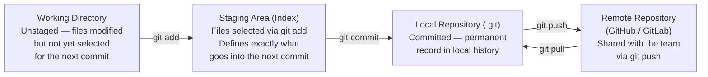
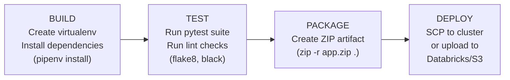

# Git, CI/CD & DevOps for Data Engineering

Version control and automated deployment pipelines are as fundamental to data engineering as they are to software engineering. Code that is not version-controlled cannot be audited, rolled back, or reviewed. Deployments that are not automated are inconsistent, error-prone, and opaque. This page covers the Git workflows, branching strategies, CI/CD pipeline structures, and secrets management patterns that production data teams rely on.

---

## Git vs GitHub

| Dimension | Git | GitHub |
|-----------|-----|--------|
| **What it is** | A local version control system (VCS) that runs on your machine | A cloud platform that hosts Git repositories remotely |
| **Where it runs** | Your local workstation | Cloud (github.com, GitLab, Bitbucket) |
| **Primary purpose** | Track changes, manage branches, create commits | Collaborate, review pull requests, trigger CI/CD |
| **Key outputs** | Commits, branches, the `.git` directory | Pull Requests, Actions pipelines, release tags |
| **Works offline?** | Yes — all local operations work offline | No — requires network access |

!!! info "Key distinction"
    **Git** manages version control locally. **GitHub** provides a remote platform for collaboration, code review, and CI/CD integration. You can use Git without GitHub, but GitHub requires Git.

---

## Git's Three-Stage Architecture

Every file in a Git repository moves through three states before becoming part of the permanent history.



The staging area is what distinguishes Git from simpler VCS tools. It allows you to commit only a subset of your changes — useful when you have made unrelated fixes in the same working session and want to create clean, atomic commits.

---

## Core Git Commands

### Initialization and Synchronization

```bash
# Initialize a new repository in the current directory
git init

# Download an existing remote repository
git clone https://github.com/org/retail-pipeline.git

# Connect an existing local repo to a remote
git remote add origin https://github.com/org/retail-pipeline.git

# Fetch and merge latest commits from remote branch
git pull origin main

# Upload committed local changes to remote
git push origin feature/RA-4521-customer-cleaning
```

### Staging and Committing

```bash
# Show current status: modified, untracked, staged files
git status

# Stage all modified and new files
git add .

# Stage a specific file only
git add lib/DataManipulation.py

# Create a commit with a descriptive message
git commit -m "feat: add null imputation for emp_length column"

# Show commit history (one line per commit)
git log --oneline --graph --all
```

### Branch Management

```bash
# List all local branches
git branch

# Create and switch to a new feature branch
git checkout -b feature/RA-4521-customer-cleaning

# Rename the current branch to main
git branch -M main

# Merge a feature branch into develop
git checkout develop
git merge feature/RA-4521-customer-cleaning

# Delete a merged local branch
git branch -d feature/RA-4521-customer-cleaning
```

### Undoing Changes

| Situation | Command | Effect |
|-----------|---------|--------|
| Unstaged file modifications | `git restore <file>` | Discards changes in working directory |
| Staged changes not yet committed | `git restore --staged <file>` | Moves file back to unstaged |
| Committed — keep the code | `git reset HEAD~1` | Undoes last commit; changes stay in working directory |
| Committed — discard the code | `git reset --hard <commit-hash>` | Moves to a specific commit; all subsequent changes are lost |

!!! warning "git reset --hard is destructive"
    `git reset --hard` permanently discards local changes. Always confirm the target commit hash with `git log --oneline` before running it, and never use it on commits already pushed to a shared remote branch.

### Git Stash — Temporary Work Storage

Stash saves uncommitted changes so you can switch tasks or branches without creating a premature commit.

```bash
# Save current modifications (tracked files only)
git stash

# Save modifications plus untracked files
git stash -u

# List all stash entries
git stash list

# Restore the most recent stash and remove it from the stack
git stash pop

# Remove all stash entries
git stash clear
```

### Advanced Operations

```bash
# Cherry-pick a single commit from another branch
git cherry-pick <commit-hash>

# Show the diff between working directory and last commit
git diff HEAD

# Show who last changed each line of a file
git blame lib/DataManipulation.py

# Interactive rebase to squash or reorder commits before a PR
git rebase -i HEAD~3
```

---

## .gitignore for Data Projects

```gitignore
# Python bytecode
__pycache__/
*.pyc
*.pyo
*.pyd
.Python

# Virtual environments
.venv/
env/
venv/
*.egg-info/

# Local configuration (contains environment-specific paths)
configs/local.conf
configs/application.local.conf

# Credentials and secrets — NEVER commit these
*.key
*.pem
*.env
.env
credentials.json
application.secrets

# Large data files — use a data lake, not Git
*.csv
*.parquet
*.orc
data/raw/
data/output/

# IDE and OS files
.idea/
.vscode/
*.DS_Store
Thumbs.db

# Spark and Hadoop local output
derby.log
metastore_db/
spark-warehouse/
```

!!! warning "Credential leakage is permanent"
    A secret committed to a Git repository is compromised — even if you delete it in a later commit. Git history retains every version of every file. If credentials are accidentally committed, rotate them immediately and rewrite history using `git filter-branch` or BFG Repo Cleaner.

---

## Branching Strategy: Gitflow

Enterprise data engineering teams typically follow a **Gitflow**-style branching model. Each branch represents a deployment environment, and code can only move forward through the pipeline — never backward.

```mermaid
gitGraph
   commit id: "init"
   branch develop
   checkout develop
   commit id: "base dev"
   branch feature/RA-4521
   checkout feature/RA-4521
   commit id: "add null imputation"
   commit id: "add unit tests"
   checkout develop
   merge feature/RA-4521 id: "merge feature"
   branch test
   checkout test
   merge develop id: "promote to TEST"
   branch uat
   checkout uat
   merge test id: "promote to UAT"
   checkout main
   merge uat id: "release to PROD"
```

| Branch | Purpose | Who deploys here |
|--------|---------|-----------------|
| `feature/TICKET-xxx` | Individual developer work, JIRA-ticket-scoped | Developer |
| `develop` | Integration of all features for the current sprint | CI on merge from feature |
| `test` | Automated integration testing and QA | CI on merge from develop |
| `uat` | Business stakeholder validation | CI on merge from test |
| `main` / `prod` | Production-ready code only | CI on merge from uat; human approval gate |

!!! note "Feature branches are temporary"
    Feature branches exist only for the duration of the work item. Once merged, they are deleted. Long-lived feature branches accumulate merge conflicts and drift from main — keep feature branches short and merge frequently.

---

## CI/CD for Data Engineering

### What CI/CD Means for Data Pipelines

**Continuous Integration (CI)** automatically builds and validates code every time a change is pushed. For a data pipeline this means:

- Installing Python dependencies in a clean virtual environment
- Running the full pytest suite
- Running lint checks (flake8, black)
- Validating Spark configuration files

**Continuous Deployment (CD)** automatically packages and deploys the validated artifact to the target environment. For a data pipeline this means:

- Creating a ZIP or JAR artifact of the application
- Uploading it to the target cluster or object storage
- Updating job definitions on the scheduler



---

## GitHub Actions

GitHub Actions defines CI/CD workflows as YAML files stored in `.github/workflows/`. The workflow runs on GitHub-hosted runners (Linux VMs) triggered by repository events.

### Workflow YAML Structure

```yaml
# .github/workflows/ci.yml
name: PySpark CI Pipeline

on:
  push:
    branches: [develop, test, uat, main]
  pull_request:
    branches: [develop]
  schedule:
    - cron: "0 6 * * 1-5"  # 6 AM Mon–Fri — nightly smoke test

jobs:
  build-and-test:
    runs-on: ubuntu-latest

    steps:
      - name: Checkout source code
        uses: actions/checkout@v4

      - name: Set up Python 3.10
        uses: actions/setup-python@v5
        with:
          python-version: "3.10"

      - name: Install pipenv and dependencies
        run: |
          pip install pipenv
          pipenv install --dev

      - name: Run lint checks
        run: pipenv run flake8 lib/ tests/ --max-line-length=120

      - name: Run unit tests
        run: pipenv run pytest tests/ -v --tb=short

  deploy-to-databricks:
    needs: build-and-test
    if: github.ref == 'refs/heads/main'
    runs-on: ubuntu-latest

    env:
      DATABRICKS_HOST: ${{ secrets.DATABRICKS_HOST }}
      DATABRICKS_TOKEN: ${{ secrets.DATABRICKS_TOKEN }}

    steps:
      - uses: actions/checkout@v4

      - name: Install Databricks CLI
        run: pip install databricks-cli

      - name: Package application
        run: zip -r retailproject.zip . --exclude "*.git*" --exclude "tests/*"

      - name: Upload artifact to DBFS
        run: |
          databricks fs cp retailproject.zip \
            dbfs:/pipelines/retail/retailproject.zip --overwrite

      - name: Update job configuration
        run: |
          databricks jobs reset --job-id ${{ secrets.PROD_JOB_ID }} \
            --json @resources/job_config_prod.json
```

### GitHub Actions Key Concepts

| Concept | Meaning |
|---------|---------|
| `on` | Events that trigger the workflow (push, pull_request, schedule, workflow_dispatch) |
| `jobs` | Independent units of work; each job runs on its own runner |
| `needs` | Dependency between jobs — `deploy` only runs after `test` succeeds |
| `steps` | Sequential commands within a job |
| `uses` | Reusable action from the GitHub Actions Marketplace |
| `run` | Shell command to execute |
| `env` | Environment variables for the job or step |
| `secrets` | Encrypted values stored in GitHub repository settings — never exposed in logs |
| `if` | Conditional expression — limits which branches trigger a step |

---

## Jenkins vs GitHub Actions

| Dimension | Jenkins | GitHub Actions |
|-----------|---------|----------------|
| **Setup** | Self-hosted; requires a dedicated Jenkins server | Managed by GitHub; no infrastructure to maintain |
| **Configuration** | Jenkinsfile (Groovy DSL) in repo root | YAML workflow files in `.github/workflows/` |
| **Runners** | Jenkins agents (on-prem or cloud VMs you manage) | GitHub-hosted runners (Linux, Windows, macOS) or self-hosted |
| **Plugin ecosystem** | Extensive; thousands of community plugins | GitHub Marketplace actions |
| **Cost** | Infrastructure cost for Jenkins server | Free for public repos; usage-based for private |
| **Best for** | Large enterprises with existing Jenkins infrastructure, complex on-prem integrations | Teams already on GitHub; simpler setup and maintenance |

### Jenkinsfile Example

```groovy
// Jenkinsfile (in project root)
pipeline {
    agent any

    environment {
        LABS = credentials("lab-credentials")  // Retrieves username/password secret
    }

    stages {
        stage("Build") {
            steps {
                echo "Installing dependencies..."
                sh "pip3 install --user pipenv"
                sh "~/.local/bin/pipenv --rm || exit 0"
                sh "~/.local/bin/pipenv install"
            }
        }

        stage("Test") {
            steps {
                echo "Running automated test suite..."
                sh "~/.local/bin/pipenv run pytest -v"
            }
        }

        stage("Package") {
            steps {
                echo "Packaging application artifact..."
                sh "zip -r retailproject.zip . --exclude '*.git*'"
            }
        }

        stage("Deploy") {
            steps {
                echo "Deploying to gateway edge node..."
                sh """
                    sshpass -p $LABS_PSW scp -o StrictHostKeyChecking=no \
                    retailproject.zip $LABS_USR@gateway.company.com:/deployments/retail/
                """
            }
        }
    }

    post {
        failure {
            mail to: "data-platform@company.com",
                 subject: "Pipeline FAILED: ${env.JOB_NAME}",
                 body: "See: ${env.BUILD_URL}"
        }
    }
}
```

---

## Environment-Specific Configuration

Production data pipelines run in multiple environments (DEV, UAT, PROD) that differ in cluster size, data paths, and connection strings. Never hardcode environment-specific values in application code.

### ConfigParser-Based Approach

```ini
# configs/application.conf
[LOCAL]
orders_input_path = data/orders_sample.csv
customers_input_path = data/customers_sample.csv
output_path = /tmp/test_output

[PROD]
orders_input_path = s3://data-lake/raw/orders/
customers_input_path = s3://data-lake/raw/customers/
output_path = s3://data-lake/processed/retail/
```

```python
# lib/ConfigReader.py
import configparser

class ConfigReader:
    def __init__(self, env: str):
        self.config = configparser.ConfigParser()
        self.config.read("configs/application.conf")
        self.env = env

    def get(self, key: str) -> str:
        return self.config[self.env][key]
```

```python
# application_main.py
import sys
from lib.ConfigReader import ConfigReader

env = sys.argv[1]  # Passed as: python application_main.py PROD
config = ConfigReader(env)

orders_path = config.get("orders_input_path")
output_path = config.get("output_path")
```

---

## Secrets Management in CI/CD

### GitHub Actions Secrets

Store sensitive values (cluster tokens, database passwords, API keys) as encrypted secrets in the repository or organization settings. Reference them in workflow files as `${{ secrets.SECRET_NAME }}`.

```yaml
# In .github/workflows/ci.yml
env:
  DATABRICKS_HOST: ${{ secrets.DATABRICKS_HOST }}
  DATABRICKS_TOKEN: ${{ secrets.DATABRICKS_TOKEN_SP }}
  DB_PASSWORD: ${{ secrets.PROD_DB_PASSWORD }}
```

GitHub masks secret values in workflow logs — if a secret value accidentally appears in output, it is replaced with `***`.

### Azure Key Vault Integration

For enterprise environments on Azure, store secrets in Azure Key Vault and fetch them at job startup rather than embedding them in CI/CD platform secrets.

```python
# Retrieve secrets from Azure Key Vault at runtime
from azure.identity import DefaultAzureCredential
from azure.keyvault.secrets import SecretClient

credential = DefaultAzureCredential()
client = SecretClient(
    vault_url="https://company-kv.vault.azure.net/",
    credential=credential
)

db_password = client.get_secret("prod-db-password").value
```

!!! tip "Use Service Principals, not personal tokens"
    CI/CD pipelines should authenticate using a Service Principal (non-human identity) with the minimum permissions required. Personal access tokens expire, are tied to individual employees who may leave, and cannot be audited separately from the user's other activity. Service Principal tokens can be rotated, scoped, and audited independently.

### Resolving Merge Conflicts in Notebook/SQL Files

Notebook files (`.ipynb`) and SQL files often produce difficult merge conflicts because their cell outputs and internal IDs change between runs. Two practices reduce this pain:

```bash
# Before merging, clear notebook outputs to reduce noise in diffs
jupyter nbconvert --ClearOutputPreprocessor.enabled=True \
    --to notebook --inplace notebooks/analysis.ipynb

# Use a .gitattributes entry to treat notebooks as binary during merges
# (prevents git from trying to auto-merge JSON internals)
echo "*.ipynb merge=binary" >> .gitattributes
```

For SQL files, conflicts arise when two developers modify the same query. Resolving them requires understanding both changes in context — use `git diff` to see the full context before accepting either side:

```bash
# See the full diff with context
git diff --diff-filter=U

# Accept the incoming version for a specific file
git checkout --theirs path/to/query.sql

# Accept our version
git checkout --ours path/to/query.sql

git add path/to/query.sql
git commit -m "resolve: merge conflict in customer_join query"
```
