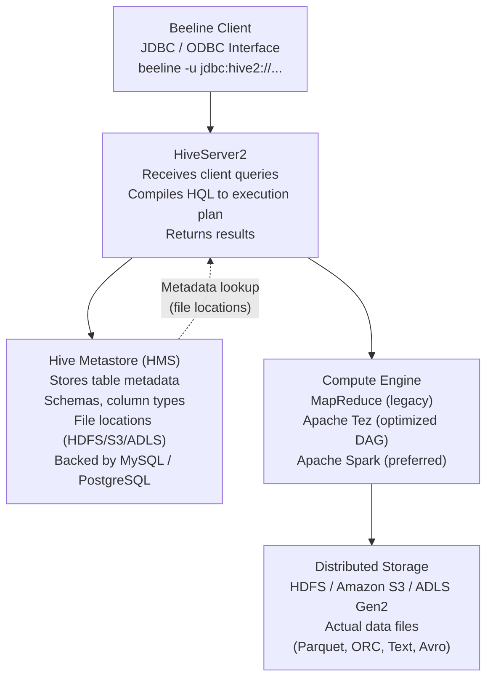
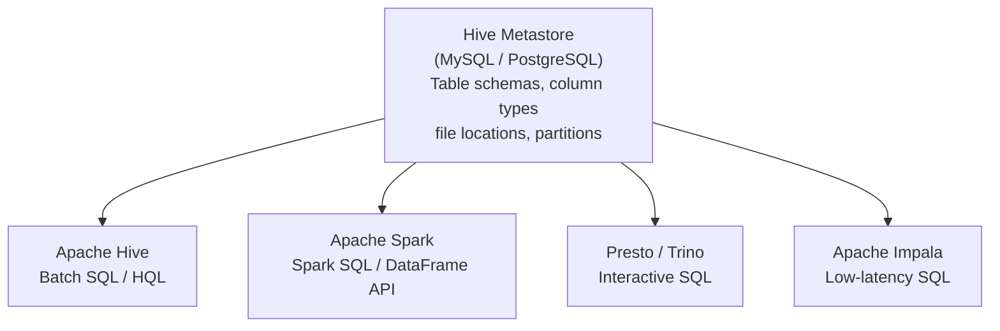

# Apache Hive & Metastore

Apache Hive provides a SQL abstraction layer over distributed storage systems such as HDFS, Amazon S3, and Azure Data Lake Storage. Rather than replacing distributed compute, Hive acts as a translation layer — converting HiveQL queries into execution plans that run on MapReduce, Apache Tez, or Apache Spark. Its most enduring contribution to the modern data stack is the **Hive Metastore** (HMS): a central metadata catalog that stores table schemas, column types, and file locations, and is shared by Spark, Presto, Impala, and other engines.

---

## OLTP vs OLAP: Where Hive Fits

Understanding Hive requires first understanding the workload distinction it was designed for.

| Dimension | OLTP | OLAP / Hive |
|-----------|------|-------------|
| **Primary workload** | High-concurrency individual record operations | Large-scale historical analysis and aggregations |
| **Operations** | INSERT, UPDATE, DELETE, single-row reads | Full table scans, GROUP BY, complex JOINs |
| **Latency** | Low (milliseconds) | Higher (seconds to minutes) |
| **Throughput** | Relatively low per query | Extremely high — processes terabytes per query |
| **Schema approach** | Schema-on-Write (schema enforced at write time) | Schema-on-Read (schema applied at query time) |
| **Example systems** | MySQL, Oracle, PostgreSQL | Apache Hive, Spark SQL, Presto |

Hive is not a replacement for a relational database. It is optimized for analytical workloads over large datasets where the query pattern is scan-heavy and latency requirements are measured in minutes, not milliseconds.

---

## Hive Architecture



### HiveServer2

HiveServer2 is the query gateway. It accepts JDBC and ODBC connections from clients (Beeline, BI tools, JDBC drivers), parses and validates HiveQL, compiles queries into execution plans, submits jobs to the compute engine, and returns results to the client.

### Hive Metastore (HMS)

The Hive Metastore is a relational database (typically MySQL or PostgreSQL) that stores metadata about every Hive table and database:

- Table names and database/schema names
- Column names and data types
- Storage location (HDFS path, S3 URI, ADLS path)
- File format (Parquet, ORC, TextFile, Avro)
- Partition information (partition columns and their values)
- Table properties (transactional, bucketing config, SERDE properties)

!!! info "Why a relational database for metadata?"
    Metadata operations — schema lookups, partition discovery, column type resolution — happen on every query but involve tiny amounts of data. A relational database provides low-latency, indexed lookups for this structured metadata far more efficiently than HDFS or object storage could.

### Beeline

Beeline is the standard JDBC-based command-line client for HiveServer2.

```bash
# Connect to HiveServer2
beeline -u "jdbc:hive2://hiveserver.company.com:10000/analytics;auth=noSasl"

# Execute a query directly
beeline -u "jdbc:hive2://..." -e "SELECT COUNT(*) FROM orders;"

# Execute from a file
beeline -u "jdbc:hive2://..." -f queries/monthly_report.hql
```

---

## Managed vs External Tables

This is the most critical conceptual distinction in Hive. The difference is about **data ownership** — who is responsible for the physical files when the table definition is dropped.

### Managed Tables

A managed table gives Hive full ownership of both the table metadata and the underlying data files. Hive stores data in the warehouse directory defined by `hive.metastore.warehouse.dir`.

```sql
-- Hive manages both metadata AND physical data
CREATE TABLE orders_managed (
    order_id    INT,
    order_date  STRING,
    customer_id INT,
    order_status STRING
)
STORED AS PARQUET;
```

**DROP TABLE behavior:**

```sql
DROP TABLE orders_managed;
-- Result: metadata is deleted AND the physical Parquet files are deleted
-- The data is gone permanently
```

### External Tables

An external table gives Hive ownership of the metadata only. The physical data lives at a custom `LOCATION` that is managed independently of Hive. This is the correct choice for any data shared across teams or used by multiple systems.

=== "HiveQL"

    ```sql
    -- Hive manages only metadata; data lives at the specified LOCATION
    CREATE EXTERNAL TABLE IF NOT EXISTS lending_club.customers (
        member_id              STRING,
        emp_title              STRING,
        emp_length             INT,
        home_ownership         STRING,
        annual_income          FLOAT,
        address_state          STRING,
        total_high_credit_limit FLOAT,
        ingest_date            TIMESTAMP
    )
    STORED AS PARQUET
    LOCATION 'hdfs:///data/lending-club/cleaned/customers_parquet';
    ```

=== "SQL (Spark)"

    ```sql
    -- In Spark SQL with Hive Metastore integration
    CREATE TABLE IF NOT EXISTS lending_club.customers (
        member_id              STRING,
        emp_title              STRING,
        emp_length             INT,
        home_ownership         STRING,
        annual_income          FLOAT,
        address_state          STRING,
        total_high_credit_limit FLOAT,
        ingest_date            TIMESTAMP
    )
    USING PARQUET
    LOCATION 'hdfs:///data/lending-club/cleaned/customers_parquet';
    ```

**DROP TABLE behavior for external tables:**

```sql
DROP TABLE lending_club.customers;
-- Result: metadata is deleted from the Hive Metastore
-- Physical Parquet files at the LOCATION remain intact
-- Another team or system can still read the files directly
```

| Property | Managed Table | External Table |
|----------|--------------|----------------|
| Hive owns metadata | Yes | Yes |
| Hive owns physical data | Yes | No |
| Storage location | Default warehouse directory | Custom `LOCATION` |
| DROP TABLE effect | Deletes metadata + physical data | Deletes metadata only |
| Best use case | Hive-managed, single-consumer data | Shared datasets, multi-team, multi-engine access |

!!! warning "Default to external tables for production data"
    In production, most datasets are shared across teams or accessed by multiple query engines. Using external tables protects against accidental data loss from a dropped table or database. Use managed tables only when the data lifecycle is fully owned and controlled by a single Hive context.

---

## HiveQL DDL

### CREATE TABLE with Storage Format

```sql
-- Parquet with Snappy compression
CREATE EXTERNAL TABLE analytics.transactions (
    txn_id          BIGINT,
    txn_date        STRING,
    customer_id     INT,
    amount          DOUBLE,
    currency        STRING,
    status          STRING
)
STORED AS PARQUET
LOCATION 's3://data-lake/analytics/transactions/';

-- ORC format (required for full ACID)
CREATE TABLE analytics.orders_acid (
    order_id     INT,
    order_date   STRING,
    customer_id  INT,
    order_status STRING
)
STORED AS ORC
TBLPROPERTIES ('transactional'='true');

-- Text/CSV for raw ingestion tables
CREATE EXTERNAL TABLE raw.orders_csv (
    order_id     STRING,
    order_date   STRING,
    customer_id  STRING,
    order_status STRING
)
ROW FORMAT DELIMITED
FIELDS TERMINATED BY ','
STORED AS TEXTFILE
LOCATION 'hdfs:///raw/orders/';
```

---

## Partitioning

Hive partitioning divides table data into separate subdirectories on the file system, one directory per distinct value of the partition column. Queries that filter on the partition column only read the matching directories — this is called **partition pruning**.

### Directory Structure

```
hdfs:///warehouse/analytics/orders/
│
├── order_status=CLOSED/
│   └── part-00000.parquet
│
├── order_status=COMPLETE/
│   └── part-00000.parquet
│
├── order_status=PENDING/
│   └── part-00000.parquet
│
└── order_status=CANCELLED/
    └── part-00000.parquet
```

### Creating and Loading a Partitioned Table

=== "HiveQL"

    ```sql
    -- Create a partitioned table
    CREATE EXTERNAL TABLE analytics.orders_partitioned (
        order_id    INT,
        order_date  STRING,
        customer_id INT
    )
    PARTITIONED BY (order_status STRING)
    STORED AS PARQUET
    LOCATION 'hdfs:///warehouse/analytics/orders/';

    -- Enable dynamic partitioning
    SET hive.exec.dynamic.partition = true;
    SET hive.exec.dynamic.partition.mode = nonstrict;

    -- Insert with dynamic partition
    INSERT INTO analytics.orders_partitioned
    PARTITION (order_status)
    SELECT order_id, order_date, customer_id, order_status
    FROM raw.orders_csv;
    ```

=== "PySpark"

    ```python
    # Write with partitioning
    orders_df.write \
        .mode("overwrite") \
        .partitionBy("order_status") \
        .parquet("hdfs:///warehouse/analytics/orders/")

    # Read with partition pruning (Spark automatically pushes the filter)
    closed_orders = spark.read.parquet("hdfs:///warehouse/analytics/orders/") \
        .filter("order_status = 'CLOSED'")
    # Only reads the order_status=CLOSED/ directory
    ```

!!! tip "Partition column cardinality"
    Partitioning is most effective on **low-cardinality** columns — those with a small number of distinct values (order_status, country, year, month). Partitioning on a high-cardinality column like `customer_id` creates millions of tiny directories, which overwhelms the NameNode (HDFS) or object storage metadata service and degrades performance.

---

## MSCK REPAIR TABLE

When partitions are added to HDFS or S3 by an external process (not through Hive or Spark), the Hive Metastore does not automatically know about the new directories. `MSCK REPAIR TABLE` scans the storage location and registers all discovered partition directories in the Metastore.

```
Hive Metastore knows:        HDFS actually contains:
order_status=CLOSED          order_status=CLOSED
order_status=COMPLETE        order_status=COMPLETE
                             order_status=PENDING    ← added externally
                             order_status=CANCELLED  ← added externally
```

```sql
-- Synchronize Metastore with actual partition directories on HDFS/S3
MSCK REPAIR TABLE analytics.orders_partitioned;
-- Now the Metastore registers PENDING and CANCELLED partitions
```

!!! note "MSCK REPAIR is specific to Hive Metastore"
    In Databricks with Unity Catalog, partition discovery happens automatically. `MSCK REPAIR TABLE` is needed in classic Hive environments or when using the Hive Metastore outside of managed services.

---

## Bucketing

While partitioning divides data into **directories** by column value, bucketing divides data into a **fixed number of files** based on a hash function applied to the bucket column. Bucketing is designed for **high-cardinality** columns where the number of distinct values makes per-value directories impractical.

### Bucket Structure

```
hdfs:///warehouse/analytics/orders_bucketed/
├── 000000_0    → Bucket 0  (order_ids where hash(order_id) % 4 == 0)
├── 000001_0    → Bucket 1  (order_ids where hash(order_id) % 4 == 1)
├── 000002_0    → Bucket 2  (order_ids where hash(order_id) % 4 == 2)
└── 000003_0    → Bucket 3  (order_ids where hash(order_id) % 4 == 3)
```

```sql
CREATE TABLE analytics.orders_bucketed (
    order_id     INT,
    order_date   STRING,
    customer_id  INT,
    order_status STRING
)
CLUSTERED BY (order_id) INTO 4 BUCKETS
STORED AS ORC;
```

### Partitioning vs Bucketing

| Feature | Partitioning | Bucketing |
|---------|-------------|-----------|
| Physical structure | Directories / folders | Fixed-count files |
| Best column type | Low cardinality | High cardinality |
| Example columns | `order_status`, `country`, `year` | `order_id`, `customer_id` |
| Main optimization | Partition pruning — skip unneeded directories | Bucket-based joins — avoid full shuffles |
| Number of output values | Few (2–1000) | Defined by `INTO N BUCKETS` |

---

## Join Optimization Strategies

### Map-Side Join (Broadcast Join)

When one table is small enough to fit in memory (~25 MB default threshold), Hive broadcasts the small table to every node and performs the join in memory during the Map phase — bypassing the expensive Reduce phase entirely.

```sql
-- Hint that small_dim should be broadcast
SELECT /*+ MAPJOIN(small_dim) */
    f.order_id,
    d.category_name
FROM orders f
JOIN product_category small_dim ON f.category_id = small_dim.category_id;
```

### Bucket Map Join

When both tables are bucketed on the join key but the small table is too large to broadcast, Hive can process the join bucket-by-bucket. The bucket counts must be **integer multiples** of each other (e.g., Table A has 4 buckets, Table B has 8 buckets — 8 is a multiple of 4).

### Sort-Merge-Bucket (SMB) Join

SMB join is the most powerful Hive join optimization for large datasets. Both tables must be bucketed **and sorted** on the join key with the **same number of buckets**. Hive can then merge corresponding bucket files sequentially — no shuffle, no in-memory sort.

**Requirements for SMB join:**

1. Both tables bucketed on the join key
2. Same number of buckets in both tables
3. Both tables sorted by the join key

```sql
-- Enable SMB join
SET hive.input.format=org.apache.hadoop.hive.ql.io.BucketizedHiveInputFormat;
SET hive.auto.convert.sortmerge.join=true;
SET hive.optimize.bucketmapjoin=true;
SET hive.optimize.bucketmapjoin.sortedmerge=true;
SET hive.enforce.bucketing=true;
SET hive.enforce.sorting=true;
```

| Join Type | When to Use | Requirements |
|-----------|------------|--------------|
| **Map-Side / Broadcast** | One table fits in memory (~25 MB) | None — automatic |
| **Bucket Map Join** | Tables too large to broadcast; different bucket counts | Both bucketed on join key; integer-multiple bucket counts |
| **SMB Join** | Both tables large; maximum optimization | Same bucket count + sorted on join key |

---

## Hive ACID Transactions

Hive supports ACID (Atomicity, Consistency, Isolation, Durability) transactions for workloads that require INSERT, UPDATE, and DELETE on managed tables — such as Slowly Changing Dimensions (SCD) and streaming update patterns.

### ACID Storage Structure

Hive stores transactional changes as a set of base and delta files:

```
hdfs:///warehouse/orders_trx/
├── base_0000001/
│   └── bucket_00000           ← Initial snapshot
├── delta_0000002_0000002/
│   └── bucket_00000           ← New inserts / updates
├── delta_0000003_0000003/
│   └── bucket_00000           ← More updates
└── delete_delta_0000004_0000004/
    └── bucket_00000           ← Recorded deletions
```

At read time, Hive merges all base, delta, and delete-delta files into the final logical dataset. **Compaction** periodically merges these files to prevent read performance from degrading as delta files accumulate.

### Full ACID Table Requirements

A full ACID table in Hive must satisfy four conditions simultaneously:

```
Managed Table
     +
ORC Format
     +
Bucketed
     +
TBLPROPERTIES ('transactional'='true')
```

```sql
-- Enable ACID support (set in hive-site.xml or per-session)
SET hive.support.concurrency=true;
SET hive.txn.manager=org.apache.hadoop.hive.ql.lockmgr.DbTxnManager;

-- Create full ACID table
CREATE TABLE analytics.orders_trx (
    order_id     INT,
    order_date   STRING,
    customer_id  INT,
    order_status STRING
)
CLUSTERED BY (order_id) INTO 4 BUCKETS
STORED AS ORC
TBLPROPERTIES ('transactional'='true');

-- Now UPDATE and DELETE are supported
UPDATE analytics.orders_trx
SET order_status = 'COMPLETE'
WHERE order_id = 12345;

DELETE FROM analytics.orders_trx
WHERE order_status = 'CANCELLED';
```

### Insert-Only Transactional Tables

For workloads that only append new records — no UPDATEs or DELETEs — insert-only transactional tables provide lighter-weight ACID guarantees with support for any file format (not just ORC).

```sql
CREATE TABLE analytics.events_insert_only (
    event_id   BIGINT,
    event_time TIMESTAMP,
    user_id    INT,
    event_type STRING
)
STORED AS PARQUET
TBLPROPERTIES (
    'transactional'='true',
    'transactional_properties'='insert_only'
);
```

| Property | Full ACID | Insert-Only |
|----------|-----------|-------------|
| Supported operations | INSERT, UPDATE, DELETE | INSERT only |
| Required file format | ORC only | Any format (Parquet, Text, ORC) |
| Bucketing required | Yes | No |
| Overhead | Higher (compaction, locking) | Lower |
| Best use case | SCD Type 1/2 updates, streaming corrections | Append-only event streams |

---

## Hive Metastore as Shared Catalog

The Hive Metastore's greatest value in modern data platforms is its role as a **shared catalog** — a single source of truth for table metadata that is used by multiple query engines simultaneously.



A table registered in the Hive Metastore is immediately available to all these engines without any additional configuration — a Spark job can write a Parquet dataset, register it in HMS, and a Presto analyst can query it seconds later without any data transfer or format conversion.

This interoperability is why the Hive Metastore remains the foundational catalog layer in most on-premises Hadoop distributions, and why cloud-managed equivalents (AWS Glue Data Catalog, Azure Data Factory Catalog) expose Hive Metastore-compatible APIs.

---

## Hive vs Delta Lake

| Dimension | Apache Hive ACID | Delta Lake |
|-----------|-----------------|------------|
| **ACID support** | Yes (ORC only, full ACID requires managed + bucketed) | Yes (all formats; Parquet by default) |
| **Schema enforcement** | Weak (schema-on-read by default) | Strong (schema enforced on write) |
| **Time travel** | No native time travel | Yes — query any historical version |
| **Streaming + batch** | Separate pipelines typically required | Unified streaming + batch writes |
| **Compaction** | Manual or scheduled (MAJOR/MINOR compaction) | Automatic (OPTIMIZE + ZORDER) |
| **Performance** | Mature; well-understood at scale | Generally faster for modern workloads |
| **Best for** | On-prem Hadoop with established Hive workflows; legacy interoperability | New projects on cloud or Databricks; modern lakehouse patterns |

!!! info "Delta Lake for modern workloads"
    For new projects on cloud platforms (Databricks, S3, ADLS), Delta Lake supersedes Hive ACID in almost every dimension. Delta Lake's time travel, schema enforcement, automatic compaction, and unified streaming/batch support address the pain points that made Hive ACID complex to operate. Hive ACID remains relevant for on-premises Hadoop environments with existing investment in the Hive ecosystem.
