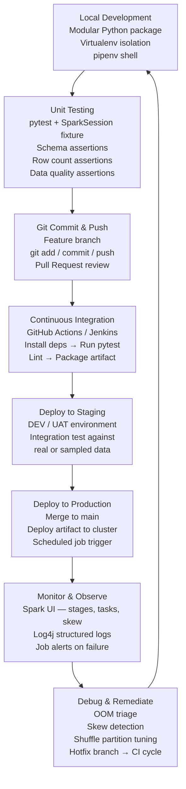

# Production Engineering

Taking a PySpark job from a working notebook to a reliable, observable, cost-efficient production pipeline involves a set of disciplines that go beyond writing correct transformations. This module covers the full engineering lifecycle: how to test code before it reaches production, how to log and observe what happens at runtime, how to size clusters against real data volumes, how to automate promotion through environments with CI/CD, and how to debug jobs when they fail under production load.

!!! info "What this module covers"
    - **Testing & Logging** — pytest fixtures for Spark code, Log4j structured logging, production debugging playbooks
    - **CI/CD & Git** — branching strategies, GitHub Actions pipelines, environment-specific configuration, secrets management
    - **Resource Sizing** — formula-driven executor and memory calculation, shuffle partition tuning, Dynamic Resource Allocation
    - **Apache Hive & Metastore** — HiveQL DDL, table types, partitioning, bucketing, ACID transactions, shared catalog interoperability

---

## The Production Engineering Lifecycle

A production data engineering pipeline passes through a repeatable set of stages — from local development through automated testing and staged deployment to live monitoring and incident response.



---

## Project Layout for Production PySpark

Production PySpark applications are organized as modular Python packages, not monolithic notebooks. This structure separates configuration, library code, tests, and the application driver so that each concern can be version-controlled, tested, and deployed independently.

```
retail_analysis/
│
├── configs/
│   ├── application.conf     # Environment file paths (LOCAL / TEST / PROD)
│   └── pyspark.conf         # Spark submit config (cores, memory, master URL)
│
├── data/
│   └── ...                  # Local sample data for unit tests only
│
├── lib/
│   ├── ConfigReader.py      # ConfigParser wrapper for app/Spark configs
│   ├── DataReader.py        # Encapsulated DataFrame reader methods
│   ├── DataManipulation.py  # Pure transformation functions
│   ├── logger.py            # Log4j wrapper class
│   └── Utils.py             # SparkSession creation utility
│
├── application_main.py      # Application driver / entry point
│
├── tests/
│   ├── conftest.py          # pytest fixtures (SparkSession setup/teardown)
│   └── test_retail.py       # pytest unit test suites
│
├── Pipfile                  # Dependency definitions
└── Pipfile.lock             # Locked package versions and hashes
```

!!! tip "Why modular structure matters"
    A monolithic notebook cannot be unit-tested, cannot be imported by other modules, and conflates configuration with business logic. Separating concerns into `lib/` modules means each transformation can be tested in isolation and reused across jobs without copy-paste duplication.

---

## Virtual Environment Isolation

Different projects on the same machine may require different Python and PySpark versions. `pyenv` manages Python runtime versions globally; `pipenv` creates a per-project virtual environment with locked dependency hashes.

```bash
# Activate or create the virtual environment for this project
pipenv shell

# Install a specific PySpark version and record it in Pipfile.lock
pipenv install pyspark==3.2.1

# Run the application inside the isolated environment
pipenv run python application_main.py LOCAL

# Remove the virtual environment completely
pipenv --rm
```

```
Global Machine (Python 3.10)
│
├── Project A — pipenv VirtualEnv
│   ├── Python 3.8
│   ├── PySpark 3.2.1
│   └── pytest
│
└── Project B — pipenv VirtualEnv
    ├── Python 3.10
    ├── PySpark 3.5.0
    └── delta-spark
```

!!! warning "Lock your dependencies"
    Always commit `Pipfile.lock` to version control. The lock file records exact package versions and cryptographic hashes, making builds reproducible across developer machines and CI agents. Without it, a dependency update can silently break a pipeline weeks after the last code change.

---

## Module Overview

| Page | What you will learn |
|------|---------------------|
| [Testing, Logging & Debugging](testing-logging.md) | pytest fixtures, schema assertions, Log4j wrapper, the 4-step debugging approach, explain() plan reading |
| [CI/CD & Git](cicd.md) | Git three-stage architecture, Gitflow branching, GitHub Actions workflow, Jenkins Pipefile, secrets management |
| [Resource Sizing & Estimation](resource-sizing.md) | 5-cores-per-executor formula, memory calculation walkthrough, shuffle partition tuning, Dynamic Resource Allocation |
| [Apache Hive & Metastore](hive.md) | HiveQL DDL, managed vs external tables, partitioning, bucketing, ACID transactions, MSCK REPAIR TABLE |

---

## Key Principles

**Test before you deploy.** A schema drift in a raw source file should fail your pytest suite, not your production SLA. Unit tests for transformation logic cost minutes to write and save hours of incident triage.

**Log with structure, not print statements.** `print()` disappears into driver stdout and carries no severity level, no timestamp, and no routing to a log aggregator. Log4j integrates with the Spark runtime and writes to files that cluster log collection agents can forward.

**Size clusters against data, not intuition.** The most common cause of underperforming Spark jobs is a mismatch between data volume and cluster configuration — particularly the default `spark.sql.shuffle.partitions = 200`, which is almost always wrong for production datasets.

**Automate promotion.** Manual deployments are the largest source of environment drift. A CI/CD pipeline that runs tests on every push and deploys only on merge to `main` keeps all environments in sync and provides a complete audit trail of what changed when.

**Debug with the Spark UI first.** The Spark UI shows task duration distributions, shuffle read/write sizes, spill metrics, and executor memory usage. Looking at these metrics before adding log statements or increasing resources usually identifies the root cause in under ten minutes.
