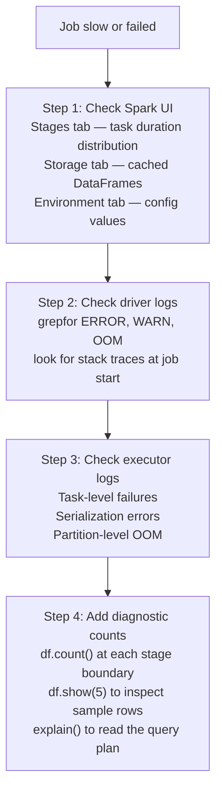

# Testing, Logging & Debugging

Production data pipelines fail in ways that development testing cannot always predict: schema drift in upstream sources, null values in columns assumed to be non-null, data skew that only appears at full production scale, and logic errors that only surface on real business data. A discipline of automated testing, structured logging, and systematic debugging reduces the mean time to detection and the mean time to resolution for these failures.

---

## Why Test Spark Code

| Risk | What testing catches | What happens without tests |
|------|---------------------|---------------------------|
| **Schema drift** | A source column is renamed or dropped | Pipeline silently produces wrong output or fails with a confusing NullPointerException |
| **Data quality regression** | A cleaning step stops removing nulls after an upstream format change | Corrupted records flow into the serving layer |
| **Logic error in transformation** | A filter predicate uses `>=` instead of `>` | Wrong records passed to downstream consumers |
| **Performance regression** | A refactored join accidentally drops a filter, increasing data volume 10× | SLA breach on the next run |

Testing Spark code is harder than testing plain Python functions because transformations operate on distributed DataFrames, not simple in-memory structures. The `pytest` framework combined with a local `SparkSession` fixture provides a practical solution that runs on a developer's machine in seconds.

---

## pytest Setup

### Project Structure

```
tests/
├── conftest.py       # Shared fixtures — SparkSession lives here
└── test_retail.py    # Test functions
```

### conftest.py — SparkSession Fixture

The `conftest.py` file is the central fixture registry for a pytest project. Fixtures defined here are automatically available to every test in the same directory and all subdirectories.

```python
# tests/conftest.py
import pytest
from lib.Utils import get_spark_session

@pytest.fixture(scope="session")
def spark():
    """
    Provides a local SparkSession for the entire test session.
    'scope="session"' means the session is created once and reused
    across all test functions, making the suite much faster.
    """
    spark_session = get_spark_session("LOCAL")
    yield spark_session
    spark_session.stop()
```

!!! tip "Use scope='session' for the SparkSession fixture"
    Creating a SparkSession takes several seconds. With `scope="session"`, pytest creates one session per test run and reuses it for all tests. With the default `scope="function"`, a new session is created for every test — making a 30-test suite 60–90 seconds slower than necessary.

### lib/Utils.py — SparkSession Factory

```python
# lib/Utils.py
from pyspark.sql import SparkSession

def get_spark_session(env: str) -> SparkSession:
    if env == "LOCAL":
        return (
            SparkSession.builder
            .master("local[*]")
            .appName("RetailTestSession")
            .config("spark.driver.extraJavaOptions",
                    "-Dlog4j.configuration=file:log4j.properties")
            .getOrCreate()
        )
    elif env == "PROD":
        return SparkSession.builder.appName("RetailProd").getOrCreate()
    else:
        raise ValueError(f"Unknown environment: {env}")
```

---

## Testing Patterns

### Pattern 1: Row Count Assertion

Verify that a read operation loads the expected number of records. This catches truncated files, empty partitions, and connection failures early.

```python
# tests/test_retail.py
from lib.DataReader import read_customers

def test_customer_count(spark):
    """Verifies customer DataFrame read row count."""
    customer_df = read_customers(spark, "LOCAL")
    assert customer_df.count() == 12435
```

### Pattern 2: Transformation Logic Assertion

Test that a specific filtering or transformation function produces the correct output on a known dataset.

```python
import pytest
from lib.DataReader import read_orders
from lib.DataManipulation import filter_closed_orders

@pytest.mark.transformation
def test_filter_closed_orders(spark):
    """Verifies that status filtering returns only CLOSED orders."""
    orders_df = read_orders(spark, "LOCAL")
    closed_df = filter_closed_orders(orders_df)
    assert closed_df.count() == 7556
```

### Pattern 3: Schema Assertion

Verify that a transformation produces the expected output schema. Schema drift is one of the most common production failure modes.

```python
from pyspark.sql.types import StructType, StructField, StringType, IntegerType, FloatType
from lib.DataManipulation import clean_customers

def test_schema_match(spark):
    """Verifies output schema after cleaning transformation."""
    raw_df = spark.read.csv("data/customers_sample.csv", header=True)
    cleaned_df = clean_customers(raw_df)

    expected_schema = StructType([
        StructField("emp_id",          StringType(),  False),
        StructField("emp_length",      IntegerType(),  True),
        StructField("annual_income",   FloatType(),    True),
        StructField("address_state",   StringType(),   True),
        StructField("ingest_date",     StringType(),  False),
    ])

    assert cleaned_df.schema == expected_schema, (
        f"Schema mismatch.\nExpected: {expected_schema}\nActual: {cleaned_df.schema}"
    )
```

### Pattern 4: Data Quality Assertion with createDataFrame

Use `spark.createDataFrame()` to create controlled test input without reading from any file. This isolates the transformation logic completely from the data source.

```python
from pyspark.sql import Row
from lib.DataManipulation import filter_closed_orders

def test_filter_logic_with_mock_data(spark):
    """Tests filter transformation against in-memory mock data."""
    mock_data = [
        Row(order_id=1, order_status="CLOSED"),
        Row(order_id=2, order_status="COMPLETE"),
        Row(order_id=3, order_status="CLOSED"),
        Row(order_id=4, order_status="PENDING"),
    ]
    orders_df = spark.createDataFrame(mock_data)

    result = filter_closed_orders(orders_df)
    assert result.count() == 2
    assert result.filter("order_id = 4").count() == 0
```

!!! note "Mock data vs sample files"
    Use `createDataFrame()` for testing transformation logic — it has no I/O overhead and makes the expected input explicit in the test. Use sample CSV/Parquet files in `data/` for integration tests that verify schema parsing and file reading behavior end-to-end.

---

## Running Tests

```bash
# Run all tests
python -m pytest

# Verbose mode — shows each test name and result
python -m pytest -v

# Run only tests tagged with @pytest.mark.transformation
python -m pytest -m transformation

# Run a specific test file
python -m pytest tests/test_retail.py

# Run inside the pipenv virtual environment
pipenv run pytest -v
```

---

## Production Logging via Log4j

### Why print() Is Not Sufficient

```python
# In a Spark cluster job — this does NOT behave as expected
print("Processing started")
# ↑ Goes to driver stdout only
# ↑ Not captured by cluster log aggregation
# ↑ No severity level — cannot filter errors from info
# ↑ Adds serialization overhead on executors
```

Spark ships with **Log4j**, the standard Java logging framework. Log4j integrates with the JVM runtime, writes to configurable log files, and supports severity-level filtering. In cluster mode, Spark's log collection agents automatically forward Log4j output to the cluster's centralized log store.

### Log4j Priority Hierarchy

```
DEBUG  <  INFO  <  WARN  <  ERROR  <  FATAL
```

Setting a log level of `WARN` means only `WARN`, `ERROR`, and `FATAL` messages are written — `DEBUG` and `INFO` are suppressed. This controls log verbosity in production without removing statements from code.

### Log4j Wrapper Class

```python
# lib/logger.py

class Log4j:
    """
    Thin wrapper around the Log4j LogManager accessed via the Spark JVM bridge.
    Provides INFO, WARN, and ERROR methods that integrate with Spark's log pipeline.
    """

    def __init__(self, spark):
        # Access the JVM Log4j LogManager through PySpark's JVM gateway
        log4j = spark._jvm.org.apache.log4j
        self.logger = log4j.LogManager.getLogger(
            "com.company.retail.application"
        )

    def info(self, message: str) -> None:
        self.logger.info(message)

    def warn(self, message: str) -> None:
        self.logger.warn(message)

    def error(self, message: str) -> None:
        self.logger.error(message)

    def debug(self, message: str) -> None:
        self.logger.debug(message)
```

### Using the Logger in Application Code

```python
# application_main.py
from lib.Utils import get_spark_session
from lib.logger import Log4j
from lib.DataReader import read_customers, read_orders
from lib.DataManipulation import filter_closed_orders

def main():
    spark = get_spark_session("PROD")
    logger = Log4j(spark)

    logger.info("Job started: RetailAnalysis pipeline")

    customers_df = read_customers(spark, "PROD")
    logger.info(f"Customers loaded: {customers_df.count()} records")

    orders_df = read_orders(spark, "PROD")
    logger.info(f"Orders loaded: {orders_df.count()} records")

    closed_orders = filter_closed_orders(orders_df)
    logger.info(f"Closed orders after filter: {closed_orders.count()} records")

    if closed_orders.count() == 0:
        logger.warn("Zero closed orders found — check upstream source")

    logger.info("Job completed successfully")

if __name__ == "__main__":
    main()
```

### Configuring Custom Log4j Properties

```python
# lib/Utils.py — configure Log4j during SparkSession creation
SparkSession.builder \
    .config(
        "spark.driver.extraJavaOptions",
        "-Dlog4j.configuration=file:log4j.properties"
    ) \
    .getOrCreate()
```

```properties
# log4j.properties
log4j.rootCategory=WARN, console
log4j.appender.console=org.apache.log4j.ConsoleAppender
log4j.appender.console.target=System.err
log4j.appender.console.layout=org.apache.log4j.PatternLayout
log4j.appender.console.layout.ConversionPattern=%d{yy/MM/dd HH:mm:ss} %p %c{1}: %m%n

# Set the application logger to INFO — more verbose than the root WARN
log4j.logger.com.company.retail=INFO, console
```

!!! tip "Include run context in log messages"
    Log messages are more useful when they include the job name, environment, and record counts at each stage. A message like `"Closed orders after filter: 7556 records"` tells an on-call engineer exactly where in the pipeline a count regression occurred. A message like `"Filter complete"` provides no diagnostic value.

---

## Debugging Production Jobs

### The 4-Step Debugging Approach



### Common Failure Types and Remedies

| Failure | Symptom in Spark UI | Likely Cause | Fix |
|---------|--------------------|-----------|----|
| **Driver OOM** | Job fails immediately, driver log shows `java.lang.OutOfMemoryError` | `df.collect()` on large DataFrame, or broadcasting a large table | Remove `.collect()`, reduce broadcast threshold, increase `spark.driver.memory` |
| **Executor OOM** | Tasks fail with OOM, then retry and fail again | Large shuffle partitions, data skew, insufficient executor memory | Increase `spark.sql.shuffle.partitions`, enable AQE, increase `--executor-memory` |
| **Task serialization error** | `org.apache.spark.SparkException: Task not serializable` | UDF references a non-serializable object (database connection, external library class) | Instantiate the non-serializable object inside the UDF or use `foreachPartition` |
| **Data skew** | One task takes 100× longer than all others | Join or groupBy key has heavily skewed cardinality | Enable AQE skew join, or manually salt the skewed key |
| **Schema mismatch** | `AnalysisException: cannot resolve column` | Column renamed or dropped in source, or explicit schema out of date | Enforce explicit schema on read; add schema assertion test |

### Reading the explain() Plan

The `explain()` method prints Spark's logical and physical query plan. Reading it reveals missing optimizations that cause unnecessary work.

=== "PySpark"

    ```python
    # Print the full physical plan
    df.explain(mode="extended")

    # Compact version — shows just the physical plan
    df.explain()
    ```

=== "SQL"

    ```sql
    EXPLAIN EXTENDED
    SELECT customer_id, COUNT(*) as order_count
    FROM orders
    WHERE order_status = 'CLOSED'
    GROUP BY customer_id;
    ```

**Key things to look for in the plan:**

```
== Physical Plan ==
AdaptiveSparkPlan (1)
+- HashAggregate (2)                   ← Fast hash-based aggregation: good
   +- Exchange hashpartitioning (3)    ← Shuffle: necessary for groupBy
      +- HashAggregate (4)             ← Pre-shuffle partial aggregation: good
         +- Filter (5)                 ← Filter pushed down: good
            +- FileScan parquet (6)    ← Reading only required columns: good
```

**Red flags to look for:**

```
CartesianProduct          ← Missing join condition — will explode to rows × rows
BroadcastNestedLoopJoin   ← Join with no matching key; usually a cross join
SortMergeJoin             ← Expensive for small tables; prefer BroadcastHashJoin
No Filter above FileScan  ← Predicate not pushed down; reading entire table
```

### Exception Handling in Transformations

```python
from pyspark.sql.functions import udf
from pyspark.sql.types import StringType

def safe_parse_state(raw_value: str) -> str:
    """Parses a state code, returning 'NA' for invalid/null inputs."""
    try:
        if raw_value is None or len(raw_value.strip()) != 2:
            return "NA"
        return raw_value.strip().upper()
    except Exception:
        return "NA"

safe_parse_state_udf = udf(safe_parse_state, StringType())

cleaned_df = raw_df.withColumn(
    "address_state",
    safe_parse_state_udf("addr_state")
)
```

### Per-Partition Error Catching with foreachPartition

For writing to external systems (databases, APIs), use `foreachPartition` to scope the connection and error handling to a single partition, avoiding connection-per-row overhead and allowing partition-level retry logic.

```python
def write_partition_to_db(partition_rows):
    """Called once per partition — opens one DB connection per partition."""
    import psycopg2
    conn = psycopg2.connect(host="db-host", database="analytics")
    cur = conn.cursor()
    try:
        for row in partition_rows:
            cur.execute(
                "INSERT INTO results (id, score) VALUES (%s, %s)",
                (row["customer_id"], row["risk_score"])
            )
        conn.commit()
    except Exception as e:
        conn.rollback()
        raise e
    finally:
        cur.close()
        conn.close()

result_df.foreachPartition(write_partition_to_db)
```

!!! warning "Never open a database connection inside a map() or UDF"
    Opening a connection per row creates one connection per task — potentially thousands simultaneously. `foreachPartition` opens one connection per partition, which is orders of magnitude more efficient and avoids exhausting the database connection pool.

---

## Structured Logging Best Practices

| Practice | Reason |
|----------|--------|
| Include job name and environment in every log message | Multiple jobs write to shared log stores; filtering requires context |
| Log record counts at every stage boundary | Detects data loss or explosion between stages |
| Log timing for expensive operations | Establishes baselines; regressions become visible in the next run |
| Use WARN for unexpected-but-recoverable events | Distinguishes "this happened and we handled it" from "this failed" |
| Never log raw data values at INFO level | Row-level data in logs creates compliance risk and floods the log store |

```python
import time

logger.info(f"[{job_name}][{env}] Starting customer cleaning stage")
start = time.time()
cleaned_df = clean_customers(raw_df)
record_count = cleaned_df.count()
elapsed = time.time() - start
logger.info(
    f"[{job_name}][{env}] Customer cleaning complete: "
    f"{record_count} records in {elapsed:.1f}s"
)

if record_count == 0:
    logger.warn(f"[{job_name}][{env}] Zero records after cleaning — check source data")
```
