# Delta Lake

Delta Lake is an open-source storage layer that adds reliability, ACID transactions, and
performance features to data lakes built on cloud object storage. It is the default table
format for every managed table in Databricks, and it is what separates a modern Lakehouse
from a collection of raw Parquet files.

---

## The Problem Delta Lake Solves

Before Delta Lake, teams stored data in data lakes as plain Parquet, CSV, or JSON files.
That model is cheap and flexible, but it has hard limits the moment you need production
reliability:

| Pain Point | Root Cause | Impact |
|---|---|---|
| **No ACID transactions** | Files are written directly to object storage; a crash mid-write leaves partial data | Readers see corrupt or incomplete tables |
| **No schema enforcement** | Any writer can append any shape of data | Silent schema drift breaks downstream jobs |
| **Deletes and updates are expensive** | Parquet is immutable — you must rewrite entire files | CDC and GDPR compliance become engineering nightmares |
| **No streaming + batch unification** | Batch jobs and streaming jobs conflict on the same files | Requires complex Lambda architectures with duplicate code |
| **No history or audit trail** | Object storage has no concept of table versions | Debugging data quality issues requires manual log correlation |

Delta Lake solves all five with a single architectural addition: the **transaction log**.

---

## The Core Innovation: The Transaction Log

Every Delta table is physically two things stored together in the same directory:

1. **Parquet data files** — the actual rows, stored as immutable columnar files on object
   storage (ADLS Gen2, S3, or GCS)
2. **`_delta_log/`** — a ordered sequence of JSON commit files (and periodic Parquet
   checkpoints) that record every operation ever performed on the table

The transaction log is what makes Delta Lake a proper storage engine rather than a pile of
files. When Spark reads a Delta table it does not list and read all Parquet files blindly — it
reads the log first to determine exactly which files make up the current (or historical)
snapshot, then reads only those files.

```
orders/
├── _delta_log/
│   ├── 00000000000000000000.json   ← initial table creation
│   ├── 00000000000000000001.json   ← first insert batch
│   ├── 00000000000000000002.json   ← an UPDATE
│   ├── 00000000000000000003.json   ← a DELETE
│   ├── 00000000000000000004.json   ← another insert
│   ...
│   └── 00000000000000000010.checkpoint.parquet  ← checkpoint every 10 commits
│
├── part-00000-3a7e4f92.snappy.parquet
├── part-00001-7b2d9c11.snappy.parquet
└── part-00002-1f8ae563.snappy.parquet
```

!!! info "The simple equation"
    **Delta Table = Parquet Data Files + Transaction Log (`_delta_log/`)**

    Everything Delta Lake provides — ACID transactions, time travel, schema enforcement,
    Change Data Feed — flows from this single design decision.

---

## Delta Table Structure — Diagram

```mermaid
flowchart TB
    WR["Write Operation\n(INSERT / UPDATE / DELETE / MERGE / COPY INTO)"]
    WR -->|"1 — write Parquet files atomically"| PF

    subgraph TL["_delta_log/ — Transaction Log"]
        direction TB
        J0["000000.json\nADD file metadata\nschema & stats"]
        J1["000001.json\nADD part-00001\nREMOVE part-00000"]
        J2["000002.json\nADD part-00002"]
        CP["000010.checkpoint.parquet\nfull snapshot at v10\n(replaces JSON replay)"]
        J0 --> J1 --> J2
        J2 -. "every 10 commits" .-> CP
    end

    WR -->|"2 — commit JSON entry\n(atomic rename)"| TL

    subgraph PF["Parquet Data Files (object storage)"]
        direction LR
        P1["part-00000.snappy.parquet"]
        P2["part-00001.snappy.parquet"]
        P3["part-00002.snappy.parquet"]
    end

    TL -->|"3 — reader resolves\ncurrent file set"| RD
    TL -->|"time travel\nVERSION AS OF N"| TT

    RD["Read Operation\n(returns snapshot at latest or requested version)"]
    TT["Historical Read\n(replays log back to version N)"]

    style TL fill:#1a1a2e,stroke:#4a9eff
    style PF fill:#1a2e1a,stroke:#51cf66
```



---

## What the Transaction Log Contains

Each JSON commit file records one or more **actions**. The most important actions are:

| Action | Meaning |
|---|---|
| `add` | A new Parquet file is now part of the table; includes file path, size, row count, and column min/max statistics |
| `remove` | A Parquet file is logically removed from the current snapshot (physically still on disk until VACUUM) |
| `metaData` | Schema definition, partition columns, table properties |
| `commitInfo` | Who ran what operation, at what timestamp, with what parameters |
| `protocol` | Minimum reader/writer versions required to interact with this table |

The `add` action's statistics are what power **data skipping** — Spark can decide which
files to skip at query time without reading them, just by inspecting the min/max values
stored in the log.

---

## ACID Guarantees

Delta Lake provides full ACID semantics:

**Atomicity** — A write either commits completely or not at all. The commit is a single
atomic operation against the transaction log (an atomic rename in object storage). If the
job crashes before committing, the orphaned Parquet files are simply ignored by all
readers.

**Consistency** — Schema enforcement ensures every committed write conforms to the
declared table schema. Constraint violations (NOT NULL, CHECK) are rejected before the
commit.

**Isolation** — Concurrent writers use **optimistic concurrency control**. Each writer
reads the current log version, performs its work, then attempts to commit. If another writer
committed first, the late writer checks whether the conflict is irreconcilable (e.g., both
writers modified the same rows) or can be retried. Reads always use **snapshot isolation**
— a reader sees a consistent point-in-time view regardless of concurrent writes.

**Durability** — Once a commit JSON file is written to object storage, it is durable. Cloud
object stores (ADLS, S3, GCS) provide 99.999999999% (11 nines) durability.

---

## How a Delta Write Works

```
1. Compute new Parquet files (written to a temporary location)
         |
         v
2. Validate schema & constraints
         |
         v
3. Attempt to commit a new JSON entry to _delta_log/
   (atomic rename — if version N+1 already exists, retry with conflict check)
         |
         v
4. New table version N+1 is visible to all readers
```

Because the commit is atomic, a crashed writer never leaves a partially visible write.
Orphaned Parquet files are cleaned up by `VACUUM`.

---

## How a Delta Read Works

```
1. Spark opens _delta_log/
         |
         v
2. Find latest checkpoint.parquet (e.g., at version 100)
         |
         v
3. Replay JSON commits from version 101 → latest
         |
         v
4. Build the list of active Parquet files (adds minus removes)
         |
         v
5. Apply data skipping (filter files using column min/max stats)
         |
         v
6. Read only the qualifying Parquet files and return the result
```

For time travel, step 3 stops replaying at the requested version N instead of the latest.

---

## Delta vs. Plain Parquet — At a Glance

| Capability | Plain Parquet | Delta Lake |
|---|---|---|
| ACID transactions | No | Yes |
| Concurrent safe reads + writes | No | Yes (snapshot isolation) |
| Schema enforcement | No | Yes |
| Schema evolution | Manual | Opt-in (`mergeSchema`) |
| UPDATE / DELETE | Rewrite entire partition manually | Native DML |
| MERGE / upsert | Not supported | Fully supported |
| Time travel | No | Yes (VERSION AS OF / TIMESTAMP AS OF) |
| Data skipping | Basic Parquet statistics | Centralized log stats + Z-ORDER |
| Streaming + batch unified | No | Yes |
| Change Data Feed | No | Yes (row-level CDC) |
| Table constraints | No | NOT NULL, CHECK |

!!! tip "When to use Delta"
    On Databricks, always use Delta. There is no reason to use plain Parquet for managed
    tables — Delta adds no storage overhead (it is Parquet underneath) and the `_delta_log/`
    directory is negligibly small even for billion-row tables.

---

## Key Concepts at a Glance

```
Delta Table
├── _delta_log/                  ← transaction log — the source of truth
│   ├── 000000.json              ← one JSON file per commit
│   ├── 000001.json
│   └── 000010.checkpoint.parquet ← checkpoint every 10 commits for fast reads
│
├── Parquet data files            ← immutable columnar files, never modified in place
│
├── ACID transactions             ← atomic commits, snapshot isolation
├── Time Travel                   ← VERSION AS OF / TIMESTAMP AS OF
├── Schema Enforcement            ← rejects bad writes at commit time
├── Schema Evolution              ← opt-in column additions
├── DML (UPDATE / DELETE / MERGE) ← copy-on-write rewrites + log entries
├── Change Data Feed              ← row-level INSERT/UPDATE/DELETE capture
└── Data Skipping                 ← file-level min/max stats in the log
```

The remaining pages in this module cover each of these capabilities in depth.

---

## Delta Lake in the Databricks Lakehouse

Delta Lake is not just a file format — it is the foundation of the entire Databricks
Lakehouse platform. Every abstraction Databricks builds (Unity Catalog tables, Delta Live
Tables pipelines, Lakeflow Connect CDC, Genie AI queries) stores data as Delta tables
underneath.

```mermaid
flowchart TB
    subgraph LS["Databricks Lakehouse Platform"]
        direction TB
        UC["Unity Catalog\n(governance, lineage, access control)"]
        DLT["Delta Live Tables\n(declarative pipelines)"]
        GENIE["Genie / AI/BI\n(natural language queries)"]
        WF["Workflows\n(orchestration)"]
        UC --> DL
        DLT --> DL
        GENIE --> DL
        WF --> DL
        subgraph DL["Delta Lake Layer"]
            direction LR
            ACID["ACID Transactions"]
            TT["Time Travel"]
            CDF["Change Data Feed"]
            SE["Schema Enforcement"]
            DS["Data Skipping"]
        end
        DL --> OS
        subgraph OS["Object Storage"]
            ADLS["ADLS Gen2"]
            S3["Amazon S3"]
            GCS["Google GCS"]
        end
    end
    style DL fill:#1a1a2e,stroke:#4a9eff
    style OS fill:#0d2e0d,stroke:#51cf66
```



### Delta Lake vs. the Alternatives

Delta Lake is one of three competing open table formats:

| Format | Creator | Key Strengths | Databricks Story |
|---|---|---|---|
| **Delta Lake** | Databricks (open-sourced) | Deep Spark integration, CDF, Liquid Clustering | Native default on Databricks |
| **Apache Iceberg** | Netflix (open-sourced) | Multi-engine neutral, partition evolution | Readable via UniForm on Delta tables |
| **Apache Hudi** | Uber (open-sourced) | Record-level upserts, incremental processing | Supported via UniForm |

Databricks' **UniForm** (Universal Format) feature lets a single Delta table simultaneously
expose Iceberg and Hudi metadata. Snowflake, Trino, Athena, and other Iceberg-compatible
engines can read the same table without any data copy.

```sql
-- Enable UniForm so external Iceberg engines can read a Delta table
ALTER TABLE prod.silver.orders
SET TBLPROPERTIES ('delta.universalFormat.enabledFormats' = 'iceberg');
```

---

## Creating Your First Delta Table

=== "PySpark"

    ```python
    from pyspark.sql.types import StructType, StructField, IntegerType, StringType

    schema = StructType([
        StructField("order_id",     IntegerType(), nullable=False),
        StructField("order_date",   StringType(),  nullable=True),
        StructField("customer_id",  IntegerType(), nullable=False),
        StructField("order_status", StringType(),  nullable=True),
    ])

    # Create an empty Delta table
    spark.createDataFrame([], schema) \
        .write \
        .format("delta") \
        .saveAsTable("retaildb.orders")

    # Or from a DataFrame
    orders_df.write \
        .format("delta") \
        .mode("overwrite") \
        .saveAsTable("retaildb.orders")
    ```

=== "SQL"

    ```sql
    CREATE TABLE IF NOT EXISTS retaildb.orders (
        order_id     INT    NOT NULL,
        order_date   DATE,
        customer_id  INT    NOT NULL,
        order_status STRING
    )
    USING DELTA
    PARTITIONED BY (order_status)
    TBLPROPERTIES (
        'delta.enableChangeDataFeed'             = 'true',
        'delta.autoOptimize.optimizeWrite'       = 'true',
        'delta.autoOptimize.autoCompact'         = 'true'
    );
    ```

### Inspecting a Delta Table

```sql
-- View current table metadata
DESCRIBE EXTENDED retaildb.orders;

-- View file count, size, partition info
DESCRIBE DETAIL retaildb.orders;

-- View full operation history
DESCRIBE HISTORY retaildb.orders;

-- View active table properties
SHOW TBLPROPERTIES retaildb.orders;
```

---

## Delta Lake Open Source vs Databricks

Delta Lake is open source (Apache 2.0 licence) and works with any Spark distribution.
Databricks adds performance and management features on top:

| Feature | Open Source Delta Lake | Databricks Delta Engine |
|---|---|---|
| ACID transactions | Yes | Yes |
| Time travel | Yes | Yes |
| Schema enforcement / evolution | Yes | Yes |
| CDF | Yes | Yes |
| MERGE | Yes | Yes |
| OPTIMIZE / VACUUM | Yes | Yes |
| Z-ORDER | Yes | Yes |
| **Photon** | No | Yes |
| **Liquid Clustering** | No | Yes (DBR 13.3+) |
| **Auto-optimize** | No | Yes |
| **Predictive I/O** | No | Yes |
| **Deletion Vectors** | No | Yes (DBR 12.2+) |
| **Row tracking** | No | Yes |

!!! tip "Deletion Vectors"
    Deletion Vectors (DBR 12.2+) change how DELETE and UPDATE work: instead of rewriting
    the entire Parquet file, Delta writes a small sidecar bitmap file marking which rows were
    deleted. This makes point-deletes and GDPR erasure requests dramatically cheaper — the
    Parquet file is not rewritten until the next OPTIMIZE run.

---

## Module Contents

| Page | What it covers |
|---|---|
| [Delta Lake Core Concepts](delta-core.md) | Transaction log internals, ACID isolation, all DML operations (INSERT, UPDATE, DELETE, MERGE), time travel, schema enforcement, schema evolution, COPY INTO, constraints |
| [Medallion Architecture](medallion.md) | Bronze / Silver / Gold layers, full pipeline example, best practices, partitioning, Z-ORDER strategy |
| [Change Data Feed (CDF)](cdf.md) | Enabling CDF, reading changes (batch + streaming), CDF + MERGE pattern, watermark tracking, limitations |
| [Optimization & Maintenance](optimization.md) | OPTIMIZE, Z-ORDER, VACUUM, data skipping, auto-optimize, Photon, Liquid Clustering, health checklist |

---

## Common First Steps on a Delta Table

The following snippet shows the standard setup when creating a production Delta table from
scratch — enabling CDF, auto-optimize, and adding a CHECK constraint in one block:

```python
from pyspark.sql.functions import current_timestamp, input_file_name

# 1. Create the table with recommended properties
spark.sql("""
    CREATE TABLE IF NOT EXISTS retaildb.orders (
        order_id     INT    NOT NULL,
        order_date   DATE,
        customer_id  INT    NOT NULL,
        order_status STRING
    )
    USING DELTA
    PARTITIONED BY (order_status)
    TBLPROPERTIES (
        'delta.enableChangeDataFeed'        = 'true',
        'delta.autoOptimize.optimizeWrite'  = 'true',
        'delta.autoOptimize.autoCompact'    = 'true'
    )
""")

# 2. Add a business-rule constraint
spark.sql("""
    ALTER TABLE retaildb.orders
    ADD CONSTRAINT valid_status
    CHECK (order_status IN ('PENDING','PROCESSING','COMPLETE','CANCELLED'))
""")

# 3. Run a first OPTIMIZE + ZORDER after the initial load
spark.sql("OPTIMIZE retaildb.orders ZORDER BY (customer_id, order_date)")
```

---

## Interview Q&A

**Q: What is Delta Lake in one sentence?**
Delta Lake is an open-source storage format that adds ACID transactions, a transaction
log, schema enforcement, time travel, and native DML (UPDATE, DELETE, MERGE) to Parquet
files stored on cloud object storage.

**Q: What problem does the `_delta_log/` directory solve?**
Object storage (S3, ADLS) has no concept of transactions. Without a transaction log, a
crashed write leaves partial files visible to readers, concurrent writers overwrite each
other's data, and there is no way to know which files belong to the "current" table.
The transaction log makes every write atomic — it is committed only when a new JSON file
is successfully written to `_delta_log/`. Readers always consult the log to determine the
current file set, so they never see partial writes.

**Q: How does Delta Lake handle concurrent reads and writes?**
Writers use optimistic concurrency: they read the current log version, perform their
computation, then attempt to commit a new log entry. If two writers conflict on the same
rows, the second writer fails with a `ConcurrentModificationException`. Readers always
use snapshot isolation — they see a consistent point-in-time view of the table regardless
of concurrent writes.

**Q: What is a Delta checkpoint?**
Every 10 commits, Delta writes a `N.checkpoint.parquet` that encodes the full active table
state at version N (all active file paths, current schema, partition columns). On the next
read, instead of replaying all JSON commits from version 0, Spark loads the checkpoint
and replays only the (at most 9) JSON commits that follow it. This keeps reads fast on
long-lived tables with thousands of commits.

**Q: Can Delta tables work without Databricks?**
Yes. Delta Lake is open source and works with any Apache Spark distribution. The
`delta-core` Maven artifact provides the full open-source implementation. Databricks adds
proprietary accelerators (Photon, Liquid Clustering, auto-optimize, Deletion Vectors)
on top of the open-source foundation, but all standard Delta operations work anywhere
Spark runs.

**Q: What is the difference between `VERSION AS OF` and `RESTORE TABLE`?**
`VERSION AS OF` is a read-only query — it returns the table as it looked at a previous
version without modifying anything. `RESTORE TABLE` is a write operation — it commits a
new version to the transaction log that reinstates the file set from the requested version,
making the table's current state equivalent to that earlier version. After a RESTORE, the
table version number is higher than the restored-to version (the RESTORE itself is
recorded as a new commit).

**Q: Does Delta Lake work with structured streaming?**
Yes. Delta tables are both valid streaming sources and streaming sinks. A streaming source
on a Delta table reads new rows as they are appended (exactly-once with checkpointing). A
streaming sink can write to a Delta table with append or complete output modes. Delta also
supports `readChangeFeed = true` as a streaming source, which delivers row-level change
records (inserts, updates, deletes) incrementally to downstream streaming consumers.

!!! tip "Getting started checklist"
    1. Create all new tables with `USING DELTA` (or omit format — Databricks defaults to Delta).
    2. Enable `delta.enableChangeDataFeed = 'true'` on Bronze and Silver tables from the start.
    3. Enable `delta.autoOptimize.optimizeWrite = 'true'` and `delta.autoOptimize.autoCompact = 'true'` on high-write tables.
    4. Schedule weekly `OPTIMIZE ... ZORDER BY (join_key)` jobs on Silver tables.
    5. Schedule weekly `VACUUM RETAIN 168 HOURS` on all tables.
    6. Never set VACUUM retention below your time-travel SLA.
    7. For new tables on Databricks Runtime 13.3+, prefer `CLUSTER BY` (Liquid Clustering)
       over `PARTITIONED BY` to avoid over-partitioning and simplify future key changes.
