# Medallion Architecture

The Medallion Architecture (also called the multi-hop architecture) is a data design
pattern that organises Lakehouse data into three progressively refined layers:
**Bronze → Silver → Gold**. Each hop improves data quality, adds business context, and
narrows the audience from raw-data engineers at Bronze to business decision-makers at Gold.

It is the recommended pattern for structuring Delta Lake pipelines on Databricks, and it
replaces the need for separate data lakes and data warehouses in the same organisation.

---

## The Three Layers

```mermaid
flowchart LR
    SRC["Source Systems\nFiles / Databases / APIs / Streams"]
    SRC --> B

    subgraph B["BRONZE — Raw Ingestion"]
        direction TB
        B1["Auto Loader / COPY INTO"]
        B2["Append-only Delta table"]
        B3["Metadata: _load_timestamp\n_source_file, _batch_id"]
        B1 --> B2 --> B3
    end

    B --> S

    subgraph S["SILVER — Cleansed & Conformed"]
        direction TB
        S1["Deduplication"]
        S2["Schema validation & type casting"]
        S3["Business key resolution"]
        S4["MERGE upserts (CDF-driven)"]
        S1 --> S2 --> S3 --> S4
    end

    S --> G

    subgraph G["GOLD — Business-Ready"]
        direction TB
        G1["Aggregations & KPIs"]
        G2["Denormalized wide tables"]
        G3["ML feature tables"]
        G4["BI-optimised reads"]
        G1 --> G2 --> G3 --> G4
    end

    G --> CONS["Consumers\nBI Dashboards / ML / APIs / Reports"]

    style B fill:#4a2000,stroke:#ffa657
    style S fill:#0d2e0d,stroke:#51cf66
    style G fill:#2e2e00,stroke:#ffd700
```



---

## Layer Reference

| Layer | Data State | Main Purpose | Typical Consumers |
|---|---|---|---|
| **Bronze** | Raw — exact copy of source, no transformation | Source archive, full audit trail, re-processable | Data engineers |
| **Silver** | Cleaned, deduplicated, validated, conformed | Single source of truth for ML, analytics, ops | Data scientists, engineers, operational systems |
| **Gold** | Aggregated, denormalized, business-ready | BI dashboards, executive reporting, ML feature tables | Business analysts, BI tools, report consumers |

---

## Bronze Layer

Bronze is the **landing zone** of the Lakehouse. Data arrives here in its original form —
no transformations, no filters, no business rules applied. The Bronze layer is immutable
once written.

### Characteristics

- **Append-only** — rows are never updated or deleted (except for legal compliance)
- **Raw fidelity** — preserve exact source values, including nulls, bad types, and
  duplicates
- **Metadata enrichment** — add ingestion context columns so every row can be traced back
  to when, where, and how it arrived
- **Full history retained** — Delta's transaction log keeps all versions; Bronze is your
  audit archive

### Standard Metadata Columns

| Column | Purpose |
|---|---|
| `_load_timestamp` | When this row was ingested into Bronze |
| `_source_file` | The exact file path this row came from |
| `_batch_id` | Pipeline run identifier for lineage tracing |
| `_pipeline_version` | Optional — version of the ingestion code |

### Bronze Table Example

```sql
CREATE TABLE retaildb.orders_bronze (
    order_id       INT,
    order_date     STRING,   -- kept as STRING — no casting at Bronze
    customer_id    INT,
    order_status   STRING,
    _source_file   STRING,
    _load_timestamp TIMESTAMP,
    _batch_id      STRING
)
USING DELTA
LOCATION "abfss://datalake@storage.dfs.core.windows.net/bronze/orders/"
PARTITIONED BY (order_status)
TBLPROPERTIES (
    'delta.enableChangeDataFeed' = 'true'
);
```

!!! info "Partition Bronze by ingestion date"
    Partitioning Bronze tables by `DATE(_load_timestamp)` or by a coarse source dimension
    (e.g., `order_status`) gives downstream Silver MERGE operations a pruning key and makes
    time-windowed re-processing straightforward.

---

## Silver Layer

Silver is the **single source of truth**. It contains the cleaned, validated, deduplicated,
and business-key-resolved version of the data. Silver tables are safe for data scientists to
query, for ML training jobs to read, and for operational analytics pipelines to consume.

### Characteristics

- **Deduplicated** — duplicate records from the source (network retries, CDC quirks) are
  removed
- **Schema-validated** — types are cast correctly (`STRING` → `DATE`, `STRING` → `INT`
  with error handling)
- **Business keys resolved** — surrogate keys or canonical identifiers replace
  raw source keys where needed
- **Joined across sources** — Silver may combine multiple Bronze tables into a unified
  entity view
- **Standardised nulls** — empty strings normalised to `NULL`, sentinel values (`-1`,
  `N/A`) replaced
- **Updated via MERGE** — new arrivals from Bronze are upserted to handle late-arriving
  corrections

### Silver Table Example

```sql
CREATE TABLE retaildb.orders_silver (
    order_id      INT,
    order_date    DATE,          -- properly typed
    customer_id   INT,
    order_status  STRING,
    -- generated columns derived from order_date
    order_year    INT  GENERATED ALWAYS AS (YEAR(order_date)),
    order_month   INT  GENERATED ALWAYS AS (MONTH(order_date)),
    createdon     TIMESTAMP,
    modifiedon    TIMESTAMP
)
USING DELTA
LOCATION "abfss://datalake@storage.dfs.core.windows.net/silver/orders/"
PARTITIONED BY (order_status)
TBLPROPERTIES (
    'delta.enableChangeDataFeed' = 'true'
);
```

---

## Gold Layer

Gold contains **aggregated, denormalized, business-ready** data. It is shaped for how
consumers will query it — wide tables, pre-computed KPIs, flattened hierarchies — not for
normalised storage efficiency.

### Characteristics

- **Pre-aggregated** — metrics (revenue, counts, rates) computed at the right grain so BI
  tools do not need to run heavy GROUP BY queries on large tables
- **Denormalized** — joins that a BI user would otherwise perform are pre-computed
- **Read-optimised** — partitioned by business dimensions (year/month, region, product
  category), Z-ORDERed on high-selectivity filter columns
- **Refreshed on schedule** — typically rebuilt from Silver on a daily or hourly job

### Gold Table Example

```sql
CREATE TABLE retaildb.orders_gold (
    customer_id   INT,
    order_status  STRING,
    order_year    INT,
    order_month   INT,
    num_orders    INT,
    total_value   DOUBLE
)
USING DELTA
LOCATION "abfss://datalake@storage.dfs.core.windows.net/gold/orders/"
TBLPROPERTIES (
    'delta.enableChangeDataFeed' = 'true'
);
```

---

## Full PySpark Pipeline: Bronze → Silver → Gold

### Step 1 — Bronze: Auto Loader Ingestion

```python
from pyspark.sql.functions import current_timestamp, input_file_name, lit
import uuid

batch_id = str(uuid.uuid4())

# Read new CSV files as they land in cloud storage
bronze_stream = (
    spark.readStream
    .format("cloudFiles")
    .option("cloudFiles.format", "csv")
    .option("cloudFiles.schemaLocation",
            "abfss://checkpoints@storage.dfs.core.windows.net/schema/orders/")
    .option("header", "true")
    .load("abfss://landing@storage.dfs.core.windows.net/raw/orders/")
    .withColumn("_load_timestamp", current_timestamp())
    .withColumn("_source_file",    input_file_name())
    .withColumn("_batch_id",       lit(batch_id))
)

(
    bronze_stream.writeStream
    .format("delta")
    .outputMode("append")
    .option("checkpointLocation",
            "abfss://checkpoints@storage.dfs.core.windows.net/bronze/orders/")
    .trigger(availableNow=True)
    .toTable("retaildb.orders_bronze")
)
```

### Step 2 — Silver: MERGE via Change Data Feed

```python
from delta.tables import DeltaTable
from pyspark.sql.functions import col, to_date, current_timestamp, upper

# Read only the rows that changed since the last Silver run
bronze_changes = (
    spark.read.format("delta")
    .option("readChangeFeed", "true")
    .option("startingVersion", 1)       # increment this per run via a watermark table
    .table("retaildb.orders_bronze")
    .filter(col("order_id").isNotNull())
    .filter(col("customer_id") > 0)
    .filter(col("order_status").isin(
        "PAYMENT_REVIEW", "PROCESSING", "CLOSED",
        "SUSPECTED_FRAUD", "COMPLETE", "PENDING",
        "CANCELLED", "PENDING_PAYMENT"
    ))
    .withColumn("order_date", to_date("order_date", "yyyy-MM-dd"))
    .withColumn("order_status", upper("order_status"))
    .dropDuplicates(["order_id"])
)

# Upsert into Silver
silver = DeltaTable.forName(spark, "retaildb.orders_silver")

(
    silver.alias("tgt")
    .merge(bronze_changes.alias("src"), "tgt.order_id = src.order_id")
    .whenMatchedUpdate(set={
        "order_status": "src.order_status",
        "customer_id":  "src.customer_id",
        "modifiedon":   "current_timestamp()"
    })
    .whenNotMatchedInsert(values={
        "order_id":     "src.order_id",
        "order_date":   "src.order_date",
        "customer_id":  "src.customer_id",
        "order_status": "src.order_status",
        "createdon":    "current_timestamp()",
        "modifiedon":   "current_timestamp()"
    })
    .execute()
)
```

### Step 3 — Gold: Aggregation

```python
# Aggregate Silver into business-ready Gold
gold_df = (
    spark.table("retaildb.orders_silver")
    .groupBy("customer_id", "order_status", "order_year", "order_month")
    .agg(
        {"order_id": "count", "*": "count"}
    )
    .withColumnRenamed("count(order_id)", "num_orders")
)

# Full refresh — Gold is typically rebuilt from scratch each run
gold_df.write \
    .format("delta") \
    .mode("overwrite") \
    .option("overwriteSchema", "true") \
    .saveAsTable("retaildb.orders_gold")
```

Or in SQL:

```sql
INSERT OVERWRITE TABLE retaildb.orders_gold
SELECT
    customer_id,
    order_status,
    order_year,
    order_month,
    COUNT(order_id) AS num_orders
FROM retaildb.orders_silver
GROUP BY
    customer_id,
    order_status,
    order_year,
    order_month;
```

---

## Why Medallion Beats Traditional Staging

Traditional data warehouses use a staging schema that is transient — loaded, transformed,
then dropped or truncated. Medallion replaces this with durable, queryable, versioned layers:

| Property | Traditional Staging | Medallion Bronze/Silver/Gold |
|---|---|---|
| **Queryable** | Only during the ETL window | Always — every layer is a full Delta table |
| **Reprocessable** | Requires re-extracting from source | Bronze is the immutable source; re-run Silver/Gold from it |
| **Auditable** | Source system only | Time travel at every layer |
| **Incremental** | Full loads or custom CDC logic | CDF provides built-in row-level change tracking |
| **Debugging** | Hard — data vanishes after load | Compare Bronze vs Silver vs Gold to isolate where data changed |

---

## Lambda vs Kappa vs Medallion

Before Medallion became standard, teams used one of two patterns to handle both batch
and streaming data:

**Lambda Architecture** — two parallel pipelines: a batch layer (high accuracy, high
latency) and a speed layer (lower accuracy, low latency). Results are merged at query time.
Problem: duplicate code, two systems to operate, results can diverge.

**Kappa Architecture** — one streaming pipeline for everything. Batch is just a very slow
stream. Problem: reprocessing historical data at batch scale is awkward in a streaming
framework; stateful streaming at very large scale is operationally complex.

**Medallion Architecture** supersedes both by using Delta Lake's unified read/write model:

- Bronze tables accept both batch appends and streaming writes
- Silver MERGEs work identically from a batch CDF read or a streaming readChangeFeed
- There is one code path, one storage layer, and no divergence problem

---

## Best Practices

### Partitioning

```sql
-- Bronze: partition by ingestion date for easy time-windowed re-processing
CREATE TABLE bronze.orders PARTITIONED BY (ingest_date DATE) ...;

-- Silver: no heavy partitioning — rely on Z-ORDER on join keys instead
OPTIMIZE silver.orders ZORDER BY (order_id, customer_id);

-- Gold: partition by the business dimensions BI tools filter on most
CREATE TABLE gold.orders_summary PARTITIONED BY (order_year INT, order_status STRING) ...;
```

### Z-ORDER

```sql
-- Silver: Z-ORDER on the MERGE join key and the most common filter column
OPTIMIZE retaildb.orders_silver ZORDER BY (order_id, customer_id);

-- Gold: Z-ORDER on the primary dashboard filter dimensions
OPTIMIZE retaildb.orders_gold ZORDER BY (customer_id, order_year);
```

!!! tip "Z-ORDER Silver on MERGE keys"
    The single most impactful optimisation for Silver layer performance is running
    `OPTIMIZE ... ZORDER BY (merge_join_key)` before each large MERGE. It colocalises
    matching rows in fewer files, cutting MERGE scan time dramatically on tables larger than
    a few hundred million rows.

### Access Control (Unity Catalog)

A common enterprise pattern is to use separate Unity Catalog schemas — or even separate
catalogs — per layer:

```
bronze_catalog.retail.orders    ← engineers have WRITE; analysts have no access
silver_catalog.retail.orders    ← data scientists have READ; engineers have WRITE
gold_catalog.retail.orders_kpi  ← all analysts and BI tools have READ
```

This ensures that raw data with PII or audit data never leaks to general audiences, and
that Gold tables analysts query are never accidentally overwritten.

!!! warning "Never write directly to Gold from source"
    Always pass through Bronze first. If a transformation bug corrupts Gold, you can
    reprocess from Bronze without re-extracting from the source system. Bronze is your
    ultimate safety net.

---

## Re-processing from Bronze

Because Bronze is immutable and Delta tables support time travel, you can re-run any
Silver or Gold transformation from any point in history:

```python
# Scenario: a bug in the Silver MERGE logic was found. Silver needs to be rebuilt
# from the beginning. Bronze data is intact and unmodified.

# Step 1: Time-travel Bronze to inspect what it looked like before the bad Silver run
bad_run_timestamp = "2024-06-15T03:00:00"
bronze_before_bug = (
    spark.read.format("delta")
    .option("timestampAsOf", bad_run_timestamp)
    .table("retaildb.orders_bronze")
)

# Step 2: Truncate Silver and rebuild from a clean Bronze CDF read from version 0
spark.sql("DELETE FROM retaildb.orders_silver WHERE 1=1")  # or TRUNCATE

# Step 3: Run Bronze → Silver pipeline from version 0
bronze_all = (
    spark.read.format("delta")
    .option("readChangeFeed", "true")
    .option("startingVersion", 0)
    .table("retaildb.orders_bronze")
    .filter(col("_change_type").isin("insert", "update_postimage"))
)
apply_silver_merge(bronze_all)

# Step 4: Rebuild Gold from the corrected Silver
spark.sql("""
    INSERT OVERWRITE TABLE retaildb.orders_gold
    SELECT customer_id, order_status, order_year, order_month, COUNT(*) AS num_orders
    FROM retaildb.orders_silver
    GROUP BY customer_id, order_status, order_year, order_month
""")
```

This reprocessing pattern is only possible because Bronze retained every version of the
data. It is the primary reason the rule "Bronze is immutable" exists.

---

## Common Medallion Variations

### Extended Four-Layer Pattern

Some organisations add a **Platinum** layer for highly curated, SLA-guaranteed datasets:

```
Bronze  →  Silver  →  Gold  →  Platinum
Raw         Clean      Agg       Certified KPIs with SLA
```

Platinum tables have formal data contracts, are owned by a named data product team, and
are the only layer exposed to external consumers or federated into other catalogs.

### Domain-Oriented Medallion

Larger organisations segment the Silver and Gold layers by business domain:

```
Bronze (shared)
├── silver.finance.transactions
├── silver.retail.orders
├── silver.hr.employees
└── silver.logistics.shipments

gold.finance.revenue_summary
gold.retail.customer_360
gold.hr.headcount_kpi
```

Each domain team owns their Silver and Gold tables. Unity Catalog schemas map cleanly
to this structure with per-schema access control.

---

## Medallion vs Traditional Data Warehouse Staging

A common question is how the Medallion Architecture maps to the traditional ETL staging
model used in enterprise data warehouses:

| DW Concept | Medallion Equivalent | Key Difference |
|---|---|---|
| Staging schema (transient) | Bronze layer | Bronze is **permanent and queryable** |
| ODS (Operational Data Store) | Silver layer | Silver is always current via MERGE, not full load |
| Data Mart | Gold layer | Gold is a Delta table, not a RDBMS materialised view |
| History table / SCD Type 2 | Silver + time travel | Time travel handles historical reads natively |
| ETL audit log | `_load_timestamp`, `_source_file` in Bronze + `DESCRIBE HISTORY` | Built into Delta, no separate audit schema needed |

!!! info "The biggest difference"
    In a traditional DW, if staging data is lost, you must re-extract from source. In
    Medallion, Bronze is your source of truth. You never need to re-extract — you
    re-process from Bronze. This decouples the source system from your downstream SLAs.

---

## Interview Q&A

**Q: What is the Medallion Architecture?**
A pattern for organising Lakehouse data into three layers — Bronze (raw), Silver
(cleaned/validated), Gold (aggregated/business-ready) — where each layer improves data
quality and adds business context.

**Q: Why is Bronze append-only?**
Because Bronze is the immutable audit archive of everything that arrived from the source.
Mutating Bronze would break the ability to re-process Silver and Gold from scratch.

**Q: What does Silver add that Bronze does not have?**
Deduplication, correct types (e.g., STRING → DATE), business key resolution, null
standardisation, joins across sources, and MERGE-based upserts to handle late-arriving
corrections from source systems.

**Q: Can you query Bronze directly?**
Yes — and you should during debugging. Because Bronze is a Delta table with time travel,
you can query any version to understand exactly what data arrived and when.

**Q: How do you handle late-arriving data in Silver?**
The MERGE pattern handles it automatically: a late-arriving Bronze record for an order that
already exists in Silver triggers the `WHEN MATCHED` branch and updates the Silver row.
The `modifiedon` column records when the Silver row was last updated.
