# Azure Databricks Architecture

Azure Databricks is an Apache Spark-based analytics platform optimized for Azure. Rather than manually provisioning and configuring Spark infrastructure, Databricks abstracts cluster lifecycle management, notebook development, job scheduling, and security integrations into a single managed service. This page covers the architecture, cluster types, runtime versions, the file system abstraction, and the utility functions data engineers use every day.

---

## Control Plane vs Data Plane

The most important architectural concept in Azure Databricks is the separation between the **Control Plane** (managed by Databricks) and the **Data Plane** (your Azure subscription). Customer data never enters the Control Plane.

```mermaid
flowchart TB
    subgraph CP["CONTROL PLANE — Databricks Managed"]
        direction TB
        WEB["Web Application / Notebooks UI"]
        CLM["Cluster Manager"]
        JOB["Job Scheduler"]
        WCF["Workspace Configuration"]
        META["Control Metadata"]
    end

    subgraph DP["DATA PLANE — Your Azure Subscription"]
        direction TB
        DRV["Driver Node\n(Spark Driver process)"]
        WRK["Worker Nodes\n(Spark Executor processes)"]
        VNT["Virtual Network + Subnets"]
        STO["ADLS Gen2 / Blob Storage"]
        DBF["DBFS Root\n(managed blob container)"]
    end

    CP <-->|"Cluster provisioning instructions\nNo customer data crosses this boundary"| DP

    style CP fill:#1a2a3a,stroke:#4dabf7
    style DP fill:#0f3a1a,stroke:#51cf66
```



| Plane | Managed By | What Lives There |
|-------|-----------|-----------------|
| **Control Plane** | Databricks Inc. | Web UI, notebook execution environment, cluster manager, job scheduler, workspace config, notebook metadata |
| **Data Plane** | You — customer Azure subscription | VM compute (driver + workers), virtual network, storage accounts, actual data files, DBFS root container |

### Security Implication

Because your data lives exclusively in the Data Plane (your VNet, your storage), Databricks engineers cannot access your data. Your Azure policies, VNet firewall rules, private link endpoints, and Key Vault configurations control data access — not Databricks infrastructure.

This separation is why Azure Databricks can be deployed inside a customer-managed VNet (**VNet injection**), with all network traffic flowing through your own subnets, NSGs, and route tables.

---

## Databricks Pricing Model

Azure Databricks has two cost components billed separately:

```
Total Databricks Cost
    = Azure Infrastructure Cost  (VMs + disks + networking)
    + Databricks DBU Cost        (software license — Databricks Units)
```

**DBU (Databricks Unit)** is the unit of processing capability that measures Databricks software consumption. Different compute types have different DBU rates per VM-hour:

| Compute Type | DBU Rate (relative) | Note |
|-------------|--------------------|----|
| All-Purpose Cluster | ~2–4× baseline | Interactive work — higher rate reflects on-demand availability |
| Job Cluster | Baseline | Production pipelines — most cost-efficient |
| SQL Warehouse (Classic) | Per cluster-hour | Based on T-shirt size (XS → 3XL) |
| SQL Warehouse (Serverless) | Per DBU consumed | No idle cost — pay only for queries running |

---

## Cluster Types

### All-Purpose Clusters

All-Purpose clusters are **long-running, interactive** clusters designed for collaborative development in notebooks.

- Started manually by a user or administrator
- Can be shared across multiple users and notebooks simultaneously
- Persist until manually stopped or after an auto-termination timeout
- Billed per DBU at the All-Purpose rate — even when idle

```
Developer → Notebook → Persistent All-Purpose Cluster
                          (running even when idle — burning DBUs)
```

**When to use All-Purpose:**
- Active notebook development and exploration
- Iterative data analysis where you need rapid REPL feedback
- Shared team development environments during sprint work

!!! warning "Cost risk from idle clusters"
    An idle All-Purpose cluster still consumes DBUs and VM cost. A single idle Standard_DS4_v2 cluster left running for 24 hours can cost $20–$40 depending on DBU tier. Always configure auto-termination (30–60 minutes for dev clusters). At production scale, an unmanaged shared cluster left running overnight can cost hundreds of dollars.

### Job Clusters

Job clusters are **ephemeral clusters** created for a single job run and terminated automatically when the job completes.

```
Workflow Trigger
      │
      ▼
Create Cluster    ← Azure provisions VMs (2–5 min cold start)
      │
      ▼
Execute Job Tasks ← runs at baseline DBU rate
      │
      ▼
Terminate Cluster ← automatic — no idle cost
```

- Created at job start, terminated at job end
- Each job run gets a fresh, isolated environment
- Cannot be reused across different jobs or concurrent runs
- Ideal for production pipelines, scheduled ETL, and ML training jobs

### SQL Warehouses (SQL Compute)

**SQL Warehouses** are purpose-built compute for SQL analytics — Databricks SQL queries, dashboards, and BI tool connections (Power BI, Tableau via JDBC/ODBC). Features:

- Multi-user query isolation — multiple analysts run simultaneous queries without interfering
- Auto-scaling — scales up during peak query load, scales down when idle
- Serverless option — sub-second start time, no idle cost

| SQL Warehouse Type | Cold Start | Billing | Best For |
|-------------------|-----------|---------|---------|
| **Classic** | 2–5 min | Per cluster-hour | Long-running, heavy SQL workloads |
| **Serverless** | Seconds | Per DBU consumed | Interactive SQL, BI tools, low-latency queries |
| **Pro** | 2–5 min | Per cluster-hour + DBU | Predictive I/O, advanced BI features |

### Cluster Modes

| Mode | Architecture | Use Case |
|------|-------------|---------|
| **Single Node** | One VM acts as both Driver and Worker | Unit testing, small data development, single-user ML |
| **Standard** | Driver + N Worker nodes | Distributed Spark — most production use cases |
| **High Concurrency** | Driver + N Workers, resource isolation per user | Multiple analysts sharing one cluster with query isolation |

---

## Serverless vs Classic Compute

| Aspect | Classic Compute | Serverless Compute |
|--------|----------------|-------------------|
| VM provisioning | Wait for Azure VMs to boot (2–5 min cold start) | Databricks manages pre-warmed VM pools — starts in seconds |
| Idle cost | Pay per VM second even when cluster is idle | No idle cost — billing starts only when code runs |
| Cost model | VM-hour + DBU-hour | DBU consumed only |
| Networking | VMs deploy in your VNet (VNet injection supported) | Databricks-managed network (no VNet injection for serverless) |
| Customization | Full (instance type, init scripts, VNet, Spark config) | Limited — no init scripts, restricted Spark config |
| Best for | Long-running jobs, custom requirements, VNet-sensitive workloads | Interactive notebooks, short SQL queries, dev/test |

---

## Databricks Runtime (DBR) Versions

Every cluster runs a specific **Databricks Runtime** version, which bundles Apache Spark, Delta Lake, Python, Scala, and curated third-party libraries.

| Runtime Type | Description | When to Use |
|-------------|------------|-------------|
| **Standard DBR** | Spark + Delta Lake + Python/Scala/R | General data engineering, PySpark pipelines |
| **DBR LTS** | Long-Term Support — 2-year security patch window | Production clusters requiring stability for 6–24 months |
| **Photon-enabled DBR** | Standard DBR + Photon C++ vectorized query engine | SQL-heavy workloads — DBSQL, Medallion Silver/Gold layers, JOIN-heavy pipelines |
| **ML Runtime** | Standard DBR + MLflow + sklearn, TensorFlow, PyTorch, XGBoost | Machine learning, feature engineering, model training |
| **GPU Runtime** | ML Runtime + CUDA drivers for GPU acceleration | Deep learning, large model fine-tuning |

### LTS vs Non-LTS

- **LTS (Long-Term Support)** runtimes receive security patches and bug fixes for **2 years** after release
- **Non-LTS** runtimes reach end-of-life faster (typically 6–12 months)
- For production jobs that must remain stable without runtime upgrades, **always pin to an LTS version**

```
# Example: pin cluster to LTS runtime in Terraform
resource "databricks_cluster" "prod_etl" {
  spark_version = "14.3.x-scala2.12"   # 14.3 LTS
  node_type_id  = "Standard_E8s_v5"
}
```

### Photon Engine

Photon is a native vectorized query engine written in C++ that replaces the JVM-based Spark SQL engine for compatible operations. Key benefits:

- 2–8× faster on SQL queries, aggregations, and JOINs
- Better CPU utilization — vectorized batch processing
- Transparent — no code changes required; the same SQL runs faster
- Cost-neutral — Photon VMs cost the same; you pay for fewer hours

!!! tip "Photon for Silver and Gold"
    Enable Photon on clusters running Medallion Silver and Gold transformations. These layers are typically SQL-heavy (GROUP BY, JOIN, window functions) — exactly where Photon delivers the largest improvements.

---

## DBFS — Databricks File System

**DBFS** is a distributed file system abstraction that maps paths to underlying cloud storage. It is mounted inside every Databricks cluster and accessible via `dbfs:/` paths.

```
dbfs:/
├── FileStore/              ← Workspace-level file uploads (shared across users)
├── mnt/                    ← User-created mount points
│   ├── rawdata/            → abfss://rawdata@account.dfs.core.windows.net/
│   └── processeddata/      → abfss://processed@account.dfs.core.windows.net/
├── databricks/             ← Internal Databricks system files
└── user/                   ← User-specific temporary storage
```

### DBFS Root

The **DBFS Root** is a managed Azure Blob container that Databricks creates in your subscription at workspace provisioning time. It stores:
- Cluster logs
- Job output files
- Uploaded library JARs
- Default Hive metastore managed table data (legacy workspaces)

!!! warning "DBFS Root is not for production data"
    The DBFS Root container is shared across all workspace users and is tied to the Databricks workspace lifecycle. Never store production data in DBFS Root. Use your own ADLS Gen2 storage accounts, governed by Unity Catalog External Locations.

### Mount Points

A **mount point** maps a DBFS path to an external cloud storage location. After mounting, code uses simple `/mnt/...` paths without embedding storage URLs or credentials:

```python
# Create a mount using Service Principal OAuth2
configs = {
    "fs.azure.account.auth.type": "OAuth",
    "fs.azure.account.oauth.provider.type":
        "org.apache.hadoop.fs.azurebfs.oauth2.ClientCredsTokenProvider",
    "fs.azure.account.oauth2.client.id":
        dbutils.secrets.get("prod-kv-scope", "sp-client-id"),
    "fs.azure.account.oauth2.client.secret":
        dbutils.secrets.get("prod-kv-scope", "sp-client-secret"),
    "fs.azure.account.oauth2.client.endpoint":
        "https://login.microsoftonline.com/TENANT_ID/oauth2/token"
}

dbutils.fs.mount(
    source="abfss://rawdata@myadlsaccount.dfs.core.windows.net/",
    mount_point="/mnt/rawdata",
    extra_configs=configs
)

# Verify mount
display(dbutils.fs.ls("/mnt/rawdata/"))

# Unmount when no longer needed
dbutils.fs.unmount("/mnt/rawdata")
```

### Three Path Styles for Accessing Data

| Path Style | Format | Context |
|-----------|--------|---------|
| DBFS mount path | `/mnt/rawdata/orders/` | Legacy — works in all runtimes, bypasses UC governance |
| Volumes path | `/Volumes/prod/retail/orders/` | Unity Catalog — governed, recommended for new code |
| Direct ABFSS path | `abfss://rawdata@account.dfs.core.windows.net/orders/` | Direct cloud access — use when no mount or Volume exists |
| DBFS root path | `dbfs:/FileStore/myfile.csv` | Workspace-level temporary files only |

=== "PySpark"

    ```python
    # Via DBFS mount (legacy)
    df = spark.read.format("delta").load("/mnt/rawdata/orders/")

    # Via Unity Catalog Volume (recommended)
    df = spark.read.format("delta").load("/Volumes/prod/retail/orders/")

    # Direct ABFSS path (no mount needed)
    df = spark.read.format("parquet").load(
        "abfss://rawdata@myadlsaccount.dfs.core.windows.net/orders/"
    )

    # Write to ADLS — always use secrets, never hardcode credentials
    df.write.format("delta").mode("overwrite").save(
        "/Volumes/prod/retail/orders/"
    )
    ```

=== "SQL"

    ```sql
    -- Unity Catalog three-level namespace (preferred)
    SELECT * FROM prod.retail.orders;

    -- Via DBFS mount path
    SELECT * FROM delta.`/mnt/rawdata/orders/`;

    -- Via Volumes path
    SELECT * FROM delta.`/Volumes/prod/retail/orders/`;

    -- Direct ABFSS (requires cluster credentials configured)
    SELECT * FROM delta.`abfss://rawdata@myadlsaccount.dfs.core.windows.net/orders/`;
    ```

---

## Unity Catalog Volumes (Replacing Mounts)

**Volumes** are Unity Catalog objects providing governed access to files in cloud storage — the recommended replacement for DBFS mounts. Unlike mounts:
- Volumes appear in UC lineage
- UC access controls (GRANT/REVOKE) apply
- Row filters and column masks are enforced when reading via Volumes
- All file access is audited in `system.access.audit`

```sql
-- Create a managed volume (UC controls storage)
CREATE VOLUME prod.retail.checkpoints;

-- Create an external volume (points to your own ADLS path)
CREATE EXTERNAL VOLUME prod.retail.raw_files
  LOCATION 'abfss://rawdata@myadlsaccount.dfs.core.windows.net/orders/'
  COMMENT 'Raw incoming order files from upstream systems';

-- Grant access
GRANT READ VOLUME  ON VOLUME prod.retail.raw_files TO `data-engineers`;
GRANT WRITE VOLUME ON VOLUME prod.retail.checkpoints TO `etl-sp`;

-- Access from Python
dbutils.fs.ls("/Volumes/prod/retail/raw_files/")
```

---

## Databricks Widgets

**Widgets** make notebooks parameterizable — the same notebook can run against different environments, date ranges, or table names by passing different widget values at runtime or from a Workflow.

| Widget Type | Description | Use Case |
|------------|-------------|---------|
| `text` | Free-text input | Date ranges, environment names, custom filters |
| `dropdown` | Select from a predefined list | Fixed choices: dev/staging/prod, table name selection |
| `combobox` | Dropdown with free-text override | Suggest values but allow custom input |
| `multiselect` | Multiple values from a list | Processing multiple regions or entity types in one run |

```python
# Create widgets at the top of the notebook
dbutils.widgets.text("environment", "dev", "Environment")
dbutils.widgets.dropdown("layer", "silver",
                         ["bronze", "silver", "gold"], "Target Layer")
dbutils.widgets.text("start_date", "2024-01-01", "Processing Start Date")
dbutils.widgets.text("end_date",   "2024-12-31", "Processing End Date")

# Read widget values anywhere in the notebook
env        = dbutils.widgets.get("environment")
layer      = dbutils.widgets.get("layer")
start_date = dbutils.widgets.get("start_date")
end_date   = dbutils.widgets.get("end_date")

print(f"Processing {layer} layer in {env} from {start_date} to {end_date}")

# Use values in queries
df = spark.sql(f"""
    SELECT *
    FROM {env}.retail.orders
    WHERE order_date BETWEEN '{start_date}' AND '{end_date}'
""")

# Remove all widgets at end of notebook (good practice)
dbutils.widgets.removeAll()
```

Widget values are passed when:
- Running a notebook from a **Databricks Workflow** (Job parameter → Widget override)
- Calling a notebook via `dbutils.notebook.run(arguments={...})`
- Running interactively with the widget UI at the top of the notebook

---

## dbutils Reference

`dbutils` is the Databricks utility library — pre-loaded in all Python, Scala, and R notebooks without any import statement.

### dbutils.fs — File System Operations

```python
# List files/directories
dbutils.fs.ls("dbfs:/mnt/rawdata/")
dbutils.fs.ls("/Volumes/prod/retail/")
dbutils.fs.ls("abfss://rawdata@myadlsaccount.dfs.core.windows.net/")

# Read first N bytes of a file (useful for inspecting headers)
dbutils.fs.head("/mnt/rawdata/orders/part-00000.parquet", 1024)

# Create a directory
dbutils.fs.mkdirs("/mnt/rawdata/new_landing_zone/")

# Copy files (supports cross-container, cross-storage-account)
dbutils.fs.cp(
    "abfss://raw@account.dfs.core.windows.net/orders/",
    "abfss://archive@account.dfs.core.windows.net/orders/",
    recurse=True
)

# Move files (rename within same storage, or cross-location copy+delete)
dbutils.fs.mv("/mnt/rawdata/temp_file.csv", "/mnt/rawdata/final_file.csv")

# Delete files or directories
dbutils.fs.rm("/mnt/rawdata/old_folder/", recurse=True)

# Put a text file
dbutils.fs.put("/mnt/rawdata/test.txt", "hello world", overwrite=True)
```

### dbutils.secrets — Secret Retrieval

```python
# List all secret scopes accessible to you
dbutils.secrets.listScopes()
# Returns: [SecretScope(name='prod-kv-scope'), SecretScope(name='dev-scope')]

# List key names in a scope (values are NEVER exposed — only names)
dbutils.secrets.list("prod-kv-scope")
# Returns: [SecretMetadata(key='sp-client-id'), SecretMetadata(key='sp-client-secret'), ...]

# Retrieve a secret value
client_secret = dbutils.secrets.get(scope="prod-kv-scope", key="sp-client-secret")
# print(client_secret)  →  [REDACTED]
```

### dbutils.notebook — Notebook Orchestration

```python
# Run another notebook synchronously — returns a string exit value
result = dbutils.notebook.run(
    path="/Shared/pipelines/ingest_orders",      # absolute or relative path
    timeout_seconds=3600,                         # raise TimeoutError if exceeded
    arguments={
        "environment": "prod",
        "start_date": "2024-01-01",
        "end_date":   "2024-01-31"
    }
)
print(f"Child notebook returned: {result}")

# In the child notebook — pass a result back to the caller
dbutils.notebook.exit("SUCCESS: 1243567 rows ingested")
```

!!! note "%run vs dbutils.notebook.run()"
    `%run ./utils/common_functions` executes the target notebook in the **same execution context** — its variables, imports, and function definitions become available in the calling notebook. Use it to load shared utility functions.
    `dbutils.notebook.run()` executes in a **separate context** — isolated scope, returns only a string. Use it to orchestrate independent pipeline stages.

### dbutils.widgets — Widget Control

```python
dbutils.widgets.text("key", "default_value", "Display Label")
dbutils.widgets.dropdown("key", "default", ["opt1", "opt2", "opt3"], "Label")
dbutils.widgets.combobox("key", "default", ["suggestion1", "suggestion2"], "Label")
dbutils.widgets.multiselect("key", "opt1", ["opt1", "opt2", "opt3"], "Label")

value = dbutils.widgets.get("key")
dbutils.widgets.remove("key")
dbutils.widgets.removeAll()
```

### dbutils.jobs — Task Values (Multi-Task Workflows)

```python
# In task A — set a value for downstream tasks to read
dbutils.jobs.taskValues.set(key="row_count",    value=df.count())
dbutils.jobs.taskValues.set(key="output_path",  value="/Volumes/prod/retail/orders/")

# In task B — read values set by task A
row_count   = dbutils.jobs.taskValues.get(taskKey="task_a", key="row_count",   default=0)
output_path = dbutils.jobs.taskValues.get(taskKey="task_a", key="output_path", default="")
```

---

## Magic Commands

Databricks notebooks are polyglot — the default language is set at notebook creation, but individual cells can switch language using magic commands:

| Command | Language | Common Use |
|---------|---------|-----------|
| `%python` | Python | Spark DataFrame API, pandas, ML libraries |
| `%sql` | SQL | Delta queries, CREATE TABLE, GRANT/REVOKE |
| `%scala` | Scala | Spark Scala API, custom Spark extensions |
| `%r` | R | Statistical analysis, ggplot2 |
| `%md` | Markdown | Documentation cells, section headers |
| `%fs` | DBFS shell | `%fs ls /mnt/rawdata/` — quick file navigation |
| `%sh` | Bash shell | `%sh pip list` — check installed packages |
| `%run` | Run notebook | `%run ./utils/helpers` — load shared functions |

```python
# Default Python cell
df = spark.read.format("delta").load("/Volumes/prod/retail/orders/")
df.printSchema()
```

```sql
-- %sql magic — this cell runs as SQL regardless of notebook default language
%sql
SELECT
    order_status,
    COUNT(*)           AS order_count,
    SUM(amount)        AS total_amount,
    AVG(amount)        AS avg_amount
FROM prod.retail.orders
WHERE order_date >= '2024-01-01'
GROUP BY order_status
ORDER BY order_count DESC;
```

---

## Workspace vs Account Level Settings

| Scope | What It Covers | Managed By |
|-------|---------------|-----------|
| **Account Level** | Identity provisioning (SCIM), metastore creation, workspace creation, account-level billing, DBU quotas | Account Admin |
| **Workspace Level** | Cluster policies, secret scopes, user access within workspace, workspace settings, library installations | Workspace Admin |

Account-level settings apply across all workspaces in your Databricks account. Workspace-level settings apply only within a single workspace — this enables isolated configurations for prod, staging, and dev environments sharing the same Databricks account.

---

## Job Cluster vs All-Purpose Cluster: Cost Comparison

```
Scenario: Daily ETL job that runs 2 hours on a 10-worker Standard_E8s_v5 cluster

All-Purpose Cluster cost:
  VM cost:  10 workers × $0.50/hour × 2 hours = $10.00
  DBU cost: 10 workers × 2 DBU/worker × 2 hours × $0.55/DBU = $22.00
  Total:    $32.00 per run

Job Cluster cost:
  VM cost:  10 workers × $0.50/hour × 2 hours = $10.00
  DBU cost: 10 workers × 0.75 DBU/worker × 2 hours × $0.55/DBU = $8.25  ← ~3× cheaper DBU rate
  Total:    $18.25 per run

Annual saving (365 runs): ($32 - $18.25) × 365 ≈ $5,019/year
```

!!! tip "Always use Job Clusters in production Workflows"
    For any scheduled or automated workload, use Job Clusters. They cost 2–4× less per DBU than All-Purpose clusters, start fresh (no state from previous runs), and terminate automatically — eliminating idle cost entirely. Reserve All-Purpose clusters for active interactive development.
