# Azure Infrastructure

Azure infrastructure is the foundation every data engineering workload runs on. Understanding service models, deployment models, the resource hierarchy, and availability constructs lets you make deliberate decisions about cost, resilience, and compliance rather than discovering them after an incident.

---

## Cloud Service Models

The three service models define how much infrastructure responsibility you carry vs how much Azure handles. The further right you move, the less you manage — and the less you can control.

| Layer | IaaS | PaaS | SaaS |
|-------|------|------|------|
| Application / Data | **You** | **You** | Vendor |
| Application Code | **You** | **You** | Vendor |
| Runtime | **You** | Provider | Vendor |
| Middleware | **You** | Provider | Vendor |
| Operating System | **You** | Provider | Vendor |
| Virtualization | Provider | Provider | Vendor |
| Hardware | Provider | Provider | Vendor |
| Storage & Networking | Provider | Provider | Vendor |

### Data Engineering Examples

| Service Model | Azure Service | What You Manage | What Provider Manages |
|--------------|---------------|-----------------|----------------------|
| **IaaS** | Azure Virtual Machines | OS patches, Spark installation, JVM tuning, all networking config | Physical servers, hypervisor, hardware |
| **IaaS** | VM Scale Sets with custom Spark | Cluster lifecycle scripts, autoscaling rules, load balancer | VM boot image, physical network, hardware |
| **PaaS** | Azure Databricks | Notebooks, cluster policies, job definitions, Unity Catalog, access control | Spark runtime, cluster orchestration, OS patches, hardware |
| **PaaS** | Azure SQL Database | Schema design, queries, indexes, performance tuning | OS, SQL Server engine, patching, backups |
| **PaaS** | Azure Data Factory | Pipeline definitions, linked services, triggers | Compute infra, scheduling engine, HA |
| **SaaS** | Microsoft 365 / Power BI | Reports, dashboards, user access | Infrastructure, application, engine, updates |

!!! tip "Choose PaaS where possible"
    For most data engineering workloads, PaaS (Databricks, ADF, ADLS Gen2) dramatically reduces operational overhead. Reserve IaaS for specialized requirements — custom networking configurations, legacy software that cannot run on a managed platform, or VM types not offered by any PaaS tier.

### IaaS vs PaaS: Total Cost of Ownership

When choosing between running your own Spark on IaaS VMs vs Azure Databricks (PaaS), the visible cost of Databricks DBUs can look higher than raw VM cost. The hidden IaaS costs that close the gap:

- 2–4 FTE engineers to manage cluster software upgrades, OS patches, Hadoop version compatibility
- Storage and compute configuration for cluster state management
- Custom autoscaling development and maintenance
- Security hardening, CVE patching, compliance documentation
- On-call operations for cluster failures at 2 AM

For most organizations, PaaS is cheaper when total cost of ownership is calculated honestly.

---

## Cloud Deployment Models

### Public Cloud

Infrastructure provided by a cloud provider (Azure, AWS, GCP) and shared across customers on multitenant hardware, with logical isolation. Resources are provisioned over the internet.

**Major public cloud providers:**
- Microsoft Azure
- Amazon Web Services (AWS)
- Google Cloud Platform (GCP)

**Advantages for data engineering:**
- Immediate access to new services (Delta Live Tables, Photon, Serverless SQL)
- No hardware procurement — scale a 500-node cluster in minutes
- Pay only for what you use — idle-cost problem disappears with auto-termination
- Global reach — deploy in any region, close to your users or data sources

### Private Cloud

Infrastructure dedicated exclusively to one organization, typically hosted on-premises in a company data center or in a co-location facility.

| Advantage | Disadvantage |
|-----------|-------------|
| Complete control over hardware and software stack | Requires a dedicated operations team (Hadoop admins, Linux sysadmins, network engineers) |
| Strong data isolation — no data leaves physical premises | High CapEx — servers, cooling, networking, real estate |
| Can satisfy very strict compliance requirements (air-gapped environments) | Scaling is slow and constrained by physical data center capacity |
| No egress charges for internal traffic | Hardware refresh cycles every 3–5 years |

### Hybrid Cloud

A hybrid cloud combines public and private infrastructure, connected via VPN or Azure ExpressRoute (dedicated private network link):

```
Private Cloud                           Public Cloud (Azure)
┌───────────────────────┐               ┌───────────────────────┐
│ On-Premise SQL DW     │               │ Databricks Spark Jobs │
│ Sensitive PII data    │◄─VPN/ER──────►│ ML Model Training     │
│ Regulated financials  │               │ Scalable batch ETL    │
│ Legacy mainframe data │               │ Analytics dashboards  │
└───────────────────────┘               └───────────────────────┘
```

**Common hybrid data engineering pattern:**
1. Sensitive customer PII remains in the private cloud
2. Anonymized/aggregated data is pushed to Azure ADLS Gen2
3. Databricks runs compute-intensive Spark transformations in Azure
4. Aggregated results are written back to the private cloud reporting system

---

## Azure Resource Hierarchy

Every Azure object lives in a four-level administrative hierarchy that controls billing, governance, access, and policy enforcement.

```mermaid
flowchart TD
    ROOT["Tenant Root Group"]
    ROOT --> MG1["Management Group\n(e.g. Data Platform)"]
    ROOT --> MG2["Management Group\n(e.g. Corporate IT)"]
    MG1 --> SUB1["Subscription\n(Production)"]
    MG1 --> SUB2["Subscription\n(Development)"]
    SUB1 --> RG1["Resource Group\n(rg-databricks-prod)"]
    SUB1 --> RG2["Resource Group\n(rg-storage-prod)"]
    RG1 --> R1["Databricks Workspace"]
    RG1 --> R2["Key Vault"]
    RG2 --> R3["Storage Account (ADLS Gen2)"]
    RG2 --> R4["Access Connector"]

    style ROOT fill:#3a0000,stroke:#e60028
    style MG1 fill:#2a1a3a,stroke:#cc5de8
    style MG2 fill:#2a1a3a,stroke:#cc5de8
    style SUB1 fill:#1a2a3a,stroke:#4dabf7
    style SUB2 fill:#1a2a3a,stroke:#4dabf7
    style RG1 fill:#0f3a1a,stroke:#51cf66
    style RG2 fill:#0f3a1a,stroke:#51cf66
```



### Management Groups

**Management Groups** are containers for managing:
- Access (RBAC policies applied across multiple subscriptions)
- Azure Policy (e.g., "all storage must enforce HTTPS", "only allowed VM sizes")
- Governance (cost limits, allowed regions, required resource tags)

Management groups can be nested — a hierarchy like `Root → Data Platform → Production` → `Development` is common.

### Subscriptions

A **Subscription** is the billing and access boundary:
- All costs inside a subscription roll up to one invoice
- RBAC roles assigned at subscription scope apply to all resources inside
- Azure service quotas and limits are scoped per subscription

**Common subscription patterns for data engineering:**
- Separate subscriptions for `Production`, `Development`, and `Data Science` — complete cost isolation
- Single subscription with cost tags and resource group structure — simpler management

### Resource Groups

A **Resource Group (RG)** is a logical container for resources that share a common lifecycle. All resources in a group are typically created, managed, and deleted together.

**Resource Group rules every engineer must know:**

| Rule | Detail |
|------|--------|
| Every resource belongs to exactly one RG | You cannot put a resource in two RGs |
| RGs cannot be nested | A Resource Group cannot contain another Resource Group |
| Resources can be moved between RGs | `az resource move` — some resource types require downtime |
| Resources in the same RG can be in different regions | The RG itself has a metadata region, but its resources can be anywhere |
| Deleting an RG deletes everything inside it | This is intentional for teardown; use resource locks in production |

!!! warning "Use resource locks in production"
    Apply `CanNotDelete` resource locks to production Resource Groups:
    ```bash
    az lock create --name "prod-lock" --resource-group rg-databricks-prod \
      --lock-type CanNotDelete
    ```
    This prevents accidental `az group delete` from removing production infrastructure.

### Azure Resource Manager (ARM)

**Azure Resource Manager (ARM)** is the management layer that processes all Azure API requests. Every interaction — portal click, CLI command, Terraform apply, SDK call — goes through ARM:

```
Azure Portal
Azure CLI
PowerShell
SDK / REST API
      │
      ▼
 Azure Resource Manager
      │
      ├── Authentication (Azure AD)
      ├── Authorization (RBAC)
      ├── Policy enforcement
      └── Resource routing
            │
            ▼
      Azure Resources
```

ARM templates (JSON) and Bicep (DSL) define infrastructure declaratively — provision identical environments from code.

---

## Azure Global Infrastructure

```mermaid
flowchart TD
    GEO["Geography\n(India, United States, Europe)"]
    GEO --> RP["Region Pair\n(Central India ↔ South India)"]
    RP --> RA["Region — Central India (Pune)"]
    RP --> RB["Region — South India (Chennai)"]
    RA --> AZ1["Availability Zone 1\n(Independent DC — power/cooling/network)"]
    RA --> AZ2["Availability Zone 2"]
    RA --> AZ3["Availability Zone 3"]
    AZ1 --> DC1["Data Center\n(Physical servers, racks, networking)"]

    style GEO fill:#3a0000,stroke:#e60028
    style RP fill:#2a1a3a,stroke:#cc5de8
    style RA fill:#1a2a3a,stroke:#4dabf7
```



### Geographies and Data Sovereignty

A **Geography** defines a data-residency boundary. Azure guarantees that data stored in a Geography remains within that boundary — critical for:
- **GDPR** (Europe Geography) — personal data of EU residents cannot leave the EU
- **PDPA** (India/Southeast Asia) — certain categories of personal data must stay in country
- **US Government** — some workloads require US-only data residency

When choosing an Azure region, confirm your regulatory requirements before deploying storage accounts that will hold customer PII.

### Region Pairs

Each Azure region is paired with another region in the same Geography:
- Geo-redundant storage (GRS/GZRS) replicates to the paired region
- Azure never updates both regions in a pair simultaneously — protects against update-induced outages
- During a regional disaster, Microsoft coordinates failover to the paired region

**Example region pairs:**
- East US ↔ West US
- Central India ↔ South India
- North Europe (Ireland) ↔ West Europe (Netherlands)

### Availability Zones

An **Availability Zone** is a physically separate data-center location within a region with:
- Independent power supply
- Independent cooling systems
- Independent network connectivity

If one zone loses power or network connectivity, the other zones continue operating normally.

A region is **Zone-Enabled** when it contains three or more independent Availability Zones.

| Service Type | Behavior | Example |
|-------------|---------|---------|
| **Zonal service** | Resource pinned to a specific zone (Zone 1, 2, or 3) | Azure VMs, Managed Disks |
| **Zone-redundant service** | Azure automatically replicates across all zones | Azure SQL Database, ZRS Storage |

---

## Availability Sets: Fault Domains and Update Domains

**Availability Sets** are for VMs that cannot use Availability Zones. They spread VMs across:

### Fault Domains

A **Fault Domain** groups hardware sharing the same:
- Physical power source
- Network switch
- Physical rack

Spreading VMs across Fault Domains protects against a single rack or power supply failure:

```
Fault Domain 0                Fault Domain 1
┌─────────────────┐           ┌─────────────────┐
│ Rack 1          │           │ Rack 2          │
│ VM 1 (Driver)   │           │ VM 2 (Worker)   │
│ Power Supply A  │           │ Power Supply B  │
└─────────────────┘           └─────────────────┘

If Rack 1 loses power → VM 2 on Rack 2 continues serving traffic
```

### Update Domains

An **Update Domain** is a logical group of VMs patched or rebooted together during planned Azure maintenance. With multiple Update Domains, Azure ensures VMs in different UDs are not simultaneously offline:

```
Maintenance window starts:
Update Domain 0 → Under maintenance (rebooting)
Update Domain 1 → Running          ← traffic served here
Update Domain 2 → Running

After UD0 completes:
Update Domain 0 → Running
Update Domain 1 → Under maintenance
Update Domain 2 → Running
```

### Availability Sets vs Availability Zones

| Feature | Availability Set | Availability Zone |
|---------|----------------|-------------------|
| Scope | Within one data center | Across separate data centers |
| Protects against | Rack/hardware failures, planned maintenance | Full data-center outage |
| Uses Fault Domains | Yes | Physical zone separation |
| Uses Update Domains | Yes | Not the primary concept |
| SLA | 99.95% | 99.99% |
| Limitation | Does NOT protect against full DC outage | Higher cost; not available in all regions |

!!! note "Availability Sets are legacy guidance"
    For new deployments, prefer **Availability Zones** — they offer stronger resilience. Availability Sets are relevant for VM types not available in zone-enabled regions, or for legacy workloads.

---

## VM Scale Sets (VMSS)

**Virtual Machine Scale Sets** automatically deploy and manage groups of identical VMs — Azure's auto-scaling group. This is the underlying mechanism Databricks uses to add and remove worker nodes in response to workload changes.

```
Load Balancer
      │
      ├── VM 1 (Worker)
      ├── VM 2 (Worker)
      └── VM 3 (Worker)

Spark job submitted — autoscaler detects pending tasks:
      │
      ├── VM 1
      ├── VM 2
      ├── VM 3
      ├── VM 4  ← scale out
      └── VM 5  ← scale out

Job completes — autoscaler detects idle executors:
      │
      ├── VM 1
      └── VM 2  ← scale in (VMs 3, 4, 5 terminated)
```

| VMSS Capability | Behavior |
|----------------|---------|
| Scale out | Adds identical VM instances when demand increases |
| Scale in | Removes VM instances when demand decreases |
| Load balancing | Distributes requests across all healthy instances |
| Health monitoring | Automatically replaces unhealthy VMs |
| Identical instances | All VMs launched from the same image — consistent Spark environment |

**Why this matters for data engineers:** Databricks cluster autoscaling maps directly to VMSS instance count adjustments. When you configure `min_workers: 2, max_workers: 20`, Databricks scales the underlying VMSS between 2 and 20 instances. Scale-out takes 2–5 minutes because Azure must provision, boot, and join VMs to the Spark cluster.

---

## Vertical vs Horizontal Scaling

| Type | Description | Azure Mechanism | Spark Pattern |
|------|------------|-----------------|---------------|
| **Vertical (scale up/down)** | Increase/decrease CPU + RAM of one machine | Resize VM SKU (e.g., DS3_v2 → DS5_v2) | Use a larger driver node for complex query plans |
| **Horizontal (scale out/in)** | Add or remove compute nodes | VMSS instance count | Add more Spark workers for parallelism |

!!! tip "Horizontal scaling is Spark's native model"
    Spark's distributed architecture is designed for horizontal scaling — add more workers to process data in more partitions simultaneously. Vertical scaling helps for single-node bottlenecks (driver memory for large `.collect()`, or pandas operations). For pure distributed Spark workloads, scale out beats scale up almost every time.

---

## VM Sizes for Data Engineering Workloads

Azure VM families relevant for Spark clusters on Databricks:

| VM Family | Example SKU | vCPUs | RAM | Disk | Best For |
|-----------|------------|-------|-----|------|---------|
| **General Purpose (D-series)** | Standard_DS3_v2 | 4 | 14 GB | SSD | Dev clusters, low-volume workloads, testing |
| **General Purpose (D-series)** | Standard_DS5_v2 | 16 | 56 GB | SSD | Medium workloads with balanced CPU/memory needs |
| **Memory Optimized (E-series)** | Standard_E8s_v5 | 8 | 64 GB | SSD | Wide DataFrames, large broadcast joins, shuffle-heavy aggregations |
| **Memory Optimized (E-series)** | Standard_E32s_v5 | 32 | 256 GB | SSD | Very large in-memory aggregations, caching entire datasets |
| **Compute Optimized (F-series)** | Standard_F16s_v2 | 16 | 32 GB | SSD | CPU-bound transformations, ML feature engineering, regex-heavy jobs |
| **Storage Optimized (L-series)** | Standard_L8s_v3 | 8 | 64 GB | Local NVMe | Shuffle-heavy jobs where Spark spills to disk, external shuffle service |
| **GPU (NC-series)** | Standard_NC6s_v3 | 6 | 112 GB | NVMe + GPU | Deep learning, GPU-accelerated model training |

**Memory-optimized VMs (E-series)** are the default recommendation for most production Spark workloads. The ~8:1 RAM-to-CPU ratio matches standard Spark executor sizing guidance (5 cores per executor, ~16 GB RAM per executor).

**Rule of thumb for cluster sizing:**

```
Executor cores:   5 per executor (leave 1 core for OS/Yarn overhead)
Executor memory:  (available RAM per node / executors per node) × 0.9
Executors/node:   (vCPUs per VM - 1) / 5

Example: Standard_E16s_v5 (16 vCPUs, 128 GB RAM)
  Executors per node = (16 - 1) / 5 = 3
  Memory per executor = (128 GB / 3) × 0.9 ≈ 38 GB
```

---

## Availability SLA Summary

```
Configuration               SLA        Max annual downtime
─────────────────────────────────────────────────────────────
Single VM                  99.9%       ~8 hours 45 minutes
Availability Set (≥2 VMs)  99.95%      ~4 hours 22 minutes
Availability Zones (≥2)    99.99%      ~52 minutes
```

**Availability calculation:**

```
Availability = Total Uptime / (Total Uptime + Total Downtime)
```

Each additional "9" in the SLA halves the permitted annual downtime. Going from 99.9% (one nine after the decimal) to 99.99% (two nines) reduces maximum annual downtime from ~8.75 hours to ~52 minutes.

For production data pipelines with SLA commitments, deploy Databricks and storage using zone-redundant configurations to target the 99.99% tier.

---

## Key Takeaways

- **IaaS vs PaaS vs SaaS** — Databricks is PaaS; you own code and data, Databricks owns infrastructure
- **Public / Private / Hybrid** — most Azure data platforms use public cloud; hybrid is used for regulated data that cannot leave on-premises
- **Azure Resource Hierarchy** — Management Group → Subscription → Resource Group → Resource; every resource belongs to exactly one RG
- **Global Infrastructure** — Geography → Region Pair → Region → Availability Zone → Data Center
- **Availability Zones** — independent power/cooling/network; 99.99% SLA; protects against full DC outage
- **Availability Sets** — Fault Domains + Update Domains; protects within one DC; 99.95% SLA; use only when Availability Zones are not available
- **VMSS** — powers Databricks autoscaling; 2–5 minute scale-out due to VM provisioning
- **VM sizing for Spark** — E-series (memory-optimized) for most workloads; 5 cores per executor rule of thumb

---

## Common Interview Questions

### Cloud Fundamentals

**Q: What is the difference between CapEx and OpEx?**
CapEx (Capital Expenditure) is a large upfront investment to purchase physical infrastructure — servers, networking, cooling. You own the asset and it depreciates over time. OpEx (Operational Expenditure) is usage-based — you pay for cloud resources as you consume them, with no upfront investment. Cloud computing converts infrastructure from CapEx to OpEx.

**Q: What is the difference between scalability and elasticity?**
Scalability is the *ability* to increase or decrease capacity. Elasticity is the ability to do it *automatically and in real time* in response to demand changes. Databricks cluster autoscaling is elastic — it does not require manual intervention.

**Q: What is the difference between High Availability and Disaster Recovery?**
High Availability (HA) minimizes unplanned downtime through redundancy — multiple replicas, Availability Zones, health checks that reroute traffic when a node fails. Disaster Recovery (DR) is about recovering from major failures that take down an entire region — failover to a secondary region, RPO/RTO targets, and tested recovery runbooks.

### Azure Resource Hierarchy

**Q: Can a Resource Group contain resources from different regions?**
Yes. A Resource Group has its own metadata region, but the resources inside it can be in any Azure region. However, co-locating related resources (Databricks workspace + ADLS Gen2) in the same region is strongly recommended to avoid cross-region data transfer costs and latency.

**Q: Can Resource Groups be nested?**
No. Resource Groups cannot contain other Resource Groups. They can only contain individual resources (VMs, storage accounts, Key Vaults, etc.).

**Q: What is Azure Resource Manager (ARM)?**
ARM is the management layer that processes all Azure API requests — portal clicks, CLI commands, Terraform applies, SDK calls. Every resource operation (create, read, update, delete) passes through ARM, which handles authentication (Azure AD), authorization (RBAC), and policy enforcement before routing requests to the appropriate resource provider.

### Availability

**Q: What is the difference between a Fault Domain and an Update Domain?**
A Fault Domain is a group of hardware sharing the same physical power source and network switch — failures in one FD do not affect others. An Update Domain is a logical group of VMs that Azure reboots together during planned maintenance — having multiple UDs ensures not all VMs restart simultaneously.

**Q: What is the difference between Availability Sets and Availability Zones?**
Availability Sets protect within a single data center (against rack/power failures) using Fault Domains and Update Domains — SLA is 99.95%. Availability Zones protect across separate, physically independent data centers within a region — SLA is 99.99%. Prefer Availability Zones for new deployments.

**Q: What is a zonal vs zone-redundant service?**
A zonal service is pinned to a specific Availability Zone (e.g., a VM in Zone 2 only). A zone-redundant service is automatically replicated by Azure across all zones in the region — if one zone fails, the service continues on the remaining zones (e.g., Azure SQL Database with zone redundancy enabled, ZRS storage accounts).

**Q: What is VMSS and how does it relate to Databricks?**
VM Scale Sets allow Azure to automatically deploy and manage groups of identical VMs, scaling out when demand increases and scaling in when demand decreases. Databricks uses VMSS internally to implement cluster autoscaling — when you set min/max workers on a cluster, Databricks adjusts the underlying VMSS instance count.

---

## Azure Networking Concepts for Data Engineers

While Databricks manages most networking complexity, data engineers on enterprise platforms encounter these constructs regularly.

### Virtual Networks (VNets) and Subnets

An **Azure Virtual Network (VNet)** is a logically isolated network inside Azure. When Databricks is deployed with **VNet injection**, the cluster VMs live inside a VNet in your subscription, controlled by your network security policies.

Databricks VNet injection requires two dedicated subnets:
- **Public subnet** — driver nodes (must communicate with the Databricks control plane)
- **Private subnet** — worker nodes (no direct internet routing required)

### Private Endpoints for Storage

**Private Endpoints** give an Azure service a private IP address inside your VNet, eliminating public internet traversal:

```
Databricks Worker Node (private-subnet)
        │
        │ Traffic stays inside VNet — no public internet
        ▼
Private Endpoint for ADLS Gen2
        │
        ▼
ADLS Gen2 Storage Account
  (public access disabled)
```

For regulated workloads configure Private Endpoints on ADLS Gen2 storage accounts and Key Vault, with public network access disabled on both.

### Azure Policy and Resource Tagging for Cost Control

**Azure Policy** enforces governance rules automatically:

| Policy | Effect |
|--------|--------|
| Storage must use HTTPS | Deny accounts without HTTPS enforcement |
| Only approved VM SKUs | Deny VMs not on the allowed list |
| Resources must have CostCenter tag | Deny resource creation without required tags |
| Storage must use ZRS minimum in prod | Deny LRS storage accounts in production subscriptions |

**Cost attribution tagging** — every Databricks cluster should carry tags that flow to Azure billing:

```json
{
  "tags": {
    "Environment":  "prod",
    "CostCenter":   "data-engineering",
    "Team":         "platform",
    "Project":      "lakehouse-v2"
  }
}
```

Tag-based cost reports answer: "How much did the lakehouse-v2 project spend on Databricks compute in Q3?"

### Region Selection Checklist

| Criterion | Question to Ask |
|-----------|----------------|
| **Data residency** | Does regulation require data to stay in a specific geography? |
| **Service availability** | Are Databricks, ADLS Gen2, and required VM SKUs available in this region? |
| **Availability Zone support** | Does the region support AZs for 99.99% SLA? |
| **Proximity** | How close is this region to users and on-premise data sources? |
| **Region pair** | What is the paired region for GRS/GZRS replication and DR? |
| **Pricing** | What are the VM and storage costs in this region vs alternatives? |

!!! info "Always co-locate compute and storage"
    Deploy Azure Databricks and ADLS Gen2 in the **same Azure region**. Cross-region data transfer incurs egress charges. A 10 TB Spark job reading data from a different region adds significant cost per run.

---

## Azure Compute Summary for Data Engineers

A quick decision guide for selecting compute type on Azure:

| Need | Azure Service | Service Model | Notes |
|------|--------------|---------------|-------|
| Run Apache Spark managed | Azure Databricks | PaaS | Standard choice for all Spark workloads |
| Custom Spark on VMs | VM Scale Set (VMSS) | IaaS | Only for specialized requirements — high maintenance overhead |
| SQL analytics / BI queries | Databricks SQL Warehouse | PaaS | Multi-user, auto-scaling, Photon-enabled |
| Scheduled ETL jobs | Databricks Job Cluster | PaaS (within Databricks) | Ephemeral, cost-efficient, auto-terminates |
| Interactive development | Databricks All-Purpose Cluster | PaaS (within Databricks) | Long-running, configure auto-termination |
| Single-node ML experiments | Databricks Single Node Cluster | PaaS (within Databricks) | No worker nodes, driver acts as executor |
| Custom containerized workloads | Azure Kubernetes Service (AKS) | PaaS | Use for microservices, streaming consumers — not typical Spark |

For the vast majority of Azure data engineering use cases, **Azure Databricks is the answer** — it abstracts cluster lifecycle, provides managed Delta Lake, integrates natively with ADLS Gen2 and Unity Catalog, and offers both interactive and automated compute modes within a single platform.
