# Azure Storage (ADLS Gen2 & Blob)

Azure storage is the data layer beneath every Databricks workload. Getting the redundancy model, access tier, and authentication pattern right up front saves significant rework later. This page covers everything from raw storage account types through to production-grade secret scope patterns.

---

## Storage Account Overview

An **Azure Storage Account** is the top-level container for all Azure storage services. One storage account can host multiple service types simultaneously:

| Service | Purpose | Data Engineering Usage |
|---------|---------|----------------------|
| **Blob Storage / Containers** | Unstructured object storage — files, images, CSV, JSON, Parquet | Raw data landing zone, model artifacts, checkpoint storage |
| **ADLS Gen2** | Blob Storage + Hierarchical Namespace enabled | Delta Lake, Spark workloads, enterprise data lake layers |
| **Azure Files** | Managed SMB file shares | Mounting shared config files, legacy application integration |
| **Queue Storage** | Asynchronous message queuing | Event-driven pipeline triggers, decoupled microservices |
| **Table Storage** | Semi-structured NoSQL key-value store | Metadata stores, small lookup tables, session state |

!!! info "ADLS Gen2 is not a separate product"
    Azure Data Lake Storage Gen2 is Blob Storage with **Hierarchical Namespace (HNS) enabled**. You enable HNS at storage account creation time — it cannot be toggled after creation without migration. There is no separate "ADLS Gen2" service to provision; it is an option on the standard storage account creation form.

---

## ADLS Gen2 vs Standard Blob Storage

The Hierarchical Namespace is the critical differentiator for Spark and Hadoop workloads:

| Aspect | Standard Blob Storage | ADLS Gen2 (HNS Enabled) |
|--------|----------------------|--------------------------|
| Namespace | Flat — all objects in a container, no real directories | Hierarchical — true directories and files |
| Directory rename/move | Must copy all child objects then delete originals — O(n) cost, non-atomic | Atomic metadata operation — O(1) cost regardless of file count |
| POSIX ACLs | Not supported | Granular file and directory permissions (rwx per identity) |
| Hadoop/Spark driver | Limited WASB driver | Full ABFS driver (`abfss://`) — optimized for analytics |
| Analytics throughput | Lower | Optimized for large-scale analytics — higher parallelism |
| URI scheme | `wasbs://container@account.blob.core.windows.net/` | `abfss://container@account.dfs.core.windows.net/` |

### Why Hierarchical Namespace Matters for Spark

Without HNS, "moving" a directory like `/raw/sales/2024/` to `/archive/sales/2024/` requires:
1. Copy every file individually (one API call per file)
2. Delete every source file individually (one API call per file)

In a data lake with 10 million small files, this is expensive, slow, and **non-atomic** — a failure midway leaves an inconsistent state.

With HNS enabled, the same move is a single atomic metadata update — instant, regardless of directory depth or file count. This is why ADLS Gen2 is the required storage backend for production Delta Lake workloads.

```
/raw
   /sales
      /2024
         /01   ← 5 million Parquet files
         /02   ← 5 million Parquet files
/processed
   /sales
      /2024_summary.parquet
```

### POSIX ACLs: Fine-Grained Directory Permissions

ADLS Gen2 supports access control at the directory and file level, independent of Azure RBAC:

```bash
# Using Azure CLI — grant the finance service principal read+execute on /raw/finance/
az storage fs access set \
  --acl "user:finance-sp-objectid:r-x" \
  --path "raw/finance" \
  --file-system datalake \
  --account-name myadlsaccount

# Recursively apply to all children
az storage fs access update-recursive \
  --acl "user:finance-sp-objectid:r-x" \
  --path "raw/finance" \
  --file-system datalake \
  --account-name myadlsaccount
```

Multiple teams can share a single ADLS Gen2 storage account with isolated directory-level permissions — the finance team sees `/raw/finance/` but not `/raw/hr/`.

---

## Storage Redundancy Options

Azure replicates storage data to protect against hardware, data-center, and regional failures. The redundancy option is set at storage account creation and impacts both cost and recovery capability.

| Option | Full Name | Copies | Replication Scope | Protects Against |
|--------|-----------|:------:|-------------------|------------------|
| **LRS** | Locally Redundant Storage | 3 | Single data center | Disk, server, rack failure |
| **ZRS** | Zone-Redundant Storage | 3 | 3 Availability Zones in one region | Full data-center failure |
| **GRS** | Geo-Redundant Storage | 6 | LRS in primary + LRS in secondary region | Regional disaster — read from secondary requires Microsoft-initiated failover |
| **RA-GRS** | Read-Access GRS | 6 | Same as GRS | Regional disaster + read access to secondary without failover |
| **GZRS** | Geo-Zone-Redundant Storage | 6 | ZRS in primary + LRS in secondary | Zone failure AND regional disaster |
| **RA-GZRS** | Read-Access GZRS | 6 | Same as GZRS | Zone + regional disaster + direct read access to secondary |

```mermaid
flowchart LR
    LRS["LRS\n3 copies\n1 datacenter\nLowest cost"]
    ZRS["ZRS\n3 copies\n3 zones\nDC failure"]
    GRS["GRS\n6 copies\n2 regions\nRegional DR"]
    RAGRS["RA-GRS\nGRS +\nread secondary"]
    GZRS["GZRS\n6 copies\nZRS + geo"]
    RAGZRS["RA-GZRS\nGZRS +\nread secondary"]

    LRS --> ZRS --> GRS --> RAGRS
    GRS --> GZRS --> RAGZRS

    style LRS fill:#1a2a3a,stroke:#4dabf7
    style ZRS fill:#1a2a3a,stroke:#4dabf7
    style GRS fill:#0f3a1a,stroke:#51cf66
    style RAGRS fill:#0f3a1a,stroke:#51cf66
    style GZRS fill:#3a2a0a,stroke:#f59f00
    style RAGZRS fill:#3a2a0a,stroke:#f59f00
```



### Choosing Redundancy for Data Lake Layers

| Layer | Recommended Redundancy | Rationale |
|-------|----------------------|-----------|
| Bronze (raw landing) | ZRS | Protects against DC failure; raw data can be re-ingested from source if needed |
| Silver (transformed) | ZRS or GZRS | GZRS if transformation cost makes re-processing from Bronze expensive |
| Gold (business-ready) | GZRS | Maximum protection for data that feeds executive dashboards and reports |
| Archive/backup | GRS or GZRS | Cross-region replication for long-term retention |

!!! tip "Production data lake recommendation"
    Use **ZRS** minimum for all production Delta Lake storage. ZRS protects against a full data-center outage at a modest cost premium over LRS. For regulated workloads requiring cross-region DR, use GZRS.

---

## Access Tiers

Azure Blob Storage (and ADLS Gen2) supports tiered pricing based on how frequently data is accessed:

| Tier | Access Frequency | Storage Cost | Retrieval Cost | Minimum Retention | Typical Use |
|------|-----------------|:------------:|:--------------:|:-----------------:|-------------|
| **Hot** | Frequent — daily or more | Highest | Lowest | None | Active Bronze/Silver/Gold layers |
| **Cool** | Infrequent — monthly | Lower | Higher | 30 days | Older partitions still queried occasionally |
| **Cold** | Rarely — quarterly | Lower still | Higher | 90 days | Year-old data kept for audits |
| **Archive** | Near-never | Lowest | Highest + rehydration delay (hours) | 180 days | Long-term regulatory retention, cold backups |

### Archive Rehydration

Data in the Archive tier is offline — it cannot be read until it is **rehydrated** back to Hot or Cool. Rehydration can take several hours. Two rehydration priority levels:

| Priority | Typical Duration | Cost |
|----------|----------------|------|
| Standard | Up to 15 hours | Lower |
| High | Under 1 hour for objects < 10 GB | Higher |

Use Archive only for data you are confident you will not need to query urgently.

### Lifecycle Management Policies

Automate tier transitions to reduce cost without manual intervention:

```json
{
  "rules": [
    {
      "name": "tier-raw-data",
      "type": "Lifecycle",
      "definition": {
        "filters": {
          "blobTypes": ["blockBlob"],
          "prefixMatch": ["raw/"]
        },
        "actions": {
          "baseBlob": {
            "tierToCool":    { "daysAfterModificationGreaterThan": 30  },
            "tierToArchive": { "daysAfterModificationGreaterThan": 365 }
          }
        }
      }
    }
  ]
}
```

!!! warning "Early deletion charges"
    Deleting or re-tiering a blob before its minimum retention period incurs early deletion charges. Cool = 30 days minimum, Archive = 180 days minimum. Factor this into lifecycle policy design — do not set Cool retention for data you might delete within the first month.

---

## Security Models

### 1. Storage Account Keys

An **Account Access Key** grants admin-level access to the entire storage account — all containers, all operations, no scope restrictions.

```python
# Databricks — mount using storage account key (never in production)
dbutils.fs.mount(
    source="wasbs://rawdata@myadlsaccount.blob.core.windows.net",
    mount_point="/mnt/rawdata",
    extra_configs={
        "fs.azure.account.key.myadlsaccount.blob.core.windows.net": "STORAGE_ACCOUNT_KEY"
    }
)
```

!!! warning "Account keys are overpowered — avoid in production"
    Account keys bypass all RBAC and ACL policies. Anyone with the key has full read/write/delete access to the entire storage account. Rotate keys regularly. Never hardcode them in notebooks, pipelines, or source code. Prefer SAS tokens or Service Principals.

### 2. Shared Access Signatures (SAS Tokens)

A **SAS token** grants time-limited, scope-limited access to specific resources. Three types:

| SAS Type | Scope | Signed By | Use Case |
|----------|-------|-----------|---------|
| **Service SAS** | One service (Blob, File, Queue, or Table) + specific resource | Storage Account Key | Grant temporary read access to one container |
| **Account SAS** | Multiple services, multiple resource types | Storage Account Key | Grant temporary broad access across multiple services |
| **User Delegation SAS** | Blob service only | Azure AD identity | Most secure — no long-lived key required |

**SAS token components:**

```
https://account.blob.core.windows.net/container/file.parquet
  ?sv=2022-11-02              ← storage version
  &ss=b                       ← service: Blob
  &srt=o                      ← resource type: object
  &sp=r                       ← permissions: read
  &se=2024-12-31T00:00:00Z   ← expiry
  &sip=203.0.113.0/24         ← allowed IP range
  &sig=ABCDEFGHIJxxx...       ← HMAC signature
```

```python
# Databricks — access ADLS via SAS token (retrieve from secret scope)
sas_token = dbutils.secrets.get("prod-kv-scope", "adls-sas-token")

spark.conf.set(
    f"fs.azure.sas.rawdata.myadlsaccount.dfs.core.windows.net",
    sas_token
)

df = spark.read.format("delta").load(
    "abfss://rawdata@myadlsaccount.dfs.core.windows.net/orders/"
)
```

### 3. Azure AD / RBAC Roles

Grant identity-based access using Azure built-in roles on the storage account:

| Role | Access Level | Typical Assignee |
|------|-------------|-----------------|
| **Storage Blob Data Reader** | Read + list all blobs/containers | Analytics service principals, Power BI, read-only ETL |
| **Storage Blob Data Contributor** | Read + write + delete | Databricks service principal, ETL pipelines, Spark jobs |
| **Storage Blob Data Owner** | Full access + set POSIX ACLs | Databricks Access Connector (for Unity Catalog metastore) |

### 4. Service Principal + OAuth2 (Recommended for Production)

A **Service Principal** is an application identity in Azure AD (Entra ID). OAuth2 authentication with a Service Principal is the recommended pattern for all production Databricks-to-ADLS access.

```mermaid
flowchart LR
    DB["Databricks\n(Data Plane — your VNet)"]
    KV["Azure Key Vault\n(stores SP credentials)"]
    AAD["Azure AD / Entra ID"]
    SP["Service Principal"]
    ADLS["ADLS Gen2"]

    DB -->|"dbutils.secrets.get()"| KV
    KV -->|"Client ID + Client Secret"| DB
    DB -->|"OAuth2 token request"| AAD
    AAD -->|"Bearer token"| SP
    SP -->|"RBAC: Blob Contributor"| ADLS

    style DB fill:#1a2a3a,stroke:#4dabf7
    style KV fill:#3a2a0a,stroke:#f59f00
    style AAD fill:#3a0000,stroke:#e60028
    style ADLS fill:#0f3a1a,stroke:#51cf66
```



```python
# Mount ADLS Gen2 using Service Principal (OAuth2) — production pattern
configs = {
    "fs.azure.account.auth.type": "OAuth",
    "fs.azure.account.oauth.provider.type":
        "org.apache.hadoop.fs.azurebfs.oauth2.ClientCredsTokenProvider",
    "fs.azure.account.oauth2.client.id":
        dbutils.secrets.get("prod-kv-scope", "sp-client-id"),
    "fs.azure.account.oauth2.client.secret":
        dbutils.secrets.get("prod-kv-scope", "sp-client-secret"),
    "fs.azure.account.oauth2.client.endpoint":
        f"https://login.microsoftonline.com/"
        f"{dbutils.secrets.get('prod-kv-scope','tenant-id')}/oauth2/token"
}

dbutils.fs.mount(
    source="abfss://rawdata@myadlsaccount.dfs.core.windows.net/",
    mount_point="/mnt/rawdata",
    extra_configs=configs
)

# Read after mounting
df = spark.read.format("delta").load("/mnt/rawdata/orders/")
```

!!! tip "Unity Catalog replaces mounts"
    In Unity Catalog-enabled workspaces, DBFS mounts are deprecated. Use **External Locations** backed by a managed identity via the Databricks Access Connector. Mounts bypass UC governance — data read via mount points does not appear in UC lineage, and UC row filters are not applied.

---

## Azure Key Vault Integration

Store all secrets in **Azure Key Vault** rather than in code, environment variables, or notebook parameters. Key Vault supports:

| Secret Type | Examples | Key Vault Object |
|------------|---------|-----------------|
| Passwords and tokens | Storage account key, SAS token, client secret | Secret |
| Encryption keys | Customer-managed keys for ADLS encryption | Key |
| TLS certificates | HTTPS certificates for API endpoints | Certificate |

Reference Key Vault secrets from Databricks by creating a **Key Vault-backed secret scope** — a bridge that lets `dbutils.secrets.get()` retrieve values from Key Vault at runtime.

```bash
# Create Key Vault and store secrets (Azure CLI)
az keyvault create --name my-data-keyvault \
  --resource-group rg-databricks-prod \
  --location eastus

az keyvault secret set --vault-name my-data-keyvault \
  --name sp-client-secret --value "your-secret-value-here"

az keyvault secret set --vault-name my-data-keyvault \
  --name sp-client-id --value "your-client-id-here"
```

---

## Databricks Secret Scopes

A **secret scope** is a named collection of key-value secrets accessible inside Databricks notebooks and jobs via `dbutils.secrets.get()`. Secret values are **always redacted** in cell output and logs.

### Two Scope Backends

| Backend | Where Secrets Live | Best For | Setup Complexity |
|---------|-------------------|---------|----------------|
| **Azure Key Vault-backed** | Azure Key Vault | Enterprise standard — one Key Vault shared with other Azure services; rotation managed centrally | Moderate — requires Key Vault + ARM resource ID |
| **Databricks-backed** | Databricks internal encrypted storage | Simpler setup for Databricks-only secrets | Low — Databricks CLI only |

### Why Hardcoding Credentials is Dangerous

```python
# NEVER do this in any notebook, script, or pipeline
storage_key = "xK9mZ2pQActualStorageKeyHere=="

# Why this is dangerous:
# 1. Visible in notebook revision history (any workspace user can view history)
# 2. Leaked in git commits if the notebook is exported
# 3. Printed in Spark driver logs and job run logs
# 4. Accessible to anyone with READ access to the notebook
# 5. Rotation requires finding every notebook that hardcodes it
```

```python
# Correct pattern — retrieve at runtime from secret scope
storage_key = dbutils.secrets.get(scope="prod-kv-scope", key="adls-storage-key")

# Value is REDACTED in all output:
# print(storage_key)  →  [REDACTED]
# spark driver log   →  fs.azure.account.key = [REDACTED]
```

### Creating a Databricks-Backed Secret Scope

```bash
# Using Databricks CLI
databricks secrets create-scope --scope prod-secrets

# Store a secret (prompts for value — not echoed to terminal)
databricks secrets put --scope prod-secrets --key adls-storage-key

# List all scopes visible to you
databricks secrets list-scopes

# List key names in a scope (values are NEVER listed)
databricks secrets list --scope prod-secrets

# Delete a secret
databricks secrets delete --scope prod-secrets --key adls-storage-key

# Delete the entire scope
databricks secrets delete-scope --scope prod-secrets
```

### Creating a Key Vault-Backed Secret Scope

Navigate to the Databricks secret scope creation URL in your workspace:

```
https://<your-workspace>.azuredatabricks.net/#secrets/createScope
```

Fill in:
- **Scope Name:** `prod-kv-scope`
- **Manage Principal:** `All Users` (or `Creator` for restricted access)
- **DNS Name:** `https://my-data-keyvault.vault.azure.net/`
- **Resource ID:** `/subscriptions/<sub-id>/resourceGroups/<rg>/providers/Microsoft.KeyVault/vaults/my-data-keyvault`

After creation, every secret in the Key Vault is accessible as `dbutils.secrets.get("prod-kv-scope", "secret-name")`.

### Using Secrets in Notebooks

```python
# Retrieve individual secrets
tenant_id     = dbutils.secrets.get("prod-kv-scope", "aad-tenant-id")
client_id     = dbutils.secrets.get("prod-kv-scope", "sp-client-id")
client_secret = dbutils.secrets.get("prod-kv-scope", "sp-client-secret")

# List available key names in a scope (for debugging — values stay hidden)
key_list = dbutils.secrets.list("prod-kv-scope")
for key in key_list:
    print(key.key)   # prints key names, never values

# Use secrets in Spark configuration
spark.conf.set(
    "fs.azure.account.oauth2.client.id.myadlsaccount.dfs.core.windows.net",
    dbutils.secrets.get("prod-kv-scope", "sp-client-id")
)
spark.conf.set(
    "fs.azure.account.oauth2.client.secret.myadlsaccount.dfs.core.windows.net",
    dbutils.secrets.get("prod-kv-scope", "sp-client-secret")
)
```

!!! note "Redaction is enforced by the runtime"
    Databricks automatically redacts secret values from all notebook cell output, Spark logs, and job run logs. They appear as `[REDACTED]`. This redaction is enforced by the Databricks runtime — even a deliberate `print(client_secret)` produces `[REDACTED]`. It is not possible to accidentally expose a secret value through logging.

---

## Mounting ADLS in Databricks

DBFS mount points are a convenient abstraction but should be treated as legacy in Unity Catalog environments. This section covers both patterns for completeness.

### Pattern 1: Mount with Service Principal (Legacy — Pre-UC)

```python
# Define all config via secret scope — no hardcoded values
storage_account = "myadlsaccount"
container       = "rawdata"
tenant_id       = dbutils.secrets.get("prod-kv-scope", "tenant-id")
client_id       = dbutils.secrets.get("prod-kv-scope", "sp-client-id")
client_secret   = dbutils.secrets.get("prod-kv-scope", "sp-client-secret")

oauth_endpoint  = f"https://login.microsoftonline.com/{tenant_id}/oauth2/token"

configs = {
    "fs.azure.account.auth.type":                              "OAuth",
    "fs.azure.account.oauth.provider.type":
        "org.apache.hadoop.fs.azurebfs.oauth2.ClientCredsTokenProvider",
    f"fs.azure.account.oauth2.client.id.{storage_account}.dfs.core.windows.net":     client_id,
    f"fs.azure.account.oauth2.client.secret.{storage_account}.dfs.core.windows.net": client_secret,
    f"fs.azure.account.oauth2.client.endpoint.{storage_account}.dfs.core.windows.net": oauth_endpoint
}

dbutils.fs.mount(
    source=f"abfss://{container}@{storage_account}.dfs.core.windows.net/",
    mount_point=f"/mnt/{container}",
    extra_configs=configs
)
```

### Pattern 2: Direct Access Without Mount (Recommended in UC)

```python
# Direct ABFSS path — no mount needed, works with Unity Catalog External Locations
df = spark.read.format("delta").load(
    "abfss://rawdata@myadlsaccount.dfs.core.windows.net/orders/"
)
```

### Pattern 3: Unity Catalog External Location + Volume (Best Practice)

```sql
-- Governed access via Unity Catalog — no credentials in notebook code
SELECT * FROM prod.retail.orders;

-- Or via Volumes for file access
LIST '/Volumes/prod/retail/raw_files/';
```

---

## Cost Factors

Azure Storage costs have multiple components. Understanding them enables cost-efficient data lake design:

| Cost Factor | What Drives It | Optimization Strategy |
|-------------|---------------|----------------------|
| **Storage tier** | GB stored × tier rate (Hot > Cool > Archive) | Lifecycle policies to auto-tier aging partitions |
| **Redundancy** | LRS < ZRS < GRS < GZRS in cost | Match redundancy to data criticality — not every layer needs GZRS |
| **Read transactions** | Per 10,000 read operations | Avoid listing millions of small files (Spark anti-pattern) |
| **Write transactions** | Per 10,000 write operations | Use Delta OPTIMIZE to compact small files rather than many tiny writes |
| **Data retrieval** | GB read from Cool/Archive tier | Keep hot analytics data in Hot; use Cool only for genuine cold data |
| **Egress** | GB transferred out of Azure region | Co-locate Databricks and storage in the same region — inter-region transfer is expensive |
| **List operations** | Per 10,000 list calls | Avoid re-listing the same directories repeatedly in pipeline code |

!!! tip "Small files are a double cost problem"
    Spark jobs that write thousands of small Parquet files (one per task partition) increase both list and read transaction counts significantly on every subsequent query. Run `OPTIMIZE table_name` after ingestion to compact small files into larger ones. This reduces transaction costs AND speeds up query planning.

---

## Authentication Decision Matrix

Choose the right authentication method based on your security requirements and use case:

| Scenario | Recommended Method | Why |
|----------|--------------------|-----|
| Production ETL pipeline | Service Principal + OAuth2 + Key Vault secret scope | Least privilege, auditable identity, no shared keys |
| Short-lived external access (partner, vendor) | User Delegation SAS with expiry | Time-bounded, no long-lived credentials |
| Unity Catalog metastore storage | Managed Identity via Access Connector | No credentials to manage at all — Azure handles token rotation |
| Development / local testing | SAS token from Key Vault (short TTL) | Convenient, scoped, expires automatically |
| Legacy mount (existing workloads) | Service Principal + OAuth2 | Same as production; never use account keys in mounts |
| Never acceptable in production | Hardcoded account key in notebook | Full account access, no audit trail, leaked in git history |

---

## Common Interview Questions

**Q: What is the difference between Blob Storage and ADLS Gen2?**
ADLS Gen2 is Blob Storage with the Hierarchical Namespace (HNS) enabled. HNS adds true directory semantics (atomic rename/move in O(1)), POSIX-style ACLs at the directory and file level, and the optimized ABFS driver for Spark/Hadoop workloads. Standard Blob uses a flat namespace — directories are just naming conventions, not real entities.

**Q: Why does ADLS Gen2 perform better than Blob Storage for Spark?**
The ABFS (Azure Blob File System) driver used by ADLS Gen2 was designed for analytics — it uses multi-threaded parallel directory listing, batched I/O, and atomic metadata operations. The flat-namespace WASB driver for standard Blob must simulate directories, which is inefficient for large-scale Spark operations.

**Q: What is a SAS token and why is it more secure than an account key?**
A SAS token is a Shared Access Signature — a signed URI that grants time-limited, scope-limited access to specific Azure Storage resources. Unlike an account key (which grants full admin access to the entire storage account indefinitely), a SAS token can be restricted to: specific containers, specific operations (read-only), a specific IP range, and a specific expiry time. When it expires, it stops working automatically.

**Q: What are the two types of Databricks secret scopes?**
Databricks-backed scopes store secrets in Databricks' internal encrypted storage — simpler to set up, Databricks-only. Azure Key Vault-backed scopes store secrets in Azure Key Vault and surface them through Databricks — the enterprise standard when Key Vault is already used for other Azure services. Both are accessed identically via `dbutils.secrets.get()`.

**Q: Why should you never hardcode credentials in a Databricks notebook?**
Credentials hardcoded in notebooks are exposed in: notebook revision history (visible to anyone with notebook access), git history if notebooks are version-controlled, Spark driver and executor logs, and job run output. They also require code changes to rotate. Secret scopes solve all of these — values are redacted everywhere, rotated in one place (Key Vault), and never appear in any log output.

**Q: What is the recommended authentication method for Databricks to ADLS Gen2 in production?**
Service Principal with OAuth2, with the client ID and client secret stored in an Azure Key Vault-backed Databricks secret scope. The Service Principal is assigned the `Storage Blob Data Contributor` RBAC role on the storage account. In Unity Catalog-enabled workspaces, use a managed identity via the Databricks Access Connector instead — it requires no credential management at all.
