# Azure Cloud & Databricks

Cloud computing fundamentals, Azure's service model, and how Azure Databricks fits into the modern data platform picture. This module covers the infrastructure concepts every data engineer working on Azure must understand before reasoning about cost, availability, and security.

!!! info "Module scope"
    This module covers Azure infrastructure, Azure Storage (ADLS Gen2), Azure Databricks architecture, and Unity Catalog governance. Each topic builds on the previous one — understanding the Azure resource hierarchy makes cluster networking clearer; understanding storage auth makes secret scope design obvious.

---

## Why Cloud for Data Engineering

On-premise Hadoop clusters were sized for peak load. A cluster that ran a 4-hour ETL job every morning at 6 AM sat idle the other 22 hours, consuming power, requiring maintenance, and depreciating on the balance sheet. Cloud computing fundamentally changes that economic model.

| Model | Description | Data Engineering Implication |
|-------|-------------|------------------------------|
| **CapEx** (On-Premise) | Large upfront investment in physical hardware — servers, networking, cooling, real estate | Cluster capacity is fixed at purchase time; scaling requires a hardware procurement cycle of weeks or months |
| **OpEx** (Cloud) | Usage-based operational expenditure — pay only for what you consume | Spin up a 200-node Spark cluster for 2 hours, pay for those 2 hours, shut it down — no idle cost |

### CapEx vs OpEx Detailed Comparison

| Feature | On-Premise (CapEx) | Cloud (OpEx) |
|---------|-------------------|--------------|
| Upfront cost | Significant capital investment | Zero upfront capital investment |
| Ongoing costs | Relatively static maintenance | Dynamic, usage-based |
| Maintenance responsibility | In-house IT teams | Cloud provider (hardware); you (applications) |
| Scaling speed | Weeks to months (hardware procurement) | Minutes (API call) |
| Scaling limit | Physical data center capacity | Virtually unlimited |
| Deployment | Requires hardware lead time | Provision in minutes |
| Innovation access | Tied to hardware refresh cycles | Access new services immediately |

---

## Five Defining Cloud Characteristics

### 1. Agility

The ability to provision and deploy IT infrastructure rapidly. Traditional infrastructure may require months for procurement and installation; cloud infrastructure can typically be provisioned within minutes via API, CLI, or portal.

**Data engineering impact:** A new project environment (Databricks workspace + ADLS Gen2 + Key Vault) can be provisioned in under an hour using Terraform or ARM templates — without waiting for a hardware requisition.

### 2. Scalability

The ability to increase or decrease resources according to workload requirements. Two primary forms:

**Vertical scaling (scale up/down)** — increase or decrease the CPU and RAM of an existing machine:
```
Before: Driver VM → 4 vCPU + 16 GB RAM
After:  Driver VM → 16 vCPU + 112 GB RAM
```

**Horizontal scaling (scale out/in)** — add or remove compute nodes:
```
Before: [ Worker 1 ] [ Worker 2 ]
After:  [ Worker 1 ] [ Worker 2 ] [ Worker 3 ] [ Worker 4 ] [ Worker 5 ]
```

### 3. Elasticity

Elasticity extends scalability with **automatic, real-time adjustment** based on demand — the system adapts without manual intervention:

```
08:00  — ETL job starts → Databricks autoscaler adds 20 workers
09:30  — ETL job completes → autoscaler removes 18 workers (2 remain idle)
18:00  — End-of-day batch starts → 20 workers re-added automatically
20:00  — Batch completes → cluster auto-terminates after 30 min idle
```

Databricks cluster autoscaling is a direct implementation of cloud elasticity.

**Scalability vs Elasticity:**
- **Scalability** = the ability to increase or decrease capacity
- **Elasticity** = the ability to do it automatically, in real time, in response to demand

### 4. Fault Tolerance

The ability of a system to remain operational even when individual components fail. Achieved through redundancy and failure-isolation mechanisms.

In Databricks: if a worker node fails mid-job, Spark detects the failure, reschedules the affected tasks on healthy workers, and the job completes — the user sees no failure.

### 5. High Availability (HA)

High Availability focuses on keeping systems operational with minimal unplanned downtime:

```
Availability = Total Uptime / (Total Uptime + Total Downtime)

99.9%  → ~8 hours 45 minutes of downtime per year
99.95% → ~4 hours 22 minutes of downtime per year
99.99% → ~52 minutes of downtime per year
```

### 6. Disaster Recovery (DR)

DR refers to architectural strategies allowing systems to **recover from major outages or disasters** — typically by maintaining failover infrastructure in a second Azure region:

```
Primary Region (East US)
    │
    │ Replication (GRS/GZRS)
    ↓
Secondary Region (West US)
    │
    │ Failover triggered on regional disaster
    ↓
Service recovers in secondary region
```

---

## Service Models: IaaS / PaaS / SaaS

```
   More control ◄─────────────────────────────► Less management overhead
        IaaS                PaaS                   SaaS
      Azure VM         Azure Databricks         Microsoft 365
   You manage OS,      You manage data       Vendor manages
   runtime, data       and pipelines         everything
```

| Layer | IaaS | PaaS | SaaS |
|-------|------|------|------|
| Application / Data | Customer | Customer | Vendor |
| Application Code | Customer | Customer | Vendor |
| Runtime | Customer | Provider | Vendor |
| Middleware | Customer | Provider | Vendor |
| Operating System | Customer | Provider | Vendor |
| Virtualization | Provider | Provider | Vendor |
| Hardware | Provider | Provider | Vendor |
| Storage & Networking | Provider | Provider | Vendor |

**Memory trick:** IaaS → Infrastructure, PaaS → Platform, SaaS → Software.

The further right you move from IaaS toward SaaS, the more infrastructure management is handled by the provider — and the less flexibility you have over the underlying stack.

**Azure Databricks is PaaS.** Databricks manages the Spark runtime, cluster orchestration, and the notebook environment. You manage your code, data pipelines, and access policies.

---

## Deployment Models

| Model | Infrastructure | Data Engineering Fit |
|-------|---------------|---------------------|
| **Public Cloud** | Shared multitenant infrastructure (Azure, AWS, GCP) | Most data platform workloads — high elasticity, immediate access to new services |
| **Private Cloud** | Dedicated to one organization — on-premises or co-location | Sensitive regulated data that cannot leave the organization's physical control |
| **Hybrid Cloud** | Combination of private and public | Keep sensitive PII on-premise; run compute-intensive Spark jobs in Azure, burst for ML training |

---

## Azure Databricks: Control Plane vs Data Plane

This is the most important architectural concept for security and compliance. Customer data **never** leaves the Data Plane — it lives in your Azure subscription.

```mermaid
flowchart LR
    subgraph CP["Control Plane — Databricks Managed"]
        UI["Web UI / Notebooks"]
        CM["Cluster Manager"]
        JS["Job Scheduler"]
        WC["Workspace Config"]
        META["Control Metadata"]
    end

    subgraph DP["Data Plane — Your Azure Subscription"]
        DR["Driver Node"]
        WN["Worker Nodes"]
        VN["Virtual Network / Subnets"]
        ST["ADLS Gen2 / Azure Storage"]
        DB["DBFS Root"]
    end

    CP <-->|"Cluster instructions\n(no customer data)"| DP

    style CP fill:#1a2a3a,stroke:#4dabf7
    style DP fill:#0f3a1a,stroke:#51cf66
```



| Plane | Managed By | Contains |
|-------|-----------|---------|
| **Control Plane** | Databricks Inc. | Web UI, notebooks, cluster manager, job scheduler, workspace config, metadata |
| **Data Plane** | You (customer Azure subscription) | Compute nodes, virtual network, storage accounts, actual data files |

!!! warning "Security implication"
    Because customer data lives exclusively in the Data Plane (your subscription), your data never transits through Databricks infrastructure. This is critical for regulated workloads — your Azure policies, VNet rules, and Key Vault configurations govern data access.

---

## Azure Resource Hierarchy

Every Azure resource lives inside a hierarchy that controls billing, governance, and access:

```mermaid
flowchart TD
    MG["Management Group\n(Governance policies across subscriptions)"]
    MG --> SUB["Subscription\n(Billing boundary + access control scope)"]
    SUB --> RG["Resource Group\n(Logical container — shared lifecycle)"]
    RG --> R1["Azure Databricks Workspace"]
    RG --> R2["Storage Account (ADLS Gen2)"]
    RG --> R3["Key Vault"]
    RG --> R4["Virtual Network"]

    style MG fill:#3a0000,stroke:#e60028
    style SUB fill:#1a2a3a,stroke:#4dabf7
    style RG fill:#0f3a1a,stroke:#51cf66
```



**Key rules:**
- Every resource belongs to exactly **one** Resource Group
- Resource Groups **cannot** be nested
- Resources inside the same Resource Group can exist in different physical regions
- Deleting a Resource Group deletes all resources inside it

---

## Azure Global Infrastructure

Physical infrastructure hierarchy from broadest to narrowest:

```mermaid
flowchart TD
    GEO["Geography\n(e.g. India, United States, Europe)"]
    GEO --> RP["Region Pair\n(e.g. East US ↔ West US)"]
    RP --> RA["Region A\n(e.g. East US)"]
    RP --> RB["Region B\n(e.g. West US — paired for DR)"]
    RA --> AZ1["Availability Zone 1\n(Independent power/cooling/network)"]
    RA --> AZ2["Availability Zone 2"]
    RA --> AZ3["Availability Zone 3"]
    AZ1 --> DC["Data Center\n(Physical servers, networking, cooling)"]

    style GEO fill:#3a0000,stroke:#e60028
    style RP fill:#2a1a3a,stroke:#cc5de8
    style RA fill:#1a2a3a,stroke:#4dabf7
    style RB fill:#1a2a3a,stroke:#4dabf7
```



| Level | What It Is | Data Engineering Relevance |
|-------|-----------|---------------------------|
| **Geography** | Broad boundary — data residency, compliance | GDPR, PDPA, data sovereignty requirements |
| **Region Pair** | Two paired regions for DR replication | GRS/GZRS storage redundancy |
| **Region** | One or more data centers, low-latency network | Choose closest region to users, comply with data residency |
| **Availability Zone** | Physically separate DC within a region | Zone-redundant storage, 99.99% SLA targets |
| **Data Center** | Physical servers, networking, power, cooling | Foundation of all cloud compute |

---

## Availability SLA Reference

| Configuration | Failure Scenario | Azure SLA | Max Annual Downtime |
|--------------|-----------------|-----------|---------------------|
| Single VM | Basic instance failure | 99.9% | ~8 h 45 min |
| Availability Set (≥2 VMs) | Rack-level failure within one DC | 99.95% | ~4 h 22 min |
| Availability Zones (≥2 zones) | Full data-center outage | 99.99% | ~52 min |

---

## Databricks Pricing Model

Azure Databricks has two cost components that are billed separately:

```
Total Databricks Cost
    = Azure Infrastructure Cost (VMs, disks, networking)
    + Databricks DBU Cost (Databricks Units — software license)
```

**DBU (Databricks Unit)** is the unit of processing capability used to measure Databricks consumption. Different cluster types consume DBUs at different rates — Job Clusters consume DBUs at a lower rate per VM-hour than All-Purpose clusters, making them significantly cheaper for production workloads.

---

## Module Contents

| Page | What You Will Learn |
|------|---------------------|
| [Azure Infrastructure](azure-infra.md) | Service models in depth, deployment models, VM scale sets, availability zones and sets, VM sizing for Spark |
| [Azure Storage](azure-storage.md) | ADLS Gen2 vs Blob, redundancy tiers, access tiers, SAS tokens, Service Principal auth, secret scopes, cost factors |
| [Azure Databricks Architecture](azure-databricks.md) | Control/Data plane, cluster types, DBR versions, DBFS, Volumes, dbutils reference, Widgets, Magic Commands |
| [Unity Catalog & Governance](unity-catalog.md) | Three-level namespace, privilege model, SCIM provisioning, compute policies, lineage, data masking, Hive migration |

---

## How the Pieces Fit Together

A typical Azure data platform uses every concept from this module:

```mermaid
flowchart TB
    subgraph AZ["Azure Subscription"]
        RG["Resource Group\n(rg-data-platform-prod)"]
        RG --> WS["Databricks Workspace\n(PaaS)"]
        RG --> ADLS["ADLS Gen2\n(ZRS or GZRS)"]
        RG --> KV["Key Vault\n(secrets)"]
        RG --> AC["Access Connector\n(managed identity)"]
    end

    subgraph DB["Azure Databricks"]
        CP["Control Plane\n(Databricks managed)"]
        DP["Data Plane\n(in your VNet)"]
        CP <--> DP
    end

    subgraph UC["Unity Catalog"]
        META["Metastore\n(one per region)"]
        CAT["Catalogs\n(prod, dev, staging)"]
        SCH["Schemas\n(retail, finance, hr)"]
        TBL["Tables, Views, Volumes"]
        META --> CAT --> SCH --> TBL
    end

    WS --> CP
    DP --> ADLS
    AC -->|"Managed identity\nno credentials"| ADLS
    KV -->|"Secret scope"| DP
    WS --> META

    style AZ fill:#0a0a1a,stroke:#4dabf7
    style DB fill:#0f1a0f,stroke:#51cf66
    style UC fill:#1a0a0a,stroke:#e60028
```



The data flow for a production pipeline:
1. Raw data lands in **ADLS Gen2** (Hot tier, ZRS redundancy)
2. **Databricks Job Cluster** (Data Plane, your VNet) reads raw data using Unity Catalog External Location credentials
3. Spark transforms data through Bronze → Silver → Gold layers, writing back to ADLS Gen2 Delta tables
4. All tables are registered in **Unity Catalog** — governed, lineage-tracked, access-controlled
5. Business analysts query Gold tables via **SQL Warehouse** — permissions enforced by Unity Catalog
6. All credentials stored in **Azure Key Vault**, surfaced via Databricks secret scopes — never hardcoded

---

## Prerequisites and Related Modules

This module assumes familiarity with:
- Apache Spark fundamentals (DataFrames, partitions, shuffle) — see `02-apache-spark-core`
- Delta Lake (ACID transactions, time travel, OPTIMIZE) — see `05-delta-lake`

This module is prerequisite for:
- Pipeline orchestration with Azure Data Factory — see `07-pipeline-orchestration`
- Structured Streaming on Azure — see `09-streaming-messaging`
- Unity Catalog advanced governance — including Lakehouse Monitoring, Lakehouse Federation, and Delta Sharing

---

## Top 10 Things to Know About This Module

These are the concepts most frequently tested in technical interviews and most important for day-to-day data engineering on Azure:

1. **CapEx vs OpEx** — Cloud converts large upfront hardware purchases into variable usage-based costs. Cloud = OpEx dominant.

2. **IaaS / PaaS / SaaS** — Azure Databricks is PaaS. Azure VM is IaaS. Microsoft 365 is SaaS. The more managed the service, the less you control and the less you maintain.

3. **Control Plane vs Data Plane** — The Control Plane (Databricks managed) handles orchestration metadata. The Data Plane (your Azure subscription) holds VMs, VNet, and storage. Customer data never leaves the Data Plane.

4. **Azure Resource Hierarchy** — Management Group → Subscription → Resource Group → Resource. Every resource belongs to exactly one Resource Group. Resource Groups cannot be nested.

5. **Availability Zones vs Availability Sets** — Zones = separate data centers in a region (99.99% SLA). Sets = fault/update domain separation within one DC (99.95% SLA). Prefer Zones for new workloads.

6. **ADLS Gen2 = Blob + HNS** — The Hierarchical Namespace enables atomic directory operations (O(1) rename), POSIX ACLs, and the optimized ABFS driver. Required for production Spark data lakes.

7. **Storage redundancy** — LRS (1 DC), ZRS (3 zones), GRS (2 regions), GZRS (zones + 2 regions). Match redundancy tier to data criticality.

8. **Secret scopes** — Never hardcode credentials. Use `dbutils.secrets.get()` with a Key Vault-backed or Databricks-backed secret scope. Values are always redacted in logs and output.

9. **Job Cluster vs All-Purpose Cluster** — Job Clusters are ephemeral, auto-terminate, and cost 2–4× less in DBUs. All-Purpose Clusters are persistent and expensive when idle. Use Job Clusters in production Workflows.

10. **Unity Catalog three-level namespace** — `catalog.schema.table`. One metastore per region, shared across all workspaces. GRANT/REVOKE at catalog/schema/table level. SCIM syncs Azure AD groups automatically.

---

## High Availability vs Disaster Recovery

Two concepts that are frequently confused:

=== "High Availability"

    **Goal:** Minimize unplanned downtime — keep the service running through component failures.

    **Mechanism:** Redundancy within the same region or zone. If one component fails, another takes over automatically without human intervention.

    **Examples:**
    - ADLS Gen2 with ZRS — if one data center goes down, the other two zones serve reads and writes transparently
    - Databricks SQL Warehouse with auto-scaling — if a worker node fails, the cluster replaces it automatically
    - Azure SQL Database with zone redundancy — automatic failover to a replica in another availability zone

    **Metric:** SLA percentage (99.9%, 99.95%, 99.99%) — how much annual downtime is permitted

    ```
    Zone 1 (primary)
        │
        │ Zone 1 data center fails
        ▼
    Zone 2 or Zone 3 takes over
        │
        │ Service continues — user sees no interruption (or brief blip)
        ▼
    High Availability achieved
    ```

=== "Disaster Recovery"

    **Goal:** Recover from catastrophic failures that take down an entire region.

    **Mechanism:** Replicate data to a paired secondary region. When the primary region is lost, fail over to the secondary.

    **Key metrics:**
    - **RPO (Recovery Point Objective)** — how much data can you afford to lose? (e.g., RPO = 1 hour means up to 1 hour of data may be lost)
    - **RTO (Recovery Time Objective)** — how long can the system be down? (e.g., RTO = 4 hours means you must restore service within 4 hours)

    **Examples:**
    - ADLS Gen2 with GRS — data replicated to paired secondary region; failover requires Microsoft-initiated action or account failover
    - ADLS Gen2 with RA-GRS — same replication, but you can read from the secondary immediately during primary region outage

    ```
    Primary Region (East US) — FULL REGIONAL OUTAGE
        │
        │ Disaster declared — initiate DR plan
        ▼
    Secondary Region (West US)
        │
        │ GRS copy of all data already present
        ▼
    Services restored in secondary — RTO clock starts ticking
    ```

    **HA vs DR summary:**

    | Aspect | High Availability | Disaster Recovery |
    |--------|-------------------|-------------------|
    | Scope | Within a region | Cross-region |
    | Trigger | Component failure | Regional catastrophe |
    | Recovery | Automatic, instant | Manual or semi-automated, minutes to hours |
    | Data loss (RPO) | Near-zero | Minutes to hours depending on replication lag |
    | Downtime (RTO) | Seconds to minutes | Hours |

---

## Economic Model Deep Dive

Understanding how Azure charges for data platform resources helps you design cost-efficient architectures:

### Databricks Cost Structure

```
Monthly Databricks bill = Σ (for each cluster run)
    (VM hours × VM price per hour)
    + (DBU hours × DBU price per hour × DBU rate for cluster type)
```

Key cost levers:
- **VM size** — larger VMs cost more per hour; right-size for workload
- **DBU rate** — All-Purpose clusters consume DBUs at 2–4× the rate of Job clusters
- **Running time** — idle clusters burn cost; auto-termination is critical
- **Photon** — same VM cost, fewer hours needed for SQL workloads = net saving

### Storage Cost Structure

```
Monthly storage bill =
    (GB stored × tier rate)            ← cheapest for Archive, most for Hot
    + (transaction count × rate)       ← reads, writes, lists per 10,000
    + (GB retrieved × retrieval rate)  ← zero for Hot, higher for Cool/Archive
    + (GB egress × egress rate)        ← data leaving the Azure region
```

Key cost levers:
- **Lifecycle policies** — auto-tier old partitions from Hot to Cool to Archive
- **Delta OPTIMIZE** — compact small files to reduce transaction counts
- **Co-location** — same region for compute + storage eliminates egress
- **Redundancy** — match tier to data value; not all Bronze needs GZRS

---

## Common Pitfalls

| Pitfall | Consequence | Prevention |
|---------|------------|------------|
| Leaving All-Purpose clusters running overnight | $50–$200/day in unnecessary DBU charges | Enforce auto-termination via cluster policy (60 min for dev) |
| Using account access keys in notebooks | Broad storage access exposed in git history and logs | Always use secret scopes + Service Principal OAuth2 |
| Choosing LRS for production Delta tables | Data permanently lost on single data-center failure | Use ZRS minimum for all production storage |
| Deploying Databricks and storage in different regions | Cross-region egress charges on every Spark job | Co-locate all resources in the same Azure region |
| Using All-Purpose clusters for production pipelines | 2–4× higher DBU rate, no workload isolation | Use Job Clusters in all Databricks Workflows |
| Hardcoding credentials in notebooks | Credential leakage, no rotation capability, audit failure | Store all secrets in Key Vault, retrieve via secret scope |
| Ignoring HNS when creating storage accounts | Cannot use ADLS Gen2 features (POSIX ACLs, atomic rename) after the fact — requires data migration | Enable Hierarchical Namespace at storage account creation |
| Granting permissions to individual users instead of groups | Permissions break when people change roles or leave | Grant to Entra ID groups; manage membership there |
| Skipping compute policies | Engineers create large expensive clusters without awareness | Define and assign cluster policies for all user groups |
| Not tagging resources | Cannot attribute cloud cost to projects or teams | Enforce mandatory tags via Azure Policy |

---

## Azure Databricks vs AWS EMR vs GCP Dataproc

For context — how Azure Databricks compares to the equivalent managed Spark services on other clouds:

| Aspect | Azure Databricks | AWS EMR | GCP Dataproc |
|--------|----------------|---------|--------------|
| Managed Spark | Yes — full lifecycle | Yes — cluster management | Yes — cluster management |
| Notebook interface | Built-in (Databricks notebooks) | Amazon EMR Studio (JupyterHub) | JupyterLab on Dataproc Hub |
| Delta Lake native | Yes — Delta Lake is the default table format | Via OSS Delta Lake (self-managed) | Via OSS Delta Lake (self-managed) |
| Unity Catalog | Yes — centralized governance across workspaces | AWS Glue Data Catalog (less feature-rich) | Dataplex (different model) |
| Data Plane isolation | Yes — VMs in customer VNet | Yes — EMR runs in customer VPC | Yes — runs in customer VPC |
| Auto-scaling | Yes — VMSS-backed, tight integration | Yes — EC2 Auto Scaling | Yes — managed instance groups |
| Serverless SQL | Databricks SQL Serverless | Amazon Athena (separate service) | BigQuery (separate service) |
| Photon engine | Yes — included in Photon-enabled DBR | Not available | Not available |

Azure Databricks is the most feature-complete managed Spark platform across all three clouds — particularly for enterprise data governance (Unity Catalog) and SQL analytics (Photon + Serverless SQL Warehouses).

!!! note "This module focuses on Azure Databricks"
    While the cloud computing fundamentals (CapEx/OpEx, IaaS/PaaS/SaaS, HA/DR) apply across all cloud providers, the infrastructure specifics in this module are Azure-centric. AWS-specific equivalents (EMR, S3, Glue, IAM roles, VPC) are covered in the `10-aws-big-data` module. The Unity Catalog governance model is Databricks-specific and applies equally on Azure, AWS, and GCP deployments of Databricks.

---

## Glossary

| Term | Definition |
|------|-----------|
| **CapEx** | Capital Expenditure — upfront investment in physical infrastructure |
| **OpEx** | Operational Expenditure — ongoing usage-based cloud spend |
| **IaaS** | Infrastructure as a Service — you manage OS and above |
| **PaaS** | Platform as a Service — you manage data and code only |
| **SaaS** | Software as a Service — vendor manages everything |
| **ADLS Gen2** | Azure Data Lake Storage Gen2 — Blob Storage with Hierarchical Namespace |
| **HNS** | Hierarchical Namespace — enables true directories in ADLS Gen2 |
| **LRS / ZRS / GRS / GZRS** | Storage redundancy tiers — increasing protection and cost |
| **SAS token** | Shared Access Signature — time-limited, scoped storage access credential |
| **Service Principal** | Application identity in Azure AD — used for service-to-service auth |
| **DBFS** | Databricks File System — virtual file system abstraction over cloud storage |
| **DBU** | Databricks Unit — unit of processing capability used for billing |
| **Control Plane** | Databricks-managed orchestration layer (no customer data) |
| **Data Plane** | Customer-owned compute and storage (all customer data lives here) |
| **VMSS** | Virtual Machine Scale Sets — powers Databricks cluster autoscaling |
| **SCIM** | System for Cross-domain Identity Management — sync users from Azure AD |
| **Compute policy** | JSON config restricting cluster configurations for cost/security control |

---

## Quick Reference: Key Concepts

| Concept | One-Line Summary |
|---------|-----------------|
| CapEx vs OpEx | Upfront hardware purchase vs usage-based cloud billing |
| IaaS / PaaS / SaaS | You manage infrastructure / platform / nothing |
| Control Plane | Databricks-managed — UI, scheduler, cluster manager |
| Data Plane | Your Azure subscription — VMs, VNet, storage |
| ADLS Gen2 | Blob Storage + Hierarchical Namespace — required for Spark data lakes |
| LRS / ZRS / GRS / GZRS | Storage redundancy: 1 DC / 3 zones / 2 regions / zones + 2 regions |
| Hot / Cool / Archive | Access tiers — cost optimized by access frequency |
| Secret scope | Named collection of secrets — Key Vault-backed or Databricks-backed |
| All-Purpose Cluster | Interactive, long-running, higher cost — for development |
| Job Cluster | Ephemeral, auto-terminates, lower cost — for production |
| DBR LTS | Long-Term Support runtime — stable for 2 years |
| Photon | C++ vectorized query engine — 2–8× SQL speedup, no code changes |
| DBFS mount | Maps a DBFS path to cloud storage — deprecated in Unity Catalog |
| Volume | UC-governed file path — preferred replacement for mounts |
| `catalog.schema.table` | Unity Catalog three-level namespace |
| SCIM | Auto-sync users and groups from Azure AD to Databricks |
| Compute policy | JSON config restricting cluster types and sizes for cost control |
