# Unity Catalog & Governance

Unity Catalog is Databricks' centralized governance layer for all data and AI assets. Before Unity Catalog, each workspace had its own isolated Hive metastore — tables registered in one workspace could not be seen in another, permissions were siloed, and lineage was unavailable. Unity Catalog solves this with a single metastore shared across all workspaces in a Databricks account.

!!! warning "Admin operations — plan before executing"
    Creating catalogs, configuring external locations, and managing grants are privileged operations that affect all workspaces sharing the metastore. Confirm with your platform admin before creating catalogs or modifying permissions at the catalog or higher level.

---

## Architecture: One Metastore, Many Workspaces

```mermaid
flowchart TB
    ACC["Databricks Account\n(1 per organization)"]
    ACC --> MS["Unity Catalog Metastore\n(1 per Azure region)"]
    MS --> WS1["Workspace — Production"]
    MS --> WS2["Workspace — Development"]
    MS --> WS3["Workspace — Data Science"]
    MS --> CAT1["Catalog: prod"]
    MS --> CAT2["Catalog: dev"]
    CAT1 --> SCH1["Schema: retail"]
    CAT1 --> SCH2["Schema: finance"]
    SCH1 --> TBL1["Table: orders"]
    SCH1 --> VIEW1["View: v_orders_active"]
    SCH1 --> VOL1["Volume: raw_files"]

    style ACC fill:#3a0000,stroke:#e60028
    style MS fill:#1a2a3a,stroke:#4dabf7
    style CAT1 fill:#0f3a1a,stroke:#51cf66
    style CAT2 fill:#0f3a1a,stroke:#51cf66
```



**Key architectural facts:**
- One metastore per Azure region — if you operate in East US and West Europe, you have two metastores
- A workspace can be attached to only one metastore at a time
- Multiple workspaces can share the same metastore — this enables cross-workspace table access
- The metastore stores all metadata; actual data lives in ADLS Gen2 (your storage)

### Legacy Hive Metastore vs Unity Catalog

| Aspect | Legacy Hive Metastore | Unity Catalog |
|--------|----------------------|---------------|
| Scope | Per-workspace, isolated | Account-wide, shared |
| Namespace | `database.table` (2 levels) | `catalog.schema.table` (3 levels) |
| Permissions | Workspace-specific RBAC | ANSI SQL GRANT/REVOKE, hierarchical |
| Lineage | Not available | Column-level, automatic |
| Audit | Limited | Full audit trail via system tables |
| Data masking | Views only | Native row filters + column masks |
| Migration | Upgrade external tables in place | Migrate via `SYNC` or external table recreation |

!!! note "Hive metastore tables are not governed by UC"
    Tables in `hive_metastore.schema.table` bypass Unity Catalog entirely — UC row filters, column masks, and audit logs do not apply to them. Migrate all important tables to UC before assuming governance is complete.

---

## Three-Level Namespace

Unity Catalog uses a three-level namespace: `catalog.schema.table`. Every table, view, volume, function, and model lives at exactly this address.

```
catalog.schema.table
   │       │      │
   │       │      └── Table / View / Volume / Function / Model
   │       └────────── Schema (equivalent to "database" in Hive)
   └────────────────── Catalog (top-level grouping)
```

### Namespace Design Patterns

**Environment-based (most common for enterprise):**

```
dev.retail.orders        ← development environment
staging.retail.orders    ← pre-production validation
prod.retail.orders       ← production — restricted write access
```

**Domain-based (for large organizations with many teams):**

```
finance.gl.ledger             ← General Ledger in Finance domain
finance.accounts.payables
marketing.campaigns.email_metrics
platform.monitoring.job_runs
```

**Hybrid — environment catalogs per domain:**

```
finance_prod.gl.ledger
finance_dev.gl.ledger
marketing_prod.campaigns.email_metrics
```

!!! tip "Environment separation at the catalog level"
    Using separate catalogs for prod, staging, and dev makes permission management clean — you grant `ALL PRIVILEGES ON CATALOG dev` to engineers without risking prod data access. Schema-level environment separation (`prod.retail.dev_orders`) is messier and harder to govern.

---

## Object Types in Unity Catalog

| Object | Level | Description | DROP Behavior |
|--------|-------|-------------|---------------|
| **Metastore** | Account (1/region) | Root container — stores all metadata | Cannot drop while workspaces are attached |
| **Catalog** | Level 1 | Top-level namespace | Drops cascade to all child schemas/tables |
| **Schema** | Level 2 | Groups tables by domain | Drops cascade to all child tables/views |
| **Managed Table** | Level 3 | Databricks manages storage (Delta by default) | Deletes metadata AND data files |
| **External Table** | Level 3 | You own the storage path | Deletes metadata only — files remain |
| **View** | Level 3 | Logical abstraction over one or more tables | Deletes view definition only |
| **Volume** | Level 3 | Governed path to unstructured files | Deletes Volume definition; files remain |
| **Function** | Level 3 | User-defined function (scalar or table-valued) | Deletes function definition |
| **Model** | Level 3 | MLflow registered model | Deletes model metadata and artifacts |

### Managed vs External Tables

=== "PySpark"

    ```python
    # Managed table — UC controls the storage location
    spark.sql("""
        CREATE TABLE IF NOT EXISTS prod.retail.orders (
            order_id    BIGINT NOT NULL,
            customer_id BIGINT,
            order_date  DATE,
            status      STRING,
            amount      DECIMAL(18, 2)
        )
        USING DELTA
        COMMENT 'Production orders table'
    """)

    # External table — you own the files at this cloud path
    spark.sql("""
        CREATE EXTERNAL TABLE prod.retail.raw_orders
        LOCATION 'abfss://rawdata@myadlsaccount.dfs.core.windows.net/orders/'
        USING DELTA
    """)
    ```

=== "SQL"

    ```sql
    -- Managed table — DROP TABLE also deletes the data files
    CREATE TABLE IF NOT EXISTS prod.retail.orders (
      order_id    BIGINT NOT NULL,
      customer_id BIGINT,
      order_date  DATE,
      status      STRING,
      amount      DECIMAL(18, 2)
    )
    USING DELTA
    COMMENT 'Production orders table';

    -- External table — DROP TABLE leaves files intact
    CREATE EXTERNAL TABLE prod.retail.raw_orders
    LOCATION 'abfss://rawdata@myadlsaccount.dfs.core.windows.net/orders/'
    USING DELTA;
    ```

!!! warning "DROP on managed tables is permanent"
    Dropping a managed table in Unity Catalog deletes the data files from ADLS Gen2. There is an `UNDROP TABLE` command within the default 7-day retention window, but after that, data is gone. Always double-check before dropping managed tables in production.

---

## External Locations & Storage Credentials

Before an external table or volume can reference a cloud storage path, Unity Catalog must know that path is trusted and how to authenticate to it. This is the **Storage Credential → External Location** model.

```mermaid
flowchart LR
    SC["Storage Credential\n(Managed Identity via Access Connector\nor Service Principal)"]
    EL["External Location\n('abfss://rawdata@account.dfs.core.windows.net/')"]
    ET["External Table / Volume\n(references a sub-path)"]

    SC -->|"backs"| EL
    EL -->|"path governs"| ET

    style SC fill:#3a0000,stroke:#e60028
    style EL fill:#1a2a3a,stroke:#4dabf7
    style ET fill:#0f3a1a,stroke:#51cf66
```



```sql
-- Step 1: Create storage credential (wraps Azure managed identity)
CREATE STORAGE CREDENTIAL adls_prod_credential
  WITH AZURE_MANAGED_IDENTITY = (
    CREDENTIAL = '/subscriptions/.../providers/Microsoft.Databricks/accessConnectors/my-connector'
  );

-- Step 2: Create external location using the credential
CREATE EXTERNAL LOCATION prod_raw_data
  URL 'abfss://rawdata@myadlsaccount.dfs.core.windows.net/'
  WITH (STORAGE CREDENTIAL adls_prod_credential)
  COMMENT 'Production raw data landing zone';

-- Step 3: Validate the external location works
VALIDATE STORAGE CREDENTIAL adls_prod_credential;

-- Step 4: Create external table referencing a sub-path of the location
CREATE EXTERNAL TABLE prod.retail.raw_orders
  LOCATION 'abfss://rawdata@myadlsaccount.dfs.core.windows.net/orders/'
  USING DELTA;
```

---

## Privilege Model: GRANT / REVOKE

Unity Catalog uses standard ANSI SQL `GRANT` and `REVOKE` for all access control. Permissions are hierarchical — but **not automatically inherited downward without explicit grants**.

### Permission Hierarchy

To read `prod.retail.orders`, a user needs privileges at every level:

```mermaid
flowchart TD
    CAT["Catalog: prod\nUSAGE required"]
    SCH["Schema: prod.retail\nUSAGE required"]
    TBL["Table: prod.retail.orders\nSELECT required"]
    DATA["Data returned to user"]

    CAT --> SCH --> TBL --> DATA

    style CAT fill:#3a0000,stroke:#e60028
    style SCH fill:#1a2a3a,stroke:#4dabf7
    style TBL fill:#0f3a1a,stroke:#51cf66
```



```sql
-- Minimum grants to allow a group to SELECT from a table
GRANT USAGE ON CATALOG prod              TO `data-analysts`;
GRANT USAGE ON SCHEMA  prod.retail       TO `data-analysts`;
GRANT SELECT ON TABLE  prod.retail.orders TO `data-analysts`;
```

### Key Privileges Reference

| Level | Privilege | Effect |
|-------|-----------|--------|
| Catalog | `USAGE` | Allow traversal into schemas below |
| Catalog | `CREATE SCHEMA` | Create new schemas in this catalog |
| Catalog | `ALL PRIVILEGES` | Full control (for admins) |
| Schema | `USAGE` | Allow traversal into tables below |
| Schema | `CREATE TABLE` | Create tables in this schema |
| Schema | `CREATE VOLUME` | Create volumes in this schema |
| Table | `SELECT` | Read data |
| Table | `MODIFY` | Insert, update, delete, truncate |
| Table | `ALL PRIVILEGES` | Full control |
| Volume | `READ VOLUME` | List and read files |
| Volume | `WRITE VOLUME` | Write and delete files |

### Grant Examples

```sql
-- Analysts: read-only access to gold schema
GRANT USAGE       ON CATALOG prod              TO `data-analysts`;
GRANT USAGE       ON SCHEMA  prod.gold         TO `data-analysts`;
GRANT SELECT      ON SCHEMA  prod.gold         TO `data-analysts`;  -- all tables

-- Engineers: write access to silver/gold
GRANT USAGE, CREATE TABLE, MODIFY ON SCHEMA prod.silver TO `data-engineers`;
GRANT USAGE, CREATE TABLE, MODIFY ON SCHEMA prod.gold   TO `data-engineers`;

-- Service principal for ETL job: specific table write
GRANT MODIFY ON TABLE prod.silver.orders TO `etl-pipeline-sp`;

-- Revoke
REVOKE SELECT ON TABLE prod.retail.salaries FROM `data-analysts`;

-- Inspect grants
SHOW GRANTS ON TABLE prod.retail.orders;
SHOW GRANTS TO `data-analysts`;
```

!!! tip "Always grant to groups, never to individuals"
    When a team member joins or leaves, you update group membership in Azure AD — not dozens of individual `GRANT` statements. Design your permission model around groups from day one.

---

## RBAC: Administrative Roles

```mermaid
flowchart TD
    AA["Account Admin\nHighest account-level role"]
    MA["Metastore Admin\nGoverns UC objects"]
    WA["Workspace Admin\nManages one workspace"]
    WU["Workspace Users\nDevelopers, analysts"]

    AA --> MA
    AA --> WA
    WA --> WU

    style AA fill:#3a0000,stroke:#e60028
    style MA fill:#1a2a3a,stroke:#4dabf7
    style WA fill:#0f3a1a,stroke:#51cf66
```



| Role | Responsibilities |
|------|-----------------|
| **Account Admin** | Create/manage workspaces; create Unity Catalog metastores; attach workspaces to metastores; manage identity provisioning (SCIM); account-level billing |
| **Metastore Admin** | Create catalogs; manage external locations and storage credentials; manage object ownership; grant catalog-level permissions; govern metastore-level resources |
| **Workspace Admin** | Cluster policies; workspace access control; secret scopes; workspace-level configurations; notebook policies |
| **Workspace User** | Create notebooks, write Spark/SQL code, run queries, execute pipelines — within the permissions granted to them |

---

## SCIM: Automated User Provisioning

**SCIM** (System for Cross-domain Identity Management) synchronizes users and groups from **Microsoft Entra ID** (formerly Azure AD) into Databricks automatically. Without SCIM, user management is manual — creating, deactivating, and updating users one by one in the Databricks Account Console.

```mermaid
flowchart LR
    ADB["Microsoft Entra ID\n(Source of Truth for users/groups)"]
    SCIM["SCIM Protocol\n(automatic sync)"]
    DBC["Databricks Account\n(users + groups mirrored)"]
    UC["Unity Catalog\n(groups used in GRANT statements)"]

    ADB -->|SCIM| DBC --> UC

    style ADB fill:#3a0000,stroke:#e60028
    style DBC fill:#1a2a3a,stroke:#4dabf7
    style UC fill:#0f3a1a,stroke:#51cf66
```



### SCIM Setup Steps

**Step 1 — Generate SCIM credentials in Databricks:**

```
Databricks Account Console
  → Settings
  → User Provisioning
  → Generate SCIM Token
```

Note the SCIM URL and SCIM Token.

**Step 2 — Configure provisioning in Entra ID:**

```
Azure Portal → Microsoft Entra ID
  → Enterprise Applications
  → "Azure Databricks SCIM Provisioning Connector"
  → Provisioning → Mode: Automatic
  → Tenant URL: <SCIM URL from Databricks>
  → Secret Token: <SCIM Token from Databricks>
  → Test Connection → Save
```

**Step 3 — Assign groups to sync:**

Assign the Entra ID groups you want to appear in Databricks (e.g., `data-engineers`, `data-analysts`, `etl-service-accounts`).

### SCIM Benefits

| Benefit | Detail |
|---------|--------|
| Centralized provisioning | One directory (Entra ID) is the source of truth |
| Automatic onboarding | New hire added to Entra ID group → automatically gets Databricks access |
| Automatic offboarding | User removed from Entra ID → immediately deprovisioned in Databricks |
| Group sync | Entra ID groups sync to Databricks — use them directly in GRANT statements |

---

## Compute Policies

**Compute policies** are JSON configurations that restrict what cluster configurations workspace users are allowed to create. They are set by Workspace Admins and assigned to user groups.

### Three Policy Approaches

| Policy Type | Description | Risk Level |
|------------|-------------|-----------|
| **Unrestricted** | Users can create any cluster with any configuration | High cost risk |
| **Shared cluster** | Admin creates and manages shared compute; users attach notebooks | Controlled, less flexible |
| **Restricted policy** | Users can create clusters but only within predefined limits | Balanced |

### Example Cluster Policy

```json
{
  "node_type_id": {
    "type": "allowlist",
    "values": ["Standard_DS3_v2", "Standard_DS4_v2"],
    "defaultValue": "Standard_DS3_v2"
  },
  "spark_version": {
    "type": "regex",
    "pattern": "14\\.[0-9]+\\.x-scala2\\.12",
    "defaultValue": "14.3.x-scala2.12"
  },
  "num_workers": {
    "type": "range",
    "minValue": 1,
    "maxValue": 8,
    "defaultValue": 2
  },
  "autotermination_minutes": {
    "type": "fixed",
    "value": 60
  },
  "custom_tags.team": {
    "type": "fixed",
    "value": "data-engineering"
  }
}
```

This policy:
- Restricts instance types to DS3_v2 and DS4_v2 (prevents engineers from launching `Standard_M128s` machines at $25/hour)
- Enforces a specific DBR version pattern (prevents running unsupported runtimes)
- Caps workers at 8 (prevents accidental 100-node clusters)
- Forces 60-minute auto-termination (prevents idle clusters)
- Tags all clusters with the team name (enables cost attribution)

!!! tip "Always enforce auto-termination in dev"
    The single biggest source of unexpected Databricks cost is idle All-Purpose clusters that engineers forget to stop. A cluster policy that forces `autotermination_minutes: 60` for development clusters eliminates this. Production job clusters auto-terminate by design.

---

## Data Lineage

Unity Catalog automatically captures **column-level lineage** for all queries, transformations, and pipeline jobs running on Databricks. No instrumentation is required.

### What Lineage Tracks

- **Table lineage** — which tables were read to produce a given output table
- **Column lineage** — which source columns flow into each output column, even across JOINs and transformations
- **Pipeline lineage** — links tables to the notebooks, jobs, or DLT pipelines that produced them
- **Downstream impact** — if you want to drop or rename a column, UC shows every downstream table, view, and dashboard that depends on it

### Accessing Lineage via System Tables

```sql
-- Column-level lineage for a specific output table
SELECT
  source_table_full_name,
  source_column_name,
  target_table_full_name,
  target_column_name
FROM system.access.column_lineage
WHERE target_table_full_name = 'prod.gold.daily_revenue'
ORDER BY event_time DESC;

-- Table-level: what did this table read from?
SELECT DISTINCT source_table_full_name
FROM system.access.table_lineage
WHERE target_table_full_name = 'prod.gold.daily_revenue';
```

Lineage is also visible in the **Catalog Explorer UI** — each table has a Lineage tab showing upstream sources and downstream consumers as a visual graph.

---

## Data Masking and Row Filters

### Dynamic Views (Legacy Approach)

Before Unity Catalog native policies, teams created separate views per user group:

```sql
-- For analysts: redacted view
CREATE VIEW prod.retail.v_orders_analyst AS
SELECT order_id, customer_id, 'REDACTED' AS email, amount
FROM prod.retail.orders;

-- For engineers: full view
CREATE VIEW prod.retail.v_orders_engineer AS
SELECT * FROM prod.retail.orders;
```

Problem: N user groups → N views to maintain. Lineage is fragmented. Permissions must be set on each view.

### Unity Catalog Row Filters (Recommended)

A **Row Filter** is a function applied transparently to every query on a table. Users see only the rows matching their filter condition:

```sql
-- Create a filter function
CREATE FUNCTION prod.security.region_filter(region_col STRING)
RETURN
  CASE
    WHEN IS_MEMBER('emea-team') THEN region_col = 'EMEA'
    WHEN IS_MEMBER('apac-team') THEN region_col = 'APAC'
    WHEN IS_MEMBER('data-admins') THEN TRUE
    ELSE FALSE
  END;

-- Apply to the table
ALTER TABLE prod.retail.orders
  SET ROW FILTER prod.security.region_filter(region);
```

### Unity Catalog Column Masks (Recommended)

A **Column Mask** replaces a column's value with a masked version for unauthorized users:

```sql
-- Create a masking function for email
CREATE FUNCTION prod.security.mask_email(email STRING)
RETURN
  CASE
    WHEN IS_MEMBER('compliance-team') THEN email
    ELSE CONCAT('***@', SPLIT(email, '@')[1])
  END;

-- Apply to the table column
ALTER TABLE prod.retail.customers
  ALTER COLUMN email
  SET MASK prod.security.mask_email();
```

With column masks, one table serves all user groups — analysts see `***@company.com`, compliance team sees `john.doe@company.com`. No separate views to maintain.

---

## Migration: Hive Metastore to Unity Catalog

### What Changes

| Aspect | Hive Metastore | Unity Catalog |
|--------|---------------|--------------|
| Namespace | `database.table` | `catalog.schema.table` |
| Access | `spark.sql("USE database")` | `spark.sql("USE CATALOG catalog; USE SCHEMA schema")` |
| Managed table storage | Workspace DBFS root | External or UC-managed ADLS Gen2 |
| DBFS mounts | Supported | Deprecated — use External Locations |
| Cluster Access Mode | Any | Shared or Single User required for UC enforcement |

### Migration Path

1. **Audit** existing Hive metastore tables: `SHOW TABLES IN hive_metastore.default`
2. **Create** the target Unity Catalog hierarchy: catalog, schema, storage credential, external location
3. **Migrate external tables** — recreate them in UC pointing to the same ADLS Gen2 paths
4. **Migrate managed tables** — use `DEEP CLONE` to copy data into UC-managed storage:

```sql
-- Deep clone a Hive metastore managed table to Unity Catalog
CREATE TABLE prod.retail.orders
DEEP CLONE hive_metastore.retail.orders;
```

5. **Update code** — change all references from `retail.orders` to `prod.retail.orders`
6. **Migrate permissions** — recreate grants using UC `GRANT` statements
7. **Decommission** the Hive metastore tables after validation
