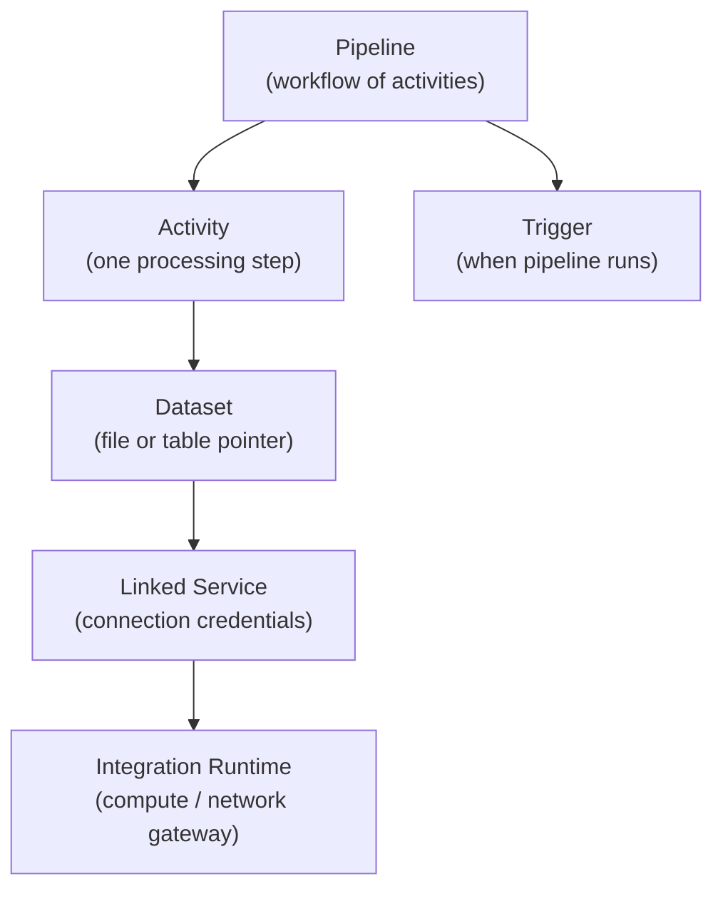

# Azure Data Factory (ADF)

Azure Data Factory is Azure's fully managed, serverless data integration and orchestration service. It automates ETL/ELT workflows across cloud and on-premises sources — connecting more than 100 native data connectors, scheduling and triggering pipeline runs, and calling external compute (Databricks, Synapse, Azure Functions) to perform transformations.

!!! warning "ADF is an orchestrator, not a transformation engine"
    ADF moves data and coordinates work. It is not a replacement for Apache Spark. For complex transformations, business logic, ML, or large-scale data reshaping, invoke a Databricks notebook or a Synapse Spark job from ADF — don't try to implement that logic inside Mapping Data Flows.

---

## Core Abstractions

Every ADF resource maps to one of five concepts:



| Abstraction | Analogy | What It Stores |
|---|---|---|
| **Linked Service** | Connection string | Endpoint URL, auth method, Key Vault references |
| **Dataset** | File/table pointer | Path, format, schema, references a Linked Service |
| **Activity** | Function call | The operation to perform (copy, lookup, notebook, etc.) |
| **Pipeline** | Workflow routine | Ordered graph of activities with branching and looping |
| **Integration Runtime** | Compute gateway | Where and how activities execute |
| **Trigger** | Cron / event listener | When the pipeline fires |

---

## Integration Runtime Types

The Integration Runtime (IR) is the underlying infrastructure that executes activities and provides network connectivity. Choose the right type based on where your data lives.

| IR Type | Where It Runs | Use Case |
|---|---|---|
| **Azure IR** | Managed by Microsoft; serverless, auto-scaling | Cloud-to-cloud movement (ADLS, SQL Azure, S3, REST APIs) |
| **Self-Hosted IR (SHIR)** | Your VM or on-premises server | On-prem SQL Server, private VNet resources, firewall-protected sources |
| **Azure-SSIS IR** | Managed cluster for SSIS | Running legacy SQL Server Integration Services packages unchanged |

!!! note "SHIR is required for on-premises sources"
    The Self-Hosted IR runs as an agent on a machine that has network access to your on-premises data source. ADF communicates with the SHIR over HTTPS — the SHIR initiates the outbound connection, so you do not need to open inbound firewall ports to your on-premises environment.

---

## Activity Types

### Data Movement

**Copy Activity** — the workhorse of ADF. Moves data from any supported source to any supported sink with configurable parallelism, column mapping, and data type conversion.

=== "ADF (JSON)"

    ```json
    {
      "name": "CopyOrdersToLanding",
      "type": "Copy",
      "inputs": [{ "referenceName": "SourceSQLDataset", "type": "DatasetReference" }],
      "outputs": [{ "referenceName": "LandingADLSDataset", "type": "DatasetReference" }],
      "typeProperties": {
        "source": { "type": "AzureSqlSource", "queryTimeout": "02:00:00" },
        "sink": {
          "type": "DelimitedTextSink",
          "storeSettings": { "type": "AzureBlobFSWriteSettings" },
          "formatSettings": { "type": "DelimitedTextWriteSettings", "fileExtension": ".csv" }
        },
        "enableStaging": false
      }
    }
    ```

=== "Pipeline Expression"

    ```
    Source:  Azure SQL Database  →  SELECT * FROM dbo.orders WHERE order_date = '@{pipeline().parameters.run_date}'
    Sink:    ADLS Gen2           →  sales/landing/orders_@{pipeline().parameters.run_date}.csv
    ```

### Metadata & Control Flow

**Lookup Activity** — reads a result set from a SQL table, JSON file, or Azure Storage. Returns a JSON array that downstream ForEach activities can iterate over. Classic use: read a config table listing which files or tables to process.

**Get Metadata Activity** — retrieves file or folder metadata without reading the data. Commonly used fields:

| Field Name | What It Returns |
|---|---|
| `exists` | Boolean — does the file/folder exist? |
| `size` | File size in bytes |
| `lastModified` | Last modified timestamp |
| `itemName` | File name |
| `childItems` | Array of child items in a folder |

**ForEach Activity** — iterates over an array. Wrap inner activities (typically a Copy Activity or Execute Pipeline) inside ForEach to process multiple items from a Lookup result dynamically.

```
@activity('LookupConfig').output.value   ← array passed to ForEach
@item().relativeURL                       ← current iteration value inside ForEach
```

**If Condition / Switch** — evaluate a Boolean expression and branch the pipeline. Use If Condition for binary True/False; Switch for multiple named cases (like a `CASE WHEN` statement).

**Validation Activity** — blocks pipeline execution until a file or dataset exists (with configurable timeout and sleep interval). Prevents downstream failures when upstream file drops are delayed.

**Fail Activity** — explicitly fails the pipeline run with a custom error message and error code. Use when a validation check fails and you want a clear failure reason in the monitoring logs.

**Wait Activity** — introduces a fixed delay between activities. Useful when a downstream system needs time to process before the next step queries it.

### Compute Invocation

**Databricks Notebook Activity** — executes a notebook in an Azure Databricks workspace. Can pass parameters as notebook base parameters (equivalent to `dbutils.widgets`). Returns the notebook exit value via `@activity('RunNotebook').output.runOutput`.

**Web Activity** — sends an HTTP request to any REST endpoint. Use to trigger Databricks jobs via the Jobs REST API, call Azure Functions, or invoke webhooks.

=== "ADF (JSON)"

    ```json
    {
      "name": "TriggerDatabricksJob",
      "type": "WebActivity",
      "typeProperties": {
        "method": "POST",
        "url": "https://<databricks-workspace>.azuredatabricks.net/api/2.1/jobs/run-now",
        "headers": { "Authorization": "Bearer @{linkedService().databricksToken}" },
        "body": { "job_id": 12345, "notebook_params": { "run_date": "@{pipeline().parameters.run_date}" } }
      }
    }
    ```

---

## Triggers

### Schedule Trigger

Fires on a recurrence defined by a cron expression. Supports many-to-many relationships — one trigger can activate multiple pipelines, and one pipeline can be associated with multiple triggers.

```json
{
  "name": "DailyAtTwoAM",
  "type": "ScheduleTrigger",
  "typeProperties": {
    "recurrence": {
      "frequency": "Day",
      "interval": 1,
      "startTime": "2025-01-01T02:00:00Z",
      "timeZone": "UTC"
    }
  }
}
```

### Tumbling Window Trigger

Fires over fixed, non-overlapping time windows. Each window has a defined start and end time, and the trigger maintains its own state — if a window is missed (e.g., ADF was paused), the trigger automatically backfills missed windows in order.

```
00:00 ─── 01:00   ← Window 1 (processed)
01:00 ─── 02:00   ← Window 2 (processing)
02:00 ─── 03:00   ← Window 3 (queued)
```

Key capabilities: **backfilling**, **dependency chaining** (Window N waits for Window N-1 to succeed), and strict 1-to-1 relationship with a pipeline.

!!! tip "Use Tumbling Window for historical reprocessing"
    If you need to reprocess three months of historical data, define a Tumbling Window trigger with a start date in the past — ADF will queue all missed windows and process them in sequence.

### Storage Event Trigger

Fires when a blob is created or deleted in an ADLS Gen2 container. Configured with a path prefix filter (`blobPathBeginsWith`) to limit which file arrivals fire the trigger. The trigger body carries `@triggerBody().fileName` and `@triggerBody().folderPath` — pass these as pipeline parameters to process the exact file that arrived.

```json
{
  "name": "OnOrdersFileArrival",
  "type": "BlobEventsTrigger",
  "typeProperties": {
    "blobPathBeginsWith": "/sales/blobs/landing/",
    "events": ["Microsoft.Storage.BlobCreated"],
    "scope": "/subscriptions/<sub>/resourceGroups/<rg>/providers/Microsoft.Storage/storageAccounts/<sa>"
  }
}
```

### Custom Event Trigger

Fires when a custom event is published to an Azure Event Grid topic. Use when an external application (order management system, data vendor API) needs to signal ADF that work is ready — without writing to storage first.

### Trigger Comparison

| Trigger | Fires On | Key Capability | Pipeline Relationship |
|---|---|---|---|
| **Schedule** | Calendar recurrence | Many-to-many, simple cron | Many pipelines per trigger |
| **Tumbling Window** | Fixed time windows | Backfilling + dependency chaining | 1:1 with pipeline |
| **Storage Event** | Blob created / deleted | Near-real-time event-driven ingestion | Many pipelines per trigger |
| **Custom Event** | Event Grid topic | External application signalling | Many pipelines per trigger |

---

## Parameters and Expressions

ADF uses a dynamic content language based on `@` expressions. Parameters flow from Trigger → Pipeline → Activity → Linked Service / Dataset.

```
@pipeline().parameters.run_date          ← pipeline-level parameter
@activity('LookupConfig').output.value   ← output of a previous activity
@triggerBody().fileName                  ← value from the trigger body (Storage Event)
@item().relativeURL                      ← current item inside ForEach loop
@concat('landing/', pipeline().parameters.run_date, '/orders.csv')
@if(equals(activity('GetMeta').output.exists, true), 'proceed', 'skip')
```

**Parameter inheritance chain:**

```
Trigger Body
    ↓  @triggerBody().fileName
Pipeline Parameter (filename)
    ↓  @pipeline().parameters.filename
Activity Base Parameter (filename → notebook widget)
    ↓  dbutils.widgets.get("filename")
Notebook Logic
```

---

## Azure Key Vault Integration

Credentials must never appear as plaintext inside Linked Service definitions. ADF supports two Key Vault integration modes:

=== "ADF Linked Service (KV Reference)"

    ```json
    {
      "name": "SqlServerLinkedService",
      "type": "AzureSqlDatabase",
      "typeProperties": {
        "connectionString": "Server=tcp:myserver.database.windows.net;Database=mydb;",
        "password": {
          "type": "AzureKeyVaultSecret",
          "store": { "referenceName": "AzureKeyVaultLinkedService", "type": "LinkedServiceReference" },
          "secretName": "sql-password"
        }
      }
    }
    ```

=== "Key Vault Linked Service"

    ```json
    {
      "name": "AzureKeyVaultLinkedService",
      "type": "AzureKeyVault",
      "typeProperties": {
        "baseUrl": "https://my-keyvault.vault.azure.net/"
      }
    }
    ```

!!! warning "Grant ADF Managed Identity access to Key Vault"
    ADF accesses Key Vault using its system-assigned Managed Identity. In Key Vault → Access Policies, grant the ADF Managed Identity **Get** and **List** permissions on secrets. Never use a service principal password for this — Managed Identity is credential-free.

---

## Metadata-Driven Pipeline Pattern

Instead of creating one pipeline per source table or file, build a single parameterized pipeline driven by a configuration table. This scales to hundreds of ingestion sources with a single ADF pipeline.

**Config table in Azure SQL:**

```sql
CREATE TABLE pipeline_config (
    source_name    VARCHAR(100),
    source_type    VARCHAR(50),   -- 'sql', 'adls', 'http'
    source_query   VARCHAR(MAX),
    sink_path      VARCHAR(500),
    sink_format    VARCHAR(20),   -- 'parquet', 'csv', 'delta'
    is_active      BIT
);

INSERT INTO pipeline_config VALUES
  ('orders',     'sql',  'SELECT * FROM dbo.orders',     'bronze/orders/',     'parquet', 1),
  ('customers',  'sql',  'SELECT * FROM dbo.customers',  'bronze/customers/',  'parquet', 1),
  ('products',   'adls', NULL,                           'bronze/products/',   'parquet', 1);
```

**ADF pipeline structure:**

```
Lookup Activity
  → SELECT * FROM pipeline_config WHERE is_active = 1
        ↓
ForEach Activity (items: @activity('LookupConfig').output.value)
        ↓
  [Inner Activities]
  Copy Activity
    Source:  @item().source_type  →  @item().source_query
    Sink:    ADLS Gen2            →  @item().sink_path
```

!!! tip "Metadata-driven pipelines reduce maintenance by 90%"
    Adding a new source is a single INSERT into the config table — no new ADF pipeline required. Schema changes in source systems only affect the `source_query` column in the config, not the ADF pipeline definition.

---

## Monitoring and Alerting

**ADF Monitor tab** — the primary operations view. Shows all pipeline runs with status, duration, trigger name, and activity-level drill-down.

Key monitoring capabilities:

| Feature | Where | What to Check |
|---|---|---|
| Pipeline run history | Monitor → Pipeline runs | Duration trends, failure rates |
| Activity-level detail | Click any run → Activity runs | Which activity failed, error message |
| Trigger run history | Monitor → Trigger runs | Whether triggers fired as expected |
| Alert rules | Monitor → Alerts | Email on pipeline failure |
| Retry configuration | Activity → Settings | Max retries, retry interval |

**Retry configuration example:**

```json
{
  "policy": {
    "timeout": "0.12:00:00",
    "retry": 3,
    "retryIntervalInSeconds": 30,
    "secureOutput": false
  }
}
```

**Activity dependency conditions** — each activity can define which upstream conditions must be met before it fires:

| Condition | Meaning |
|---|---|
| **Succeeded** | Run only if the upstream activity succeeded |
| **Failed** | Run only if the upstream activity failed (error handling branch) |
| **Completed** | Run regardless of outcome (cleanup, logging) |
| **Skipped** | Run if the upstream activity was skipped |

Use the **Failed** condition to route errors to a notification activity or quarantine path without stopping the entire pipeline run.

---

## Production Pipeline Checklist

- [ ] All credentials stored in Azure Key Vault — no plaintext in Linked Services
- [ ] Pipelines parameterized — no hardcoded file paths, dates, or table names
- [ ] Validation Activity guards against missing files before Copy Activity fires
- [ ] Get Metadata → If Condition confirms file size > 0 before processing
- [ ] Fail Activity used (with meaningful message) when business rules fail
- [ ] Retry policy set on Copy and Databricks activities
- [ ] Alert rule configured to email on pipeline failure
- [ ] Tumbling Window trigger (not Schedule) when backfilling is a requirement
- [ ] Storage Event Trigger passes `@triggerBody().fileName` to pipeline parameter
- [ ] Master pipeline calls child pipelines via Execute Pipeline Activity
