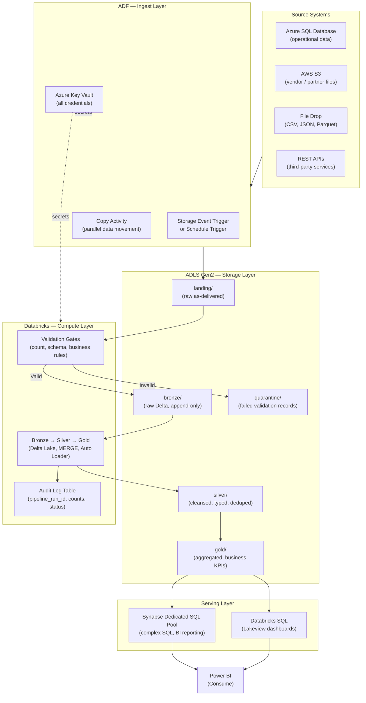
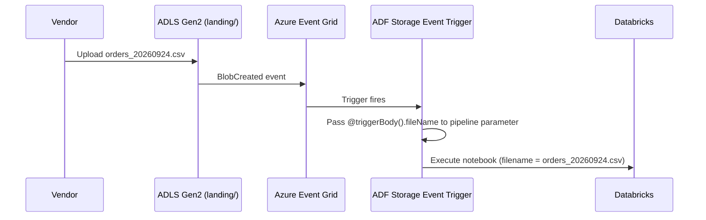
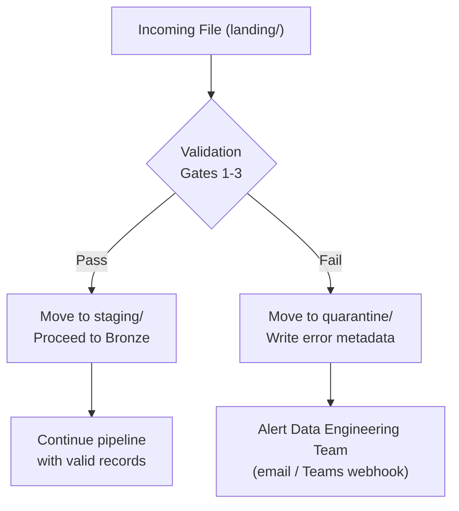
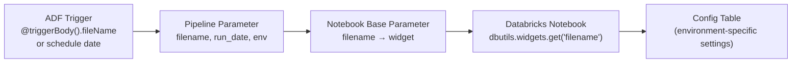
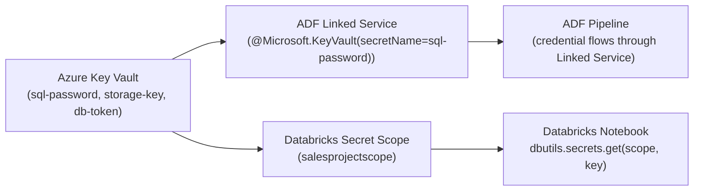
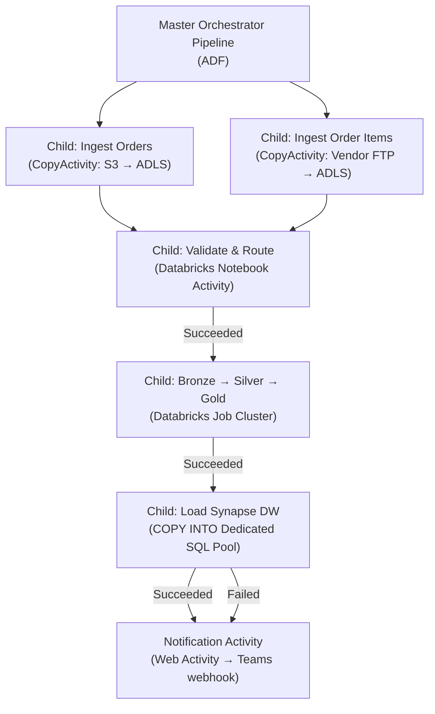

# End-to-End Pipeline Design

An enterprise data pipeline is not a single tool — it is a coordinated system where orchestration, compute, storage, and security each play a defined role. This page describes how to assemble those components into a production-grade, event-driven pipeline that is idempotent, observable, and resilient.

---

## Reference Architecture



---

## Event-Driven vs. Scheduled Ingestion

### Event-Driven (Storage Event Trigger)

React to data arrival rather than polling on a clock. An ADF Storage Event Trigger fires within seconds of a file landing in ADLS Gen2.



**ADF trigger configuration:**

```json
{
  "name": "OnOrdersFileArrival",
  "type": "BlobEventsTrigger",
  "typeProperties": {
    "blobPathBeginsWith": "/sales/blobs/landing/",
    "events": ["Microsoft.Storage.BlobCreated"],
    "scope": "/subscriptions/<sub>/resourceGroups/<rg>/providers/Microsoft.Storage/storageAccounts/mysa"
  },
  "pipelines": [{
    "pipelineReference": { "referenceName": "MasterOrchestrator" },
    "parameters": { "filename": "@triggerBody().fileName" }
  }]
}
```

### Scheduled Ingestion

Use for systems that batch-export data on a known schedule (nightly database extracts, daily vendor feeds).

```
Cron: 0 2 * * *   (daily at 02:00 UTC)
       ↓
ADF Schedule Trigger
       ↓
Pipeline parameter: run_date = @formatDateTime(trigger().scheduledTime, 'yyyy-MM-dd')
       ↓
Copy Activity: SELECT * FROM orders WHERE order_date = @{pipeline().parameters.run_date}
```

!!! tip "Tumbling Window for reliable backfilling"
    If your scheduled pipeline can be paused for maintenance or an outage, use a Tumbling Window trigger instead of Schedule. Tumbling Window tracks each time window as a discrete unit — ADF automatically queues and processes any missed windows when the trigger resumes.

---

## Idempotency Design

Every step in a production pipeline must be **idempotent** — running it twice must produce the same result as running it once. This is the foundation of safe retries, backfills, and incident recovery.

### Idempotent Ingestion — COPY INTO / Auto Loader

=== "ADF COPY INTO (Synapse)"

    ```sql
    -- COPY INTO is idempotent when the target table has a primary key constraint
    -- or when you truncate-and-reload the staging table before each load
    TRUNCATE TABLE dbo.orders_staging;

    COPY INTO dbo.orders_staging
    FROM 'https://mysa.dfs.core.windows.net/landing/orders_*.csv'
    WITH (FILE_TYPE = 'CSV', FIRSTROW = 2, FIELDTERMINATOR = ',');
    ```

=== "PySpark (Auto Loader)"

    ```python
    # Auto Loader tracks which files have been processed via checkpoint
    # Re-running will not re-ingest already-processed files
    (
        spark.readStream
            .format("cloudFiles")
            .option("cloudFiles.format", "csv")
            .option("cloudFiles.schemaLocation", "/mnt/bronze/_schema/orders")
            .load("/mnt/landing/orders/")
        .writeStream
            .format("delta")
            .option("checkpointLocation", "/mnt/bronze/_checkpoint/orders")
            .outputMode("append")
            .table("bronze.orders")
    )
    ```

### Idempotent Upserts — MERGE

For Silver and Gold layers where the same record may arrive in multiple batches, use MERGE (upsert) instead of INSERT.

=== "PySpark (Delta MERGE)"

    ```python
    from delta.tables import DeltaTable

    silver_table = DeltaTable.forName(spark, "silver.orders")

    silver_table.alias("target").merge(
        source=new_orders_df.alias("source"),
        condition="target.order_id = source.order_id"
    ).whenMatchedUpdateAll() \
     .whenNotMatchedInsertAll() \
     .execute()
    ```

=== "SQL (Delta MERGE)"

    ```sql
    MERGE INTO silver.orders AS target
    USING new_orders AS source
    ON target.order_id = source.order_id
    WHEN MATCHED THEN UPDATE SET *
    WHEN NOT MATCHED THEN INSERT *;
    ```

!!! warning "Append-only Bronze, MERGE at Silver and above"
    Bronze is the permanent raw archive — always append, never overwrite. Apply MERGE semantics from Silver onward, where deduplication and corrections belong.

---

## Validation Gates

Validation runs after ingestion into the landing zone and before promotion to Bronze. A validation failure routes the file to quarantine and raises an alert rather than silently poisoning downstream tables.

### Gate 1 — Record Count Validation

Verify that the number of records ingested matches the expected count from the source system.

```python
source_count = get_source_count()           # call source API or read ADF activity output
loaded_df = spark.read.format("csv") \
    .option("header", "true") \
    .load(f"/mnt/landing/{filename}")

loaded_count = loaded_df.count()

if loaded_count != source_count:
    quarantine_file(filename, f"Count mismatch: expected {source_count}, got {loaded_count}")
    dbutils.notebook.exit('{"errorFlg": "true", "errorMsg": "Record count mismatch"}')
```

### Gate 2 — Schema Validation

Confirm that the incoming file contains all required columns with compatible data types.

```python
EXPECTED_COLUMNS = {"order_id", "order_date", "customer_id", "order_status", "order_amount"}
actual_columns   = set(loaded_df.columns)
missing_columns  = EXPECTED_COLUMNS - actual_columns

if missing_columns:
    quarantine_file(filename, f"Missing columns: {missing_columns}")
    dbutils.notebook.exit('{"errorFlg": "true", "errorMsg": "Schema validation failed"}')
```

### Gate 3 — Business Rule Validation

Check allowed values, referential integrity, and uniqueness constraints.

```python
# Uniqueness: no duplicate order_ids
total_count    = loaded_df.count()
distinct_count = loaded_df.select("order_id").distinct().count()

if total_count != distinct_count:
    quarantine_file(filename, "Duplicate order_id values detected")
    dbutils.notebook.exit('{"errorFlg": "true", "errorMsg": "Duplicate order_id detected"}')

# Referential integrity: all order_status values must be in the allowed list
valid_status_df = spark.read.jdbc(
    url=jdbc_url,
    table="dbo.valid_order_status",
    properties=connection_properties
)

invalid_records = loaded_df.join(
    valid_status_df,
    loaded_df.order_status == valid_status_df.status_name,
    "left_anti"
)

if invalid_records.count() > 0:
    quarantine_file(filename, "Invalid order_status values present")
    dbutils.notebook.exit('{"errorFlg": "true", "errorMsg": "Status validation failed"}')
```

---

## Error Handling Pattern

Failed records never silently disappear — they go to a quarantine path with structured error metadata.



**Quarantine table schema:**

```sql
CREATE TABLE audit.pipeline_quarantine (
    quarantine_id      BIGINT IDENTITY(1,1),
    pipeline_run_id    VARCHAR(100)   NOT NULL,
    filename           VARCHAR(500)   NOT NULL,
    error_type         VARCHAR(100)   NOT NULL,   -- 'SCHEMA', 'COUNT', 'BUSINESS_RULE'
    error_message      VARCHAR(MAX),
    record_count       BIGINT,
    quarantine_path    VARCHAR(500),
    quarantined_at     DATETIME2      DEFAULT GETUTCDATE()
);
```

**ADF dependency to call error handler:**

In ADF, connect the validation Databricks activity to a notification activity using the **Failed** dependency condition:

```
[Validate Notebook]  --Succeeded-->  [Promote to Bronze]
[Validate Notebook]  --Failed-->     [Send Alert Web Activity]
```

---

## Parameterization — Environment and Date Passing

Parameters flow from the trigger through ADF into Databricks notebooks. No value should be hardcoded at any layer.



=== "ADF (JSON)"

    ```json
    {
      "name": "RunValidationNotebook",
      "type": "DatabricksNotebook",
      "typeProperties": {
        "notebookPath": "/production/validate_orders",
        "baseParameters": {
          "filename":  "@{pipeline().parameters.filename}",
          "run_date":  "@{pipeline().parameters.run_date}",
          "env":       "@{pipeline().parameters.env}"
        }
      }
    }
    ```

=== "PySpark"

    ```python
    # In the Databricks notebook
    dbutils.widgets.text("filename", "",       "Incoming Filename")
    dbutils.widgets.text("run_date", "",       "Run Date (YYYY-MM-DD)")
    dbutils.widgets.text("env",      "dev",    "Environment")

    filename = dbutils.widgets.get("filename")
    run_date = dbutils.widgets.get("run_date")
    env      = dbutils.widgets.get("env")

    # Resolve environment-specific paths from config table
    config_df = spark.sql(f"SELECT * FROM config.pipeline_settings WHERE env = '{env}'")
    ```

---

## Secrets Management

Credentials follow a strict path: Key Vault → ADF Linked Service or Databricks Secret Scope → notebook/activity. They are never hardcoded anywhere.



```python
# Databricks — fetch storage key from Key Vault-backed secret scope
storage_key = dbutils.secrets.get(
    scope="salesprojectscope",
    key="storage-account-key"
)

# Fetch SQL password
db_password = dbutils.secrets.get(
    scope="salesprojectscope",
    key="sql-password"
)

jdbc_url = (
    f"jdbc:sqlserver://{db_server}.database.windows.net:1433;"
    f"database={db_name};"
)
connection_properties = {
    "user": db_user,
    "password": db_password,
    "driver": "com.microsoft.sqlserver.jdbc.SQLServerDriver"
}
```

---

## Audit Logging

Every pipeline run must be traceable. Write audit records at each layer boundary — landing → bronze, bronze → silver, silver → gold.

```python
# Write audit record at the end of each notebook stage
audit_record = spark.createDataFrame([{
    "pipeline_run_id":  dbutils.widgets.get("run_id"),
    "stage":            "bronze",
    "filename":         filename,
    "records_read":     source_count,
    "records_written":  bronze_count,
    "records_rejected": source_count - bronze_count,
    "status":           "SUCCESS",
    "start_time":       stage_start,
    "end_time":         datetime.utcnow().isoformat(),
    "error_message":    None
}])

audit_record.write \
    .format("delta") \
    .mode("append") \
    .saveAsTable("audit.pipeline_run_log")
```

**Audit log table schema:**

```sql
CREATE TABLE audit.pipeline_run_log (
    pipeline_run_id    STRING     NOT NULL,
    stage              STRING     NOT NULL,   -- 'landing', 'bronze', 'silver', 'gold'
    filename           STRING,
    records_read       BIGINT,
    records_written    BIGINT,
    records_rejected   BIGINT,
    status             STRING     NOT NULL,   -- 'SUCCESS', 'FAILED', 'PARTIAL'
    start_time         TIMESTAMP,
    end_time           TIMESTAMP,
    error_message      STRING
)
USING DELTA
PARTITIONED BY (stage);
```

---

## Orchestration Dependencies

ADF activities wire together in a dependency graph using four conditions:

| Condition | When the Downstream Activity Runs |
|---|---|
| **Succeeded** | Upstream activity completed successfully |
| **Failed** | Upstream activity failed (use for error-handling branches) |
| **Completed** | Always — regardless of success or failure (use for cleanup/logging) |
| **Skipped** | Upstream activity was skipped because its own dependency condition was not met |

**Example: validation → promote or quarantine:**

```
GetMetadata  --Succeeded-->  IfCondition (size > 0?)
                                True  -->  RunValidationNotebook  --Succeeded-->  PromoteToBronze
                                           RunValidationNotebook  --Failed-->     WriteQuarantine
                                False -->  FailActivity ("Empty file received")
IfCondition  --Completed-->  WriteAuditLog   ← always writes regardless of branch taken
```

---

## Master Orchestrator Pattern

Large enterprise pipelines are composed of modular child pipelines. One master pipeline coordinates sequencing while each child pipeline handles a discrete concern.



**Benefits of modular child pipelines:**

- Each child pipeline can be developed, tested, and deployed independently
- Failed child pipelines can be retried without rerunning the entire workflow
- Multiple master pipelines can reuse the same child pipeline (e.g., the Validate child is shared across multiple ingest pipelines)
- Monitoring is cleaner — each child pipeline has its own run history

---

## Full Production Notebook — Reference Pattern

The following structure is the standard template for a production Databricks validation and enrichment notebook called by ADF.

```python
# ── STEP 1: Parameter retrieval and idempotent mount ──────────────────────
dbutils.widgets.text("filename", "", "Incoming Filename")
dbutils.widgets.text("run_id",   "", "ADF Pipeline Run ID")

filename = dbutils.widgets.get("filename")
run_id   = dbutils.widgets.get("run_id")

storage_key = dbutils.secrets.get(scope="salesprojectscope", key="storage-account-key")

mount_point = "/mnt/sales"
if not any(m.mountPoint == mount_point for m in dbutils.fs.mounts()):
    dbutils.fs.mount(
        source=f"wasbs://sales@mysa.blob.core.windows.net",
        mount_point=mount_point,
        extra_configs={f"fs.azure.account.key.mysa.blob.core.windows.net": storage_key}
    )

# ── STEP 2: Load file and validate ───────────────────────────────────────
import datetime
stage_start = datetime.datetime.utcnow().isoformat()

file_path = f"{mount_point}/landing/{filename}"
df = spark.read.format("csv").option("header", "true").option("inferSchema", "true").load(file_path)

total_count    = df.count()
distinct_count = df.select("order_id").distinct().count()

if total_count != distinct_count:
    dbutils.fs.mv(file_path, f"{mount_point}/quarantine/{filename}")
    dbutils.notebook.exit('{"errorFlg": "true", "errorMsg": "Duplicate order_id detected"}')

# ── STEP 3: Dynamic SQL lookup validation ────────────────────────────────
db_password = dbutils.secrets.get(scope="salesprojectscope", key="sql-password")
jdbc_url    = "jdbc:sqlserver://myserver.database.windows.net:1433;database=mydb;"
conn_props  = {"user": "myuser", "password": db_password,
               "driver": "com.microsoft.sqlserver.jdbc.SQLServerDriver"}

valid_status_df = spark.read.jdbc(url=jdbc_url, table="dbo.valid_order_status", properties=conn_props)
invalid_records = df.join(valid_status_df, df.order_status == valid_status_df.status_name, "left_anti")

if invalid_records.count() > 0:
    dbutils.fs.mv(file_path, f"{mount_point}/quarantine/{filename}")
    dbutils.notebook.exit('{"errorFlg": "true", "errorMsg": "Invalid order_status values"}')

# ── STEP 4: Promote to staging and enrich ────────────────────────────────
dbutils.fs.mv(file_path, f"{mount_point}/staging/{filename}")

order_items_df = spark.read.json(f"{mount_point}/order_items/order_items.json")
customers_df   = spark.read.jdbc(url=jdbc_url, table="dbo.customers", properties=conn_props)

enriched = (
    df.join(order_items_df, df.order_id == order_items_df.order_item_order_id)
      .join(customers_df,   df.customer_id == customers_df.customer_id)
      .groupBy("customers_df.customer_id", "customer_fname", "customer_lname")
      .agg({"order_id": "count", "order_item_subtotal": "sum"})
)

enriched.write.jdbc(url=jdbc_url, table="dbo.customer_sales_summary",
                    mode="append", properties=conn_props)

# ── STEP 5: Write audit record ────────────────────────────────────────────
audit = spark.createDataFrame([{
    "pipeline_run_id": run_id, "stage": "silver", "filename": filename,
    "records_read": total_count, "records_written": enriched.count(),
    "status": "SUCCESS", "start_time": stage_start,
    "end_time": datetime.datetime.utcnow().isoformat(), "error_message": None
}])
audit.write.format("delta").mode("append").saveAsTable("audit.pipeline_run_log")

dbutils.notebook.exit('{"errorFlg": "false", "errorMsg": "Pipeline executed successfully"}')
```

---

## Production Readiness Checklist

- [ ] All pipeline steps are idempotent — safe to re-run without side effects
- [ ] Validation gates enforce count, schema, and business rules before data promotion
- [ ] Failed validation routes to quarantine with structured error metadata
- [ ] Alert fires on pipeline failure (ADF alert rule + Teams webhook)
- [ ] Credentials sourced from Azure Key Vault at every layer
- [ ] ADF parameters pass trigger context (filename, run_date) into Databricks widgets
- [ ] Audit log written at each medallion layer boundary
- [ ] Master pipeline calls modular child pipelines via Execute Pipeline Activity
- [ ] Retry policy set on every Databricks and Copy activity
- [ ] Tumbling Window trigger used where backfilling must be guaranteed
- [ ] MERGE semantics used at Silver/Gold — never blind overwrite
- [ ] Auto Loader with checkpoint used for Bronze ingestion — file tracking built in
