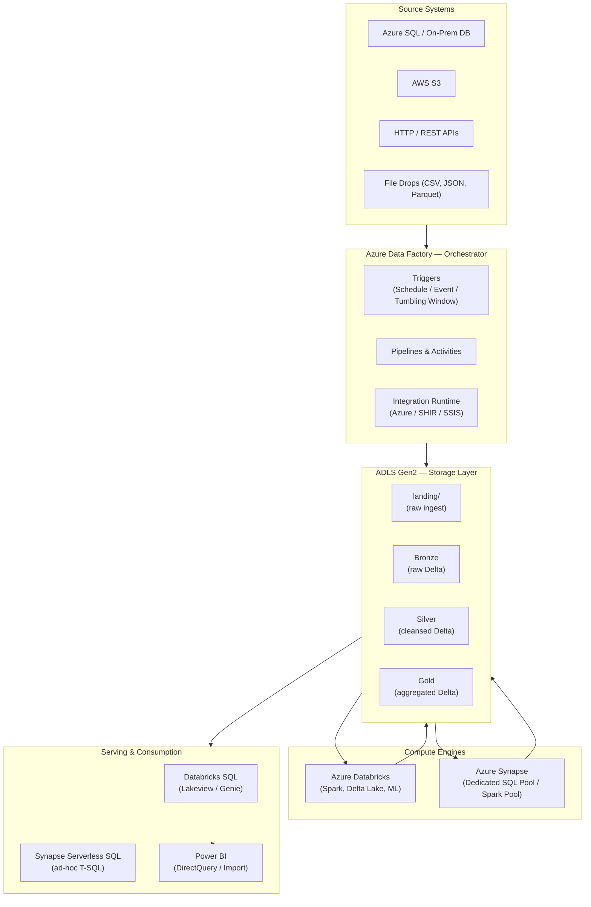
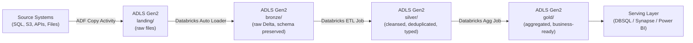
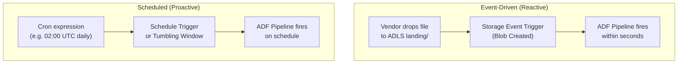
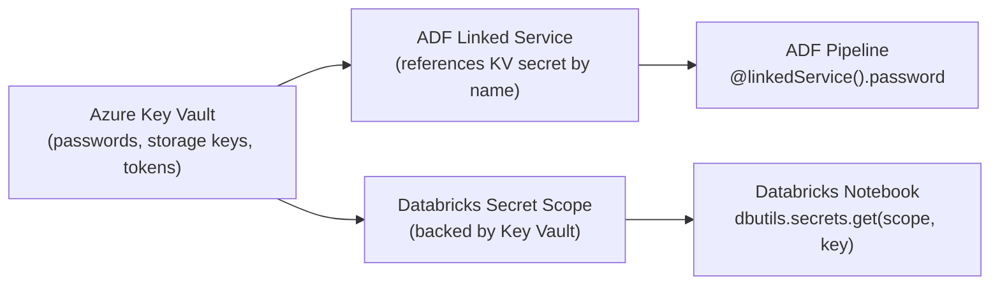

# Pipeline Orchestration

Modern enterprise data platforms separate concerns across three layers: **orchestration**, **compute**, and **storage**. This module covers how Azure's native services snap together into a production data pipeline — Azure Data Factory (ADF) driving the workflow, Databricks and Synapse performing the heavy computation, and ADLS Gen2 providing the durable, cost-effective storage beneath everything.

---

## The Orchestration Landscape

---

## Core Services at a Glance

| Service | Role | When to Reach For It |
|---|---|---|
| **Azure Data Factory** | Orchestrator — schedules, triggers, moves data, calls compute | Connecting 100+ sources, metadata-driven ETL, event-driven ingestion |
| **Azure Databricks** | Compute — Spark, Delta Lake, ML, streaming | Python-heavy ETL, Delta transformations, ML pipelines, complex joins |
| **Azure Synapse Dedicated SQL** | Compute — MPP SQL data warehouse | Structured DW workloads, complex SQL, BI reporting at scale |
| **Azure Synapse Serverless SQL** | Compute — query-in-place on Data Lake | Ad-hoc exploration, ETL result verification, pay-per-query |
| **ADLS Gen2** | Storage — hierarchical namespace object store | All raw and processed data; bronze/silver/gold Medallion layers |
| **Azure Key Vault** | Security — secret store | All credentials, connection strings, storage keys |

!!! info "ADF is the conductor, not the instrument"
    ADF's job is to coordinate — it moves data between systems and triggers compute jobs. It does not replace Apache Spark for complex transformations. When you find yourself writing business logic inside ADF Mapping Data Flows, that logic probably belongs in a Databricks notebook.

---

## The Medallion Pattern in Azure

The Medallion Architecture (Bronze → Silver → Gold) is the standard layering convention for Delta Lake on ADLS Gen2. ADF handles ingestion into the landing zone; Databricks promotes data through the layers.

| Layer | Format | Transformation | Owner |
|---|---|---|---|
| **Landing** | Native (CSV, JSON, Parquet) | None — raw as-delivered | ADF |
| **Bronze** | Delta Lake | Schema enforcement, append-only | Databricks |
| **Silver** | Delta Lake | Dedup, type casting, NULL handling, joins | Databricks |
| **Gold** | Delta Lake | Business aggregations, KPIs, denormalized facts | Databricks |

---

## Event-Driven vs. Scheduled Ingestion

Two triggering patterns dominate production pipelines:

!!! tip "Prefer event-driven when latency matters"
    Storage Event Triggers react within seconds of a file landing. Schedule Triggers are simpler to reason about but introduce up to one full schedule-interval of latency. Use Tumbling Window Triggers when you need both scheduling *and* the ability to backfill missed historical windows.

---

## Security Architecture

No credential should ever appear as plaintext inside a pipeline definition, notebook, or configuration file. The pattern is:

---

## Module Contents

| Page | What You Will Learn |
|---|---|
| [Azure Data Factory](adf.md) | ADF architecture, all activity types, triggers, parameters, Key Vault integration, metadata-driven patterns |
| [Azure Synapse Analytics](synapse.md) | Dedicated SQL Pool (MPP), Serverless SQL Pool, Spark Pool, distribution strategies, COPY INTO, CTAS |
| [End-to-End Pipeline Design](e2e-pipeline.md) | Full reference architecture, idempotency, validation gates, error handling, audit logging, master orchestrator pattern |
