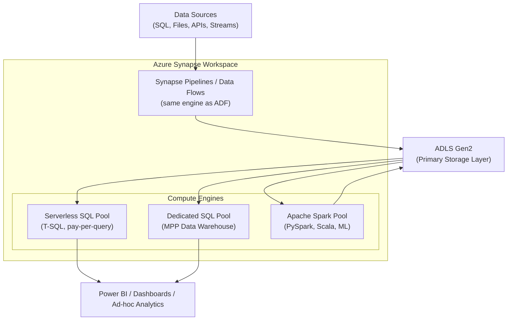
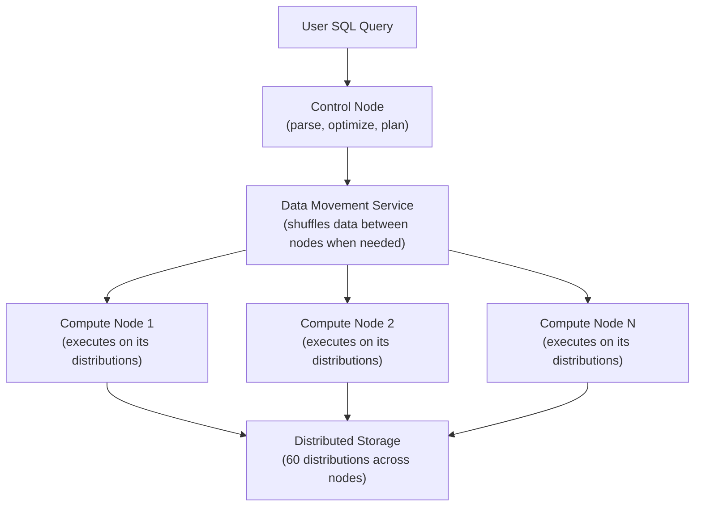
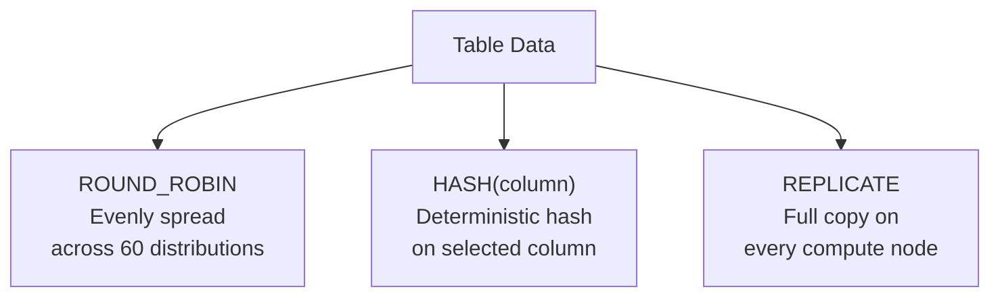
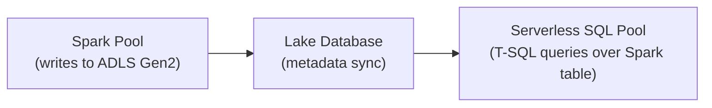
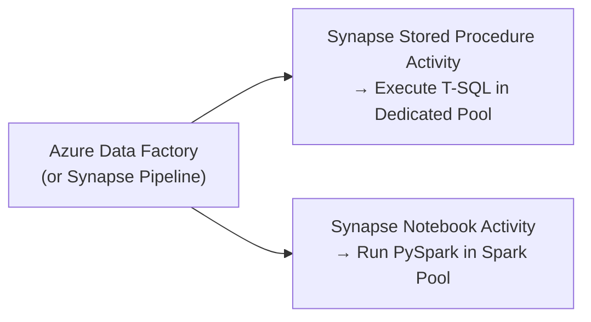

# Azure Synapse Analytics

Azure Synapse Analytics is a unified enterprise analytics platform that combines data ingestion, warehousing, big data processing, and SQL analytics into a single workspace. A Synapse workspace uses ADLS Gen2 as its shared storage layer, and three distinct compute engines run against that shared storage depending on the workload.

---

## Platform Architecture



| Compute Engine | What It Is | Best For |
|---|---|---|
| **Serverless SQL Pool** | On-demand T-SQL over ADLS Gen2 | Ad-hoc exploration, ETL verification, pay-per-query |
| **Dedicated SQL Pool** | MPP data warehouse (formerly SQL DW) | Enterprise DW workloads, complex SQL, BI at scale |
| **Apache Spark Pool** | Managed Spark cluster with auto-pause | Big Data processing, ML, PySpark/Scala ETL |

---

## OLTP vs. OLAP — Why a Dedicated Warehouse?

Standard relational databases (MySQL, PostgreSQL) are optimized for OLTP — small, frequent row-level transactions. Analytical workloads are fundamentally different and need a purpose-built system.

| Feature | OLTP (e.g. MySQL) | OLAP / Data Warehouse (e.g. Synapse Dedicated) |
|---|---|---|
| Primary purpose | Operational transactions | Analytics and reporting |
| Data scope | Current operational data | Historical analytical data |
| Schema style | Highly normalized | Often denormalized (star / snowflake schema) |
| Typical query | Single-record lookups | Aggregations over millions of rows |
| Scaling model | Vertical (bigger server) | Massively parallel (distributed compute) |
| Concurrent writes | High throughput | Low — optimized for reads |

!!! info "Resource contention is why you need separation"
    Running a `GROUP BY` over 10 billion rows on the same database that serves your application will saturate CPU and degrade transaction latency. Dedicated SQL Pool offloads analytics to purpose-built MPP compute.

---

## Serverless SQL Pool

The Serverless SQL Pool provides on-demand T-SQL analytics directly over files stored in ADLS Gen2. No cluster provisioning — queries execute on demand and you pay per terabyte of data scanned.

### OPENROWSET — Query Files Directly

`OPENROWSET` reads files from ADLS Gen2 without creating any database objects. Ideal for exploration and one-off queries.

```sql
-- Query a Parquet file directly from ADLS Gen2
SELECT TOP 100
    order_id,
    order_date,
    customer_id,
    order_status
FROM OPENROWSET(
    BULK 'https://mysa.dfs.core.windows.net/raw/orders.parquet',
    FORMAT = 'PARQUET'
) AS orders_data;
```

!!! tip "Use Parquet or ORC to minimize cost"
    Serverless SQL Pool charges by the amount of data scanned. Columnar formats (Parquet, ORC) allow column pruning and predicate pushdown — a query selecting 3 of 50 columns from a Parquet file scans roughly 6% of the data compared to CSV.

### External Tables — Reusable Structures

External tables create a persistent logical definition over files, allowing repeated queries without repeating the OPENROWSET syntax. The data stays in ADLS Gen2.

```sql
-- Step 1: Security foundation
CREATE MASTER KEY ENCRYPTION BY PASSWORD = 'StrongPassword123!';

-- Step 2: Scoped credential (SAS token stored here)
CREATE DATABASE SCOPED CREDENTIAL SasToken
WITH
    IDENTITY = 'SHARED ACCESS SIGNATURE',
    SECRET = 'sv=2020-08-04&ss=b&srt=sco&sp=rwdlacx&se=2026-12-31...';

-- Step 3: External data source (points to ADLS container)
CREATE EXTERNAL DATA SOURCE ExtDataSrc
WITH (
    LOCATION = 'https://mysa.dfs.core.windows.net/raw',
    CREDENTIAL = SasToken
);

-- Step 4: File format definition
CREATE EXTERNAL FILE FORMAT CsvFormat
WITH (
    FORMAT_TYPE = DELIMITEDTEXT,
    FORMAT_OPTIONS (
        FIELD_TERMINATOR = ',',
        FIRST_ROW = 2,
        USE_TYPE_DEFAULT = FALSE
    )
);

-- Step 5: External table — queryable like a regular table
CREATE EXTERNAL TABLE dbo.orders_ext (
    order_id       BIGINT,
    order_date     NVARCHAR(4000),
    customer_id    BIGINT,
    order_status   NVARCHAR(4000)
)
WITH (
    LOCATION = 'orders.csv',
    DATA_SOURCE = ExtDataSrc,
    FILE_FORMAT  = CsvFormat
);

-- Now query it like a regular table
SELECT order_status, COUNT(*) AS cnt
FROM dbo.orders_ext
GROUP BY order_status;
```

!!! warning "Serverless SQL Pool cannot create managed tables"
    Serverless SQL Pool is a read-only lens over your Data Lake. You cannot `CREATE TABLE` (managed) inside it — only `CREATE EXTERNAL TABLE`. For writable table storage, use Dedicated SQL Pool or Databricks Delta Lake.

---

## Dedicated SQL Pool

The Dedicated SQL Pool is an enterprise-scale MPP (Massively Parallel Processing) data warehouse. It distributes data and computation across 60 fixed logical distributions, enabling parallel query execution across multiple compute nodes.

### Architecture



| Component | Role |
|---|---|
| **Control Node** | Receives queries, generates execution plan, coordinates work |
| **Compute Nodes** | Execute query operations against their assigned distributions |
| **Data Movement Service (DMS)** | Transfers data between compute nodes for joins and aggregations |
| **Distributions (60)** | Fixed logical data partitions spread across compute nodes |
| **DWUs** | Data Warehousing Units — scale from DW100c to DW30000c |

!!! note "DMS is the performance bottleneck to minimize"
    Data Movement between compute nodes is expensive. Choosing distribution keys that co-locate join partners on the same node eliminates DMS shuffles for those joins — often the single biggest performance lever.

### Scale Up / Down / Pause

```sql
-- Scale up to more compute (takes ~60 seconds)
ALTER DATABASE mysynapsedw
SET SERVICE_OBJECTIVE = 'DW2000c';

-- Scale down during off-hours
ALTER DATABASE mysynapsedw
SET SERVICE_OBJECTIVE = 'DW500c';
```

Pause the Dedicated SQL Pool from the Azure portal or via PowerShell to eliminate compute charges when the warehouse is not in use. Storage charges continue while paused.

---

## Table Distribution Strategies

Distribution determines how the 60 logical partitions are assigned rows. The right choice eliminates unnecessary DMS shuffles.



| Distribution | How It Works | DMS for Joins | Best Use Case |
|---|---|---|---|
| **ROUND_ROBIN** | Rows distributed evenly in sequence | Required for most joins | Staging tables, temporary ingestion |
| **HASH(col)** | Deterministic hash on chosen column; same key → same distribution | Eliminated when both tables hash on the same key | Large fact tables (orders, transactions) |
| **REPLICATE** | Full copy of table stored on every compute node | Eliminated — data is local | Small dimension tables (< ~2 GB) |

!!! tip "Interview memory trick"
    Round-Robin → Load fast. Hash → Join efficiently. Replicate → Small table everywhere.

**Choosing a HASH key:**

- Pick the column most frequently used as a JOIN key (usually a foreign key like `customer_id` or `order_id`)
- Avoid columns with high NULL rates or very low cardinality (e.g. a boolean flag) — rows with the same hash key land in the same distribution, causing skew
- Hash distribution pays off only for large tables (> 60 million rows)

---

## Table Types and Index Strategies

| Table Type | Index | Use Case |
|---|---|---|
| **Heap** | No index — rows appended in arrival order | Staging tables: fast load, no maintenance overhead |
| **Clustered Columnstore Index (CCI)** | Column-group compressed storage | Default for fact tables; optimal compression and scan speed |
| **Clustered Index** | Row-oriented B-tree index | Small lookup / dimension tables where point-lookups dominate |

---

## High-Speed Ingestion

Standard `INSERT` statements are single-threaded and unsuitable for loading millions of rows. Dedicated SQL Pool provides two parallel ingestion mechanisms.

### CTAS — CREATE TABLE AS SELECT

The recommended way to create and populate a table in one atomic step. The query is distributed across all compute nodes.

```sql
-- Staging table: fast load from external source (round-robin, heap)
CREATE TABLE dbo.orders_staging
WITH (
    DISTRIBUTION = ROUND_ROBIN,
    HEAP
)
AS
SELECT * FROM dbo.orders_ext;   -- orders_ext is an external table over ADLS

-- Production fact table: hash distribution + CCI compression
CREATE TABLE dbo.orders_fact
WITH (
    DISTRIBUTION = HASH(customer_id),
    CLUSTERED COLUMNSTORE INDEX
)
AS
SELECT * FROM dbo.orders_staging;
```

### COPY INTO — Simplified Parallel Ingestion

`COPY INTO` loads data directly from ADLS Gen2 into a Dedicated SQL Pool table without requiring external database objects. It is newer, simpler, and more flexible than PolyBase.

```sql
-- First: create the target table
CREATE TABLE dbo.orders_internal (
    order_id       BIGINT        NOT NULL,
    order_date     VARCHAR(45)   NOT NULL,
    customer_id    BIGINT        NOT NULL,
    order_status   VARCHAR(45)   NOT NULL
)
WITH (
    DISTRIBUTION = HASH(customer_id),
    CLUSTERED COLUMNSTORE INDEX
);

-- Then: load from ADLS Gen2 (wildcard matches multiple files in parallel)
COPY INTO dbo.orders_internal
FROM 'https://mysa.dfs.core.windows.net/raw/orders_*.csv'
WITH (
    FILE_TYPE      = 'CSV',
    CREDENTIAL     = (IDENTITY = 'Shared Access Signature', SECRET = 'sv=2020-08-04...'),
    FIRSTROW       = 2,
    FIELDTERMINATOR = ','
);
```

### PolyBase vs. COPY INTO

| Feature | PolyBase | COPY INTO |
|---|---|---|
| Requires external objects | Yes (data source, file format, external table) | No |
| Wildcard file loading | Via external table location | Native wildcard support |
| Authentication options | SAS, managed identity | SAS, managed identity, AAD |
| Recommended for | Legacy workloads | New development |

!!! tip "Prefer COPY INTO for new pipelines"
    `COPY INTO` removes the boilerplate of creating external data sources and file formats. It is the current best practice for bulk loading into Dedicated SQL Pool.

### Inspecting Distribution Balance

```sql
-- Check row distribution across the 60 distributions
DBCC PDW_SHOWSPACEUSED('dbo.orders_fact');
```

Look for distributions with significantly more rows than others — this indicates a skewed distribution key.

---

## Apache Spark Pool in Synapse

The Spark Pool provides an in-memory distributed compute environment within Synapse — the same Spark engine as Azure Databricks, with auto-pause to eliminate idle cost.

```python
# Reading from Dedicated SQL Pool into a Spark DataFrame
df = spark.read.sqlanalytics("retaildb.dbo.orders_fact")

# Transform in Spark
summary_df = df.groupBy("customer_id").agg(
    {"order_id": "count", "order_amount": "sum"}
)

# Write back as a Spark (Lake) table
summary_df.write \
    .mode("overwrite") \
    .saveAsTable("default.customer_order_summary")
```

### Spark ↔ Serverless SQL Pool — Metadata Sync

When a Spark table is created or updated in Synapse, background metadata synchronization makes it accessible through the Serverless SQL Pool as a Lake Database table.



This allows data engineers to produce data in PySpark and have it immediately queryable via T-SQL — useful for BI tools that support only SQL.

---

## Synapse Dedicated SQL Pool vs. Azure Databricks

Both services run Spark workloads and can process large datasets. Choosing the right tool avoids over-engineering.

| Dimension | Synapse Dedicated SQL Pool | Azure Databricks |
|---|---|---|
| **Language** | T-SQL (primary) | Python, Scala, SQL, R |
| **Best for** | Structured DW, star schemas, complex SQL analytics | ML, Delta Lake, Python-heavy ETL, streaming |
| **Transformation style** | SQL-first, set-based | Code-first, DataFrame API |
| **Table format** | Proprietary columnar (CCI) | Delta Lake (open format) |
| **Cost model** | DWU-based — pause to save | DBU-based — auto-terminate clusters |
| **BI integration** | Native DirectQuery from Power BI | Via DBSQL or export |
| **Data governance** | Limited (workspace-scoped) | Unity Catalog (cross-workspace) |

!!! note "Synapse and Databricks are complementary"
    A common pattern: Databricks handles ETL and Delta Lake transformations; Synapse Dedicated SQL Pool serves as the presentation layer for structured BI queries that require complex SQL window functions or integration with on-premises SQL Server tooling.

---

## Synapse Integration with ADF

Synapse Pipelines share the same visual authoring UI and activity set as Azure Data Factory — they are the same underlying engine embedded in the Synapse workspace. Any ADF pipeline can call a Synapse Spark notebook or Synapse SQL stored procedure as an activity.


