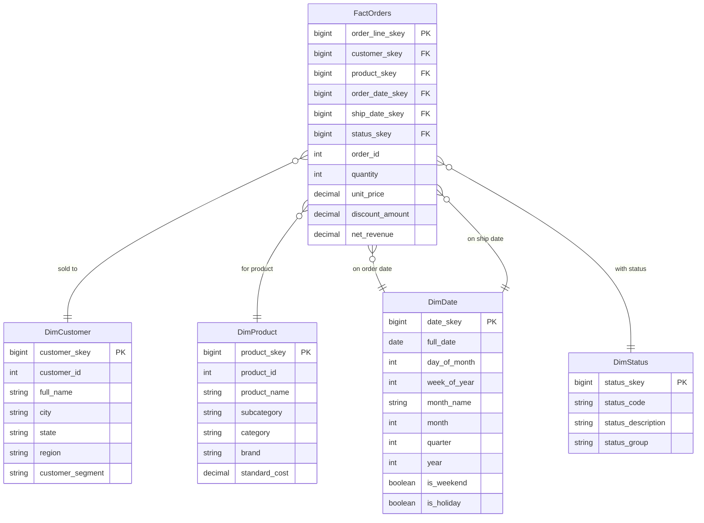
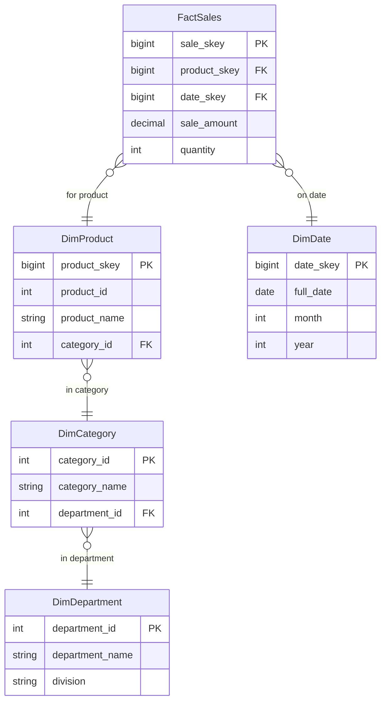
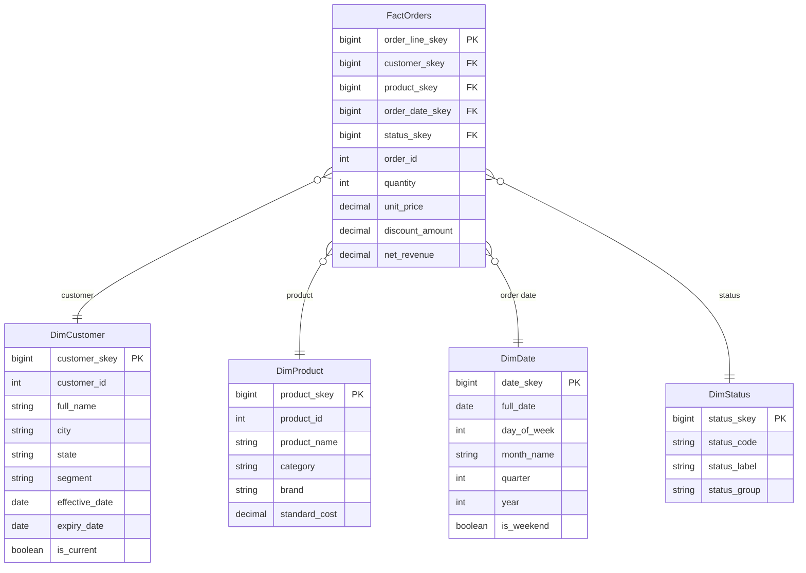

# Dimensional Modeling

Dimensional modeling is the data design methodology developed by Ralph Kimball for organizing analytical data into structures that are fast to query, easy to understand, and maintainable at enterprise scale. The central idea is to organize business data into two structural types: **facts** (numeric measurements) and **dimensions** (the descriptive context that surrounds those measurements).

## Kimball Methodology

The Kimball methodology rests on two architectural pillars:

**Bus architecture** — all fact tables in an enterprise data warehouse share a common set of *conformed dimensions*. The Sales fact table and the Inventory fact table both reference the same `DimProduct` and `DimDate` dimensions, defined identically. This makes cross-process analysis (e.g., comparing sales to inventory levels) possible without data transformation.

**Bottom-up design** — Kimball builds one dimensional model per business process, rather than attempting a single enterprise-wide normalized model first. Each business process model (orders, returns, inventory) is independently deliverable and immediately useful.

### The Four-Step Design Process

Every dimensional model is designed by following four sequential steps:

1. **Select the business process** — identify the operational activity being modeled (retail point-of-sale transactions, insurance claims, HR timesheets)
2. **Declare the grain** — define precisely what one row in the fact table represents (see [Grain](#grain) below)
3. **Identify the dimensions** — determine the descriptive context attached to each grain-level event
4. **Identify the facts** — determine the numeric measurements produced by the event at the declared grain

## Facts vs. Dimensions

**Facts** are quantitative, additive numeric values that represent a business measurement at a point in time. They answer "how much" or "how many":

- `sale_amount` — revenue from a line item
- `order_quantity` — units sold
- `discount_amount` — discount applied
- `call_duration_seconds` — length of a support call

Decimal and numeric data types are a strong signal that a column belongs in a fact table.

**Dimensions** provide the descriptive context that surrounds facts. They answer who, what, where, when, and why:

- `customer_name`, `customer_city`, `customer_segment`
- `product_name`, `category`, `brand`
- `store_location`, `region`
- `order_date`, `fiscal_quarter`

String and categorical data types are a strong signal that a column belongs in a dimension table.

## Star Schema

The star schema is the foundational dimensional design pattern. A central fact table holds numeric measurements and foreign keys; surrounding dimension tables hold descriptive attributes. Dimensions do not link to each other — they connect only to the fact table, producing a shape that resembles a star.



**Advantages of the star schema:**

- Highly performant — analytical engines optimize single-level joins efficiently
- Fewer joins — most queries need only the fact table plus one or two dimensions
- Easy for business users to understand and self-serve

## Snowflake Schema

The snowflake schema is a variation of the star schema where dimension tables are further normalized into sub-dimension tables. Instead of a flat `DimProduct`, the product dimension branches into a `DimCategory` and `DimDepartment`:



**Star vs. Snowflake comparison:**

| Criterion | Star Schema | Snowflake Schema |
|-----------|-------------|-----------------|
| **Join count** | Low — one level | Higher — multi-level |
| **Storage** | Slightly higher (repeated category names) | Marginally lower |
| **Query performance** | Faster — fewer joins | Slower — cascading joins |
| **ETL complexity** | Simpler | More complex to maintain |
| **Business usability** | High — flat dimensions are intuitive | Lower — users must navigate hierarchy |

!!! warning "Prefer the star schema for most analytical use cases"
    The storage savings from snowflaking are negligible in modern columnar storage. The join complexity cost is real. Use snowflake schema only when dimension hierarchies are very deep, the dimension tables are extremely large, or storage budget is tightly constrained.

## Grain

**Grain is the single most important design decision in dimensional modeling.** The grain defines exactly what one row in the fact table represents. Declaring the grain before identifying dimensions or facts prevents ambiguous, unmaintainable schemas.

### Grain Examples

| Business Process | Atomic Grain | Coarser Grain |
|-----------------|--------------|---------------|
| Retail POS | One line item on a receipt | One receipt (order total) |
| Insurance claims | One claim transaction event | One claim per month |
| Bank account | One financial transaction | Daily account balance snapshot |
| Hotel booking | One room-night booked | One booking record |

**Always prefer the atomic grain.** You can always aggregate atomic data to answer a coarser question. You cannot disaggregate summary data to recover the detail.

!!! info "Grain and fact additivity"
    The grain determines which facts are additive across which dimensions. A `revenue` fact at the line-item grain is additive across all dimensions — you can sum it by product, by date, by customer. A `unit_price` fact at the same grain is not additive across quantity — it is semi-additive or non-additive depending on the aggregation.

## Fact Table Types

### Transaction Fact Table

The most common type. Each row represents a single discrete business event at a point in time. Rows are never updated — only new rows are appended.

Examples: a sales line item, an ATM withdrawal, a web click event.

```sql
-- Transaction fact: one row per order line
CREATE TABLE gold.sales.FactOrders (
    order_line_skey  BIGINT     NOT NULL,   -- surrogate key
    customer_skey    BIGINT     NOT NULL,
    product_skey     BIGINT     NOT NULL,
    order_date_skey  BIGINT     NOT NULL,
    order_id         INT        NOT NULL,   -- degenerate dimension
    quantity         INT        NOT NULL,
    unit_price       DECIMAL(12,4) NOT NULL,
    discount_amount  DECIMAL(12,4) NOT NULL,
    net_revenue      DECIMAL(12,4) NOT NULL
)
USING DELTA
PARTITIONED BY (order_date_skey);
```

### Periodic Snapshot Fact Table

Each row represents a measurement of an entity at the end of a regular period — regardless of whether anything changed. Rows for previous periods are never updated.

Examples: account balance at end of month, inventory count at end of day, employee headcount at end of quarter.

```sql
-- Periodic snapshot: one row per account per month
CREATE TABLE gold.finance.FactAccountBalanceMonthly (
    snapshot_skey       BIGINT        NOT NULL,
    account_skey        BIGINT        NOT NULL,
    month_date_skey     BIGINT        NOT NULL,
    closing_balance     DECIMAL(18,4) NOT NULL,
    average_balance     DECIMAL(18,4),
    transaction_count   INT
)
USING DELTA
PARTITIONED BY (month_date_skey);
```

### Accumulating Snapshot Fact Table

Each row represents the full lifecycle of a single business process instance. Multiple date foreign keys track milestones (order placed, order shipped, order delivered). Rows are **updated** as milestones occur — making this the only fact table type where updates are expected.

Examples: order fulfillment lifecycle, insurance claim pipeline, loan origination workflow.

```sql
-- Accumulating snapshot: one row per order, updated as it progresses
CREATE TABLE gold.logistics.FactOrderLifecycle (
    order_skey           BIGINT NOT NULL,
    customer_skey        BIGINT NOT NULL,
    order_placed_date_skey  BIGINT,
    order_shipped_date_skey BIGINT,     -- NULL until shipped
    order_delivered_date_skey BIGINT,   -- NULL until delivered
    order_returned_date_skey BIGINT,    -- NULL unless returned
    order_total          DECIMAL(12,4),
    days_to_ship         INT,           -- computed when shipped
    days_to_deliver      INT            -- computed when delivered
)
USING DELTA;
```

## Dimension Table Types

### Conformed Dimension

A dimension used identically across multiple fact tables in the enterprise data warehouse. `DimDate` and `DimCustomer` are typical conformed dimensions — the same table definition, same surrogate keys, same attribute names, used by both `FactOrders` and `FactReturns`.

Conformed dimensions are the backbone of the Kimball bus architecture. They enable cross-process analysis without data transformation.

### Role-Playing Dimension

The same physical dimension table used multiple times in a single fact table, each time playing a different role. `DimDate` is the canonical example — an order may have an order date, a ship date, and a delivery date, all referencing the same `DimDate` table through different foreign keys.

```sql
-- Three role-playing references to DimDate in one fact table
SELECT
    o.order_id,
    od.full_date    AS order_date,
    sd.full_date    AS ship_date,
    dd.full_date    AS delivery_date,
    o.net_revenue
FROM gold.sales.FactOrders o
JOIN gold.shared.DimDate od ON o.order_date_skey  = od.date_skey
JOIN gold.shared.DimDate sd ON o.ship_date_skey   = sd.date_skey
JOIN gold.shared.DimDate dd ON o.deliver_date_skey = dd.date_skey;
```

### Degenerate Dimension

A dimension attribute that has no associated dimension table — it lives directly in the fact table. Degenerate dimensions are typically transaction identifiers like order numbers, invoice numbers, or ticket IDs. They provide a lookup key back to the source system but carry no further descriptive attributes.

In `FactOrders`, `order_id` is a degenerate dimension — it identifies the transaction but does not justify its own dimension table.

### Junk Dimension

A dimension table created by grouping together several low-cardinality flag columns that would otherwise clutter the fact table. Instead of adding `is_gift_wrapped`, `is_expedited`, `is_promotional` as three separate tiny dimensions or three columns directly in the fact table, a junk dimension combines all permutations into a single lookup table.

```sql
CREATE TABLE gold.shared.DimOrderFlags (
    order_flags_skey  BIGINT PRIMARY KEY,
    is_gift_wrapped   BOOLEAN,
    is_expedited      BOOLEAN,
    is_promotional    BOOLEAN,
    is_loyalty_redemption BOOLEAN
);
-- Populated with all 2^4 = 16 possible permutations at load time
```

## Surrogate Keys vs. Natural Keys

A **surrogate key** is a warehouse-generated integer assigned as the primary key of a dimension record. It is completely independent of the source system's business identifier (the natural key).

| Concern | Surrogate Key | Natural Key |
|---------|--------------|-------------|
| **SCD Type-2 support** | Essential — new surrogate key per version | Cannot repeat; breaks history tracking |
| **Source system insulation** | Changes in source key format do not break joins | Source key format changes break downstream |
| **Multi-source integration** | Prevents key collisions across systems | Numeric IDs often collide across sources |
| **Join performance** | Fast — small integer footprint | Slower — wide VARCHAR keys |

!!! warning "Always use surrogate keys in dimensional models"
    Natural keys are stored as attributes in dimension tables for traceability, but they must never be the primary key of a dimension. When SCD Type-2 creates a new version of a customer record, the natural key (`customer_id`) repeats across both versions. The surrogate key uniquely identifies each version.

```sql
-- Correct dimensional table with both surrogate and natural keys
CREATE TABLE gold.shared.DimCustomer (
    customer_skey    BIGINT     NOT NULL,   -- surrogate key (PK)
    customer_id      INT        NOT NULL,   -- natural key (from source)
    full_name        VARCHAR(200),
    city             VARCHAR(100),
    state            VARCHAR(50),
    customer_segment VARCHAR(50),
    effective_date   DATE       NOT NULL,
    expiry_date      DATE       NOT NULL,
    is_current       BOOLEAN    NOT NULL,
    hash_md5         VARCHAR(32)
)
USING DELTA;
```

## Designing for Spark and Delta Lake

### Partitioning Fact Tables by Date

Fact tables are almost always queried with a date filter. Partitioning by a date key ensures Spark reads only the relevant partitions rather than scanning the entire table.

```python
fact_df.write \
    .format("delta") \
    .partitionBy("order_date_skey") \
    .mode("append") \
    .saveAsTable("gold.sales.FactOrders")
```

For very large fact tables, partition by a coarser date unit (year or year-month integer) to avoid too many small partitions.

### Z-Ordering on Common Filter Dimensions

After date, the next most common filters in analytical queries are typically customer, product, or geography. Z-Ordering on these keys co-locates related data within each partition, enabling Spark's data skipping to eliminate file reads:

```sql
OPTIMIZE gold.sales.FactOrders
ZORDER BY (customer_skey, product_skey);
```

!!! tip "Z-Order after partition, not instead of it"
    Z-Ordering works within partitions. Partition by date first, then Z-Order within each partition on the next-most-selective filter columns. Do not Z-Order more than 3–4 columns — effectiveness diminishes beyond that.

### Dimension Table Optimization

Dimension tables are typically small and fully scanned for joins. For very large dimensions (hundreds of millions of rows), use Liquid Clustering rather than static partitioning:

```sql
ALTER TABLE gold.shared.DimCustomer
CLUSTER BY (customer_skey);
```

## Example: Order Data Model

The complete order domain model as a star schema with all five tables:



```sql
-- Typical analytical query on the star schema
SELECT
    d.year,
    d.month_name,
    p.category,
    c.state,
    SUM(f.net_revenue)  AS total_revenue,
    SUM(f.quantity)     AS units_sold,
    COUNT(DISTINCT f.order_id) AS order_count
FROM gold.sales.FactOrders f
JOIN gold.shared.DimDate     d ON f.order_date_skey = d.date_skey
JOIN gold.shared.DimProduct  p ON f.product_skey    = p.product_skey
JOIN gold.shared.DimCustomer c ON f.customer_skey   = c.customer_skey
                              AND c.is_current = TRUE
WHERE d.year = 2025
GROUP BY d.year, d.month_name, p.category, c.state
ORDER BY d.year, d.month_name;
```
