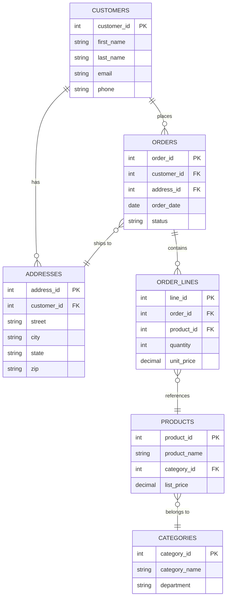
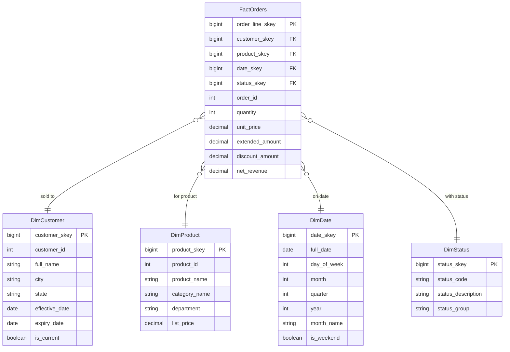

# Data Modeling

Data modeling is the structural process of defining how data entities relate to each other, what integrity rules govern them, and how they should be organized to serve the access patterns of their consumers. The choice of model is not merely academic — it determines whether a system can sustain thousands of concurrent writes per second or whether analysts can answer a business question in milliseconds rather than minutes.

## The Modeling Spectrum

Every data model sits somewhere on a spectrum between two poles: **normalized OLTP design** optimized for write throughput and integrity, and **denormalized OLAP design** optimized for read throughput and analytical flexibility. Understanding where a system sits on that spectrum — and why — is the foundation of every data engineering decision.

| Dimension | OLTP (Normalized) | OLAP (Dimensional) |
|-----------|-------------------|-------------------|
| **Primary Goal** | High-speed row writes, strict consistency | High-throughput reads, large aggregations |
| **Structure** | 3NF normalized tables | Star or snowflake schema |
| **Data Scope** | Current operational state | Multi-year historical data |
| **Query Profile** | Low-latency CRUD — single rows | Full table scans, GROUP BY, window functions |
| **Primary Consumers** | Applications, end users, APIs | BI tools, analysts, data engineers |
| **Write Pattern** | Many small, frequent writes | Bulk batch loads or streaming micro-batches |
| **Join Count** | High (data spread across many tables) | Low (denormalized dimensions pre-join context) |
| **Anomaly Risk** | Designed to prevent anomalies | Accepts some redundancy for read speed |

## Why the Same Business Domain Needs Two Models

Consider an e-commerce order. In the operational system, an order is spread across `orders`, `order_lines`, `customers`, `products`, and `addresses` — normalized to prevent a customer address update from requiring edits to millions of order rows. In the data warehouse, analysts need a single query to answer "what was revenue by product category, by region, by month" — so the same order data is pre-joined into a `FactOrders` table surrounded by flat dimension tables.

The extract-transform-load (ETL) pipeline is the bridge between these two worlds. Data engineers extract from the normalized OLTP source, transform it into dimensional structures, and load it into the analytical target.

## OLTP Normalized vs. OLAP Dimensional — Side-by-Side

The diagram below contrasts a normalized OLTP schema for an order domain (left) with the equivalent dimensional star schema in the data warehouse (right). Both represent the same business reality using structurally different models.

!!! info "Reading the diagrams"
    The left (OLTP) schema has six tables and requires five joins to answer a basic revenue-by-category query. The right (OLAP star schema) has five tables but only four joins — and those joins are between integer surrogate keys on pre-aggregated facts, making them dramatically faster for analytical engines.

## Core Vocabulary

| Term | Definition |
|------|------------|
| **Fact table** | Contains numeric measurements (revenue, quantity, duration) plus foreign keys to surrounding dimensions |
| **Dimension table** | Contains descriptive context (who, what, where, when) that surrounds each fact |
| **Surrogate key** | Warehouse-generated integer key, independent of source system keys |
| **Natural key** | The business identifier from the source system (customer_id, order_number) |
| **Grain** | The precise definition of what one row in a fact table represents |
| **SCD** | Slowly Changing Dimension — a strategy for handling dimension attribute changes over time |
| **Conformed dimension** | A dimension shared across multiple fact tables with a consistent definition |

## Module Contents

| Page | Coverage |
|------|----------|
| [Normalization](normalization.md) | 1NF, 2NF, 3NF with worked examples, functional dependencies, denormalization trade-offs |
| [Dimensional Modeling](dimensional.md) | Kimball methodology, star vs snowflake, fact/dimension types, grain, surrogate keys, Spark/Delta design patterns |
| [Slowly Changing Dimensions](scd.md) | All six SCD types with examples, full PySpark SCD Type-2 implementation |

!!! tip "Where to start"
    If you are new to data modeling, read **Normalization** first to understand why OLTP schemas look the way they do, then **Dimensional Modeling** to understand how analytical schemas are built from the ground up. **SCD** builds on dimensional modeling concepts — read it last.
