# Streaming & Messaging

Real-time data pipelines, event-driven architectures, and the toolchain that makes them production-grade — Apache Kafka for durable transport and Spark Structured Streaming for distributed processing.

---

## Why Streaming?

Most enterprise data is generated continuously — click events, sensor readings, payment transactions, log lines. Batch pipelines can handle it by collecting data for minutes or hours and then processing in bulk, but that introduces latency. Streaming pipelines reduce that latency to seconds or sub-seconds, unlocking use cases that are impossible with batch alone: fraud detection before a transaction clears, alerting on infrastructure anomalies, live recommendation engines.

The tradeoff is complexity. Streaming systems must handle late-arriving data, maintain state across unbounded time, guarantee exactly-once semantics, and recover cleanly from failures — challenges that batch systems simply avoid by reprocessing from scratch.

---

## Batch vs. Micro-Batch vs. Streaming

Three execution models sit on a latency / complexity spectrum:

| Model | Latency | Trigger | State | Typical Use Case |
|-------|---------|---------|-------|-----------------|
| **Batch** | Minutes → Hours | Scheduled (cron) | None — recompute from full dataset | End-of-day reporting, historical ML training, daily reconciliation |
| **Micro-Batch** | Seconds → Minutes | Fixed interval or on-data-arrival | Managed per trigger window | Fraud scoring, near-real-time dashboards, event ingestion |
| **True Streaming** (per-event) | Sub-second | Per-event | Long-lived, per-key state | HFT tick processing, low-latency alerting |

!!! info "Spark Structured Streaming is micro-batch"
    Spark processes data in small batches triggered at configurable intervals. It is not a true event-at-a-time engine (like Apache Flink's continuous mode), but micro-batch latency in the 1–30 second range is sufficient for the overwhelming majority of enterprise use cases and much simpler to operate.

---

## When to Choose Each Model

**Choose batch when:**

- Latency of 15 minutes or more is acceptable
- The transformation logic requires access to the entire historical dataset (full aggregations, cohort analysis, model retraining)
- Cost optimization matters — batch jobs run on demand, not continuously

**Choose micro-batch (Structured Streaming) when:**

- Latency of 5–60 seconds is required
- Data arrives in a replayable source (Kafka, cloud files)
- You need windowed aggregations, watermarked late-data handling, or Delta Lake upserts
- The team already knows Spark DataFrames — same API, minimal learning curve

**Choose true streaming (Flink, Kafka Streams) when:**

- Sub-second per-event latency is a hard requirement
- Complex event processing (CEP) patterns, millisecond-level joins
- The engineering team has stream processing expertise and the infrastructure budget to match

---

## Lambda vs. Kappa Architecture

Two competing architectural philosophies govern how streaming and batch interact in a modern data platform.

### Lambda Architecture

Lambda runs **two parallel systems** — a batch layer for correctness and a speed layer for low latency — and merges their outputs in a serving layer.

```mermaid
flowchart LR
    SRC["Event Source\n(Kafka / Files)"] --> BL & SL

    subgraph BL["Batch Layer (correctness)"]
        B1["Reprocess full history\nHadoop / Spark batch"]
        B2["Batch views\n(accurate, slow)"]
    end

    subgraph SL["Speed Layer (low latency)"]
        S1["Structured Streaming\nor Flink"]
        S2["Real-time views\n(approximate, fast)"]
    end

    BL --> SRV["Serving Layer\n(merge batch + speed views)"]
    SL --> SRV
    SRV --> CON["Consumers\nBI / APIs / Dashboards"]

    style BL fill:#1a2a3a,stroke:#4a9eff
    style SL fill:#1a3a1a,stroke:#51cf66
    style SRV fill:#3a2a00,stroke:#ffd700
```

**Pros:** Batch layer is always authoritative; speed layer only needs to be approximate.  
**Cons:** Two codebases for the same logic (batch SQL and streaming SQL); synchronization complexity; high operational overhead.

### Kappa Architecture

Kappa eliminates the batch layer entirely. A single streaming pipeline is the system of record. Historical reprocessing is done by replaying the event log from the beginning.

```mermaid
flowchart LR
    SRC["Event Source\nKafka (durable log)"] --> SP

    subgraph SP["Single Streaming Pipeline"]
        R["readStream\n(Kafka / Auto Loader)"]
        T["Transformations\n(stateless + stateful)"]
        W["writeStream\n(Delta Lake)"]
        R --> T --> W
    end

    SP --> DL["Delta Lake\nBronze / Silver / Gold"]
    DL --> CON["Consumers\nBI / APIs / ML"]

    subgraph RP["Historical Reprocessing"]
        direction LR
        K2["Replay from\nearliest offset"]
        T2["Same pipeline code\nnew checkpoint location"]
    end

    SRC --> RP --> DL

    style SP fill:#1a3a1a,stroke:#51cf66
    style RP fill:#2a1a3a,stroke:#a07aff
```

**Pros:** One codebase; simpler operations; the event log (Kafka + Delta) replaces the batch layer.  
**Cons:** Requires a durable, replayable event store (Kafka or Delta CDF); state management becomes critical for correctness; reprocessing at scale means running a large streaming job.

### Which One in Practice?

Most modern Lakehouse deployments converge on **Kappa-style thinking** with a pragmatic twist: Kafka provides the durable event transport, Spark Structured Streaming processes it into Delta Bronze tables, and if a reprocessing run is needed, `startingOffsets=earliest` replays the full topic through the same pipeline code. The batch layer is gone — Delta's ACID semantics and time travel handle the correctness guarantees instead.

!!! tip "Kappa wins with Kafka + Delta"
    Delta Lake's ACID transactions and append semantics mean streaming and batch reads coexist safely on the same table. You no longer need a separate batch layer for correctness — Delta provides it. This is why the Kafka → Spark → Delta pattern has largely displaced Lambda for new builds.

---

## Module Overview

This module covers the full streaming stack from transport to processing to storage:

| Page | Scope |
|------|-------|
| [Spark Structured Streaming](structured-streaming.md) | Micro-batch engine, triggers, output modes, checkpointing, stateful ops, watermarking, joins, foreachBatch |
| [Apache Kafka Architecture](kafka.md) | Brokers, topics, partitions, offsets, producers, consumers, replication, retention, schema registry |
| [Kafka + Spark Integration](kafka-spark.md) | Reading/writing Kafka in Spark, JSON/Avro parsing, end-to-end pipeline, offset management, performance tuning |

---

## Key Concepts at a Glance

```mermaid
flowchart TB
    EV["Event Sources\n(IoT / Apps / DBs)"]
    KP["Kafka Producer"]
    KC["Kafka Cluster\nTopics → Partitions → Offsets"]
    CG["Consumer Group"]
    SS["Spark Structured Streaming\nreadStream → transform → writeStream"]
    DL["Delta Lake\nBronze → Silver → Gold"]
    BI["Consumers\nBI / ML / APIs"]

    EV --> KP --> KC --> CG --> SS --> DL --> BI

    style KC fill:#1a1a3a,stroke:#4a9eff
    style SS fill:#1a3a1a,stroke:#51cf66
    style DL fill:#3a2a00,stroke:#ffd700
```

**Kafka** is the durable backbone — a distributed commit log that decouples producers from consumers, retains messages for configurable periods, and supports multiple independent consumers reading the same data at their own pace.

**Spark Structured Streaming** is the processing engine — it pulls from Kafka in micro-batches, applies DataFrame transformations, manages state across batches, and writes results to Delta Lake with exactly-once guarantees.

**Delta Lake** is the sink — ACID transactions ensure that partial micro-batch writes never corrupt downstream reads, and checkpointing integrates with Delta's transaction log for reliable recovery.
