# Kafka + Spark Structured Streaming

Spark's native Kafka connector (`format("kafka")`) is the standard integration point between Apache Kafka and the Databricks/Spark ecosystem. The same connector supports both batch snapshots and continuous streaming reads, making it straightforward to evolve a pipeline from exploratory batch reads to a production streaming ingestion.

---

## Reading from Kafka

### Batch Read (Finite Snapshot)

`spark.read` (not `readStream`) reads a bounded snapshot of Kafka records and terminates. Useful for backfill jobs, ad-hoc analysis, or testing schema parsing logic before promoting to streaming.

=== "PySpark"

    ```python
    kafka_batch_df = spark.read \
        .format("kafka") \
        .option("kafka.bootstrap.servers", "broker1:9092,broker2:9092") \
        .option("subscribe", "retail-orders") \
        .option("startingOffsets", "earliest") \
        .option("endingOffsets", "latest") \
        .load()
    ```

=== "Key Options"

    | Option | Values | Description |
    |--------|--------|-------------|
    | `subscribe` | `"topic-name"` | Single topic |
    | `subscribePattern` | `"topic-.*"` | Regex pattern — all matching topics |
    | `assign` | `'{"topic":[0,1,2]}'` | Specific partitions (JSON) |
    | `startingOffsets` | `"earliest"`, `"latest"`, JSON | Where to begin reading |
    | `endingOffsets` | `"latest"`, JSON | Where to stop (batch only) |

### Streaming Read (Continuous)

`spark.readStream` opens a continuous stream that polls Kafka for new records on each micro-batch trigger.

```python
kafka_stream_df = spark.readStream \
    .format("kafka") \
    .option("kafka.bootstrap.servers", "broker1:9092,broker2:9092") \
    .option("subscribe", "retail-orders") \
    .option("startingOffsets", "earliest") \   # use "latest" in production once caught up
    .option("maxOffsetsPerTrigger", 10000) \
    .load()
```

!!! info "`startingOffsets` on first run vs. restart"
    `startingOffsets` only applies when the **checkpoint does not exist**. On restart, Spark reads the committed offsets from the checkpoint and resumes from there, regardless of the `startingOffsets` setting. This is how exactly-once semantics are maintained.

---

## Kafka Metadata Columns

Every row in the Kafka DataFrame includes system columns alongside the payload:

| Column | Type | Description |
|--------|------|-------------|
| `key` | binary | Record key bytes (partition routing, compaction key) |
| `value` | binary | Record value bytes — the actual payload |
| `topic` | string | Topic name the record came from |
| `partition` | int | Partition number |
| `offset` | long | Offset within the partition |
| `timestamp` | timestamp | Producer timestamp or broker ingestion time |
| `timestampType` | int | 0 = CreateTime (producer), 1 = LogAppendTime (broker) |

---

## Decoding Key and Value

Kafka transmits both key and value as raw bytes. The first step in any Kafka pipeline is converting them to strings:

```python
decoded_df = kafka_stream_df.selectExpr(
    "CAST(key AS STRING) AS key",
    "CAST(value AS STRING) AS raw_json",
    "topic",
    "partition",
    "offset",
    "timestamp"
)
```

---

## Parsing JSON Payloads

After decoding to string, use `from_json()` with an explicit `StructType` schema to parse the payload into typed columns.

=== "PySpark (StructType)"

    ```python
    from pyspark.sql.functions import from_json, col
    from pyspark.sql.types import (
        StructType, StructField, LongType, StringType, DoubleType, ArrayType
    )

    order_schema = StructType([
        StructField("order_id",        LongType(),   nullable=False),
        StructField("customer_id",     LongType(),   nullable=False),
        StructField("customer_fname",  StringType(), nullable=True),
        StructField("customer_lname",  StringType(), nullable=True),
        StructField("city",            StringType(), nullable=True),
        StructField("state",           StringType(), nullable=True),
        StructField("amount",          DoubleType(), nullable=True),
    ])

    parsed_df = decoded_df \
        .withColumn("data", from_json(col("raw_json"), order_schema)) \
        .select("data.*", "partition", "offset", "timestamp")
    ```

=== "PySpark (DDL String)"

    ```python
    from pyspark.sql.functions import from_json, col

    schema_ddl = """
        order_id      LONG,
        customer_id   LONG,
        customer_fname STRING,
        city           STRING,
        state          STRING,
        amount         DOUBLE
    """

    parsed_df = decoded_df \
        .withColumn("data", from_json(col("raw_json"), schema_ddl)) \
        .select("data.*")
    ```

!!! tip "Always define schema explicitly"
    Never rely on schema inference from Kafka values in production. Inference reads a sample and can miss fields; an explicit `StructType` fails fast and loudly when the schema changes, which is exactly what you want in a monitored pipeline.

### Flattening Nested Arrays

Real payloads often contain arrays of structs (e.g., line items in an order). Use `explode()` to convert each array element into a separate row:

```python
from pyspark.sql.functions import explode

# order_schema includes: line_items ARRAY<STRUCT<product_id LONG, quantity INT, price DOUBLE>>
exploded_df = parsed_df \
    .select(
        "order_id",
        "customer_id",
        explode("line_items").alias("item")
    ) \
    .select(
        "order_id",
        "customer_id",
        col("item.product_id").alias("product_id"),
        col("item.quantity").alias("quantity"),
        col("item.price").alias("unit_price")
    )
```

---

## Parsing Avro Payloads (Schema Registry)

When the Kafka topic uses Avro serialization with Confluent Schema Registry, use `from_avro()`:

```python
from pyspark.sql.functions import col
# pip install pyspark-avro is bundled in Databricks Runtime
from pyspark.sql.avro.functions import from_avro

# Fetch schema string from Schema Registry
avro_schema_str = """
{
  "type": "record",
  "name": "Order",
  "fields": [
    {"name": "order_id",    "type": "long"},
    {"name": "customer_id", "type": "long"},
    {"name": "amount",      "type": "double"}
  ]
}
"""

# Confluent wire format: first 5 bytes are magic byte + schema ID
# Skip them with substring before passing to from_avro
avro_df = kafka_stream_df \
    .select(
        # Drop the 5-byte Confluent wire format header
        from_avro(col("value").substr(6, 99999), avro_schema_str).alias("data")
    ) \
    .select("data.*")
```

---

## Writing to Kafka from Spark

To publish Spark DataFrame rows back to Kafka, the DataFrame must have at minimum a `value` column (bytes or string). Optionally include `key` and `topic` columns.

```python
from pyspark.sql.functions import to_json, struct, col

# Build the output DataFrame: key + value (serialized JSON struct)
output_df = parsed_df \
    .filter(col("city") == "Chicago") \
    .select(
        col("customer_id").cast("string").alias("key"),
        to_json(struct(
            "order_id", "customer_id", "customer_fname",
            "city", "state", "amount"
        )).alias("value")
    )

# Write to Kafka sink
query = output_df.writeStream \
    .format("kafka") \
    .outputMode("append") \
    .option("kafka.bootstrap.servers", "broker:9092") \
    .option("topic", "chicago-orders") \
    .option("checkpointLocation", "/checkpoints/kafka_sink/chicago/") \
    .start()
```

---

## End-to-End Pipeline: Kafka → Spark → Delta (Bronze)

This is the most common production pattern — JSON events from Kafka ingested into a Delta Bronze table:

```mermaid
flowchart LR
    SRC["Event Sources\n(Apps / IoT / Services)"]
    KP["Kafka Producer"]
    KT["Kafka Topic\nretail-orders\n(4 partitions)"]
    SS["Spark Structured Streaming\nreadStream"]
    DP["Parse / Validate / Flatten\nfrom_json + explode"]
    DL["Delta Bronze Table\nretail_db.orders_bronze"]

    SRC --> KP --> KT --> SS --> DP --> DL

    style KT fill:#1a1a3a,stroke:#4a9eff
    style SS fill:#1a3a1a,stroke:#51cf66
    style DL fill:#3a2a00,stroke:#ffd700
```



```python
from pyspark.sql import SparkSession
from pyspark.sql.functions import from_json, col, explode, current_timestamp
from pyspark.sql.types import (
    StructType, StructField, LongType, StringType, DoubleType, ArrayType
)

spark = SparkSession.builder.appName("KafkaToDeltaBronze").getOrCreate()

BOOTSTRAP = "broker1:9092,broker2:9092"
TOPIC     = "retail-orders"
CHECKPOINT = "/checkpoints/retail_orders_bronze/"
TARGET_TABLE = "retail_db.orders_bronze"

# 1. Read from Kafka
raw_df = spark.readStream \
    .format("kafka") \
    .option("kafka.bootstrap.servers", BOOTSTRAP) \
    .option("subscribe", TOPIC) \
    .option("startingOffsets", "earliest") \
    .option("maxOffsetsPerTrigger", 5000) \
    .load()

# 2. Decode binary → string
decoded_df = raw_df.selectExpr(
    "CAST(value AS STRING) AS raw_json",
    "partition",
    "offset",
    "timestamp AS kafka_timestamp"
)

# 3. Define schema and parse JSON
order_schema = StructType([
    StructField("order_id",    LongType(),   False),
    StructField("customer_id", LongType(),   False),
    StructField("city",        StringType(), True),
    StructField("state",       StringType(), True),
    StructField("amount",      DoubleType(), True),
    StructField("line_items", ArrayType(StructType([
        StructField("product_id", LongType(),   True),
        StructField("quantity",   LongType(),   True),
        StructField("price",      DoubleType(), True),
    ])), True),
])

parsed_df = decoded_df \
    .withColumn("data", from_json(col("raw_json"), order_schema)) \
    .select(
        "data.*",
        "partition",
        "offset",
        "kafka_timestamp",
        current_timestamp().alias("_load_timestamp")
    )

# 4. Flatten line_items array
flattened_df = parsed_df \
    .select(
        "order_id", "customer_id", "city", "state", "amount",
        explode("line_items").alias("item"),
        "partition", "offset", "kafka_timestamp", "_load_timestamp"
    ) \
    .select(
        "order_id", "customer_id", "city", "state", "amount",
        col("item.product_id").alias("product_id"),
        col("item.quantity").alias("quantity"),
        col("item.price").alias("unit_price"),
        "partition", "offset", "kafka_timestamp", "_load_timestamp"
    )

# 5. Write to Delta Bronze
query = flattened_df.writeStream \
    .queryName("KafkaToDeltaBronze") \
    .format("delta") \
    .outputMode("append") \
    .option("checkpointLocation", CHECKPOINT) \
    .trigger(processingTime="30 seconds") \
    .toTable(TARGET_TABLE)

query.awaitTermination()
```

---

## Offset Management

### Spark Manages Offsets via Checkpointing

Spark does **not** commit offsets back to Kafka's consumer group offset store (`__consumer_offsets` topic). Instead, Spark tracks offsets in its own checkpoint directory.

```
Kafka consumer group offset:  NOT updated by Spark
Spark checkpoint:              Updated after every committed batch
```

This has an important implication: the Kafka `kafka-consumer-groups.sh` tool will show the Spark consumer group as having a fixed or incorrect lag — that number is meaningless for Spark jobs. Measure Spark streaming progress via `query.lastProgress` instead.

### Replaying from Any Offset

Because Spark manages offsets independently, you can replay from any point:

```python
# Force replay from the beginning (ignores checkpoint)
# WARNING: Delete the checkpoint first, or use a new checkpoint location
spark.readStream \
    .format("kafka") \
    .option("subscribe", "retail-orders") \
    .option("startingOffsets", "earliest") \
    ...
```

Or specify exact per-partition offsets:

```python
.option("startingOffsets",
    '{"retail-orders": {"0": 1000, "1": 2500, "2": 0, "3": 750}}')
```

---

## Exactly-Once End-to-End

Achieving exactly-once semantics across the full Kafka → Spark → Delta stack requires all three guarantees simultaneously:

```mermaid
flowchart LR
    K["Kafka\nacks=all\n(producer durability)"]
    S["Spark Checkpointing\n(offset tracking + state)"]
    D["Delta Lake\nIdempotent writes\n(txnAppId/txnVersion)"]

    K -->|"replayable source"| S
    S -->|"idempotent sink"| D

    style K fill:#1a1a3a,stroke:#4a9eff
    style S fill:#2a1a3a,stroke:#a07aff
    style D fill:#1a3a1a,stroke:#51cf66
```



| Layer | Guarantee | Mechanism |
|-------|-----------|-----------|
| Kafka producer | No data loss | `acks=all` + `min.insync.replicas >= 2` |
| Spark → Kafka consumer | Exactly-once read | Checkpointed offsets; replay from WAL on failure |
| Spark → Delta sink | Exactly-once write | Delta's idempotency token (`queryId + batchId`); same batch ID = same write = safe to replay |

---

## Production Architecture: Bronze → Silver

The recommended production pattern extends the basic ingestion into a two-stage pipeline with Delta MERGE for Silver upserts:

```mermaid
flowchart TB
    K["Kafka Topic\nraw events"]

    subgraph B["Bronze Layer"]
        BW["writeStream append\nKafka → Delta Bronze\n(raw, with kafka_timestamp + offset)"]
    end

    subgraph S["Silver Layer"]
        SW["foreachBatch MERGE\nBronze → Delta Silver\n(deduplicated, typed, enriched)"]
    end

    K --> B --> S

    style B fill:#6b3a00,stroke:#ffa657
    style S fill:#1a3a1a,stroke:#51cf66
```



```python
def silver_merge(batch_df, batch_id):
    batch_df.createOrReplaceTempView("bronze_batch")
    spark.sql("""
        MERGE INTO silver.retail.orders AS target
        USING (
            SELECT DISTINCT order_id, customer_id, city, state, amount,
                            product_id, quantity, unit_price, kafka_timestamp
            FROM bronze_batch
        ) AS source
        ON target.order_id = source.order_id
           AND target.product_id = source.product_id
        WHEN MATCHED THEN
            UPDATE SET target.quantity    = source.quantity,
                       target.unit_price  = source.unit_price
        WHEN NOT MATCHED THEN
            INSERT *
    """)

silver_query = flattened_df.writeStream \
    .format("delta") \
    .outputMode("update") \
    .option("checkpointLocation", "/checkpoints/silver_orders_merge/") \
    .trigger(processingTime="1 minute") \
    .foreachBatch(silver_merge) \
    .start()
```

---

## Multi-Topic Consumption

### Subscribe to a Topic List

```python
spark.readStream \
    .format("kafka") \
    .option("subscribe", "orders,returns,inventory") \
    .load()
# The "topic" column identifies which topic each row came from
```

### Subscribe by Pattern

```python
spark.readStream \
    .format("kafka") \
    .option("subscribePattern", "retail-.*") \
    .load()
# Matches retail-orders, retail-returns, retail-inventory, etc.
```

!!! warning "Schema differences across topics"
    When subscribing to multiple topics, all rows arrive in the same DataFrame with a binary `value` column. If topics have different schemas, add a branch in your parsing logic keyed on the `topic` column, or route them to separate Delta tables in a `foreachBatch` function.

---

## Performance Tuning

### `maxOffsetsPerTrigger`

Caps the number of Kafka records consumed per micro-batch trigger. Use this to:
- Prevent a large backlog from overwhelming the Spark cluster on first start
- Smooth throughput to avoid memory pressure on the driver

```python
.option("maxOffsetsPerTrigger", 50000)   # max 50k records per batch
```

### `minPartitions`

Spark creates one task per Kafka partition by default. If your topic has few partitions (e.g., 4) but your cluster has many cores, set `minPartitions` to repartition the data and increase parallelism:

```python
.option("minPartitions", 32)   # repartition to 32 even if topic has 4 partitions
```

!!! tip "minPartitions adds shuffle cost"
    `minPartitions` triggers a shuffle to redistribute data across more tasks. Use it only when partition count is genuinely too low for your cluster size — the shuffle cost outweighs the benefit on small datasets.

### Trigger Interval vs. Latency vs. Cost

| Trigger | Latency | Cluster Cost | When to Use |
|---------|---------|-------------|-------------|
| `processingTime="1 second"` | ~1–2 sec | Very high (cluster always busy) | Near-real-time alerting SLAs |
| `processingTime="30 seconds"` | ~30–60 sec | Moderate | Standard streaming pipelines |
| `processingTime="5 minutes"` | ~5–10 min | Lower | Near-real-time dashboards, moderate latency OK |
| `availableNow=True` | N/A (batch) | Lowest | Incremental daily/hourly batch loads |

---

## Consumer Group Lag Monitoring

### Command-Line (kafka-consumer-groups.sh)

```bash
# List all consumer groups
kafka-consumer-groups.sh \
    --bootstrap-server broker:9092 \
    --list

# Describe lag for a specific group
kafka-consumer-groups.sh \
    --bootstrap-server broker:9092 \
    --describe \
    --group my-spark-consumer-group
```

Output shows per-partition `LOG-END-OFFSET`, `CURRENT-OFFSET`, and `LAG`.

!!! warning "Spark's consumer group lag is not meaningful in Kafka UI"
    Spark does not commit offsets to Kafka's consumer group store. The lag shown by `kafka-consumer-groups.sh` for a Spark streaming job will appear as stale or zero. Monitor Spark's `query.lastProgress` instead, specifically `inputRowsPerSecond` and `processedRowsPerSecond`.

### Spark Query Progress Monitoring

```python
import json

# Non-blocking — run in a notebook cell while the stream runs in another
progress = query.lastProgress

print(f"Batch ID:                  {progress['batchId']}")
print(f"Input rows/sec:            {progress['inputRowsPerSecond']:.0f}")
print(f"Processed rows/sec:        {progress['processedRowsPerSecond']:.0f}")
print(f"Trigger duration (ms):     {progress['triggerExecution']['triggerExecution']}")

# Full JSON for debugging
print(json.dumps(progress, indent=2))
```

### Grafana / Kafka UI Alerting

In production, integrate Kafka metrics into Grafana via the JMX exporter or Confluent Cloud metrics API:

- `kafka.consumer.group.lag` per partition — alert when lag exceeds SLA threshold
- `kafka.broker.BytesInPerSec` — detect producer throughput spikes
- `kafka.controller.ActiveControllerCount` — should always be exactly 1

```bash
# Confluent Cloud: consumer lag via REST API
curl -X GET \
    -H "Authorization: Basic <base64-encoded-key:secret>" \
    "https://api.confluent.cloud/kafka/v3/clusters/{cluster_id}/consumer-groups/{group_id}/lags"
```

---

## Common Gotchas

!!! danger "Never hardcode `startingOffsets=earliest` on a running stream"
    On the first run of a new pipeline, `earliest` is correct — it processes all historical data. But if the checkpoint already exists and you restart the job, `startingOffsets` is ignored (Spark uses the checkpoint). The danger is when someone deletes the checkpoint and restarts: `earliest` will reprocess the entire Kafka retention window, potentially billions of records. **Always document whether a checkpoint reset is intentional.**

!!! warning "Schema mismatch between producer and consumer"
    If a producer deploys a new event schema (added fields, renamed fields, changed types) while the Spark job is running, `from_json()` silently nulls missing fields and ignores unknown fields. This can lead to subtle data quality issues. Enforce schemas with Confluent Schema Registry or monitor for unexpected null rates in Silver layer expectations.

!!! warning "foreachBatch is not parallel across partitions"
    `foreachBatch` receives the entire micro-batch as a single DataFrame and runs the function **once** per batch on the driver. The DataFrame operations inside the function still run distributed across executors, but the function itself is single-threaded. Do not put blocking I/O or slow external calls directly in the `foreachBatch` function.

!!! info "Kafka → Spark does not use Kafka consumer group offset commits"
    Spark tracks its read position via checkpointing, not via Kafka consumer group commits. This means Kafka-side tools (`kafka-consumer-groups.sh`, Kafka UI) will not show accurate lag. This also means you can run multiple independent Spark jobs against the same topic and consumer group name — they each maintain their own checkpoint, and Kafka does not arbitrate between them.
