# Apache Kafka Architecture

Apache Kafka is an open-source, distributed event-streaming platform designed for high-throughput, fault-tolerant, real-time messaging. It is not a message queue — messages are not deleted after consumption. Kafka is a **durable, distributed commit log** that retains events for a configurable period and allows multiple independent consumers to read the same data at their own pace.

---

## Kafka's Role in a Data Platform

```mermaid
flowchart LR
    P["Producers\nApps / IoT / Services / DBs"]
    KC["Kafka Cluster\nDurable Event Log"]
    CGA["Consumer Group A\nSpark Structured Streaming"]
    CGB["Consumer Group B\nFlink / Analytics App"]
    CGC["Consumer Group C\nMonitoring / Alerting"]

    P -->|"publish events"| KC
    KC -->|"pull independently"| CGA
    KC -->|"pull independently"| CGB
    KC -->|"pull independently"| CGC

    style KC fill:#1a1a3a,stroke:#4a9eff
```



**Decoupling** is Kafka's core value proposition. Producers publish events without knowing who reads them, how many consumers exist, or how quickly they process. Each consumer group tracks its own position independently. Adding a new consumer group does not affect existing consumers.

### Kafka vs. Traditional Message Queue

| Characteristic | Message Queue (RabbitMQ, SQS) | Apache Kafka |
|---------------|-------------------------------|--------------|
| Message lifecycle | Deleted after consumption | Retained for configured period |
| Consumer model | Competing consumers (one gets each message) | Each consumer group reads all messages |
| Replayability | No | Yes — seek to any offset |
| Ordering guarantee | Per-queue (usually) | Per-partition |
| Throughput | Moderate | Very high (millions/sec per cluster) |
| Best for | Task queues, work distribution | Event streaming, audit logs, CDC |

---

## Core Concepts

### Kafka Namespace Hierarchy

```mermaid
flowchart TD
    CL["Kafka Cluster"]
    B1["Broker 1"] & B2["Broker 2"] & B3["Broker 3"]
    T1["Topic: retail-orders"] & T2["Topic: user-events"]
    P0["Partition 0"] & P1["Partition 1"] & P2["Partition 2"] & P3["Partition 3"]
    O["Offsets: 0, 1, 2, 3, 4 ..."]

    CL --> B1 & B2 & B3
    B1 --> T1 --> P0 & P1 & P2 & P3
    B2 --> T2
    P0 --> O

    style CL fill:#1a1a3a,stroke:#4a9eff
    style T1 fill:#0d2b0d,stroke:#51cf66
    style P0 fill:#2b1a0d,stroke:#ffa657
```



### Topic

A **topic** is a named, logical stream of events. Think of it like a database table that only ever appends and never deletes. Examples: `retail-orders`, `user-login-events`, `payment-transactions`.

### Partition

A topic is divided into **partitions** — ordered, immutable, append-only logs. Partitions are the unit of parallelism and scaling:

```
Topic: retail-orders

Partition 0 → [offset 0][offset 1][offset 2][offset 3]...
Partition 1 → [offset 0][offset 1][offset 2][offset 3]...
Partition 2 → [offset 0][offset 1][offset 2][offset 3]...
Partition 3 → [offset 0][offset 1][offset 2][offset 3]...
```

- Ordering is guaranteed **within a partition**, not across partitions.
- More partitions = more parallelism for consumers, but more overhead for the broker and rebalancing cost for consumer groups.

### Offset

An **offset** is the sequential integer identifier of a record within a partition. Offsets are unique per partition, not across the entire topic.

A specific record is addressed by the triple: `(topic, partition, offset)`. For example: `("retail-orders", 2, 1456)` = record at offset 1456 in partition 2 of the retail-orders topic.

### Broker

A **broker** is a single Kafka server responsible for storing partitions and serving producer/consumer requests. A **cluster** is a group of brokers. Production clusters typically run 3, 6, or more brokers.

### ZooKeeper vs. KRaft

| Mode | How Metadata Is Managed | When to Use |
|------|------------------------|-------------|
| ZooKeeper (legacy) | External ZooKeeper ensemble manages cluster metadata | Kafka < 3.3, legacy deployments |
| KRaft (modern) | Kafka manages its own metadata via a Raft-based consensus protocol — no ZooKeeper | Kafka 3.3+, all new deployments |

KRaft simplifies operations significantly — no separate ZooKeeper cluster to manage, faster controller failover, and support for larger partition counts per cluster.

---

## Producers

A producer publishes records to a Kafka topic. The producer is responsible for choosing which partition to send each record to.

### Partitioning Strategies

| Strategy | How | Ordering Guarantee |
|----------|-----|-------------------|
| Key-based (default with key) | `hash(key) % num_partitions` | Same key → same partition → ordered |
| Round-robin (no key) | Rotates through partitions evenly | None |
| Custom partitioner | User-defined logic | Depends on implementation |

**Why key-based partitioning matters:** if you need all events for `customer_id=256` to be processed in order, use `customer_id` as the Kafka key. All three orders for that customer will land in the same partition, preserving arrival order.

!!! warning "Hot partition risk"
    If your key is highly skewed (e.g., a small number of customers generate 80% of orders), those keys land on the same partition → one broker handles disproportionate load. Choose keys that distribute evenly: composite keys, hashed IDs, or random salting for non-ordered workloads.

### Producer Acknowledgement Modes

| `acks` Setting | Behavior | Durability | Latency |
|---------------|----------|------------|---------|
| `acks=0` | Fire-and-forget, no confirmation | Lowest | Lowest |
| `acks=1` | Leader broker acknowledges | Moderate | Low |
| `acks=all` (or `-1`) | All ISR replicas acknowledge | Highest | Higher |

Use `acks=all` for financial transactions, audit events, or any data you cannot afford to lose.

```python
from confluent_kafka import Producer
import json

conf = {
    "bootstrap.servers": "kafka-broker:9092",
    "security.protocol": "SASL_SSL",
    "sasl.mechanism": "PLAIN",
    "sasl.username": "API_KEY",
    "sasl.password": "API_SECRET",
    "acks": "all"
}

producer = Producer(conf)

def delivery_callback(err, msg):
    if err:
        print(f"Delivery failed: {err}")
    else:
        print(f"Delivered to {msg.topic()} [{msg.partition()}] @ offset {msg.offset()}")

payload = {"order_id": 1001, "customer_id": 256, "amount": 499.99}

producer.produce(
    topic="retail-orders",
    key="256",                          # customer_id as key → consistent partition routing
    value=json.dumps(payload),
    callback=delivery_callback
)

producer.flush()   # wait for all buffered messages to be delivered before exit
```

!!! info "`produce()` is asynchronous"
    `produce()` places the record in the producer's local buffer. The broker acknowledgement happens in the background. Call `producer.flush()` before your process exits to ensure all buffered records are delivered.

---

## Consumers and Consumer Groups

### Consumer Group Assignment

A **consumer group** is a set of consumers cooperating to consume a topic. Kafka assigns each partition to exactly one consumer within the group at any time — preserving per-partition ordering while distributing load.

```mermaid
flowchart LR
    subgraph T["Topic: retail-orders (4 partitions)"]
        P0["Partition 0"]
        P1["Partition 1"]
        P2["Partition 2"]
        P3["Partition 3"]
    end

    subgraph CG["Consumer Group A"]
        C1["Consumer 1"]
        C2["Consumer 2"]
        C3["Consumer 3"]
        C4["Consumer 4"]
    end

    P0 --> C1
    P1 --> C2
    P2 --> C3
    P3 --> C4

    style T fill:#1a1a3a,stroke:#4a9eff
    style CG fill:#0d2b0d,stroke:#51cf66
```



### Scaling Rules

| Scenario | Result |
|----------|--------|
| `consumers < partitions` | Each active consumer reads multiple partitions |
| `consumers = partitions` | Perfect 1:1 assignment — maximum throughput |
| `consumers > partitions` | Extra consumers are **idle** — they receive no partition assignment |

The practical implication: **partition count sets the maximum parallelism ceiling** for a consumer group. To increase throughput, increase partitions (and correspondingly add consumers).

### Rebalancing

When a consumer joins or leaves a group, Kafka triggers a **rebalance** — reassigning partitions across the current membership. During a rebalance, no consumer in the group can read messages. Frequent rebalances (caused by consumer crashes, slow consumers, or rolling deploys) degrade throughput. Minimize them with:
- Stable consumer instance IDs (`group.instance.id` for static membership)
- Appropriate `session.timeout.ms` and `heartbeat.interval.ms` settings

---

## Replication and Fault Tolerance

Each partition has one **leader** replica and zero or more **follower** replicas distributed across brokers. Producers and consumers interact with the leader; followers passively replicate.

```mermaid
flowchart LR
    subgraph "Partition 0 — replication factor 3"
        direction LR
        BR1["Broker 1\nLeader"]
        BR2["Broker 2\nFollower (ISR)"]
        BR3["Broker 3\nFollower (ISR)"]
    end

    P["Producer\nacks=all"] -->|"write"| BR1
    BR1 -->|"replicate"| BR2 & BR3
    BR2 & BR3 -->|"ack"| BR1
    BR1 -->|"ack to producer"| P

    style BR1 fill:#1a3a1a,stroke:#51cf66
    style BR2 fill:#1a1a3a,stroke:#4a9eff
    style BR3 fill:#1a1a3a,stroke:#4a9eff
```



**ISR (In-Sync Replicas)** — the set of replicas that are fully caught up with the leader. With `acks=all`, the leader waits for all ISR members to acknowledge before confirming to the producer. If a broker fails:
1. Kafka detects the failure via heartbeat timeout
2. A controller broker elects a new leader from the ISR
3. Consumers automatically redirect to the new leader

---

## Retention Policies

Kafka retains records after consumption — unlike a message queue. Two retention mechanisms exist:

| Policy | Trigger | Use Case |
|--------|---------|----------|
| **Time-based** | Records older than N days are deleted | Event streams, logs (default: 7 days) |
| **Size-based** | Oldest records deleted when partition exceeds size limit | Capacity-constrained environments |
| **Log compaction** | Latest record per key is retained indefinitely; older records for the same key are deleted | CDC / key-value change logs |

### Log Compaction

Log compaction is used when you need the **latest state** for each key, not the full event history. Kafka retains the most recent value for every key and periodically removes older records for the same key.

```mermaid
flowchart LR
    subgraph "Before Compaction"
        direction LR
        R1["offset 0\nkey=A val=v1"]
        R2["offset 1\nkey=B val=v1"]
        R3["offset 2\nkey=A val=v2"]
        R4["offset 3\nkey=C val=v1"]
        R5["offset 4\nkey=A val=v3"]
    end

    subgraph "After Compaction"
        direction LR
        RC1["key=B val=v1"]
        RC2["key=C val=v1"]
        RC3["key=A val=v3\n(latest only)"]
    end

    style RC3 fill:#1a3a1a,stroke:#51cf66
```



Use cases: user preference stores, latest device state from IoT sensors, CDC tombstone propagation.

---

## Kafka Record Structure

Every Kafka record contains:

| Field | Type | Description |
|-------|------|-------------|
| `key` | bytes (nullable) | Used for partition routing and compaction |
| `value` | bytes | The event payload (JSON, Avro, Protobuf, raw bytes) |
| `timestamp` | long | Event time (producer-assigned) or broker ingestion time |
| `headers` | list of key-value | Metadata (trace IDs, schema version, source system) |
| `partition` | int | Which partition this record belongs to |
| `offset` | long | Position within the partition |

---

## Choosing Partition Count

Partition count is set at topic creation and affects parallelism, overhead, and rebalancing cost.

| Consideration | Direction |
|--------------|-----------|
| Higher throughput needed | More partitions (more consumers can process in parallel) |
| Ordering required per entity | At least as many partitions as you have logical entities (or use key routing) |
| Replication factor × partition count | Total replicas = partitions × replication factor — each replica is a file on a broker disk |
| Rebalancing frequency | More partitions = more work per rebalance (longer pause) |
| Controller failover | More partitions = more metadata work for the controller broker |

A common starting point for high-throughput topics is **12–24 partitions** (divisible by typical cluster and consumer counts). You can increase partitions later, but note that adding partitions breaks key-based ordering for existing keys — plan ahead.

---

## Kafka Design Patterns

### Event Sourcing

Store all state changes as an immutable event log. The current state of any entity is derived by replaying its events from the beginning. Kafka is a natural fit — the topic is the event log, and consumers can replay from `earliest` to rebuild state.

### CQRS (Command Query Responsibility Segregation)

Commands (writes) go to one Kafka topic; a separate consumer derives a read-optimized view (e.g., a Delta table) for queries. Kafka decouples the write path from the query path, letting each scale independently.

### Outbox Pattern

A service writes to its own database AND to an "outbox" table in the same ACID transaction. A separate process reads the outbox table and publishes to Kafka — guaranteeing that no event is lost even if Kafka is temporarily unavailable.

---

## Confluent Schema Registry

When multiple teams produce and consume the same topics, schema drift is a major operational risk. The **Confluent Schema Registry** enforces schema contracts:

```mermaid
flowchart LR
    PROD["Producer\n(Avro/Protobuf serializer)"]
    SR["Schema Registry\n(schema store + version history)"]
    KC["Kafka Cluster"]
    CONS["Consumer\n(Avro/Protobuf deserializer)"]

    PROD -->|"register / validate schema"| SR
    PROD -->|"publish records\n(schema ID embedded in bytes)"| KC
    CONS -->|"fetch schema by ID"| SR
    CONS -->|"consume records"| KC

    style SR fill:#2a1a3a,stroke:#a07aff
```



### Compatibility Modes

| Mode | What It Allows | What It Prevents |
|------|---------------|-----------------|
| `BACKWARD` | New schema can read old data | Removing non-optional fields |
| `FORWARD` | Old schema can read new data | Adding non-optional fields |
| `FULL` | Both backward and forward compatible | Most schema changes |
| `NONE` | No compatibility checks | Nothing — dangerous in production |

In practice, most enterprise Kafka deployments use `BACKWARD` or `FULL` compatibility and Avro or Protobuf serialization to prevent schema mismatches from breaking downstream consumers.

!!! tip "Always use Schema Registry in production"
    Without a schema registry, a producer deploying a breaking schema change silently corrupts all downstream consumers. Even for JSON topics, consider using Schema Registry with JSON Schema validation. The operational cost of setting it up is far lower than the cost of debugging a schema mismatch at 3 AM.

---

## Production Considerations

| Area | Recommendation |
|------|----------------|
| **Security** | TLS encryption in transit; SASL authentication (PLAIN/SCRAM); ACLs per topic |
| **Replication factor** | Minimum 3 for production; never 1 (single point of failure) |
| **`min.insync.replicas`** | Set to `replication.factor - 1` (e.g., 2 for RF=3) with `acks=all` |
| **Retention** | Set per topic based on replay window needed; default 7 days |
| **Monitoring** | Consumer lag (critical SLA signal), broker disk usage, ISR count, network throughput |
| **Consumer lag alerting** | Alert when lag exceeds your SLA threshold (e.g., > 10,000 records or > 5 minutes behind) |
| **Partition key design** | Test distribution before production — skewed keys create hot brokers |
