# Spark Structured Streaming

Spark Structured Streaming is a scalable, fault-tolerant stream processing engine built on top of the Spark SQL Catalyst optimizer. It treats a live data stream as an **unbounded append-only table** — you write the same DataFrame transformations you'd write for batch, and Spark handles the micro-batch execution loop, state management, and checkpointing under the hood.

---

## The Unbounded Table Mental Model

Every incoming event is appended as a new row to an imaginary input table that grows forever. Your query runs continuously against that table, and the results flow to a sink.

```mermaid
flowchart LR
    S["Event Stream\n(Kafka / Files / Delta CDF)"]
    IT["Input Table\n(unbounded, append-only)\nrow 1 → row 2 → row 3 → ..."]
    Q["Your Query\n(same DataFrame API as batch)"]
    RT["Result Table\n(incrementally updated)"]
    SK["Sink\n(Delta / Kafka / Console)"]

    S -->|"new rows appended\nevery micro-batch"| IT
    IT --> Q --> RT --> SK

    style IT fill:#1a2a3a,stroke:#4a9eff
    style RT fill:#1a3a1a,stroke:#51cf66
```



This mental model is the key insight: **you do not write a loop**. Spark continuously polls the source, computes the incremental result, and writes it to the sink. The developer writes a declarative query; the engine handles the scheduling.

---

## The Three-Stage Pipeline

Every Structured Streaming application follows the same structure:

```python
from pyspark.sql import SparkSession

spark = SparkSession.builder.appName("MyStream").getOrCreate()

# 1. READ — DataStreamReader
stream_df = spark.readStream \
    .format("kafka") \
    .option("kafka.bootstrap.servers", "broker:9092") \
    .option("subscribe", "events") \
    .load()

# 2. TRANSFORM — standard DataFrame operations
transformed = stream_df.selectExpr("CAST(value AS STRING) AS payload")

# 3. WRITE — DataStreamWriter
query = transformed.writeStream \
    .format("delta") \
    .outputMode("append") \
    .option("checkpointLocation", "/checkpoints/events/") \
    .trigger(processingTime="30 seconds") \
    .toTable("bronze.events.raw")

query.awaitTermination()
```

---

## Sources

| Source | Format String | Replayable | Production-Ready |
|--------|--------------|-----------|-----------------|
| Apache Kafka | `"kafka"` | Yes | Yes |
| Cloud files (Auto Loader) | `"cloudFiles"` | Yes | Yes |
| Delta table (CDF) | `"delta"` | Yes | Yes |
| Socket | `"socket"` | **No** | Dev / demo only |

!!! warning "Socket source is not replayable"
    The socket source (`host:port`) cannot re-read data after a failure. Never use it in production — it breaks exactly-once semantics. Use Kafka or Auto Loader for any real pipeline.

### Kafka Source

```python
kafka_df = spark.readStream \
    .format("kafka") \
    .option("kafka.bootstrap.servers", "broker1:9092,broker2:9092") \
    .option("subscribe", "retail-orders") \
    .option("startingOffsets", "earliest") \
    .option("maxOffsetsPerTrigger", 10000) \
    .load()
```

### Auto Loader (Cloud Files)

```python
files_df = spark.readStream \
    .format("cloudFiles") \
    .option("cloudFiles.format", "json") \
    .option("cloudFiles.schemaLocation", "/checkpoints/schema/events/") \
    .load("/Volumes/landing/raw/events/")
```

### Delta Table Source

```python
delta_df = spark.readStream \
    .format("delta") \
    .option("readChangeFeed", "true") \
    .option("startingVersion", 0) \
    .table("bronze.raw_orders")
```

---

## Sinks

| Sink | Format String | Notes |
|------|--------------|-------|
| Delta Lake | `"delta"` | Recommended for production; ACID + time travel |
| Apache Kafka | `"kafka"` | Stream-to-stream routing |
| Console | `"console"` | Dev / debugging only |
| Custom logic | `foreachBatch` | Write to multiple sinks, run MERGE, custom business logic |

---

## Output Modes

Output mode controls **which rows** are written to the sink at the end of each micro-batch.

| Mode | Writes | Aggregation Required | Best For |
|------|--------|---------------------|----------|
| **Append** | Only new rows added since last batch | No (or yes with watermark) | Event streams, Bronze ingestion |
| **Update** | Only rows that changed since last batch | Optional | Key-value state, aggregations with watermark |
| **Complete** | Entire result table, every batch | Yes (`groupBy`) | Small aggregation outputs (counts, sums) |

```mermaid
flowchart TD
    MB["Micro-Batch N\n(new data arrived)"]
    AP["Append Mode\nWrite only NEW rows\n→ Delta / Kafka"]
    UP["Update Mode\nWrite CHANGED rows only\n→ Delta MERGE / Kafka"]
    CM["Complete Mode\nWrite ENTIRE result table\n→ Delta overwrite"]

    MB --> AP
    MB --> UP
    MB --> CM

    style AP fill:#0d2b0d,stroke:#51cf66
    style UP fill:#0d1b2b,stroke:#4a9eff
    style CM fill:#2b1a0d,stroke:#ffa657
```



### When to Use Each

- **Append** — plain event forwarding, file ingestion, Bronze layer writes. No aggregation needed; simply land each event as a new row.
- **Update** — stateful aggregations where you want incremental writes. Example: per-user running totals written back to a keyed Delta table via `foreachBatch` + MERGE.
- **Complete** — total counts or global sums that must be recalculated in full each batch. Only feasible if the result set is small (fits in a single write); dangerous on large datasets because it rewrites everything every trigger.

!!! note "Append with aggregations requires a watermark"
    If you group by event-time windows *and* use Append mode, Spark needs a watermark to know when a window is closed before emitting rows. Without a watermark, Spark cannot guarantee that no late data will arrive to change the window — so it refuses to write in Append mode.

---

## Trigger Strategies

Triggers control when Spark starts the next micro-batch.

| Trigger | Syntax | Behavior |
|---------|--------|----------|
| Default (continuous polling) | `.trigger()` omitted | Next batch starts immediately after the current one completes |
| Fixed interval | `.trigger(processingTime="30 seconds")` | Waits for the interval even if a batch finishes early; starts immediately if a batch runs long |
| Available Now | `.trigger(availableNow=True)` | Processes all currently available data in sequential batches, then **terminates** |
| Once (deprecated) | `.trigger(once=True)` | Processes one batch then stops — use `availableNow` instead |

### Fixed Interval Behavior Detail

```
Configured interval: 5 minutes

Scenario A — batch completes in 2 min:
  Batch start → 2 min → done → wait 3 min → next batch

Scenario B — batch takes 8 min:
  Batch start → 8 min → done → next batch starts immediately (no additional wait)
```

### Available Now — Incremental Batch Jobs

`availableNow=True` is ideal when you want **incremental processing without a continuously running cluster**. It combines streaming checkpointing (tracks where it left off) with batch-style execution (terminates when caught up):

```python
query = files_df.writeStream \
    .trigger(availableNow=True) \
    .format("delta") \
    .outputMode("append") \
    .option("checkpointLocation", "/checkpoints/daily_events/") \
    .toTable("bronze.events.raw")

query.awaitTermination()
# Cluster can now be shut down — next run resumes from checkpoint
```

---

## Checkpointing and Exactly-Once Semantics

### The Fault Tolerance Triangle

Exactly-once semantics require all three sides:

```mermaid
flowchart TD
    RS["Replayable Source\n(Kafka / Delta / cloudFiles)\nCan re-read from a specific offset"]
    CP["Checkpointing\n(Write-Ahead Log)\nPersists offsets + state after each batch"]
    IS["Idempotent Sink\n(Delta MERGE / overwrite)\nRe-executing a batch produces no duplicates"]

    RS --- CP --- IS --- RS

    style RS fill:#1a2a3a,stroke:#4a9eff
    style CP fill:#2a1a3a,stroke:#a07aff
    style IS fill:#1a3a1a,stroke:#51cf66
```



**Replayable source** — the source must allow re-reading uncommitted data. Kafka supports this via offsets. Auto Loader tracks processed files. A raw socket does not replay — hence it cannot provide exactly-once.

**Checkpointing (WAL)** — Spark writes a Write-Ahead Log to the checkpoint location before committing each batch. The WAL records:
- The offsets read in this batch
- Any intermediate state (aggregations, join buffers)
- The batch ID

On restart, Spark reads the WAL and replays from the last committed offset — not from the beginning of time.

**Idempotent sink** — if a batch is replayed (e.g., a write succeeded at Kafka but Spark crashed before committing the checkpoint), the sink must tolerate the duplicate write. Delta Lake handles this via:
- Append mode: Delta's `txnAppId` / `txnVersion` idempotency prevents double-appends from the same batch
- `foreachBatch` + MERGE: the MERGE logic is inherently idempotent (matched rows update, unmatched rows insert — running it twice produces the same result)

```python
query = transformed_df.writeStream \
    .format("delta") \
    .outputMode("append") \
    .option("checkpointLocation", "/checkpoints/unique/per/stream/") \
    .trigger(processingTime="10 seconds") \
    .toTable("bronze.events.raw")
```

!!! danger "Each stream must have a unique checkpoint location"
    Never share a checkpoint directory between two streaming queries. The checkpoint encodes the schema, offsets, and state specific to one query. Sharing causes failures or silent data corruption on restart. Use a distinct path for every `writeStream` call.

### What Happens on Restart

```
1. Spark reads checkpoint/offsets → finds last committed batch (e.g., batch 47)
2. Spark reads checkpoint/state → restores aggregation state from batch 47
3. Spark contacts Kafka → requests records from the offsets recorded in batch 47
4. Spark replays batch 48 → writes to sink → commits checkpoint
5. Normal operation resumes
```

---

## Stateful Streaming Operations

Stateful operations require Spark to maintain information across multiple micro-batches in a **State Store** — an in-memory key-value store on each executor, backed by RocksDB (recommended for production) or HDFS.

### Stateless vs. Stateful

| Stateless | Stateful |
|-----------|----------|
| `select`, `filter`, `map`, `explode` | `groupBy`, windowed aggregations |
| Each row evaluated independently | State persisted across batches |
| No memory growth | State can grow unbounded without bounds |

### Unbounded Aggregations — The Danger

```python
# DANGEROUS in long-running streams — state grows forever
word_counts = stream_df \
    .groupBy("word") \
    .count()  # state size = number of unique words, ever
```

If the stream runs for weeks and accumulates millions of unique words, the state store grows until executors run out of memory (OOM). Always bound state with **watermarking** or time-bounded windows.

---

## Windowed Aggregations

### Tumbling Windows

Fixed-size, non-overlapping, contiguous intervals. Each event belongs to exactly one window.

```
10:00 ──── 10:15
            10:15 ──── 10:30
                        10:30 ──── 10:45
```

```python
from pyspark.sql.functions import window, col, sum

windowed = stream_df \
    .withWatermark("event_time", "10 minutes") \
    .groupBy(window(col("event_time"), "15 minutes")) \
    .agg(sum("amount").alias("total_sales"))
```

### Sliding Windows

Overlapping intervals defined by a window duration and a slide duration. Each event can belong to multiple windows.

```
Window duration = 15 min, Slide = 5 min:
10:00 ──── 10:15
      10:05 ──── 10:20
            10:10 ──── 10:25
```

```python
sliding = stream_df \
    .withWatermark("event_time", "10 minutes") \
    .groupBy(
        window(col("event_time"), "15 minutes", "5 minutes")
    ) \
    .agg(sum("amount").alias("total_sales"))
```

### Session Windows

Variable-length windows that close after a period of inactivity. Events in the same session are grouped together regardless of when they fall.

```python
from pyspark.sql.functions import session_window

sessions = stream_df \
    .withWatermark("event_time", "30 minutes") \
    .groupBy(
        session_window(col("event_time"), "10 minutes"),
        col("user_id")
    ) \
    .count()
```

---

## Watermarking

A watermark defines the **maximum allowed late arrival** for an event. It tells Spark: "once you have seen events up to time T, you may safely discard any event with `event_time < T - threshold`."

### Watermark Formula

```
Watermark boundary = max(event_time seen so far) − late threshold
```

**Example:**
- Max event time seen: `11:45 AM`
- Late threshold: `30 minutes`
- Watermark boundary: `11:15 AM`
- Event at `11:20 AM` → **accepted**
- Event at `11:05 AM` → **dropped** (arrived after the watermark passed it)

### Why Watermarking Matters for State Size

Without a watermark, Spark must keep every window open indefinitely in case a late event arrives. With a watermark, windows older than the boundary are **evicted** from the state store — bounding memory consumption.

```python
orders = spark.readStream \
    .format("json") \
    .schema("order_id LONG, event_time TIMESTAMP, amount DOUBLE") \
    .load("/Volumes/landing/orders/")

windowed_sales = orders \
    .withWatermark("event_time", "30 minutes") \
    .groupBy(window(col("event_time"), "15 minutes")) \
    .agg(sum("amount").alias("total_sales"))

query = windowed_sales.writeStream \
    .outputMode("update") \
    .format("delta") \
    .option("checkpointLocation", "/checkpoints/windowed_sales/") \
    .toTable("silver.sales.windowed")
```

!!! tip "Watermark + Append mode"
    To use Append output mode with windowed aggregations, you need a watermark. Spark only emits a window's result in Append mode after the watermark has passed the window's end time — guaranteeing that no more late data can change it.

---

## Streaming Joins

### Stream-Static Join

Enriches a live stream with a static reference dataset. The static side is loaded once per batch (or broadcast) — it has no state in the streaming engine.

```python
# Live ATM swipes enriched with customer data
streaming_txns = spark.readStream \
    .format("kafka") \
    .option("kafka.bootstrap.servers", "broker:9092") \
    .option("subscribe", "atm-swipes") \
    .load()

static_customers = spark.read.table("prod.retail.customers")  # batch read

enriched = streaming_txns.join(
    static_customers,
    streaming_txns.card_id == static_customers.card_id,
    "left_outer"
)
```

!!! warning "Outer join direction matters"
    For a left outer join: the **left** side must be streaming, the right side static.  
    For a right outer join: the **right** side must be streaming, the left side static.  
    Reversing these raises an `AnalysisException`.

### Stream-Stream Join

Joins two live streams. Both sides must buffer state, so **watermarks on both sides** are required to bound state growth. A time-range constraint further limits how long records are held.

```python
impressions = spark.readStream.format("kafka") \
    .option("subscribe", "ad-impressions").load() \
    .withWatermark("impression_time", "2 hours")

clicks = spark.readStream.format("kafka") \
    .option("subscribe", "ad-clicks").load() \
    .withWatermark("click_time", "3 hours")

from pyspark.sql.functions import expr

matched = impressions.join(
    clicks,
    expr("""
        click_ad_id = impression_ad_id
        AND click_time >= impression_time
        AND click_time <= impression_time + interval 1 hour
    """),
    "inner"
)
```

The time-range constraint (`click_time <= impression_time + interval 1 hour`) tells Spark the maximum age difference between matching rows, so it can evict old buffered records from the state store.

---

## foreachBatch

`foreachBatch` passes each micro-batch DataFrame to a custom Python/Scala function. This unlocks:

- Writing to **multiple sinks** from one stream
- Running **Delta MERGE** for upserts
- Custom validation or notification logic per batch

### MERGE in foreachBatch — Full Example

```python
def merge_micro_batch(micro_batch_df, batch_id):
    """
    Upsert streaming aggregates into a Delta target table.
    This function is called once per micro-batch by Spark.
    """
    # Register the micro-batch as a temp view
    micro_batch_df.createOrReplaceTempView("updates")

    merge_sql = """
        MERGE INTO silver.retail.customer_summary AS target
        USING updates AS source
        ON target.customer_id = source.customer_id
        WHEN MATCHED THEN
            UPDATE SET
                target.orders_placed      = source.orders_placed,
                target.products_purchased = source.products_purchased,
                target.amount_spent       = source.amount_spent,
                target.last_updated       = source.last_updated
        WHEN NOT MATCHED THEN
            INSERT (
                customer_id, orders_placed, products_purchased,
                amount_spent, last_updated
            )
            VALUES (
                source.customer_id, source.orders_placed,
                source.products_purchased, source.amount_spent,
                source.last_updated
            )
    """
    micro_batch_df._jdf.sparkSession().sql(merge_sql)


# Attach the function to the stream
query = aggregated_orders.writeStream \
    .format("delta") \
    .outputMode("update") \
    .option("checkpointLocation", "/checkpoints/customer_summary_merge/") \
    .foreachBatch(merge_micro_batch) \
    .start()

query.awaitTermination()
```

### Writing to Multiple Sinks

```python
def multi_sink(batch_df, batch_id):
    # Persist a copy
    batch_df.write.format("delta").mode("append") \
        .option("mergeSchema", "true") \
        .saveAsTable("bronze.events.raw")

    # Also push high-value events to a Kafka alert topic
    batch_df.filter("amount > 10000") \
        .selectExpr("CAST(order_id AS STRING) AS key",
                    "to_json(struct(*)) AS value") \
        .write.format("kafka") \
        .option("kafka.bootstrap.servers", "broker:9092") \
        .option("topic", "high-value-alerts") \
        .save()

stream.writeStream.foreachBatch(multi_sink).start()
```

---

## Monitoring a Streaming Query

```python
# Non-blocking start
query = df.writeStream.format("delta") \
    .option("checkpointLocation", "/checkpoints/monitor/") \
    .start()

# Current status
print(query.status)
# {'message': 'Processing new data', 'isDataAvailable': True, 'isTriggerActive': True}

# Last micro-batch statistics
import json
print(json.dumps(query.lastProgress, indent=2))
# Shows: batchId, numInputRows, inputRowsPerSecond, processedRowsPerSecond,
#        stateOperators, sources (startOffset, endOffset), sink

# Block until query terminates (or exception)
query.awaitTermination()

# Graceful shutdown
query.stop()
```

!!! tip "lastProgress is your primary SLA signal"
    `inputRowsPerSecond` vs `processedRowsPerSecond` reveals whether your stream is keeping up. If `inputRowsPerSecond` consistently exceeds `processedRowsPerSecond`, consumer lag is growing — increase cluster size, add partitions, or tune `maxOffsetsPerTrigger`.

---

## Common Gotchas

!!! danger "Reusing checkpoint locations"
    A checkpoint encodes the stream's schema, output mode, and source offsets. Reusing the same path for a modified query or a different stream causes schema conflicts or silently wrong results. **Always use a unique path per `writeStream` call.**

!!! warning "Complete mode on large aggregations"
    Complete mode rewrites the entire result table on every trigger. On a query that produces millions of rows, this means writing millions of rows to Delta on every batch. This is rarely what you want. Use Update mode + `foreachBatch` MERGE instead.

!!! warning "Unbounded state without watermark"
    A `groupBy` without a watermark on an event-time column accumulates state forever. On a stream running for days or weeks, this leads to executor OOM. Always pair aggregations with `.withWatermark()`.

!!! info "DStreams API is legacy"
    The older DStreams API (Spark Streaming, `StreamingContext`) is RDD-based, lacks the Catalyst optimizer, and has no built-in support for event-time windowing or watermarking. All new streaming development should use Structured Streaming.
