# Amazon EMR

Amazon EMR (Elastic MapReduce) is AWS's managed Big Data platform for running distributed frameworks — Apache Spark, Apache Hive, Presto, Trino, and HBase — on EC2 infrastructure. EMR abstracts cluster provisioning, YARN configuration, and framework installation, letting engineers focus on workload logic rather than infrastructure management.

## Cluster Architecture

An EMR cluster is divided into three distinct node tiers, each with a specific role in the YARN / HDFS topology.

```mermaid
flowchart TB
    subgraph PRIMARY["Primary Node (Master)"]
        RM["YARN ResourceManager\nJob scheduling & resource allocation"]
        NN["HDFS NameNode\nFilesystem metadata"]
        SD["Spark Driver\n(cluster deploy mode)"]
    end

    subgraph CORE["Core Nodes (2..N)"]
        NM1["YARN NodeManager"]
        DN1["HDFS DataNode — persistent HDFS blocks"]
        EX1["Spark Executors — task execution"]
    end

    subgraph TASK["Task Nodes (0..N — optional)"]
        NM2["YARN NodeManager"]
        EX2["Spark Executors — task execution"]
        NOTE["No HDFS DataNode\nCompute-only — safe for Spot"]
    end

    PRIMARY --> CORE
    PRIMARY --> TASK
    CORE <-.->|"HDFS replication"| CORE

    style PRIMARY fill:#1a2a3a,stroke:#4a9eff
    style CORE fill:#1a3a2a,stroke:#51cf66
    style TASK fill:#2a2a1a,stroke:#ffd700
```



### Node Type Reference

| Feature | Primary Node | Core Node | Task Node |
|---|---|---|---|
| YARN ResourceManager | Yes | No | No |
| HDFS NameNode | Yes | No | No |
| YARN NodeManager | No | Yes | Yes |
| HDFS DataNode (stores blocks) | No | **Yes** | **No** |
| Spark task execution | No | Yes | Yes |
| Safe to remove aggressively | No | No | **Yes** |
| Good candidate for Spot | No | Possible | **Excellent** |
| Primary purpose | Coordination | Compute + Storage | Compute only |

!!! warning "Core Node removal risk"
    Core Nodes store HDFS data. Removing Core Nodes when HDFS replication factor is low can cause HDFS block loss. In production, all persistent data should live in **S3** — HDFS should only hold temporary shuffle spill during job execution. This makes the cluster safe to treat as disposable.

## S3 as the Durable Storage Layer

In production EMR architectures, **all persistent data lives in S3**. HDFS is used only for temporary shuffle and intermediate spill during job execution.

```
S3 (durable, persistent)        HDFS (ephemeral, temporary)
────────────────────────         ──────────────────────────
Input datasets                   Shuffle data
Output / processed results        Spill files
Checkpoint locations             RDD persist() cache
Job scripts and JARs
Glue Catalog metadata
```

This decouples storage from compute — the cluster can be terminated after every job completes without losing any data, and a new cluster can read the same S3 data on the next run.

## Instance Groups vs Instance Fleets

EMR offers two capacity provisioning models for configuring EC2 instances across node tiers.

| Feature | Instance Groups | Instance Fleets |
|---|---|---|
| Instance types per group | Single type only | Multiple types (up to 5) |
| Purchasing options | On-Demand or Spot per group | Mixed On-Demand + Spot within one fleet |
| Configuration complexity | Simple | Higher |
| Spot availability | Depends on single instance availability | Higher — EMR picks from multiple pools |
| Cost optimization | Moderate | Strong |
| Best for | Predictable, stable workloads | Dynamic, cost-sensitive workloads |

**Instance Groups** — each group (Primary, Core, Task) uses exactly one EC2 instance type and one purchasing option. Simple to reason about and operate.

**Instance Fleets** — a fleet specifies a target capacity in weighted units and a list of acceptable instance types. EMR fills the target using whichever combination of instance types has the most available Spot capacity.

```
CORE INSTANCE FLEET  (target: 40 weighted units)
        │
  ┌─────┼──────────────┐
  │     │              │
m5.xlarge  m5.2xlarge  r5.xlarge
(weight=2) (weight=4)  (weight=2)
On-Demand    Spot         Spot

EMR allocates: 5× m5.xlarge = 10 units
               5× m5.2xlarge = 20 units   → total 40 units ✓
               5× r5.xlarge  = 10 units
```

!!! tip "Instance Fleets for Spot availability"
    Instance Fleets dramatically increase the probability of obtaining Spot capacity because EMR can draw from multiple EC2 instance pools simultaneously. This is the recommended configuration for cost-optimized production clusters.

## Spot Instances for Task Nodes

Task Nodes have no HDFS data, making them safe to interrupt without risk of data loss.

- **Cost savings**: Spot can be up to 90% cheaper than On-Demand.
- **Interruption handling**: YARN re-schedules tasks from an interrupted Task Node onto remaining workers. The job slows but does not fail.
- **2-minute warning**: AWS provides a 2-minute Spot interruption notice. YARN handles this gracefully at the task level.

```
Instance:    m5.xlarge
On-Demand:   $0.192 / hr
Spot (avg):  ~$0.058 / hr
Saving:       ~70%

For 10 Task Nodes running 8 hours:
  On-Demand:  10 × $0.192 × 8 = $15.36
  Spot:       10 × $0.058 × 8 =  $4.64
  Saving:     $10.72 per run
```

## Cluster Sizing Formula

A standard YARN-based sizing approach:

```python
# Example: 3 worker nodes (2 Core + 1 Task), each m5.xlarge (4 vCPU, 16 GB)

YARN_MEMORY_FRACTION = 0.75
VCPUS_PER_EXECUTOR   = 4        # leave 0 reserved for OS/YARN
EXECUTOR_MEMORY_GB   = 10       # executor heap + overhead headroom

num_worker_nodes   = 3
vcpus_per_node     = 4
ram_per_node_gb    = 16

# YARN memory per node
yarn_mem_per_node = ram_per_node_gb * YARN_MEMORY_FRACTION   # = 12 GB
total_yarn_mem    = yarn_mem_per_node * num_worker_nodes      # = 36 GB

# Executors per node (1 vCPU reserved for YARN NodeManager)
usable_vcpus_per_node = vcpus_per_node - 1                    # = 3
executors_per_node    = usable_vcpus_per_node // VCPUS_PER_EXECUTOR  # = 0!
# → use 4 vCPUs per executor, 1 executor per node in this example

total_executors = 1 * num_worker_nodes   # = 3
```

!!! info "Memory overhead"
    Always account for Spark's off-heap memory overhead: `spark.executor.memoryOverhead` defaults to `max(384 MB, 10% of executor memory)`. Set `spark.executor.memory` to leave room for overhead within the YARN container limit.

## EMR Pricing Model

EMR costs have two components billed per instance-hour:

| Component | What It Covers | Example Rate |
|---|---|---|
| **EC2 cost** | Underlying virtual machine | $0.192 / hr (m5.xlarge On-Demand) |
| **EMR service fee** | Managed EMR orchestration overhead | $0.048 / hr (m5.xlarge) |
| **Total** | | **$0.240 / hr per instance** |

For a 4-node cluster running 2 hours:
```
4 nodes × $0.240 × 2 hours = $1.92
```

Additional costs: S3 requests, CloudWatch logs, EBS volumes, data transfer.

## Bootstrap Actions

Bootstrap actions run on **every node** during cluster startup, before YARN and Spark are initialized. Use them to install Python packages, configure Spark defaults, or mount network filesystems.

```bash
#!/bin/bash
# s3://my-bucket/bootstrap/bootstrap.sh
set -e

# Install additional Python libraries needed by Spark jobs
sudo pip3 install --quiet \
    pandas==2.1.0 \
    boto3==1.34.0 \
    great_expectations==0.18.0

# Configure Spark defaults for all jobs on this cluster
SPARK_CONF_DIR="/etc/spark/conf"
sudo mkdir -p "${SPARK_CONF_DIR}"
cat << 'EOF' | sudo tee -a "${SPARK_CONF_DIR}/spark-defaults.conf"
spark.sql.shuffle.partitions=200
spark.executor.memoryOverhead=512m
spark.serializer=org.apache.spark.serializer.KryoSerializer
spark.sql.adaptive.enabled=true
spark.sql.adaptive.coalescePartitions.enabled=true
EOF

echo "Bootstrap complete"
```

Apply during cluster creation:

```bash
aws emr create-cluster \
  --name "production-etl-cluster" \
  --release-label emr-7.1.0 \
  --applications Name=Spark \
  --bootstrap-actions \
    Path="s3://my-bucket/bootstrap/bootstrap.sh" \
  --instance-groups \
    InstanceGroupType=MASTER,InstanceCount=1,InstanceType=m5.xlarge \
    InstanceGroupType=CORE,InstanceCount=2,InstanceType=m5.xlarge \
    InstanceGroupType=TASK,InstanceCount=4,InstanceType=m5.xlarge,BidPrice=0.06 \
  --auto-terminate \
  --log-uri s3://my-bucket/emr-logs/
```

## Job Submission Methods

### 1. EMR Console

Point-and-click submission via the AWS Management Console. Useful for manual testing, one-off administrative tasks, and learning the cluster. Not suitable for production automation.

### 2. SSH to Primary Node

Connect directly and run `spark-submit` interactively — useful for debugging and development:

```bash
# Connect to Primary Node
ssh -i my-keypair.pem hadoop@<primary-node-public-dns>

# Submit a Spark job in cluster deploy mode
spark-submit \
  --deploy-mode cluster \
  --conf spark.executor.memory=8g \
  --conf spark.executor.cores=4 \
  --conf spark.sql.shuffle.partitions=200 \
  s3://my-bucket/jobs/transform_orders.py \
    --date 2025-07-25 \
    --env production
```

### 3. AWS CLI — Add Steps

For production automation, steps are added programmatically. Each step runs a command on the cluster:

```bash
aws emr add-steps \
  --cluster-id j-TSDACODLWSO6 \
  --region eu-west-1 \
  --steps \
    Type=CUSTOM_JAR,\
    Name="OrdersAggregationJob",\
    ActionOnFailure=CONTINUE,\
    Jar=command-runner.jar,\
    Args=["spark-submit",\
          "--deploy-mode","cluster",\
          "--conf","spark.executor.memory=8g",\
          "s3://my-bucket/jobs/orders_aggregation.py",\
          "--date","2025-07-25"]
```

`ActionOnFailure` controls cluster behavior on step failure:

| Value | Cluster Behavior |
|---|---|
| `CONTINUE` | Cluster keeps running; next steps execute |
| `CANCEL_AND_WAIT` | Remaining steps cancelled; cluster waits for new steps |
| `TERMINATE_CLUSTER` | Cluster terminates immediately on failure |

### 4. Step Functions Integration

AWS Step Functions provides a state machine that orchestrates the full cluster lifecycle — create, wait, submit steps, terminate — with retry logic and error handling:

```json
{
  "Comment": "EMR transient cluster pipeline",
  "StartAt": "CreateCluster",
  "States": {
    "CreateCluster": {
      "Type": "Task",
      "Resource": "arn:aws:states:::elasticmapreduce:createCluster.sync",
      "Parameters": {
        "Name": "nightly-etl-cluster",
        "ReleaseLabel": "emr-7.1.0",
        "Applications": [{"Name": "Spark"}],
        "Instances": {
          "InstanceGroups": [
            {"InstanceRole": "MASTER", "InstanceCount": 1, "InstanceType": "m5.xlarge"},
            {"InstanceRole": "CORE",   "InstanceCount": 2, "InstanceType": "m5.xlarge"},
            {"InstanceRole": "TASK",   "InstanceCount": 4, "InstanceType": "m5.xlarge",
             "BidPrice": "0.06"}
          ],
          "KeepJobFlowAliveWhenNoSteps": false,
          "TerminationProtected": false
        }
      },
      "ResultPath": "$.ClusterInfo",
      "Next": "RunSparkStep"
    },
    "RunSparkStep": {
      "Type": "Task",
      "Resource": "arn:aws:states:::elasticmapreduce:addStep.sync",
      "Parameters": {
        "ClusterId.$": "$.ClusterInfo.ClusterId",
        "Step": {
          "Name": "SparkETL",
          "ActionOnFailure": "TERMINATE_CLUSTER",
          "HadoopJarStep": {
            "Jar": "command-runner.jar",
            "Args": ["spark-submit", "--deploy-mode", "cluster",
                     "s3://my-bucket/jobs/nightly_etl.py"]
          }
        }
      },
      "End": true
    }
  }
}
```

### 5. EventBridge Scheduled Triggers

Amazon EventBridge (cron rules) triggers Step Functions or Lambda on a fixed schedule:

```
cron(30 22 * * ? *)     →  Every night at 22:30 UTC → start Step Functions → create cluster → run ETL → terminate
cron(0/15 * * * ? *)    →  Every 15 minutes → trigger Lambda → trigger Glue job
```

## EMR Step Lifecycle

Steps transition through these states:

```
PENDING
   │ (cluster resources available)
   ↓
RUNNING
   │
   ├─→ COMPLETED  (success — next step starts)
   │
   └─→ FAILED     (ActionOnFailure determines cluster behavior)
```

Multiple steps can be submitted at once. By default they execute sequentially. Parallel step execution can be enabled with `--step-concurrency-level N` at cluster creation.

## Transient vs Long-Running Clusters

| Feature | Transient Cluster | Long-Running Cluster |
|---|---|---|
| Lifecycle | Created per job, auto-terminates | Runs continuously |
| Cost | Pay only for job duration | Continuous billing including idle |
| Cold start overhead | 3–8 minutes | None (already running) |
| Data persistence | All outputs to S3 before termination | S3 + HDFS available |
| Best for | Scheduled nightly / hourly batch ETL | Ad-hoc interactive queries; very frequent short jobs |

**Transient pattern** (recommended for scheduled batch ETL):

```
EventBridge cron (22:30 UTC)
    ↓
Step Functions: Create EMR cluster
    ↓
Step Functions: Add Spark step(s)
    ↓
Spark job reads from S3, transforms, writes to S3
    ↓
Cluster auto-terminates (KeepJobFlowAliveWhenNoSteps=false)
    ↓
Lambda notification → Slack / SNS alert
```

## EMR Serverless

EMR Serverless removes cluster management entirely. Submit a Spark application; AWS dynamically allocates workers, auto-scales during execution, and releases all workers when the job completes.

```mermaid
flowchart LR
    JOB["Submit Application\n(S3 script URI + config)"] --> APP
    subgraph APP["EMR Serverless Application"]
        W1["Worker — auto-allocated"]
        W2["Worker — auto-allocated"]
        W3["Worker — auto-scaled"]
    end
    APP --> S3OUT["Results → S3"]
    APP --> CW["Logs → CloudWatch"]

    style APP fill:#1a2a3a,stroke:#4a9eff
```



### Pricing — vCPU-second and GB-second

```
vCPU rate:    $0.052624 / vCPU-hour
Memory rate:  $0.005779 / GB-hour

Example: 10 workers, each 4 vCPU / 16 GB, running 30 minutes (0.5 hr)

vCPU cost   = (10 × 4)  × 0.5 × $0.052624  =  $1.05
Memory cost = (10 × 16) × 0.5 × $0.005779  =  $0.46
              ───────────────────────────────────────
Total for that phase                         ≈  $1.51
```

No idle cost — when no job is running, there are no workers, and the bill is zero.

### EMR on EC2 vs EMR Serverless

| Feature | EMR on EC2 | EMR Serverless |
|---|---|---|
| Infrastructure | EC2 cluster you provision and manage | AWS-managed, fully abstracted |
| Cluster management | Full — node types, YARN config, bootstrap | Minimal — application-level config only |
| Cold start | Near-instant (pre-warmed) | 1–3 minutes per application |
| Tuning control | Very high — instance type, YARN, Spark conf | Lower — application-level only |
| Networking | Full VPC control, private subnets, peering | Managed VPC (limited config) |
| Cost model | EC2 rate + EMR fee (per instance-hour) | vCPU-second + GB-second |
| Idle cost | Full hourly rate for long-running clusters | Zero |
| Best for | Complex workloads, fine-grained tuning, streaming | Sporadic batch, variable load, minimal ops |

!!! tip "Cold start trade-off"
    EMR Serverless incurs ~1–3 minutes of startup latency per job. For nightly batch jobs this is acceptable. For jobs that run every few minutes, or for streaming workloads requiring always-on compute, a long-running EMR on EC2 cluster is preferable.

## EMR Auto Scaling

EMR supports automatic scaling for Core and Task Node Instance Groups based on CloudWatch metrics — scaling out when YARN memory is exhausted and scaling in when utilization drops.

```json
{
  "Constraints": {
    "MinCapacity": 2,
    "MaxCapacity": 10
  },
  "Rules": [
    {
      "Name": "ScaleOutMemoryPercentage",
      "Description": "Scale out when YARN memory > 75% for 5 minutes",
      "Action": {
        "SimpleScalingPolicyConfiguration": {
          "AdjustmentType": "CHANGE_IN_CAPACITY",
          "ScalingAdjustment": 2,
          "CoolDown": 300
        }
      },
      "Trigger": {
        "CloudWatchAlarmDefinition": {
          "ComparisonOperator": "GREATER_THAN",
          "EvaluationPeriods": 1,
          "MetricName": "YARNMemoryAvailablePercentage",
          "Namespace": "AWS/ElasticMapReduce",
          "Period": 300,
          "Statistic": "AVERAGE",
          "Threshold": 25,
          "Unit": "PERCENT"
        }
      }
    },
    {
      "Name": "ScaleInMemoryPercentage",
      "Description": "Scale in when YARN memory > 85% available for 10 minutes",
      "Action": {
        "SimpleScalingPolicyConfiguration": {
          "AdjustmentType": "CHANGE_IN_CAPACITY",
          "ScalingAdjustment": -2,
          "CoolDown": 300
        }
      },
      "Trigger": {
        "CloudWatchAlarmDefinition": {
          "ComparisonOperator": "GREATER_THAN",
          "EvaluationPeriods": 2,
          "MetricName": "YARNMemoryAvailablePercentage",
          "Namespace": "AWS/ElasticMapReduce",
          "Period": 300,
          "Statistic": "AVERAGE",
          "Threshold": 85,
          "Unit": "PERCENT"
        }
      }
    }
  ]
}
```

!!! info "Managed Scaling"
    EMR Managed Scaling is a simpler alternative to custom auto-scaling rules. Enable it with a min/max node count and EMR automatically scales the cluster using a proprietary algorithm that considers job queues and resource utilization. Managed Scaling is recommended for most production workloads.

## Cost Optimization Checklist

| Strategy | Mechanism | Estimated Saving |
|---|---|---|
| Spot Instances on Task Nodes | Uses spare AWS capacity | Up to 90% on task compute |
| Auto-terminate after steps | No idle billing | Full cluster cost while idle |
| Instance Fleets for Spot | More pools to draw from | Higher fill rate, fewer Spot gaps |
| EMR Serverless for sporadic jobs | Zero idle cost | 100% idle billing eliminated |
| Right-size instance family | R-family for memory-heavy Spark | Avoid paying for unused CPU or RAM |
| Store outputs to S3, not HDFS | Enables transient clusters | Cluster cost ÷ idle hours = 0 |
| Use auto-scaling for Task Nodes | Scale down when idle | Proportional to idle time |

## Common Interview Questions

**Q: What are the three EMR node types and their roles?**

Primary Node coordinates the cluster — it runs YARN ResourceManager and HDFS NameNode. Core Nodes provide both compute (YARN NodeManager, Spark executors) and HDFS storage (DataNode). Task Nodes provide compute only — no HDFS DataNode — making them stateless from a storage perspective and ideal for Spot Instances.

**Q: Why are Task Nodes the best tier for Spot Instances?**

Because Task Nodes hold no HDFS data. If a Spot Task Node is interrupted, YARN simply reschedules those tasks onto other workers. No HDFS blocks are lost, and the job completes (more slowly) without manual intervention. Core Node Spot interruption, by contrast, risks HDFS data loss.

**Q: Instance Groups vs Instance Fleets — when would you choose Fleets?**

Choose Instance Fleets when you want to maximize Spot availability and cost savings. Fleets allow EMR to draw capacity from multiple EC2 instance type pools simultaneously, increasing the likelihood of meeting your target capacity at Spot pricing. Choose Instance Groups when simplicity and predictability are more important than Spot optimization.

**Q: When would you use a transient EMR cluster?**

For any scheduled batch ETL job — nightly aggregations, daily data loads, weekly reports. The cluster is created just before the job, processes data from S3, writes results back to S3, then terminates. This eliminates idle infrastructure cost — you pay only for the minutes the job actually runs.

**Q: When would you choose EMR on EC2 over EMR Serverless?**

Choose EMR on EC2 when you need fine-grained control over instance types, networking (private subnets, VPC peering), cluster topology, bootstrap configuration, or when you have a continuously running workload where the startup overhead of Serverless is unacceptable (e.g., streaming jobs, sub-5-minute batch cadence).
