# AWS Glue

AWS Glue is a fully managed, serverless data integration service that combines ETL execution, centralized metadata cataloging, schema discovery via crawlers, PII detection, and data quality enforcement — all without provisioning or managing servers. It is the metadata and ETL backbone of the AWS data lake ecosystem.

## Glue's Role in the Data Lake

```mermaid
flowchart LR
    subgraph GLUE["AWS Glue — Four Core Capabilities"]
        CAT["Glue Data Catalog\nCentral metadata store\n(Hive-compatible)"]
        CRAWLER["Glue Crawlers\nAuto-discover schemas\nand partitions"]
        ETL["Glue ETL Jobs\nServerless PySpark\n(Visual / Script / Notebook)"]
        DQ["Data Quality\nDQDL rulesets\n(DeeQu-backed)"]
    end

    S3["Amazon S3\nData Lake"] -->|scan| CRAWLER
    CRAWLER -->|register metadata| CAT
    CAT -->|schema context| ETL
    ETL -->|validate inline| DQ
    CAT -->|table definitions| ATHENA["Amazon Athena"]
    CAT -->|table definitions| EMR["Amazon EMR"]
    CAT -->|external schema| RS["Redshift Spectrum"]

    style GLUE fill:#1a2a1a,stroke:#51cf66
```



| Capability | Description | Azure Equivalent |
|---|---|---|
| **Glue Data Catalog** | Hive-compatible metadata store for tables, schemas, partitions | Azure Purview / Hive Metastore |
| **Glue Crawlers** | Auto-detect schema and partition structure from S3 / RDS | ADF schema detection trigger |
| **Glue ETL** | Serverless PySpark / Scala jobs; Visual ETL canvas | Azure Data Factory Mapping Data Flows |
| **Glue Data Quality** | DQDL rule engine powered by DeeQu | ADF data flow assertions |

## Glue Data Catalog

The **Glue Data Catalog** is a Hive Metastore-compatible repository. It stores schema metadata — not the actual data. Every AWS analytics service (Athena, EMR, Redshift Spectrum) uses the catalog to interpret S3 data without having to re-scan files.

```
S3 Bucket (actual data)              Glue Data Catalog (metadata only)
─────────────────────────            ─────────────────────────────────────
s3://data-lake/orders/               Database:  analytics
  year=2025/month=07/                Table:     orders
    data_0001.parquet                Columns:
  year=2025/month=08/                  order_id    BIGINT
    data_0001.parquet                  customer_id BIGINT
  year=2026/month=01/                  amount      DOUBLE
    data_0001.parquet                  order_date  DATE
                                     Partition keys: year, month
                                     Location: s3://data-lake/orders/
                                     SerDe: ParquetHiveSerDe
```

The catalog holds:
- Database and table names
- Column names and data types (including partition key types)
- S3 locations and SerDe (serialization/deserialization) configuration
- Partition keys and all registered partition values
- Table properties and custom metadata tags

### Partition Registration

When new partitioned files land in S3, the catalog must be updated so Athena and EMR can see the new partitions.

**Option 1 — Hive SQL (Athena / EMR):**

```sql
-- Scan S3 location and register all partition folders found
MSCK REPAIR TABLE analytics.orders;
```

**Option 2 — Glue API (more granular, avoids full S3 scan):**

```python
import boto3

glue = boto3.client('glue', region_name='eu-west-1')

glue.batch_create_partition(
    DatabaseName='analytics',
    TableName='orders',
    PartitionInputList=[
        {
            'Values': ['2025', '08'],
            'StorageDescriptor': {
                'Columns': [
                    {'Name': 'order_id',    'Type': 'bigint'},
                    {'Name': 'customer_id', 'Type': 'bigint'},
                    {'Name': 'amount',      'Type': 'double'},
                ],
                'Location': 's3://data-lake/orders/year=2025/month=08/',
                'InputFormat':  'org.apache.hadoop.mapred.TextInputFormat',
                'OutputFormat': 'org.apache.hadoop.hive.ql.io.HiveIgnoreKeyTextOutputFormat',
                'SerdeInfo': {
                    'SerializationLibrary':
                        'org.apache.hadoop.hive.ql.io.parquet.serde.ParquetHiveSerDe'
                }
            }
        }
    ]
)
```

## Glue Crawlers

A **Glue Crawler** scans a data source, infers its schema, detects partition structure, and creates or updates table definitions in the Glue Data Catalog — automatically.

```mermaid
flowchart LR
    S3["S3 Files\nCSV / Parquet / JSON / ORC / Avro"] --> CRAWL
    RDS["RDS / DynamoDB\nJDBC sources"] --> CRAWL
    subgraph CRAWL["Glue Crawler"]
        A1["Apply classifiers\n(custom first, then built-in)"]
        A2["Infer column schema\nand data types"]
        A3["Detect partition keys\nfrom S3 path structure"]
    end
    CRAWL -->|"create / update table"| GDC["Glue Data Catalog"]

    style CRAWL fill:#2a1a3a,stroke:#cc5de8
```



### Built-in vs Custom Classifiers

| Type | Formats Recognized | Use When |
|---|---|---|
| **Built-in** | JSON, CSV, Parquet, ORC, Avro | Standard structured or semi-structured files |
| **Custom (Grok)** | User-defined regex patterns | Application logs, custom line formats |

Custom classifiers are evaluated first. If a match is found, built-in classifiers are skipped for that file.

**Custom Grok example** — parse unstructured application logs:

```
Raw log line:
  [2026-07-26T10:30:00Z] [ERROR] admin@example.com Connection to DB failed

Grok pattern:
  \[%{TIMESTAMP_ISO8601:timestamp}\] \[%{WORD:severity}\] %{EMAILADDRESS:email} %{GREEDYDATA:message}

Extracted structured columns:
  timestamp  STRING   → "2026-07-26T10:30:00Z"
  severity   STRING   → "ERROR"
  email      STRING   → "admin@example.com"
  message    STRING   → "Connection to DB failed"
```

This transforms unstructured log files into queryable Athena tables.

### Schema Evolution

When new files arrive with additional columns, the crawler automatically updates the catalog:

```
Initial catalog schema:   order_id, customer_id, order_date, amount
New file contains:        order_id, customer_id, order_date, amount, discount_code

After crawler re-run:     order_id, customer_id, order_date, amount, discount_code

Historical rows (no discount_code):  discount_code = NULL on read
```

## DynamicFrame vs DataFrame

AWS Glue introduces **DynamicFrame** as an alternative to the Spark DataFrame. DynamicFrames tolerate schema inconsistencies across rows — a column can be a string in one row and an integer in another (stored as a `ChoiceType`).

| Feature | DynamicFrame | Spark DataFrame |
|---|---|---|
| Schema tolerance | Handles mixed types (ChoiceType) | Strict schema enforcement |
| Glue Catalog integration | Native read/write via `from_catalog` | Via conversion |
| PySpark API surface | Limited subset | Full Spark DataFrame API |
| Best for | Ingestion from messy sources | Transformations, joins, aggregations |

```python
from awsglue.context import GlueContext
from awsglue.dynamicframe import DynamicFrame
from pyspark.context import SparkContext

sc = SparkContext()
glueContext = GlueContext(sc)
spark = glueContext.spark_session

# Read from Glue Catalog (returns DynamicFrame)
orders_dyf = glueContext.create_dynamic_frame.from_catalog(
    database="analytics",
    table_name="orders",
    push_down_predicate="year='2025' and month='07'"  # partition filter
)

# Convert to Spark DataFrame for full PySpark operations
orders_df = orders_dyf.toDF()

# Apply transformations using standard PySpark API
from pyspark.sql.functions import col, when

enriched_df = orders_df \
    .filter(col("amount") > 0) \
    .withColumn("tier",
        when(col("amount") < 100, "small")
        .when(col("amount") < 1000, "medium")
        .otherwise("large")
    )

# Convert back to DynamicFrame for Glue target write
output_dyf = DynamicFrame.fromDF(enriched_df, glueContext, "enriched_orders")

# Write to S3 in Parquet format
glueContext.write_dynamic_frame.from_options(
    frame=output_dyf,
    connection_type="s3",
    connection_options={"path": "s3://data-lake/processed/orders/year=2025/month=07/"},
    format="glueparquet",
    format_options={"compression": "snappy"}
)
```

## Glue Job Authoring

Three authoring modes are available:

| Mode | Interface | Best For |
|---|---|---|
| **Visual ETL** | Drag-and-drop graph canvas | Low-code ETL, business analyst collaboration |
| **Interactive Notebooks** | Jupyter-style cell execution | Development, exploration, debugging |
| **Script Editor** | Direct PySpark / Scala code | Complex logic, fine-grained control |

### Worker Types

| Worker Type | vCPUs | Memory | DPUs | Typical Use |
|---|---|---|---|---|
| **G.1X** | 4 vCPUs | 16 GB | 1 DPU | Standard ETL workloads |
| **G.2X** | 8 vCPUs | 32 GB | 2 DPUs | Heavy compute / large joins / ML transforms |
| **G.025X** | 2 vCPUs | 4 GB | 0.25 DPU | Micro-batch streaming (Glue Streaming) |
| **Flex** | Variable (spare capacity) | Variable | — | Non-urgent, cost-sensitive jobs |

Default job configuration: **10 workers**, minimum **2 workers**, timeout **2,880 minutes (48 hours)**.

!!! info "G.1X vs G.2X"
    G.2X provides exactly double the vCPU and memory of G.1X. Use G.2X when your job has large broadcast joins, ML transforms (FindMatches), or processes datasets that cause frequent GC pressure on G.1X workers.

## Visual ETL Transforms

Visual ETL represents the pipeline as a **Source → Transform → Target** node graph. Each node is a declarative operation — no code required for standard patterns.

### Source Node Types

- Amazon S3 (CSV, JSON, Parquet, ORC, Avro)
- AWS Glue Data Catalog table
- Amazon RDS / MySQL / PostgreSQL (via JDBC connection)
- Amazon Redshift
- Amazon DynamoDB

### Transform Library

| Transform | Purpose | Example Use |
|---|---|---|
| **Change Schema** (ApplyMapping) | Rename columns, change data types, drop fields | `order_id STRING → order_id BIGINT` |
| **Join** | Inner / left / right join on key columns | Enrich orders with customer name |
| **Filter** | Drop rows failing a condition (AND / OR / regex) | Remove `status = 'CANCELLED'` |
| **Aggregate** | GROUP BY with COUNT, SUM, AVG, MIN, MAX | Daily revenue by product |
| **SQL Query** | Execute arbitrary SQL against in-pipeline views | Complex multi-table expressions |
| **Conditional Router** | Split one stream into multiple branches by condition | Route EMEA vs APAC vs AMER data |
| **Select Fields** | Keep only listed columns | Projection before writing |
| **Drop Fields** | Remove listed columns | Remove PII before downstream |
| **Rename Field** | Rename a single column | Standardize naming convention |
| **Drop Null Fields** | Remove entirely-null columns | Clean up sparse schema |
| **Drop Duplicates** | Deduplicate by all columns or key subset | Remove duplicate order events |
| **Fill Missing Values** | Impute nulls with a literal | `NULL → 0` for numeric columns |
| **Split Fields** | Flatten nested struct into top-level columns | Unnest JSON address object |

**Example pipeline — Orders + Customers → enriched Parquet output:**

```
S3: s3://raw/orders.csv ──────┐
                               ├──> JOIN (customer_id)
S3: s3://raw/customers.csv ───┘         │
                                         ▼
                                  Change Schema
                                    (rename, cast)
                                         │
                                         ▼
                                       Filter
                                  (status != 'TEST')
                                         │
                                         ▼
                               S3: s3://processed/orders/
                                  (Parquet + Snappy)
```

## S3 to RDS Ingestion (JDBC)

Glue can load data from S3 into a relational database using JDBC connections:

```sql
-- Step 1: Create target table in RDS MySQL
CREATE DATABASE IF NOT EXISTS sales_db;

USE sales_db;

CREATE TABLE orders (
    order_id      BIGINT PRIMARY KEY,
    order_date    VARCHAR(20),
    customer_id   BIGINT,
    order_status  VARCHAR(30),
    amount        DECIMAL(12,2)
);
```

```python
# Glue ETL script: S3 CSV → RDS MySQL via JDBC
import sys
from awsglue.utils import getResolvedOptions
from pyspark.context import SparkContext
from awsglue.context import GlueContext
from awsglue.job import Job

args = getResolvedOptions(sys.argv, ['JOB_NAME'])
sc = SparkContext()
glueContext = GlueContext(sc)
spark = glueContext.spark_session
job = Job(glueContext)
job.init(args['JOB_NAME'], args)

# Read source CSV from S3 via Glue Catalog
source_dyf = glueContext.create_dynamic_frame.from_catalog(
    database="analytics",
    table_name="raw_orders"
)

# Apply schema mapping
from awsglue.transforms import ApplyMapping
mapped_dyf = ApplyMapping.apply(
    frame=source_dyf,
    mappings=[
        ("order_id",     "string", "order_id",     "bigint"),
        ("order_date",   "string", "order_date",   "string"),
        ("customer_id",  "string", "customer_id",  "bigint"),
        ("order_status", "string", "order_status", "string"),
        ("amount",       "string", "amount",       "double"),
    ]
)

# Write to RDS via Glue JDBC connection
glueContext.write_dynamic_frame.from_catalog(
    frame=mapped_dyf,
    database="sales_db_catalog",
    table_name="orders",
    additional_options={"useConnectionProperties": "true",
                        "connectionName": "RDS_MySQL_Conn"}
)

job.commit()
```

## PII Detection and Masking

AWS Glue can identify and protect Personally Identifiable Information using the **Detect Sensitive Data** transform node inside Visual ETL.

### Built-in Entity Types

SSN · Credit card numbers · Email addresses · Phone numbers · IP addresses · Bank account numbers · Passport numbers · Driver's license numbers

### Detection Models

| Mode | Mechanism | Threshold |
|---|---|---|
| **Row-level** | Scans every individual cell for PII patterns | N/A — checks each value |
| **Column-level** | Samples a percentage of rows; flags column if PII % exceeds threshold | Configurable (e.g., 20%) |

### PII Global Actions

| Action | What Happens | Example |
|---|---|---|
| **DETECT** | Identify PII — preserve original value; add entity metadata | Metadata: `{column: "email", type: "EMAIL_ADDRESS"}` |
| **REDACT** | Replace PII value with `****` | `john@example.com` → `****` |
| **SHA256_HASH** | One-way cryptographic hash of the value | `john@example.com` → `a665a459...` |

```
DETECT       → Identify    (compliance audit trail)
REDACT       → Hide        (downstream consumers don't need PII)
SHA256_HASH  → Transform   (join-safe anonymization — consistent hash per value)
```

**Custom regex PII pattern** (example — date of birth):

```python
# Register a custom detection pattern for YYYY-MM-DD birth dates
DOB_PATTERN = r'\d{4}-(0[1-9]|1[0-2])-(0[1-9]|[12]\d|3[01])'
```

!!! info "SHA256_HASH for join-safe anonymization"
    Use `SHA256_HASH` when two datasets both contain an email column and you need to join them without exposing the original email. The hash is deterministic — the same email always produces the same hash — so the join works correctly while PII is never transmitted.

## Glue Data Quality

AWS Glue Data Quality is powered by the open-source **DeeQu** framework. Rules are written in **DQDL (Data Quality Definition Language)**.

### Two Operating Modes

| Mode | When It Runs | Output |
|---|---|---|
| **At Rest** | Against a cataloged table | Quality results written to S3 / CloudWatch |
| **In Motion** | Inside an active ETL pipeline | `originalData` stream + `ruleOutcomes` stream |

**In Motion** routing splits the pipeline output:

```
Input Data
   │
   ▼
Data Quality Evaluation Node
   │
   ├──→ originalData   (all rows — proceed to target)
   └──→ ruleOutcomes   (pass/fail verdict per rule per row — route to audit table)
```

### DQDL Ruleset Example

```python
Rules = [
    IsPrimaryKey "order_id",

    IsComplete "customer_id",
    IsComplete "email",
    IsComplete "order_date",

    Uniqueness "email" = 1.0,
    Uniqueness "order_id" = 1.0,

    ColumnValues "amount" > 0,
    ColumnValues "amount" < 1000000,
    ColumnValues "order_status" in ["PENDING", "CONFIRMED", "SHIPPED", "DELIVERED", "CANCELLED"],

    RowCount > 100,
    ColumnCount = 8,

    CustomSql "select count(*) from primary where ship_date < order_date" = 0
]
```

| Rule | What It Validates |
|---|---|
| `IsPrimaryKey "col"` | Column is both complete and unique |
| `IsComplete "col"` | No NULL values |
| `Uniqueness "col" = 1.0` | All values are distinct |
| `ColumnValues "col" in [...]` | Values restricted to an allowed set |
| `ColumnValues "col" > N` | All values satisfy numeric comparison |
| `RowCount > N` | Dataset has minimum expected rows |
| `ColumnCount = N` | Schema has exactly N columns |
| `CustomSql "..." = 0` | Custom cross-column business logic |

## Custom Visual Transform

For logic that exceeds built-in Visual ETL capabilities, create a **reusable custom transform** — a Python function that appears as a first-class node in the Visual ETL canvas.

### Signature and Pattern

```python
from awsglue.dynamicframe import DynamicFrame, DynamicFrameCollection
from pyspark.sql.functions import when, col

def CustomerSegmentTransform(glueContext, dfc) -> DynamicFrameCollection:
    """
    Custom transform: derives CustomerSegment from LoyaltyPoints.
    Input/output: DynamicFrameCollection (required contract for custom nodes).
    """
    # 1. Extract the DynamicFrame from the collection
    df = dfc.select(list(dfc.keys())[0]).toDF()

    # 2. Apply PySpark business logic
    result_df = df.withColumn(
        "CustomerSegment",
        when(col("LoyaltyPoints") < 1000, "Bronze")
        .when(col("LoyaltyPoints") < 5000, "Silver")
        .otherwise("Gold")
    )

    # 3. Convert back to DynamicFrame
    output_dyf = DynamicFrame.fromDF(result_df, glueContext, "segmented_customers")

    # 4. Return as DynamicFrameCollection
    return DynamicFrameCollection(
        {"CustomerSegmentTransform0": output_dyf},
        glueContext
    )
```

!!! note "Select From Collection is mandatory"
    A custom transform returns a `DynamicFrameCollection`. Downstream Visual ETL nodes require a single `DynamicFrame`. Always insert a **Select From Collection** node immediately after a custom transform to extract the named output before connecting to the next transform or target.

### Registering for Reuse

Two files are required, placed in the Glue assets bucket:

```
s3://aws-glue-assets-<account_id>-<region>/transforms/
    ├── CustomerSegmentTransform.json   ← node UI definition, parameter labels
    └── CustomerSegmentTransform.py     ← PySpark function (above)
```

Once registered, the transform appears as a reusable node across all Glue Studio jobs in the account — shareable across development teams without duplicating code.

## Glue Pricing

| Component | Billing Unit | Approximate Rate |
|---|---|---|
| Crawler | DPU-hour | $0.44 / DPU-hour |
| ETL job (G.1X, 1 DPU/worker) | DPU-hour | $0.44 / DPU-hour |
| ETL job (G.2X, 2 DPU/worker) | DPU-hour | $0.88 / DPU-hour |
| S3 scan during crawl | TB scanned | $5.00 / TB |

Billing is per-second with a 1-minute minimum. A job with 10 × G.1X workers running for 5 minutes:

```
DPU count:    10 workers × 1 DPU/worker = 10 DPU
Runtime:      5 minutes = 5/60 hours
Cost:         10 × (5/60) × $0.44 = $0.37
```

## Glue vs Databricks

Both platforms run Spark ETL and integrate with the Glue Data Catalog. The choice depends on workload complexity.

| Dimension | AWS Glue | Databricks |
|---|---|---|
| ETL complexity | Light to moderate | Moderate to very complex |
| Catalog integration | Native (Glue Data Catalog) | Unity Catalog (or external Glue) |
| Streaming | Micro-batch via G.025X | Full Spark Structured Streaming + Kafka |
| ML workloads | Not primary purpose | MLflow, Feature Store, AutoML |
| Data quality | DQDL / DeeQu | Delta Live Tables `@dlt.expect` |
| Notebook experience | Basic (Glue interactive sessions) | Rich (collaborative Databricks notebooks) |
| Cost model | DPU-hours (pay per job run) | DBU-hours (cluster-based) |

!!! tip "They are complementary, not competitive"
    A common production pattern: **Glue** crawls S3 and manages the Glue Data Catalog; **Databricks** or **EMR** run the complex transformation workloads reading from that same catalog. Use the right tool for each layer rather than forcing one service to do everything.

## Common Interview Questions

**Q: What is the Glue Data Catalog and why is it important?**

The Glue Data Catalog is a Hive-compatible metadata repository storing table definitions, schemas, partition keys, and S3 locations. It is important because it provides a single shared metadata layer consumed by Athena, EMR, Redshift Spectrum, and Glue ETL jobs — without it, each service would need to re-infer schema from raw files.

**Q: What does a Glue Crawler do?**

A crawler scans data sources (S3, RDS, DynamoDB), detects file formats using classifiers, infers column schemas, identifies partition structure from S3 path prefixes, and creates or updates table definitions in the Glue Data Catalog. This eliminates manual schema registration for most data lake ingestion patterns.

**Q: What is schema evolution and how does Glue handle it?**

Schema evolution is when a dataset's column structure changes over time — for example, a new column is added to Parquet files. When the crawler re-runs, it detects the new column and adds it to the catalog table definition. Existing files that lack the new column return NULL for that column when queried via Athena.

**Q: What is the difference between DETECT, REDACT, and SHA256_HASH?**

`DETECT` identifies PII and adds metadata without changing values — useful for audit and compliance tagging. `REDACT` replaces the PII value with asterisks — suitable when downstream consumers don't need the actual value. `SHA256_HASH` applies a one-way hash — suitable when you need to preserve the ability to join on the field without exposing the original PII.

**Q: Why does a custom Glue transform receive and return a DynamicFrameCollection?**

The DynamicFrameCollection is the Glue Visual ETL node's standard I/O contract — it allows a single transform node to produce multiple output DynamicFrames (e.g., a routing transform that separates pass/fail records). Always extract the required DynamicFrame using a Select From Collection node before passing data to the next transform or target.
