# AWS Big Data

The AWS analytics ecosystem provides a comprehensive set of managed services covering every layer of a modern data platform — from object storage and serverless query engines to managed Spark clusters and enterprise data warehouses. This module maps the AWS service landscape to Azure equivalents, explains how each service is used in a production data lake, and covers the key architectural decisions that separate good designs from bad ones.

## AWS vs Azure Service Mapping

AWS and Azure offer functionally equivalent services at every tier of the analytics stack. The following table maps the services covered in this module:

| AWS Service | Azure Equivalent | Functional Role |
|---|---|---|
| **Amazon S3** | ADLS Gen2 / Azure Blob Storage | Object storage — data lake foundation |
| **Amazon EC2** | Azure Virtual Machines | Infrastructure-as-a-Service compute |
| **Amazon EMR** | Azure HDInsight | Managed Hadoop / Spark cluster platform |
| **AWS Glue** | Azure Data Factory | Serverless ETL engine + metadata catalog |
| **Amazon Athena** | Synapse Serverless SQL Pool | Pay-per-scan SQL over object storage |
| **Amazon Redshift** | Azure Synapse Dedicated SQL Pool | Enterprise MPP data warehouse |
| **AWS Lambda** | Azure Functions | Event-driven serverless compute |
| **Amazon EventBridge** | Azure Logic Apps / Event Grid | Event routing and cron scheduling |
| **AWS Glue Data Catalog** | Azure Purview / Hive Metastore | Centralized metadata repository |
| **Amazon RDS** | Azure SQL Database | Managed relational database |
| **AWS Step Functions** | Azure Durable Functions / Logic Apps | Serverless workflow orchestration |
| **Amazon Kinesis** | Azure Event Hubs | Managed real-time data streaming |

!!! note "Functional equivalence, not architectural identity"
    The mapping above is functional, not architectural. Azure Data Factory is a visually orchestrated ETL tool with native pipeline scheduling, whereas AWS Glue is primarily a serverless Spark execution engine backed by a separate metadata catalog. They overlap in purpose but differ significantly in design and pricing model.

## Service Roles at a Glance

| Service | Primary Role | Interaction with S3 |
|---|---|---|
| **S3** | Durable object storage (11 9s durability) | Foundation — all services read/write here |
| **Glue Crawler** | Auto-discover schemas and partitions | Scans S3 and registers metadata in Glue Catalog |
| **Glue Data Catalog** | Hive-compatible metadata store | Holds table definitions, schemas, partition keys |
| **Glue ETL** | Serverless PySpark ETL | Reads from S3, transforms, writes back to S3 |
| **Amazon Athena** | Serverless SQL (Trino engine) | SQL queries directly against S3 data |
| **Amazon EMR** | Managed Spark / Hadoop cluster | Reads raw data from S3; writes results back |
| **Amazon Redshift** | Enterprise MPP data warehouse | Loads data from S3 via COPY; queries S3 via Spectrum |
| **AWS Lambda** | Event-driven glue code | Responds to S3 events; triggers downstream jobs |
| **Amazon EventBridge** | Scheduling and event routing | Triggers Lambda / Glue / Step Functions on cron |

## Analytics Engine Decision Framework

```
WORKLOAD TYPE
     │
     ├─── Ad-hoc SQL on data already in S3?
     │          └─→  Amazon Athena  (serverless, pay per TB scanned — no cluster)
     │
     ├─── High-concurrency BI / enterprise DWH?
     │          └─→  Amazon Redshift  (provisioned RA3 or serverless RPU)
     │
     ├─── Custom Spark workloads needing full tuning control?
     │          └─→  Amazon EMR on EC2  (instance families, bootstrap, YARN config)
     │
     ├─── Sporadic Spark jobs, variable schedule, no cluster management?
     │          └─→  EMR Serverless  (auto-scales, no idle cost)
     │
     ├─── Serverless ETL + catalog + schema discovery + data quality?
     │          └─→  AWS Glue  (DPU-based, Visual ETL or PySpark)
     │
     └─── Event-driven automation (file routing, job triggering, fan-out)?
                └─→  AWS Lambda  (responds to S3 events in < 1 second)
```

!!! tip "Interview answers"
    - **Athena** → "Data is already in S3 and I want SQL without provisioning infrastructure."
    - **Redshift** → "I need an enterprise warehouse with high concurrency for BI workloads."
    - **EMR** → "I need full control over Spark cluster configuration and workload tuning."
    - **Glue** → "I need serverless ETL with automatic schema discovery and data quality."
    - **Lambda** → "I need to react to a file arriving in S3 and trigger something downstream."

## AWS Data Lake Reference Architecture

```mermaid
flowchart TB
    subgraph SRC["Data Sources"]
        APP["Applications\n(Kafka / API)"]
        DB["Databases\n(RDS MySQL)"]
        FILES["File Exports\n(CSV / JSON)"]
    end

    subgraph LAND["Landing Zone — S3 (Raw / Bronze)"]
        S3R["s3://data-lake/raw/\nOriginal format, untransformed"]
    end

    subgraph META["Metadata Layer"]
        CRAWLER["Glue Crawler\nAuto-discover schemas"]
        GDC["Glue Data Catalog\nDatabases · Tables · Partitions"]
    end

    subgraph PROC["Processing Layer"]
        GLUE["AWS Glue ETL\nServerless Spark\n(simple to moderate ETL)"]
        EMR["Amazon EMR\nManaged Spark\n(complex / tuned workloads)"]
        LAMBDA["AWS Lambda\nEvent dispatcher"]
    end

    subgraph SILVER["Processed Zone — S3 (Silver)"]
        S3P["s3://data-lake/processed/\nPartitioned Parquet + Snappy"]
    end

    subgraph SERVE["Serving Layer"]
        ATHENA["Amazon Athena\nServerless SQL — ad-hoc"]
        REDSHIFT["Amazon Redshift\nMPP DWH — BI / reporting"]
        SPECTRUM["Redshift Spectrum\nQuery S3 in-place"]
    end

    SRC --> LAND
    LAND --> CRAWLER
    CRAWLER --> GDC
    LAND --> LAMBDA
    LAMBDA --> GLUE
    LAMBDA --> EMR
    GLUE --> SILVER
    EMR --> SILVER
    SILVER --> GDC
    GDC --> ATHENA
    SILVER --> REDSHIFT
    SILVER --> SPECTRUM
    SPECTRUM --> REDSHIFT

    style LAND fill:#1a2a3a,stroke:#4a9eff
    style SILVER fill:#1a3a2a,stroke:#51cf66
    style META fill:#2a2a1a,stroke:#ffd700
    style PROC fill:#2a1a2a,stroke:#cc5de8
    style SERVE fill:#3a1a1a,stroke:#ff6b6b
```



## Athena Execution Engines

Amazon Athena supports two distinct execution engines for different workload types:

| Engine | Query Language | Billing Unit | Best For |
|---|---|---|---|
| **Trino SQL** | Standard SQL (ANSI-compatible) | Per TB scanned ($5 / TB) | Ad-hoc SQL analytics, BI tools, partition-filtered queries |
| **Apache Spark** | PySpark / Python | Per DPU-hour ($0.35 / DPU-hr) | Python-based analysis, ML preprocessing, notebook-style exploration |

**Trino SQL** is the default and most commonly used engine. It is stateless and executes SQL queries directly against S3 data registered in the Glue Data Catalog. The minimum billed scan per query is 10 MB. Queries that fail are not charged; queries that are cancelled are charged for data scanned before cancellation.

**Apache Spark** on Athena runs PySpark notebooks interactively. 1 DPU = 4 vCPUs + 16 GB RAM. The notebook server itself is free; DPU time is charged only during active cell execution. This is useful for Python-heavy exploratory analysis where the data lives in S3 but you prefer notebooks over SQL.

!!! info "Athena DPU calculation example"
    Driver: 1 DPU running for 1 hour.
    Workers: 20 DPUs, executing 6 cells, each running for 1 minute.
    Worker DPU-hours = 6 × 20 × (1/60) = 2 DPU-hours.
    Total = 1 + 2 = 3 DPU-hours × $0.35 = **$1.05**.

## Athena Query Cost Optimization

Athena (Trino engine) charges **$5 per TB scanned**. The three primary cost-reduction techniques work multiplicatively:

| Technique | How It Reduces Cost | Typical Impact |
|---|---|---|
| **Compression** (Snappy / Gzip) | Reduces physical file size on disk | 50–70% size reduction |
| **Columnar format** (Parquet / ORC) | Only required columns are read — skips all others | 70–90% reduction for selective queries |
| **Partition pruning** | WHERE clause skips entire S3 prefixes | Proportional to query selectivity |

**Scan cost comparison — same 3 TB dataset, 4 columns, query needs 1 column:**

| Storage Strategy | Format | Data Stored | Data Scanned | Approximate Cost |
|---|---|---|---|---|
| Raw uncompressed | CSV | 3 TB | 3 TB | $15.00 |
| Compressed | Gzip CSV | ~1 TB | ~1 TB | $5.00 |
| Compressed columnar | Parquet (Snappy) | ~0.25 TB | ~0.06 TB | $0.31 |

```sql
-- Partitioned external table registered in Glue Catalog
CREATE EXTERNAL TABLE IF NOT EXISTS analytics.orders (
    order_id    BIGINT,
    customer_id BIGINT,
    amount      DOUBLE,
    status      STRING
)
PARTITIONED BY (year STRING, month STRING)
STORED AS PARQUET
LOCATION 's3://data-lake/processed/orders/';

-- Register all partition folders found under the S3 prefix
MSCK REPAIR TABLE analytics.orders;

-- Partition pruning in action — Athena scans only year=2025/month=07/
SELECT order_id, amount
FROM analytics.orders
WHERE year = '2025' AND month = '07'
  AND status = 'COMPLETED';
```

## EC2 Instance Families for Data Engineering

EMR cluster nodes and other compute workloads run on EC2. The three most relevant families:

| Family | Prefix | Resource Profile | Data Engineering Use |
|---|---|---|---|
| **General Purpose** | M | Balanced vCPU + memory | EMR Primary Nodes, baseline workers |
| **Compute Optimized** | C | High vCPU-to-memory ratio | CPU-bound transformations, batch processing |
| **Memory Optimized** | R | High memory-to-vCPU ratio | Spark Drivers, large in-memory aggregations, JVM-heavy workloads |

```
M → Balanced       m5.xlarge  : 4 vCPU /  16 GB RAM
C → CPU Heavy      c5.xlarge  : 4 vCPU /   8 GB RAM
R → Memory Heavy   r5.xlarge  : 4 vCPU /  32 GB RAM
```

## EC2 Pricing Models

| Model | When to Use | Cost Profile |
|---|---|---|
| **On-Demand** | Unpredictable workloads, short jobs, development | Highest flexibility; highest per-hour cost |
| **Reserved Instances** (1 or 3-year) | Continuously running clusters; predictable workloads | Up to 72% discount vs On-Demand |
| **Spot Instances** | Fault-tolerant batch jobs; EMR Task Nodes | Up to 90% discount; can be interrupted with 2-min warning |

!!! tip "Spot strategy for data engineering"
    Use Spot Instances exclusively for EMR Task Nodes — they hold no HDFS data, so interruption merely slows the job. Never run EMR Primary or Core Nodes on Spot in production; Core Node interruption can cause HDFS data loss.

## Enterprise Incremental ETL Pattern

A production incremental pipeline on AWS combines all the services in this module into one event-driven flow:

```mermaid
flowchart LR
    RDS["AWS RDS MySQL\n(Source DB)"] -->|"Glue incremental extract\n(watermark query)"| LAND["S3 Landing\n(Raw Parquet)"]
    LAND -->|"S3 ObjectCreated event"| LM["AWS Lambda\n(dispatcher)"]
    LM -->|"start_job_run()"| GLUEETL["AWS Glue ETL\n(DQDL + PII masking)"]
    GLUEETL --> PROC["S3 Processed\n(Partitioned Parquet)"]
    PROC -->|"Redshift Spectrum\nexternal schema"| RS["Amazon Redshift\n(Analytics DWH)"]

    style LAND fill:#1a2a3a,stroke:#4a9eff
    style PROC fill:#1a3a2a,stroke:#51cf66
    style LM fill:#2a1a1a,stroke:#ff6b6b
```



**Watermark pattern** — extract only new/changed records since the last successful run:

```sql
-- Glue extraction query using watermark state table
SELECT *
FROM orders
WHERE updated_at > (
    SELECT COALESCE(MAX(last_success_timestamp), '1900-01-01 00:00:00')
    FROM watermark_tracker
    WHERE table_name = 'orders'
);
```

**EventBridge cron scheduling** — for time-triggered batch jobs:

```
Schedule Expression          When It Fires
──────────────────────────   ───────────────────────────────
cron(*/5 * * * ? *)          Every 5 minutes
cron(30 2 * * ? *)           Daily at 02:30 AM UTC
cron(0 9-17 ? * MON-FRI *)   Mon–Fri, every hour 09:00–17:00 UTC
cron(0 0 1 * ? *)            First day of every month at midnight UTC
```

## Glue Catalog — The Shared Metadata Layer

The Glue Data Catalog is the glue (literal) that makes the AWS data lake coherent. Every service uses the same catalog to understand what data exists in S3 and how to interpret it. Without a shared catalog, each service would need to re-infer schema from raw files on every query.

```mermaid
flowchart LR
    GDC["AWS Glue Data Catalog\nDatabases · Tables · Partitions · Schemas"]

    ATHENA["Athena\n(Trino SQL)"] -->|"SELECT * FROM analytics.orders"| GDC
    EMR["EMR Spark"] -->|"spark.read.table('analytics.orders')"| GDC
    SPEC["Redshift Spectrum"] -->|"CREATE EXTERNAL SCHEMA FROM DATA CATALOG"| GDC
    CRAWLER["Glue Crawler"] -->|"discover + register metadata"| GDC
    GLUE["Glue ETL Jobs"] -->|"from_catalog(database, table)"| GDC

    GDC --> S3["Amazon S3\n(actual data files)"]

    style GDC fill:#2a2a1a,stroke:#ffd700
```



All services reference the same table name (e.g., `analytics.orders`) and all point to the same S3 prefix. The catalog is the single source of schema truth — update it once and all services see the change immediately.

## Partitioning Strategy

How you partition S3 data directly impacts query performance and cost across all AWS analytics services.

**Standard data lake partition structure:**

```
s3://data-lake/processed/orders/
    year=2025/
        month=07/
            day=01/  orders_0001.parquet  (partition: year=2025, month=07, day=01)
            day=02/  orders_0001.parquet
        month=08/
            day=01/  orders_0001.parquet
    year=2026/
        month=01/
            day=01/  orders_0001.parquet
```

**Query partition filter impact:**

| Query Filter | Partitions Scanned | % of Data |
|---|---|---|
| None (`SELECT *`) | All years, all months, all days | 100% |
| `year='2025'` | All months and days within 2025 | ~33% |
| `year='2025' AND month='07'` | All days in July 2025 | ~3% |
| `year='2025' AND month='07' AND day='15'` | Single day | ~0.1% |

!!! tip "Partition column cardinality"
    Do not partition on high-cardinality columns like `customer_id` or `order_id` — this creates millions of tiny partition folders that degrade Glue Catalog performance and add LIST request overhead. Partition on low-to-medium cardinality columns: date hierarchies, region, status, event type.

## Compression and Format Reference

| Format | Type | Athena Support | Redshift Spectrum | EMR Spark | Recommended For |
|---|---|---|---|---|---|
| **Parquet + Snappy** | Columnar | Yes | Yes | Yes | Standard choice for all processed data |
| **Parquet + Zstd** | Columnar | Yes | Yes | Yes | Slightly better compression than Snappy |
| **ORC + Zlib** | Columnar | Yes | Yes | Yes | Hive-native alternative to Parquet |
| **JSON + Gzip** | Row | Yes | Yes | Yes | Semi-structured / schema-flexible raw data |
| **CSV + Gzip** | Row | Yes | Yes | Yes | Simple raw landing, human-readable |
| **Avro** | Row + schema | Yes (limited) | No | Yes | Kafka deserialization, schema evolution |

## Best Practices

### Storage

- Always write processed data to S3 in **compressed Parquet** (Snappy or Zstd) — this minimizes Athena and Spectrum scan costs.
- Partition by the most common filter columns — typically date hierarchies (`year/month/day`).
- Use S3 Lifecycle rules to automatically transition cold data to Glacier tiers.

### Metadata

- Run Glue Crawlers after every batch load to keep partition metadata in sync.
- For high-frequency loads, use the Glue API `add_partition` directly rather than running a full crawl.
- Treat the Glue Data Catalog as the single source of truth — all engines (Athena, EMR, Redshift Spectrum) should use the same catalog.

### Cost

- Use **transient EMR clusters** for batch ETL — create, run, terminate.
- Use **EMR Serverless** for sporadic jobs where cold-start latency is acceptable.
- Use **Athena** for exploratory queries; move to **Redshift** only when concurrency or performance SLAs require it.
- Use **Spot Instances** on EMR Task Nodes for up to 90% compute savings.

### Security

- Never hard-code credentials — use IAM Roles for service-to-service access (EC2 instance profile, Lambda execution role).
- Store secrets (DB passwords, API keys) in **AWS Secrets Manager** and retrieve at runtime.
- Enable **S3 Block Public Access** at the account level.
- Use **SSE-KMS** for sensitive data lakes with audit requirements.

## Cost Estimation Reference

Rough per-service cost indicators to guide architecture decisions (rates vary by region):

| Service | Billing Unit | Example Rate | When Cost Grows |
|---|---|---|---|
| **S3 Standard** | per GB/month | $0.023 / GB | Data volume — plan lifecycle transitions |
| **S3 Glacier Deep Archive** | per GB/month | $0.00099 / GB | Cheapest long-term tier |
| **Athena (Trino)** | per TB scanned | $5.00 / TB | Large unpartitioned or non-columnar tables |
| **Glue ETL** | per DPU-hour | $0.44 / DPU-hr | Long-running jobs, many workers |
| **EMR on EC2** | per instance-hour | EC2 + ~25% EMR fee | Idle long-running clusters |
| **EMR Serverless** | per vCPU-second + GB-second | ~$0.05/vCPU-hr | Sustained continuous workloads |
| **Redshift Provisioned** | per node-hour | $0.65 / hr (ra3.xlplus) | Always-on cluster cost |
| **Redshift Serverless** | per RPU-second | $0.375 / RPU-hr | Many concurrent queries, large RPU count |
| **Redshift Spectrum** | per TB scanned | $5.00 / TB | Uncompressed / non-columnar S3 data |
| **Lambda** | per 100ms + per invocation | $0.0000002 / invocation | Millions of invocations (usually negligible) |

**Rule**: The biggest AWS data lake cost drivers are almost always **S3 storage** (managed with lifecycle policies) and **idle compute** (eliminated by transient EMR clusters and Redshift Serverless). Athena and Spectrum costs are minimized by Parquet + partition pruning.

!!! tip "Cost forecasting"
    Use AWS Cost Explorer to track cost per service tag (tag your EMR clusters, Glue jobs, and Redshift clusters with `project=data-lake`). Set billing alerts at 80% of monthly budget to catch runaway clusters before they become expensive incidents.

## Common Interview Questions

**Q: What is the difference between Athena and Redshift?**

Athena is serverless — it executes SQL directly against data in S3 with no infrastructure to manage, billed per TB scanned. It is ideal for ad-hoc and exploratory queries. Redshift is an enterprise MPP data warehouse with provisioned (or serverless) compute, optimized for high-concurrency BI workloads with consistent sub-second performance.

**Q: What is the difference between EMR and Glue?**

EMR is a distributed compute platform giving full control over Spark cluster configuration, instance types, networking, and tuning. Glue is a serverless ETL and metadata service where AWS manages the infrastructure — you provide the transformation logic. EMR suits complex, custom workloads; Glue suits lightweight ETL with catalog management.

**Q: Why store data in S3 rather than HDFS on EMR?**

S3 is durable (11 9s), cheap, independent of any cluster lifecycle, and accessible by all AWS analytics services simultaneously. HDFS is ephemeral — it lives on cluster nodes. If the cluster terminates, HDFS data is lost. Using S3 as the durable storage layer and HDFS only for temporary shuffle data allows clusters to be transient, dramatically reducing cost.

**Q: What is partition pruning and why does it matter for Athena cost?**

Partition pruning is the query engine's ability to skip S3 prefixes that cannot satisfy the WHERE clause. For a table partitioned by year and month, `WHERE year='2025' AND month='07'` causes Athena to scan only the `year=2025/month=07/` prefix rather than the entire table. Since Athena charges per TB scanned, pruning reduces both cost and query latency proportionally.

**Q: When would you choose Spot Instances for EMR?**

Spot Instances are suitable for EMR Task Nodes — they hold no HDFS data, so interruption only causes task re-execution (handled by YARN), not data loss. Spot can reduce compute costs by up to 90%. Never use Spot for Primary or Core Nodes in production, as Core Node loss risks HDFS corruption.

## Athena vs Redshift vs EMR — Full Comparison

| Dimension | Amazon Athena | Amazon Redshift | Amazon EMR |
|---|---|---|---|
| **Infrastructure** | Fully serverless | Provisioned cluster or serverless | EC2 cluster or serverless |
| **Management overhead** | Minimal | Moderate (schema, WLM, vacuum) | High (nodes, bootstrap, tuning) |
| **Primary purpose** | Ad-hoc SQL on S3 data | Enterprise MPP data warehouse | Custom Spark / Hadoop processing |
| **Query language** | SQL (Trino / Spark) | SQL (PostgreSQL-compatible) | Spark SQL, PySpark, Hive, Presto |
| **Data location** | Data stays in S3 | Data loaded into Redshift storage | Data read from S3 (or HDFS) |
| **Pricing model** | Per TB scanned | Per node-hour + storage | Per instance-hour + EMR fee |
| **Concurrency** | Serverless (auto-scales) | WLM queues (configurable) | YARN resource manager |
| **Startup latency** | None | None (provisioned) | 3–8 minutes (cluster creation) |
| **Best for** | Exploratory analysis, infrequent queries | High-concurrency BI, dashboards | Complex ETL, ML pipelines |

## AWS Data Lake — Layer Responsibilities

```
┌──────────────────────────────────────────────────────────────────┐
│  INGESTION LAYER                                                  │
│  AWS Glue ETL (serverless) / Amazon EMR (managed Spark)          │
│  AWS Lambda (event-driven routing)                               │
├──────────────────────────────────────────────────────────────────┤
│  STORAGE LAYER                                                    │
│  Amazon S3 — object storage (raw / processed / curated zones)    │
│  Partitioned Parquet + Snappy — standard for all analytics data   │
├──────────────────────────────────────────────────────────────────┤
│  METADATA LAYER                                                   │
│  AWS Glue Data Catalog — Hive-compatible, shared by all services  │
│  Table definitions, schemas, partition keys, S3 locations        │
├──────────────────────────────────────────────────────────────────┤
│  QUERY LAYER                                                      │
│  Amazon Athena — ad-hoc SQL, pay-per-scan                        │
│  Redshift Spectrum — SQL over S3 via Redshift engine             │
│  Amazon Redshift — enterprise DWH, high-concurrency BI           │
├──────────────────────────────────────────────────────────────────┤
│  ORCHESTRATION LAYER                                              │
│  Amazon EventBridge — cron scheduling                            │
│  AWS Step Functions — state machine workflows                    │
│  AWS Lambda — event dispatch, fan-out                            │
└──────────────────────────────────────────────────────────────────┘
```

## Key Architectural Principles

### Separation of Storage and Compute

All persistent data lives in **Amazon S3**, not on cluster nodes. Clusters (EMR, Redshift) are compute-only from a data-persistence perspective. This means:

- Clusters can be terminated after a job completes — no data loss.
- Multiple services (Athena, Redshift Spectrum, EMR) can read the same S3 data simultaneously.
- Storage scales independently of compute — you pay for S3 storage regardless of whether a cluster is running.

### Schema on Read

S3 stores raw files with no enforced schema. Schema is applied at query time by Athena and EMR using the Glue Data Catalog metadata. This enables:

- Multiple schemas can be applied to the same raw data for different use cases.
- Schema evolution (adding columns) is non-destructive — historical files return NULL for new columns.
- Raw data is preserved — if a schema definition was wrong, re-catalog and re-query without re-ingesting.

### Idempotent Pipeline Design

Every stage in a production AWS pipeline should be idempotent — running it twice produces the same result as running it once:

- Glue incremental extractions use watermark state tables to avoid re-processing.
- Redshift `MERGE` (upsert) handles duplicate deliveries — matched rows update, new rows insert.
- S3 object keys are deterministic — writing the same key twice overwrites rather than duplicates.
- Lambda S3 event triggers may fire more than once for the same object — always check if processing has already been done.

### Security Boundaries

| Layer | Recommended Security Mechanism |
|---|---|
| S3 buckets | Bucket policies + Block Public Access; SSE-KMS for sensitive data |
| EMR cluster | IAM Instance Profile on EC2 nodes; VPC private subnets |
| Glue jobs | IAM service role with least-privilege S3 and Glue Catalog access |
| Lambda functions | IAM execution role; Secrets Manager for credentials |
| Redshift | IAM role for COPY / Spectrum; VPC security groups; column-level encryption |

## Quick Reference — Service Selection

```
Data already in S3, need SQL fast?
    → Athena  (zero setup, pay per scan)

Need to query S3 from inside Redshift without COPY?
    → Redshift Spectrum  (external schema + external table)

High-concurrency dashboard queries, sub-second latency SLA?
    → Redshift Provisioned (RA3 nodes, WLM queues, result caching)

Variable workload, don't want to manage a cluster?
    → Redshift Serverless or EMR Serverless

Custom PySpark pipeline, full Spark configuration control?
    → EMR on EC2 (Instance Fleets + Spot Task Nodes)

Lightweight ETL + metadata catalog + data quality in one service?
    → AWS Glue  (Visual ETL or PySpark script)

React to a file arriving in S3?
    → Lambda  (S3 ObjectCreated trigger)

Schedule a nightly batch job?
    → EventBridge cron → Lambda → Glue job OR Step Functions → EMR
```

## IAM — The Common Thread

Every AWS data lake service authenticates and authorizes using **IAM (Identity and Access Management)**. The pattern is always the same: the service runs as an IAM role with only the minimum permissions needed.

| Service | IAM Role Type | Typical Permissions |
|---|---|---|
| EMR cluster nodes | EC2 Instance Profile | `s3:GetObject`, `s3:PutObject` on specific buckets; `glue:GetTable` |
| Glue ETL job | Glue service role | `s3:*` on data lake buckets; `glue:*` on Catalog; `logs:*` |
| Lambda function | Lambda execution role | `s3:GetObject` on landing bucket; `glue:StartJobRun`; `emr:AddJobFlowSteps` |
| Redshift cluster | IAM role (attached to cluster) | `s3:GetObject` for COPY; `glue:GetTable` for Spectrum |
| Athena | IAM user / role (via query API) | `s3:GetObject` on data; `s3:PutObject` on results bucket; `glue:GetTable` |

Never attach `AmazonS3FullAccess` to a data engineering service role in production. Always scope to specific bucket ARNs and specific prefixes using resource-based IAM policy conditions.

!!! warning "Cross-service IAM trust"
    Each service role requires a trust policy that allows the relevant AWS service to assume it. For example, a Glue job role needs `glue.amazonaws.com` in its trust policy; a Redshift cluster role needs `redshift.amazonaws.com`. Without the correct trust relationship, the service cannot assume the role and will fail with an access denied error even if the permission policy is correct.

## Module Contents

| Page | Topics Covered |
|---|---|
| [Amazon EMR](emr.md) | Node types, Instance Groups vs Fleets, Spot strategy, Serverless, bootstrap actions, job submission, sizing |
| [AWS Glue](glue.md) | Data Catalog, Crawlers, DynamicFrames, Visual ETL, PII protection, Data Quality, custom transforms |
| [Amazon S3 & Lambda](s3-lambda.md) | Storage classes, lifecycle policies, security model, Lambda event-driven patterns, cross-cloud movement |
| [Amazon Redshift](redshift.md) | MPP architecture, distribution styles, sort keys, Spectrum, COPY, VACUUM, Serverless vs Provisioned |
