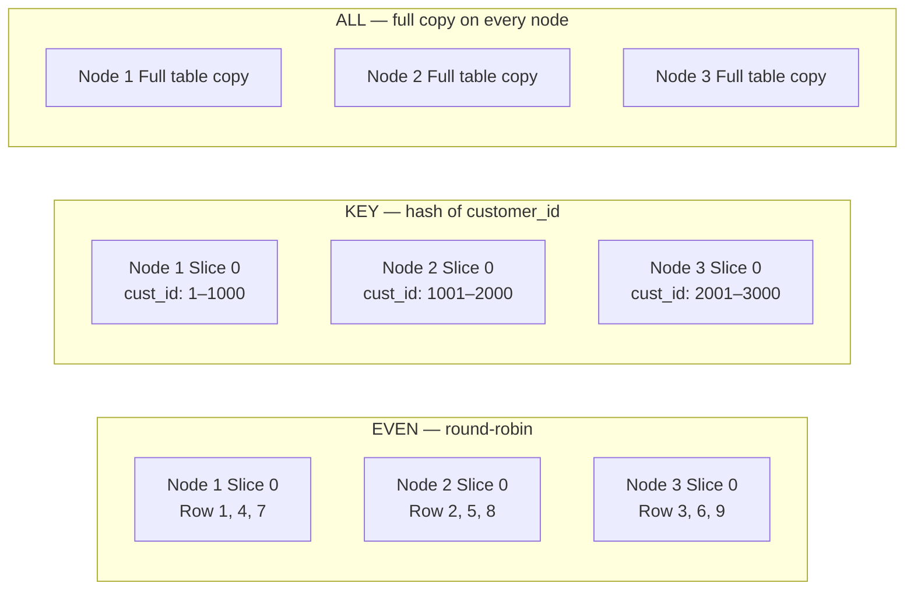

# Amazon Redshift

Amazon Redshift is AWS's managed cloud data warehouse optimized for OLAP analytical workloads. Built on Massively Parallel Processing (MPP) with columnar storage, zone-map pruning, and per-column compression, Redshift delivers high-performance analytical queries at petabyte scale. It is the AWS equivalent of Azure Synapse Dedicated SQL Pool.

## Architecture Overview

A Redshift provisioned cluster consists of three logical layers working together in a coordinated parallel execution model.

```mermaid
flowchart TB
    CLIENT["Client Applications\nBI Tools / SQL Clients / ETL / JDBC"] --> LN

    subgraph CLUSTER["Redshift Cluster"]
        subgraph LN["Leader Node"]
            PARSE["SQL Parsing\n& Semantic Analysis"]
            OPT["Cost-Based Optimization\n& Plan Generation"]
            DIST["Step Distribution\nto Compute Nodes"]
            AGG["Result Aggregation\n& Return"]
        end

        subgraph CN1["Compute Node 1  (ra3.xlplus)"]
            S1A["Slice 0\nData shard + CPU + Memory"]
            S1B["Slice 1\nData shard + CPU + Memory"]
        end

        subgraph CN2["Compute Node 2  (ra3.xlplus)"]
            S2A["Slice 0"]
            S2B["Slice 1"]
        end

        subgraph CNN["Compute Node N..."]
            SNA["Slice 0"]
            SNB["Slice 1"]
        end
    end

    LN --> CN1
    LN --> CN2
    LN --> CNN
    CN1 --> AGG
    CN2 --> AGG
    CNN --> AGG

    style LN fill:#1a2a3a,stroke:#4a9eff
    style CN1 fill:#1a3a2a,stroke:#51cf66
    style CN2 fill:#1a3a2a,stroke:#51cf66
    style CNN fill:#1a3a2a,stroke:#51cf66
```



### Component Roles

| Component | Responsibilities |
|---|---|
| **Leader Node** | Receives client connections; parses and validates SQL; generates a cost-optimized execution plan; compiles and distributes query steps to Compute Nodes; aggregates partial results from all nodes; returns the final result to the client |
| **Compute Nodes** | Execute the distributed query work against the data shards they own; communicate results back to the Leader Node |
| **Slices** | Each Compute Node is subdivided into virtual slices (count depends on node type); each slice independently owns a portion of the table data, its own CPU, and its own memory — enabling true intra-node parallelism |

## Columnar Storage

Redshift stores data column-by-column rather than row-by-row. This is the foundation of its analytical query performance.

```
Row-oriented storage (MySQL, PostgreSQL):
┌───────────────────────────────────────────────┐
│ Row 1: order_id=1001 | date=2025-07-01 | amt=149.99 | status=SHIPPED │
│ Row 2: order_id=1002 | date=2025-07-01 | amt=89.50  | status=PENDING │
└───────────────────────────────────────────────┘
→ Even SELECT amount must read the entire row

Column-oriented storage (Redshift):
┌──────────┐  ┌──────────┐  ┌────────────────┐  ┌────────────┐
│ order_id │  │ date     │  │ amount         │  │ status     │
│ 1001     │  │2025-07-01│  │ 149.99         │  │ SHIPPED    │
│ 1002     │  │2025-07-01│  │ 89.50          │  │ PENDING    │
└──────────┘  └──────────┘  └────────────────┘  └────────────┘
→ SELECT amount reads only the amount column block
```

Benefits for analytical workloads:

- **Columnar projection** — queries that touch 3 out of 50 columns read only those 3 columns.
- **Higher compression** — storing homogeneous data (same type, similar values) compresses 3–10× better than row-based storage.
- **Reduced I/O and network** — less data scanned per query, less data transferred between slices.

## Compression Encoding

Each column in Redshift is compressed independently using the most effective algorithm for its data characteristics.

| Encoding | Best For | Notes |
|---|---|---|
| **AZ64** | Numeric types, dates, timestamps | Amazon proprietary; excellent compression + speed |
| **LZO** | Long varchar strings | High compression ratio; moderate CPU overhead |
| **ZSTD** | General purpose — any type | Good balance of compression ratio and decompression speed |
| **BYTEDICT** | Low-cardinality strings (status, region, category) | Dictionary encoding; very effective for < 256 distinct values |
| **DELTA** | Monotonically increasing integers / timestamps | Stores difference between consecutive values |
| **RAW** | Frequently filtered sort-key columns | No compression; fastest I/O for range scans |

```sql
-- Analyze an existing table and get encoding recommendations
-- Run this after loading representative data (at least 100K rows)
ANALYZE COMPRESSION analytics.fact_orders;

-- Sample output:
-- Table        Column          Encoding   Est_reduction
-- fact_orders  order_id        az64       63%
-- fact_orders  order_date      az64       70%
-- fact_orders  order_status    bytedict   89%
-- fact_orders  amount          az64       55%
```

## Distribution Styles

Distribution determines **which slice on which Compute Node holds each row**. The goal is to co-locate rows that will be joined together, eliminating cross-node network shuffle during query execution.



| Style | Mechanism | Best Use Case | Join Behavior |
|---|---|---|---|
| **AUTO** | Redshift decides; starts EVEN, promotes to KEY when beneficial | Default for new tables | Automatic improvement over time |
| **EVEN** | Round-robin across all slices | Tables without strong join relationships; no natural distribution key | Requires cross-node shuffle for all joins |
| **KEY** | Hash of DISTKEY column → rows with same hash value → same slice | Frequently joined large fact tables (orders, transactions) | Eliminates shuffle for joins on the DISTKEY column |
| **ALL** | Full table replicated on every Compute Node | Small dimension tables (< a few GB) | Eliminates shuffle entirely — local join always |

!!! tip "KEY distribution for star-schema performance"
    When `fact_orders` and `fact_order_items` both use `DISTKEY(customer_id)`, rows for the same customer are co-located on the same slice. The join executes as a local merge join with zero network data movement. This is the single highest-impact Redshift optimization for star-schema workloads.

## Sort Keys

A `SORTKEY` defines the physical order of rows within storage blocks. Redshift maintains **zone maps** — per-block min/max metadata — allowing entire blocks to be skipped for range queries.

```
SORTKEY = order_date

Block 1 (zone map): order_date  2025-01-01 → 2025-03-31
Block 2 (zone map): order_date  2025-04-01 → 2025-06-30
Block 3 (zone map): order_date  2025-07-01 → 2025-09-30
Block 4 (zone map): order_date  2025-10-01 → 2025-12-31

Query: WHERE order_date BETWEEN '2025-07-01' AND '2025-08-31'
→ Skip Blocks 1, 2, 4 (zone map max/min outside range)
→ Scan only Block 3  → 75% I/O reduction
```

| Sort Key Type | Mechanism | Best For |
|---|---|---|
| **Compound** | Columns ordered by priority; primary column is the dominant sort dimension | ORDER BY, range filters, and join predicates on the leading column |
| **Interleaved** | All listed columns weighted equally | Multi-column filter patterns where different queries use different column combinations |

## Creating Optimized Tables

```sql
-- Large fact table: distributed on customer_id, sorted on order_date
CREATE TABLE analytics.fact_orders (
    order_id        BIGINT          ENCODE AZ64        NOT NULL,
    order_date      DATE            ENCODE AZ64        NOT NULL,
    customer_id     INTEGER         ENCODE AZ64        NOT NULL,
    product_id      INTEGER         ENCODE AZ64,
    quantity        SMALLINT        ENCODE AZ64,
    unit_price      DECIMAL(12,2)   ENCODE AZ64,
    order_status    VARCHAR(20)     ENCODE BYTEDICT,
    region          VARCHAR(10)     ENCODE BYTEDICT
)
DISTSTYLE KEY
DISTKEY (customer_id)
COMPOUND SORTKEY (order_date, customer_id);

-- Small dimension table: replicated to every node for broadcast joins
CREATE TABLE analytics.dim_customers (
    customer_id     INTEGER         ENCODE AZ64        NOT NULL,
    customer_name   VARCHAR(100)    ENCODE LZO,
    email           VARCHAR(200)    ENCODE LZO,
    country         VARCHAR(50)     ENCODE BYTEDICT,
    segment         VARCHAR(20)     ENCODE BYTEDICT,
    join_date       DATE            ENCODE AZ64
)
DISTSTYLE ALL
SORTKEY (customer_id);
```

!!! note "DISTKEY vs SORTKEY — the core interview distinction"
    `DISTKEY` controls **where** data goes — which node/slice receives which rows. `SORTKEY` controls **how** data is physically ordered within each node's storage blocks. They solve different performance problems and are typically set on different columns. `DISTKEY` eliminates network shuffle; `SORTKEY` enables zone-map block pruning.

## Loading Data — COPY Command

`COPY` is the primary and most efficient data loading mechanism. It loads files in **parallel** across all Compute Nodes simultaneously, using the full cluster bandwidth.

```sql
-- Parallel bulk load from S3 in Parquet format (fastest, no transformation)
COPY analytics.fact_orders
FROM 's3://data-lake/processed/orders/'
IAM_ROLE 'arn:aws:iam::123456789012:role/RedshiftCopyRole'
FORMAT AS PARQUET;

-- Load from CSV with explicit options
COPY analytics.fact_orders (order_id, order_date, customer_id, order_status, amount)
FROM 's3://data-lake/raw/orders/orders_2025_07.csv'
IAM_ROLE 'arn:aws:iam::123456789012:role/RedshiftCopyRole'
FORMAT AS CSV
DELIMITER ','
IGNOREHEADER 1
DATEFORMAT 'YYYY-MM-DD'
MAXERROR 10
REGION AS 'eu-west-1';
```

### Auto Copy

For continuously arriving files, **Auto Copy** polls an S3 path and automatically loads new files without requiring a scheduled COPY command:

```sql
-- Create an auto copy job that monitors an S3 prefix
CREATE JOB auto_copy_orders
    SCHEDULE RATE(5 MINUTES)
    COPY analytics.fact_orders
    FROM 's3://data-lake/raw/orders/'
    IAM_ROLE 'arn:aws:iam::123456789012:role/RedshiftCopyRole'
    FORMAT AS PARQUET;
```

### CTAS — Create Table As Select

```sql
-- Staging table: create + populate in a single parallel operation
CREATE TABLE analytics.stg_orders_july
DISTSTYLE KEY DISTKEY(customer_id)
SORTKEY(order_date)
AS
SELECT *
FROM analytics.fact_orders
WHERE order_date >= '2025-07-01'
  AND order_date <  '2025-08-01';
```

!!! warning "Never use row-by-row INSERT for bulk loading"
    Inserting rows individually via application JDBC bypasses Redshift's parallel loading mechanism and creates thousands of tiny unsorted storage blocks. Use `COPY` from S3 for any bulk load — even a few thousand rows. Fall back to `INSERT INTO ... SELECT` only for small in-database operations.

## Redshift Spectrum — Query S3 In-Place

**Redshift Spectrum** extends the Redshift query engine to read data directly from S3 using the Glue Data Catalog as the metadata source. Data remains in S3 — no `COPY` required.

```mermaid
flowchart LR
    CLIENT["BI Tool / SQL Client"] --> LN["Redshift Leader Node"]
    LN --> CN["Internal Redshift Tables\n(Compute Nodes)"]
    LN --> SPEC["Redshift Spectrum Nodes\n(Dedicated S3 scan fleet)"]
    SPEC --> GDC["Glue Data Catalog\nExternal table schema"]
    GDC --> S3["Amazon S3\nParquet / ORC / CSV"]

    style SPEC fill:#2a2a1a,stroke:#ffd700
    style CN fill:#1a3a2a,stroke:#51cf66
```



### Setting Up Spectrum

```sql
-- Step 1: Create external schema pointing to Glue Data Catalog
CREATE EXTERNAL SCHEMA spectrum_sales
FROM DATA CATALOG
DATABASE 'analytics_catalog_db'
IAM_ROLE 'arn:aws:iam::123456789012:role/RedshiftSpectrumRole'
CREATE EXTERNAL DATABASE IF NOT EXISTS;

-- Step 2: Create external table (metadata only — data stays in S3)
CREATE EXTERNAL TABLE spectrum_sales.ext_orders (
    order_id        BIGINT,
    customer_id     BIGINT,
    amount          DOUBLE PRECISION,
    order_status    VARCHAR(50)
)
PARTITIONED BY (order_date VARCHAR(10))
STORED AS PARQUET
LOCATION 's3://data-lake/processed/orders/';

-- Step 3: Synchronize partitions from S3
ALTER TABLE spectrum_sales.ext_orders RECOVER PARTITIONS;

-- Step 4: Federated query — join S3 data with internal Redshift table
SELECT
    c.customer_name,
    COUNT(o.order_id)       AS total_orders,
    SUM(o.amount)           AS total_spend,
    ROUND(AVG(o.amount), 2) AS avg_order_value
FROM analytics.dim_customers c
JOIN spectrum_sales.ext_orders o
  ON c.customer_id = o.customer_id
WHERE o.order_date = '2025-07-25'
GROUP BY c.customer_name
ORDER BY total_spend DESC
LIMIT 20;
```

### COPY vs Spectrum

| Feature | COPY (ingest into Redshift) | Spectrum (query S3 in-place) |
|---|---|---|
| Data location | Moved into Redshift managed storage | Stays in S3 — zero data movement |
| Query performance | Fastest — data local to compute slices | Slower — S3 scans per query |
| Storage cost | Redshift managed storage fee | S3 storage fee only (cheaper) |
| Scan charges | None (data already loaded) | $5 per TB scanned |
| Best for | Frequently queried hot data | Historical / archival / large cold data |

## Workload Management (WLM)

WLM creates **query queues** to isolate different user classes and prevent a heavy ETL batch job from consuming all resources and starving interactive BI queries.

```sql
-- Assign an ETL session to the etl queue
SET query_group TO 'etl';

-- Assign a BI tool session to the bi_users queue
SET query_group TO 'bi_users';
```

| Queue | Max Concurrency | Memory % | Priority | Typical Users |
|---|---|---|---|---|
| ETL | 2 | 40% | Normal | Glue jobs, nightly COPY loads |
| BI | 10 | 40% | High | Tableau, QuickSight, dashboards |
| Ad-hoc | 5 | 20% | Low | Analysts, exploratory queries |

**Concurrency Scaling** — when a queue hits its concurrency limit, Redshift can automatically add transient Compute Nodes to handle the overflow workload. Charged at $6 per node-hour; first 1 hour per day is free.

**Result Set Caching** — Redshift caches query result sets. Identical subsequent queries return instantly from cache (no re-scan). Cache is invalidated when the underlying table is modified. Useful for dashboard queries that many users run simultaneously.

## Provisioned vs Serverless

| Feature | Provisioned (RA3) | Redshift Serverless |
|---|---|---|
| Infrastructure | Fixed RA3 node cluster | Fully AWS-managed |
| Compute unit | Nodes (ra3.xlplus / ra3.4xlarge / ra3.16xlarge) | RPUs (Redshift Processing Units) |
| Billing | Per node-hour + managed storage | Per RPU-second consumed |
| Scaling | Manual / elastic resize | Automatic |
| Cold start | None (always running) | Seconds to minutes after pause |
| Idle cost | Full hourly rate even when idle | Near-zero (auto-pauses after inactivity) |
| Tuning control | Full — WLM, sort/dist keys, vacuum schedule | Limited |
| Best for | Consistent high-concurrency BI workloads | Variable / unpredictable query patterns |

**Provisioned cost example** — 4 × ra3.xlplus, 730 hours/month:

```
Compute:  4 nodes × $0.65/node-hr × 730 hr       = $1,898/month
Storage:  40 TB × $0.024/GB/month × 1024 GB/TB   =   $983/month
Spectrum: 20 TB scanned × $5/TB                  =   $100/month
                                                    ──────────────
Total:                                            ≈ $2,981/month
```

**Serverless RPU cost example** — 128 RPUs, 630 s/run, 13 runs/day:

```
Daily runtime:  13 × 630 s = 8,190 s = 2.275 hours
Daily cost:     128 RPU × 2.275 hr × $0.375/RPU-hr = $10.92/day
Monthly:        $10.92 × 30 ≈ $328/month
```

## Table Maintenance — VACUUM and ANALYZE

Redshift does not automatically reclaim space or maintain statistics. Both must be scheduled.

```sql
-- VACUUM FULL: reclaim deleted-row space AND re-sort rows by SORTKEY
-- Most thorough — run after large DELETE / UPDATE / data loads
VACUUM FULL analytics.fact_orders;

-- VACUUM DELETE ONLY: reclaim deleted-row space without re-sorting
-- Faster than VACUUM FULL — good for tables that are rarely queried by range
VACUUM DELETE ONLY analytics.fact_orders;

-- VACUUM SORT ONLY: re-sort unsorted rows without reclaiming space
-- Use when zone map pruning is degrading but space isn't a concern
VACUUM SORT ONLY analytics.fact_orders;

-- Check how much unsorted data exists before running VACUUM
SELECT schema, "table", size, unsorted, stats_off
FROM SVV_TABLE_INFO
WHERE schema = 'analytics'
ORDER BY unsorted DESC;

-- ANALYZE: update statistics used by the cost-based query planner
-- Run after any large COPY, DELETE, or UPDATE operation
ANALYZE analytics.fact_orders;

-- Deep ANALYZE: more accurate statistics (slower)
ANALYZE analytics.fact_orders PREDICATE COLUMNS;
```

!!! tip "When to schedule VACUUM"
    Run `VACUUM FULL` during an off-peak maintenance window after large bulk loads or mass-delete operations. Monitor `SVV_TABLE_INFO.unsorted` — if above 20%, the query planner is working with an increasingly unsorted table and zone-map pruning effectiveness degrades.

!!! warning "ANALYZE after COPY is mandatory in production"
    After loading significant data with `COPY`, the query planner's statistics are stale. Without fresh statistics, the planner may choose extremely suboptimal join strategies (e.g., using a hash join instead of a sort-merge join), causing queries to run 10–100× slower.

## Incremental ETL Pattern — Production Example

The following pattern implements a watermark-based incremental load from S3 into Redshift using Spectrum as a staging intermediary:

```sql
-- Step 1: External schema and table already defined (see Spectrum section)
-- Step 2: Recover partitions after Glue ETL writes new Parquet files
ALTER TABLE spectrum_sales.ext_orders RECOVER PARTITIONS;

-- Step 3: Merge new records into internal Redshift fact table
-- Uses MERGE (upsert) to handle re-delivered records idempotently
MERGE INTO analytics.fact_orders AS target
USING (
    SELECT
        order_id,
        order_date,
        customer_id,
        amount,
        order_status
    FROM spectrum_sales.ext_orders
    WHERE order_date = '2025-07-25'   -- partition filter — only today's data
) AS source
ON target.order_id = source.order_id
WHEN MATCHED THEN
    UPDATE SET
        order_status = source.order_status,
        amount       = source.amount
WHEN NOT MATCHED THEN
    INSERT (order_id, order_date, customer_id, amount, order_status)
    VALUES (source.order_id, source.order_date, source.customer_id,
            source.amount, source.order_status);

-- Step 4: Refresh statistics after the merge
ANALYZE analytics.fact_orders PREDICATE COLUMNS;
```

## Spectrum File-Format Optimization

Spectrum charges per TB scanned. Parquet + compression reduces scanned bytes dramatically:

| Format | Storage Size | Data Scanned (1 of 100 cols queried) | Spectrum Cost |
|---|---|---|---|
| Uncompressed CSV | 4 TB | 4 TB | $20.00 |
| Gzip CSV | ~1 TB | ~1 TB | $5.00 |
| Snappy Parquet | ~200 GB | ~10 GB | $0.05 |

The 99.75% cost reduction comes from two effects: compression reduces the physical file size, and columnar format means only the queried column's data blocks are read — the other 99 columns are skipped entirely.

## Schema Evolution in Incremental Loads

When source schemas change — for example, a new column is added to upstream Parquet files — the Redshift load pipeline must handle the change gracefully.

**Pattern 1 — Spectrum + Glue Catalog (recommended):**

```sql
-- After Glue Crawler updates the catalog with the new column,
-- Spectrum automatically reads it. Historical files return NULL.
SELECT order_id, amount, discount_code   -- new column
FROM spectrum_sales.ext_orders
WHERE order_date = '2025-08-01';
-- Files before discount_code was added: discount_code = NULL
```

**Pattern 2 — COPY with explicit column list (for internal Redshift tables):**

```sql
-- Add the new column to the internal Redshift table first
ALTER TABLE analytics.fact_orders ADD COLUMN discount_code VARCHAR(20);

-- COPY with explicit column mapping — new column defaults to NULL for old files
COPY analytics.fact_orders (order_id, order_date, customer_id, amount, order_status)
FROM 's3://data-lake/processed/orders/year=2025/month=08/'
IAM_ROLE 'arn:aws:iam::123456789012:role/RedshiftCopyRole'
FORMAT AS PARQUET;
```

!!! warning "Schema changes need coordination"
    Always apply `ALTER TABLE ... ADD COLUMN` to the Redshift internal table before running `COPY` or `MERGE` against new Parquet files that contain the additional column. If the Redshift table lacks the column and the Parquet file contains it, the COPY succeeds by ignoring the extra column. If the Redshift table has the column but the file does not, the column receives NULL.

## Common Anti-Patterns

| Anti-Pattern | Problem | Correct Approach |
|---|---|---|
| `SELECT *` on large fact tables | Reads all columns — eliminates columnar benefit | Select only the columns required |
| Row-by-row `INSERT` from application | No parallel loading; creates tiny blocks | Use `COPY` from S3 for bulk loads |
| No DISTKEY on large tables that are joined | Every join requires expensive cross-node shuffle | Set `DISTKEY` on the most frequently joined column |
| No SORTKEY on date/range-filtered columns | Zone-map pruning disabled; full table scan | Set `SORTKEY (order_date)` on every fact table |
| Identical DISTKEY and SORTKEY column | Less effective than using different columns | DISTKEY = join key; SORTKEY = time/range filter |
| Running VACUUM during peak hours | Competes with user queries for I/O throughput | Schedule in maintenance window (e.g., 02:00 AM) |
| Querying Spectrum with uncompressed CSV | 20–400× higher scan cost vs Parquet | Always write to S3 in compressed Parquet |
| Forgetting ANALYZE after COPY | Stale statistics → poor query plans | Run `ANALYZE` after every significant data load |

## Common Interview Questions

**Q: What is Massively Parallel Processing (MPP) in Redshift?**

MPP means the query is divided into multiple steps distributed across all Compute Node slices simultaneously. Each slice processes its own data shard independently and returns partial results to the Leader Node, which aggregates them. The total query time is proportional to the longest-running slice rather than the total data size — adding more nodes or slices reduces query time.

**Q: What is the difference between DISTKEY and SORTKEY?**

`DISTKEY` determines which node and slice each row is assigned to — it controls the physical distribution of data across the cluster. `SORTKEY` determines the physical ordering of rows within each node's storage blocks — it enables zone-map pruning for range and equality predicates. They solve different problems: DISTKEY eliminates join shuffle; SORTKEY enables block-level pruning.

**Q: When would you use DISTSTYLE ALL?**

For small dimension tables (country codes, product categories, status lookup tables — typically less than a few GB). Replicating the entire table to every Compute Node means any join on that table can be executed as a local merge join with zero network data movement. The storage overhead is acceptable given the size.

**Q: What is Redshift Spectrum and when would you use it?**

Spectrum extends the Redshift query engine to query Parquet / ORC / CSV files directly in S3 via the Glue Data Catalog, without loading the data into Redshift managed storage. Use Spectrum for historical / archival / cold data that is too large or infrequently accessed to justify loading into Redshift, or to join freshly landed S3 data with internal Redshift tables before a full load cycle.

**Q: What does VACUUM do in Redshift?**

VACUUM performs two operations: it reclaims disk space from soft-deleted rows (rows are logically deleted but remain on disk until VACUUM runs), and it re-sorts unsorted rows according to the table's SORTKEY (ensuring zone-map pruning remains effective after data is inserted out of order). `VACUUM FULL` does both; `VACUUM DELETE ONLY` reclaims space without sorting; `VACUUM SORT ONLY` re-sorts without reclaiming space.
