# Amazon S3 & AWS Lambda

Amazon S3 is the storage backbone of every AWS data lake architecture — it provides virtually unlimited, highly durable object storage that all AWS analytics services read from and write to. AWS Lambda is the event-driven compute layer that reacts to S3 events in real time, acting as the glue between storage and processing. Together they enable reactive, serverless data engineering patterns.

---

## Amazon S3

### Object Storage Model

Amazon S3 (Simple Storage Service) stores data as **objects** identified by a key within a globally-namespaced bucket. There are no true directories — the `/` characters in key names are a convention used by tools like Athena and Glue to infer partition structure, but S3 itself treats the entire key as a flat string.

```
GLOBAL AWS NAMESPACE
        │
     REGION  (e.g., eu-west-1)
        │
     BUCKET  (globally unique: company-data-lake-prod)
        │
  OBJECT KEY  (raw/orders/year=2025/month=07/orders_part0001.parquet)
        │
   ┌────┴────┐
   │         │
  DATA     METADATA
(payload)  (Content-Type, ETag, custom tags, ACL policy)
```

| Property | Value |
|---|---|
| **Designed durability** | 99.999999999% — eleven 9s |
| **Maximum object size** | 5 TB (use multipart upload for > 5 GB) |
| **Bucket namespace** | Global — unique across all AWS accounts worldwide |
| **Storage model** | Flat object store — no true directory hierarchy |
| **Versioning** | Optional; preserves all object versions; enables recovery from accidental deletes |
| **Consistency model** | Strong read-after-write consistency (since December 2020) |

!!! info "No real directories"
    The key `raw/orders/year=2025/month=07/data.parquet` is a single object whose key contains `/` characters. Athena and Glue use these as partition prefix hints, but S3 itself has no concept of a folder. S3 Select, LIST, and prefix-based operations work by matching the key string.

### Storage Classes

S3 provides seven storage classes covering the full spectrum from millisecond-latency hot data to 12-hour-retrieval cold archives.

| Storage Class | Access Pattern | Min. Duration | Retrieval | Relative Cost |
|---|---|---|---|---|
| **S3 Standard** | Frequent — daily | None | Milliseconds | Highest |
| **S3 Intelligent-Tiering** | Unknown / variable | None | Milliseconds (hot) | Auto-optimized |
| **S3 Standard-IA** | Infrequent — monthly | 30 days | Milliseconds | Lower + retrieval fee |
| **S3 One Zone-IA** | Infrequent, single AZ | 30 days | Milliseconds | Lower still |
| **S3 Glacier Instant Retrieval** | Rare, needs immediate access | 90 days | Milliseconds | Low |
| **S3 Glacier Flexible Retrieval** | Rare, batch access acceptable | 90 days | Minutes to hours | Very low |
| **S3 Glacier Deep Archive** | Long-term preservation | 180 days | Up to 12 hours | Cheapest |

!!! warning "One Zone-IA durability risk"
    S3 One Zone-IA stores data in a single Availability Zone. If that AZ is destroyed, the data is lost. Use it only for reproducible intermediaries (processed outputs that can be re-derived from Standard-tier raw data). Never use it for irreplaceable source data.

**Intelligent-Tiering internals:**
S3 Intelligent-Tiering monitors access patterns at the object level and automatically moves objects between a Frequent Access tier and an Infrequent Access tier (after 30 days without access). A small monthly monitoring fee applies per object but no retrieval fees are charged.

### S3 Lifecycle Policies

Lifecycle rules automate object transitions between storage classes and expiration — eliminating manual data movement.

```yaml
# lifecycle-policy.json — example lifecycle configuration
Rules:
  - ID: "data-lake-tiering"
    Status: Enabled
    Filter:
      Prefix: "raw/"
    Transitions:
      - Days: 30
        StorageClass: STANDARD_IA        # infrequent access after 30 days
      - Days: 90
        StorageClass: GLACIER_IR         # glacier instant after 90 days
      - Days: 365
        StorageClass: DEEP_ARCHIVE       # deep archive after 1 year
    Expiration:
      Days: 2555                         # delete after 7 years

  - ID: "temp-cleanup"
    Status: Enabled
    Filter:
      Prefix: "tmp/"
    Expiration:
      Days: 7                            # auto-delete temp files after 7 days

  - ID: "incomplete-multipart-cleanup"
    Status: Enabled
    AbortIncompleteMultipartUpload:
      DaysAfterInitiation: 3             # abort stalled multipart uploads
```

Apply via CLI:

```bash
aws s3api put-bucket-lifecycle-configuration \
  --bucket company-data-lake-prod \
  --lifecycle-configuration file://lifecycle-policy.json
```

### S3 Security Model

| Mechanism | Scope | Common Use |
|---|---|---|
| **Bucket Policy** (resource-based IAM) | Entire bucket or key prefix | Cross-account access grants; deny all except specific roles |
| **IAM Policy** (identity-based) | Attached to user / role / group | Grant EMR role read access to raw/, Glue role write to processed/ |
| **ACLs** (legacy) | Individual objects | Avoid — use bucket policies for all new architectures |
| **S3 Block Public Access** | Account or bucket level | Override all ACLs and bucket policies that would allow public access |
| **Pre-signed URLs** | Single object, time-limited | Temporary download URL for external partners (no AWS credentials needed) |
| **SSE-S3** | Server-side encryption | AWS-managed keys — no additional cost |
| **SSE-KMS** | Server-side encryption | Customer-managed KMS keys — audit trail via CloudTrail, key rotation |
| **SSE-C** | Server-side encryption | Customer provides key per request — AWS never stores the key |

```python
import boto3

s3 = boto3.client('s3', region_name='eu-west-1')

# Generate a pre-signed URL valid for 1 hour
presigned_url = s3.generate_presigned_url(
    ClientMethod='get_object',
    Params={
        'Bucket': 'company-data-lake-prod',
        'Key':    'reports/q3_summary_2025.pdf'
    },
    ExpiresIn=3600   # seconds
)
# Share this URL via email — no AWS credentials required; auto-expires
```

### S3 Performance Patterns

**Multi-part upload** — required for objects over 5 GB, strongly recommended for anything over 100 MB:

```python
from boto3.s3.transfer import TransferConfig
import boto3

s3 = boto3.client('s3')
config = TransferConfig(
    multipart_threshold=100 * 1024 * 1024,   # 100 MB — use multipart above this
    multipart_chunksize=50  * 1024 * 1024,   # 50 MB chunk size
    max_concurrency=10                         # 10 parallel upload threads
)

s3.upload_file(
    '/data/large_export.parquet',
    'company-data-lake-prod',
    'processed/exports/large_export.parquet',
    Config=config
)
```

**S3 Select** — server-side row and column filter at the object level, reducing bytes transferred to the application:

```python
response = s3.select_object_content(
    Bucket='company-data-lake-prod',
    Key='raw/orders/orders_2025_07.csv',
    ExpressionType='SQL',
    Expression="SELECT s.order_id, s.amount FROM S3Object s WHERE s.status = 'COMPLETED'",
    InputSerialization={'CSV': {'FileHeaderInfo': 'USE'}},
    OutputSerialization={'CSV': {}}
)
```

**Transfer Acceleration** — routes uploads through AWS CloudFront edge locations for faster uploads from distant geographies. Useful for cross-continent data collection pipelines.

### Partitioned Data Lake Layout

Hive-style key prefixes enable Athena and Glue to prune irrelevant S3 prefixes without scanning unrelated data:

```
s3://data-lake/processed/orders/
    ├── year=2024/
    │   ├── month=11/day=01/  data_0001.parquet
    │   └── month=12/day=01/  data_0001.parquet
    ├── year=2025/
    │   ├── month=01/day=01/  data_0001.parquet
    │   └── month=07/day=15/  data_0001.parquet   ← query only scans this prefix
    └── year=2026/
        └── month=01/day=01/  data_0001.parquet
```

```sql
-- Athena scans only year=2025/month=07/day=15/ — all other prefixes skipped
SELECT order_id, amount
FROM analytics.orders
WHERE year = '2025' AND month = '07' AND day = '15'
  AND status = 'COMPLETED';
```

### S3 Pricing Factors

| Factor | Pricing Mechanism |
|---|---|
| **Storage** | Per GB/month — rate varies by storage class |
| **PUT / COPY / POST** | Per 1,000 requests |
| **GET / SELECT** | Per 1,000 requests |
| **LIST** | Per 1,000 requests |
| **Data transfer out** | Charged for traffic leaving to internet or cross-region |
| **Data transfer in** | Free from internet into S3 |
| **Within-region** | S3 to EC2 / Lambda / Glue / EMR in same region is free |
| **Glacier retrieval** | Per GB retrieved + per request (bulk cheapest, expedited most expensive) |

---

## AWS Lambda

### Lambda for Data Engineering

Lambda is a **serverless compute** service — you write a function, AWS executes it in response to events, scales it horizontally with concurrency, and charges only for execution duration (measured in milliseconds). In a data engineering context, Lambda is not an ETL engine — it is **event-driven glue code** that routes, validates, triggers, and coordinates.

```mermaid
flowchart LR
    S3["S3: ObjectCreated\nnew Parquet file arrived"] --> LM["AWS Lambda\nlambda_handler()"]
    LM --> A["Trigger Glue ETL job"]
    LM --> B["Trigger EMR step"]
    LM --> C["Start Step Functions workflow"]
    LM --> D["Copy file to another bucket\n(routing / fan-out)"]
    LM --> E["Schema validation gate\n(reject malformed files)"]
    LM --> F["Send SNS / Slack notification"]

    style LM fill:#2a1a1a,stroke:#ff6b6b
```



### Lambda Execution Constraints

| Constraint | Limit |
|---|---|
| **Max execution time** | 15 minutes (900 seconds) |
| **Max memory** | 10 GB (configurable) |
| **Default memory** | 128 MB |
| **Ephemeral disk (/tmp)** | 512 MB (configurable to 10 GB) |
| **Deployment package size** | 50 MB zipped / 250 MB unzipped |
| **Concurrent executions (account)** | 1,000 (soft limit, can be raised) |

!!! warning "Lambda is not an ETL engine"
    Lambda cannot run Spark jobs. Maximum 15-minute execution time and limited memory make it unsuitable for large data transformations. Use Lambda only to trigger EMR steps, start Glue job runs, invoke Step Functions, or perform lightweight file operations (< a few hundred MB). All heavy processing belongs in EMR, Glue, or Athena.

### S3 Event Trigger Pattern

The most common data engineering Lambda pattern: a file lands in S3, triggers Lambda, Lambda starts a downstream job.

```python
import boto3
import os
import logging

logger = logging.getLogger()
logger.setLevel(logging.INFO)

# Initialize clients outside the handler — reused across warm invocations
glue_client = boto3.client('glue', region_name=os.environ['AWS_REGION'])

def lambda_handler(event, context):
    """
    Triggered by S3 ObjectCreated event.
    Parses the event payload and starts a downstream Glue ETL job.
    """
    record       = event['Records'][0]
    source_bucket = record['s3']['bucket']['name']
    source_key    = record['s3']['object']['key']

    logger.info(f"New S3 object: s3://{source_bucket}/{source_key}")

    # Guard: only process Parquet files in the landing/ prefix
    if not (source_key.startswith('landing/') and source_key.endswith('.parquet')):
        logger.info("File does not match criteria — skipping.")
        return {'statusCode': 200, 'body': 'Skipped'}

    glue_job_name = os.environ.get('GLUE_JOB_NAME', 'data_cleansing_job')

    # Trigger Glue job with source file coordinates as arguments
    response = glue_client.start_job_run(
        JobName=glue_job_name,
        Arguments={
            '--SOURCE_BUCKET': source_bucket,
            '--SOURCE_KEY':    source_key
        }
    )

    run_id = response['JobRunId']
    logger.info(f"Started Glue job {glue_job_name} — RunId: {run_id}")

    return {
        'statusCode': 200,
        'body': f"Triggered {glue_job_name} / RunId: {run_id}"
    }
```

### Lambda Layers — Packaging Shared Dependencies

A **Lambda Layer** is a `.zip` archive containing shared Python libraries that can be attached to multiple Lambda functions, avoiding duplication across deployment packages.

```
Without layers:                  With a shared layer:
─────────────────────────        ─────────────────────────────
Function A .zip (50 MB)                pandas + boto3 layer
  ├── handler.py                    ─────────────────────
  ├── pandas/                    Function A .zip (tiny)
  └── boto3/                       └── handler.py
Function B .zip (50 MB)          Function B .zip (tiny)
  ├── handler.py                    └── handler.py
  ├── pandas/                    Function C .zip (tiny)
  └── boto3/                        └── handler.py
```

```bash
# Build and publish a shared data-engineering layer
mkdir -p layer/python/lib/python3.12/site-packages
pip install pandas boto3 pyarrow requests \
    --target layer/python/lib/python3.12/site-packages \
    --quiet

cd layer && zip -r ../data_engineering_layer.zip . && cd ..

aws lambda publish-layer-version \
  --layer-name data-engineering-deps \
  --description "pandas, boto3, pyarrow, requests for data engineering Lambdas" \
  --zip-file fileb://data_engineering_layer.zip \
  --compatible-runtimes python3.12
```

### Environment Variables and Secrets

Configuration that varies between environments should come from environment variables. Credentials must never be hardcoded.

```python
import boto3
import json
import os

def get_secret(secret_arn: str) -> dict:
    """Retrieve a secret from AWS Secrets Manager."""
    client = boto3.client('secretsmanager', region_name=os.environ['AWS_REGION'])
    return json.loads(client.get_secret_value(SecretId=secret_arn)['SecretString'])

def lambda_handler(event, context):
    # Non-sensitive config from Lambda environment variables
    target_bucket  = os.environ['TARGET_BUCKET']
    glue_job_name  = os.environ['GLUE_JOB_NAME']
    environment    = os.environ['ENVIRONMENT']    # dev / staging / prod

    # Sensitive credentials from Secrets Manager — never in env vars
    db_secret_arn = os.environ['DB_SECRET_ARN']
    db_creds      = get_secret(db_secret_arn)
    db_host       = db_creds['host']
    db_password   = db_creds['password']
```

### Fan-Out Pattern

One S3 event can trigger multiple parallel downstream operations:

```mermaid
flowchart LR
    S3["S3 ObjectCreated\nraw/orders/new_batch.parquet"] --> LM["Lambda — fan-out dispatcher"]
    LM --> G1["Glue: data quality check"]
    LM --> G2["Glue: silver transform"]
    LM --> SF["Step Functions: orchestrated workflow"]
    LM --> SNS["SNS: monitoring alert"]

    style LM fill:#2a1a1a,stroke:#ff6b6b
```



```python
def lambda_handler(event, context):
    source_key = event['Records'][0]['s3']['object']['key']

    # Fan out — start multiple Glue jobs in parallel for the same file
    jobs = ['data_quality_job', 'silver_transform_job', 'pii_scan_job']
    for job_name in jobs:
        glue_client.start_job_run(
            JobName=job_name,
            Arguments={'--SOURCE_KEY': source_key}
        )
```

### EventBridge Scheduling

For batch workloads on fixed schedules (rather than file-event triggers), **Amazon EventBridge** provides cron-based rules that trigger Lambda, Glue jobs, Step Functions, or EMR step submissions.

| Schedule Requirement | EventBridge Cron Expression |
|---|---|
| Every 5 minutes | `cron(*/5 * * * ? *)` |
| Daily at 02:30 AM UTC | `cron(30 2 * * ? *)` |
| Mon–Fri, hourly 09:00–17:00 UTC | `cron(0 9-17 ? * MON-FRI *)` |
| 1st of every month at midnight | `cron(0 0 1 * ? *)` |

```python
# EventBridge → Lambda → Glue (scheduled batch extraction)
def lambda_handler(event, context):
    """
    Triggered by EventBridge cron rule (not S3 event).
    Starts the nightly incremental Glue extraction job.
    """
    from datetime import datetime, timezone

    run_date = datetime.now(timezone.utc).strftime('%Y-%m-%d')

    response = glue_client.start_job_run(
        JobName=os.environ['EXTRACTION_JOB_NAME'],
        Arguments={
            '--RUN_DATE':    run_date,
            '--ENVIRONMENT': os.environ['ENVIRONMENT']
        }
    )
    logger.info(f"Nightly extraction started — RunId: {response['JobRunId']}")
    return {'statusCode': 200, 'body': response['JobRunId']}
```

**Lambda vs EventBridge — decision:**

| Trigger | Best For |
|---|---|
| **S3 event → Lambda** | React immediately when a specific file arrives; 1-to-1 file routing; near-instant latency |
| **EventBridge cron → Lambda/Glue** | Fixed-schedule batch; multi-target fan-out (one event → Glue + SQS + SNS + Step Functions simultaneously) |

### Cross-Cloud Pattern — S3 to ADLS Gen2

Lambda can bridge data from AWS S3 to Azure ADLS Gen2 for multi-cloud architectures:

```python
import boto3
import os
from azure.storage.blob import BlobServiceClient

s3_client = boto3.client('s3')

def lambda_handler(event, context):
    source_bucket = event['Records'][0]['s3']['bucket']['name']
    source_key    = event['Records'][0]['s3']['object']['key']
    filename      = source_key.split('/')[-1]
    local_path    = f"/tmp/{filename}"

    # Download from S3 into Lambda /tmp (max 10 GB with config)
    s3_client.download_file(source_bucket, source_key, local_path)

    # Upload to Azure ADLS Gen2 (azure-storage-blob in Lambda Layer)
    blob_service = BlobServiceClient.from_connection_string(
        os.environ['ADLS_CONNECTION_STRING']
    )
    blob_client = blob_service.get_blob_client(
        container=os.environ['ADLS_CONTAINER'],
        blob=source_key
    )

    with open(local_path, 'rb') as data:
        blob_client.upload_blob(data, overwrite=True)

    return {'statusCode': 200, 'body': f"Mirrored {source_key} to ADLS Gen2"}
```

!!! warning "/tmp size limit"
    Lambda's `/tmp` ephemeral storage is 512 MB by default (configurable to 10 GB via `EphemeralStorage` setting). For files larger than the available /tmp space, stream directly using chunked reads rather than downloading the entire file.

## End-to-End Pattern — S3 + Lambda in a Pipeline

```mermaid
flowchart TB
    subgraph INGEST["Ingestion"]
        SRC["Source System\n(RDS / API / Kafka)"] -->|file upload| LAND["S3 Landing\ns3://data-lake/raw/"]
    end

    subgraph EVENT["Event Layer"]
        LAND -->|"ObjectCreated"| LM["Lambda\n(validator / dispatcher)"]
        EB["EventBridge cron\n(scheduled batch)"] --> LM
    end

    subgraph PROCESS["Processing"]
        LM -->|"start_job_run()"| GLUE["Glue ETL\n(quality + PII masking)"]
        LM -->|"add-steps"| EMR["EMR Spark\n(complex transforms)"]
    end

    subgraph STORE["Processed Zone"]
        GLUE --> PROC["S3 Processed\ns3://data-lake/processed/\n(Parquet + Snappy, partitioned)"]
        EMR  --> PROC
    end

    PROC --> GDC["Glue Data Catalog\n(partition update)"]
    GDC  --> ATHENA["Athena — ad-hoc SQL"]
    PROC --> RS["Redshift — COPY into DWH"]

    style INGEST fill:#1a2a3a,stroke:#4a9eff
    style EVENT  fill:#2a1a1a,stroke:#ff6b6b
    style PROCESS fill:#2a1a2a,stroke:#cc5de8
    style STORE  fill:#1a3a2a,stroke:#51cf66
```



## S3 Event Notification Configuration

S3 event notifications are configured at the bucket level. Multiple notification targets can be attached to the same bucket prefix:

```json
{
  "LambdaFunctionConfigurations": [
    {
      "LambdaFunctionArn": "arn:aws:lambda:eu-west-1:123456789012:function:s3-dispatcher",
      "Events": ["s3:ObjectCreated:*"],
      "Filter": {
        "Key": {
          "FilterRules": [
            {"Name": "prefix", "Value": "landing/orders/"},
            {"Name": "suffix", "Value": ".parquet"}
          ]
        }
      }
    }
  ],
  "QueueConfigurations": [
    {
      "QueueArn": "arn:aws:sqs:eu-west-1:123456789012:data-lake-events",
      "Events": ["s3:ObjectCreated:*"],
      "Filter": {
        "Key": {
          "FilterRules": [
            {"Name": "prefix", "Value": "landing/"}
          ]
        }
      }
    }
  ]
}
```

Applying via CLI:

```bash
aws s3api put-bucket-notification-configuration \
  --bucket company-data-lake-prod \
  --notification-configuration file://notification-config.json
```

!!! tip "Use SQS as a buffer for high-volume events"
    For high-volume S3 buckets with thousands of object uploads per minute, route events through an SQS queue rather than directly to Lambda. The queue buffers events, prevents Lambda throttling, and provides at-least-once delivery guarantees with visibility timeout-based retry.

## Common Interview Questions

**Q: What is the difference between S3 Standard, Standard-IA, and Glacier?**

S3 Standard is for frequently accessed data — low latency, highest cost. Standard-IA is for infrequently accessed data — lower storage cost but a per-GB retrieval fee and a 30-day minimum. Glacier (Instant / Flexible / Deep Archive) is for archival data — lowest storage cost but retrieval latency ranging from milliseconds to 12 hours, with minimum storage durations.

**Q: What is S3 Intelligent-Tiering and when would you use it?**

Intelligent-Tiering automatically monitors per-object access patterns and moves objects to lower-cost tiers when they go unaccessed for 30 days. Use it when access patterns are unknown or highly variable — for example, a data lake where some historical partitions are queried frequently by analysts and others are rarely touched.

**Q: What is AWS Lambda's role in a data engineering pipeline?**

Lambda acts as the event-driven coordination layer, not the transformation layer. It responds to S3 events (new file arrived), parses the event payload, and triggers downstream processing — starting a Glue job, submitting an EMR step, or invoking Step Functions. The actual data transformation happens in EMR, Glue, or Athena, not inside Lambda.

**Q: Why is it important to initialize boto3 clients outside the Lambda handler?**

Lambda reuses execution environments (warm starts) for a period after the first invocation. If the boto3 client is created inside the handler, it is re-initialized on every invocation — including the overhead of establishing a connection. Initializing it at module level means it is created once and reused across all warm invocations of the same environment.

**Q: What is a Lambda Layer and why is it useful?**

A Lambda Layer is a `.zip` archive of shared dependencies (Python libraries, custom modules) that can be attached to multiple Lambda functions. It avoids duplicating large packages (like pandas or pyarrow) in every function's deployment package, reduces deployment package size, and allows shared library versions to be updated independently of individual function code.
