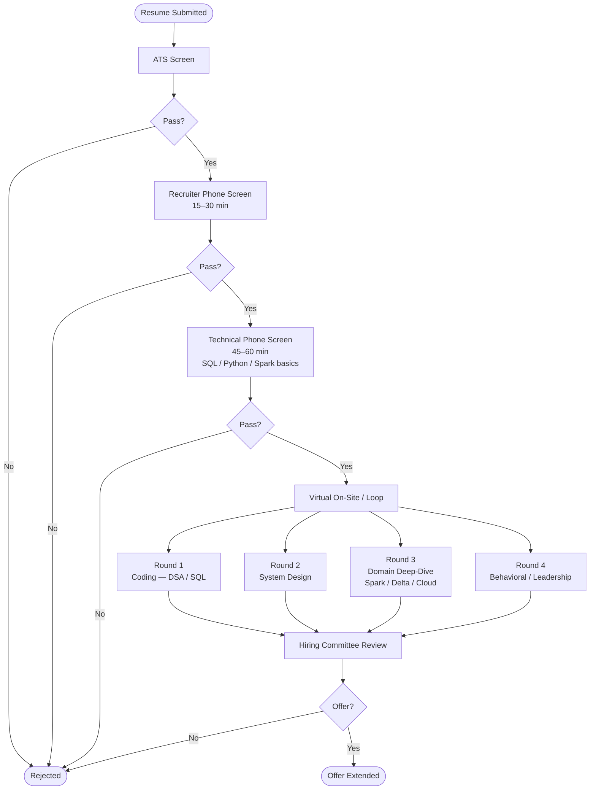
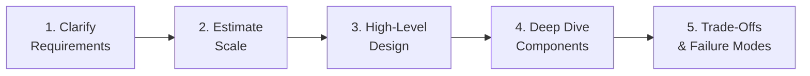
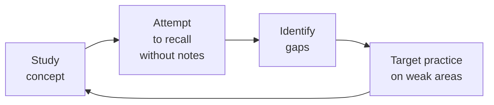

# Interview Preparation

This module prepares you for data engineering interviews at every stage — from the initial recruiter screen through system design rounds and final behavioral panels. The pages that follow cover system design frameworks, a technical Q&A bank, data structures and algorithms, and resume strategy. This page maps the overall process so you know what to expect and how to prioritize your preparation.

---

## The Data Engineering Interview Landscape

Data engineering roles sit at the intersection of software engineering and data infrastructure. Interviewers are evaluating three dimensions simultaneously:

1. **Technical depth** — Do you understand how distributed systems actually work, not just the API surface?
2. **Engineering judgment** — Can you make reasonable trade-off decisions under ambiguity?
3. **Communication** — Can you explain complex systems clearly to both technical and non-technical audiences?

Unlike pure software engineering interviews, DE interviews weight system design and domain knowledge more heavily than algorithmic puzzles. You will rarely be asked to implement a red-black tree, but you will be asked to design a CDC pipeline or explain why your Spark job is skewed.

---

## Typical Interview Process



---

## What Each Stage Tests

| Stage | Duration | What You're Being Evaluated On |
|---|---|---|
| ATS / Resume Screen | Automated | Keywords, formatting, quantified impact |
| Recruiter Phone Screen | 15–30 min | Communication, role fit, notice period |
| Technical Phone Screen | 45–60 min | SQL proficiency, Python basics, Spark concepts |
| Coding Round | 45–60 min | Data structures, algorithms, SQL patterns |
| System Design Round | 45–60 min | Architecture breadth, trade-off reasoning |
| Domain Deep-Dive | 45–60 min | Spark internals, Delta Lake, cloud platform |
| Behavioral Round | 30–45 min | STAR stories, collaboration, ownership |

---

## How to Structure Your Answers

### Behavioral Questions — STAR Framework

STAR is the standard structure for behavioral questions. Every answer should cover all four parts.

| Component | What to Cover | Target Length |
|---|---|---|
| **S**ituation | Context — team size, system scale, business problem | 2–3 sentences |
| **T**ask | Your specific responsibility | 1–2 sentences |
| **A**ction | Exactly what *you* did — tools, decisions, trade-offs | 3–5 sentences |
| **R**esult | Quantified outcome — latency reduced, cost saved, SLA met | 1–2 sentences |

!!! tip "Quantify Everything"
    Vague results are forgettable. "Improved pipeline performance" is weak. "Reduced end-to-end latency from 6 hours to 45 minutes by switching from a full table scan to incremental watermarking" is memorable and verifiable.

**Example STAR answer for "Tell me about a time you improved pipeline reliability":**

> **S:** Our nightly batch pipeline for 500 GB of transaction data had a 15% failure rate due to schema drift from the upstream Oracle source.
>
> **T:** I was responsible for redesigning the ingestion layer to handle schema changes gracefully.
>
> **A:** I replaced the brittle JDBC-based Copy Activity with Auto Loader on ADLS Gen2, enabled schema evolution mode, and added a data quality check layer in the Silver zone that alerted on unexpected column additions rather than crashing.
>
> **R:** Pipeline failure rate dropped to under 1% and the on-call team went from 3 overnight pages per week to zero.

---

### System Design Questions — Think Out Loud

System design interviews reward structured thinking under ambiguity. Follow this five-step framework:



**Step 1 — Clarify Requirements (2–3 minutes)**

Always ask clarifying questions before drawing anything. Interviewers reward this. Good questions:

- What is the expected data volume per day / per second?
- What is the acceptable latency — seconds, minutes, hours?
- Is the workload batch, streaming, or both?
- What are the downstream consumers — dashboards, ML models, APIs?
- What consistency guarantees are required — eventual or strong?
- What is the budget constraint / cloud platform?

**Step 2 — Estimate Scale**

Back-of-envelope math demonstrates engineering instinct. Example: "1 TB/day is roughly 12 MB/second sustained, or 120 MB/second in a 2-hour batch window — within a single-node Spark executor's network capacity, so I'd start with 4–8 executors."

**Step 3 — High-Level Design**

Draw the major system components first. Interviewers want to see sources → ingestion → processing → storage → serving before you dive into any single component.

**Step 4 — Deep Dive**

Pick the hardest or most interesting component and go deep. This is where you demonstrate domain expertise — explain how Kafka offsets guarantee ordering, why Delta's transaction log enables ACID semantics, or how AQE dynamically coalesces shuffle partitions.

**Step 5 — Trade-Offs and Failure Modes**

Always close by discussing what could go wrong and how you'd handle it. This is where senior candidates separate themselves.

!!! info "Thinking Out Loud"
    Silence in a system design interview is a red flag. Narrate your thinking: "I'm considering Kafka here because we need replay capability and the downstream consumer might be slower than the producer — but if the budget is limited, Azure Event Hubs gives us a managed Kafka API without the ops overhead."

---

## Technical Phone Screen — What to Prepare

The technical phone screen typically covers:

- **SQL:** Window functions, GROUP BY + HAVING, CTEs, self-joins
- **Python:** List comprehensions, dictionary operations, generators
- **Spark basics:** Transformation vs. action, lazy evaluation, common APIs
- **Delta Lake:** ACID, time travel, Medallion architecture
- **Cloud storage:** ADLS Gen2 vs. Blob, when to use each

!!! warning "Common Mistakes"
    - Jumping to code before clarifying what is being asked
    - Confusing `groupByKey` (avoid) with `reduceByKey` (prefer) in Spark RDDs
    - Not knowing the difference between a narrow and wide transformation
    - Being unable to explain *why* lazy evaluation matters for performance

---

## Resume and Job Search

### Resume Bullet Formula

Every bullet point on your resume should follow this structure:

```
[Active Verb] + [Technical Scope] + [Quantified Result]
```

| Weak | Strong |
|---|---|
| Worked on data pipelines in ADF | Engineered 12 ADF ETL pipelines ingesting 500 GB/day into Delta Lake, cutting data latency by 35% |
| Involved in Spark optimization | Resolved partition skew in a 10 TB Spark join via salting, reducing stage runtime from 4 hours to 22 minutes |
| Used Delta Lake | Implemented Medallion architecture across Bronze/Silver/Gold zones, enabling 99.9% SLA compliance for BI dashboards |

### High-Impact Action Verbs

Replace passive phrases (worked on, involved in, responsible for) with:

`Architected` · `Engineered` · `Optimized` · `Automated` · `Streamlined` · `Pioneered` · `Designed` · `Deployed` · `Reduced` · `Migrated` · `Implemented` · `Refactored`

---

## Module Contents

| Page | What You'll Find |
|---|---|
| [System Design](system-design.md) | 6 fully worked design questions with Mermaid diagrams and trade-off tables |
| [Technical Q&A Bank](qa-bank.md) | 30+ interview questions across Spark, Delta Lake, Kafka, Azure, and general DE |
| [Data Structures & Algorithms](dsa.md) | DE-relevant DSA patterns with Python solutions and Big O analysis |

---

!!! tip "Preparation Strategy"
    Study in this order: (1) Q&A Bank to build vocabulary, (2) System Design to practice structured thinking, (3) DSA for coding rounds. Do at least one mock system design interview out loud — narrating to yourself or a peer is qualitatively different from reading notes.

---

## 8-Week Preparation Schedule

Use this schedule if you have two months before your target interview date. Adjust the cadence based on your experience level.

| Week | Focus | Daily Goal | Deliverable |
|---|---|---|---|
| 1 | Spark fundamentals | 1.5 hours | Read Q&A Bank — Spark section. Explain each answer out loud. |
| 2 | Delta Lake + Medallion | 1.5 hours | Read Q&A Bank — Delta Lake section. Draw the Medallion architecture from memory. |
| 3 | Kafka + Streaming | 1.5 hours | Read Q&A Bank — Kafka section. Diagram a Kafka → Spark SS → Delta pipeline. |
| 4 | Azure / Cloud + General DE | 1.5 hours | Read Q&A Bank — Azure and General DE sections. Write 3 STAR stories. |
| 5 | System Design | 2 hours | Work through all 6 system design scenarios. Time yourself: 45 minutes per design. |
| 6 | DSA + SQL | 1.5 hours | Code all DSA algorithms without looking. Practice all SQL patterns against a live DB. |
| 7 | Mock interviews | 2 hours | Conduct 2 mock interviews — one system design, one coding. Record yourself. |
| 8 | Consolidation | 1 hour | Review weak areas only. Rest 2 days before the interview. |

!!! info "If You Have Less Time"
    With 2–3 weeks, prioritise: Q&A Bank → System Design → 3 STAR stories. Skip the DSA section unless the job description explicitly mentions coding rounds.

---

## LinkedIn and Job Search Strategy

### Profile Optimisation

A strong LinkedIn profile drives inbound recruiter outreach, reducing the effort you spend on outbound applications.

**Headline formula:**
```
[Role Title] | [X] Years | [Stack] | [Achievement / Certification]
```

Example:
```
Senior Data Engineer | 5 Years | PySpark · Databricks · Azure | Built pipelines
processing 500 TB/day | DP-203 Certified
```

**About section checklist:**
- Opens with a one-sentence value proposition ("I design fault-tolerant data pipelines that turn raw event streams into business intelligence.")
- Lists primary tools and cloud platforms using exact keywords recruiters search for
- Quantifies one or two notable achievements
- Ends with a call to action ("Currently open to senior DE roles on Azure or AWS.")

**Open to Work settings:**
- Enable "Share with recruiters only" to avoid alerting your current employer
- Set preferred job titles to at least three variants: "Data Engineer", "Senior Data Engineer", "Big Data Engineer"
- Set location preference to include remote roles

### Direct Recruiter Outreach

When you see a job posting that matches your profile, message the recruiter or hiring manager directly within 24 hours of the posting — the first candidates to reach out get prioritised.

Message template:
```
Hi [Name],

I came across the [Job Title] role at [Company] and wanted to reach out directly.
I have [X] years building [relevant stack] and recently [specific relevant achievement].
I've attached my resume and would welcome a brief call at your convenience.

Best,
[Your Name]
```

Keep messages under 5 sentences. Recruiters read dozens per day — brevity is a signal of communication skill.

### Job Application Cadence

- Apply to 5–10 positions per week, not 50. Quality outreach beats volume.
- Customise the first bullet on your resume summary to mirror the exact language in the job description.
- Set LinkedIn Job Alerts for target companies so you are notified within minutes of new postings.
- Follow up once after 5–7 business days if you have not heard back — one follow-up is professional; more is not.

---

## Interview Day Preparation

### The 24 Hours Before

- Review your STAR stories (not technical content — your stories should be solid by now)
- Prepare 3–5 questions to ask the interviewer (see below)
- Test your video/audio setup if the interview is remote
- Get 7–8 hours of sleep — cognitive performance degrades measurably with less

### Questions to Ask the Interviewer

Asking thoughtful questions signals genuine interest and gives you information to evaluate the offer. Good questions:

| Question | What It Signals |
|---|---|
| "What does the data platform look like today — batch, streaming, or both?" | Curiosity about the technical environment |
| "What are the biggest pain points in the current data infrastructure?" | Interest in real problems, not just the pitch |
| "How does the team handle schema changes from upstream sources?" | Operational maturity awareness |
| "What does a successful first 90 days look like for this role?" | Ownership mindset |
| "What is the on-call rotation like for production pipelines?" | Realistic job preview |

!!! warning "Avoid These Questions"
    Do not ask about salary, PTO, or benefits in the technical round — these belong in the recruiter screen or offer stage. Do not ask questions that were clearly answered in the job description.

### Handling Unknowns

If you encounter a question you don't know:

1. Say what you do know about the related concept.
2. Reason from first principles: "I haven't used that specific tool, but based on the problem it's solving, I would expect..."
3. Acknowledge the gap directly: "That's not something I've worked with in depth — could you tell me more about how you're using it?"

Interviewers are evaluating your reasoning process, not just your recall. Saying "I don't know, but here's how I'd approach finding out" is significantly better than guessing incorrectly or going silent.

---

## Salary Negotiation

### Know Your Number

Research market rates before the final round. Use:
- LinkedIn Salary (available with Premium)
- Glassdoor, Levels.fyi (for tech companies)
- Local DE community forums and peer comparisons

For data engineers in 2024–2025:
- Entry level (0–2 years): varies significantly by location and company size
- Mid-level (3–5 years): typically 20–40% above entry level
- Senior (6+ years): typically 40–80% above entry level with strong cloud/Spark expertise

### Negotiation Principles

1. **Never give the first number.** If asked for your salary expectation, say: "I'd like to understand the full scope of the role before discussing compensation — could you share the band for this position?"

2. **Negotiate everything, not just base salary.** Bonus structure, stock/RSUs, signing bonus, remote work flexibility, conference budget, and professional development allowance are all negotiable.

3. **Use competing offers as leverage.** If you have multiple offers, mention them professionally: "I have another offer in hand — I'd prefer to join your team, but I'd need the compensation to be comparable."

4. **Get it in writing.** Do not resign from your current role until you have a signed offer letter with all negotiated terms documented.

!!! tip "The 24-Hour Rule"
    You are never required to accept or decline an offer on the spot. A response of "Thank you — I'd like 24 hours to review the details" is standard professional practice and will not cost you the offer.

---

## Top 10 Behavioral Questions and How to Answer Them

Behavioral questions assess how you have acted in real situations. Prepare answers to these 10 questions before any interview loop. Each answer should take 90–120 seconds when spoken.

### 1. Tell me about yourself.

This is not a request for your life story — it is a 90-second professional pitch. Structure: current role + key responsibilities → most relevant recent achievement → why you're interested in this role.

> "I'm a data engineer with 4 years of experience building large-scale batch and streaming pipelines on Azure and Databricks. In my current role, I own the end-to-end lakehouse platform that processes 2 TB of transaction data daily for 500 analysts. Most recently, I migrated our ingestion layer to Auto Loader and Delta Lake, which reduced pipeline failure rates by 80%. I'm looking for a senior role where I can architect platforms at larger scale and mentor a team."

---

### 2. Tell me about a time you dealt with a production incident.

Interviewers want to see: how you diagnose under pressure, how you communicate, and how you prevent recurrence.

STAR structure:
- **S:** Describe the incident and its business impact (data was wrong / pipeline was down for X hours)
- **T:** Your role — were you on-call, escalated to you, discovered it yourself?
- **A:** How you diagnosed it (Spark UI, Delta time travel, log analysis), what you fixed, how you communicated status
- **R:** Mean time to recovery, follow-up actions (runbook, alert, test coverage)

---

### 3. Tell me about a time you disagreed with a technical decision.

Interviewers want to see: intellectual honesty, ability to advocate constructively, and knowing when to disagree and commit.

Key points to hit: you raised the concern with data/evidence, you listened to the counterargument, you made a final recommendation, and you fully committed to the team's decision once it was made — regardless of outcome.

---

### 4. Describe a project you're most proud of.

Pick a project that is (a) technically substantial, (b) had measurable business impact, and (c) demonstrates your range. Avoid projects where you were a minor contributor. The interviewer is looking for ownership, not credit-sharing.

Structure: problem → your architecture decision → outcome in numbers.

---

### 5. Tell me about a time you had to learn something quickly.

Common in roles involving a new cloud platform or tool. Demonstrate: how you structured your learning (documentation, hands-on experiment, expert consultation), how quickly you reached productivity, and what you would do differently.

---

### 6. Describe a situation where you had to balance technical debt with delivery speed.

Interviewers want to see: pragmatism. You understand that perfect is the enemy of shipped, but you also have a plan to retire the debt. Key phrase: "We made a deliberate decision to take on technical debt with a clear remediation timeline."

---

### 7. Tell me about a time you influenced a decision without formal authority.

Data engineers frequently need to persuade product managers, architects, or engineering leads to adopt a technical approach. Demonstrate: you built a data-backed case, you understood the stakeholder's concerns, and you found common ground.

---

### 8. How do you handle competing priorities?

Demonstrate: explicit prioritisation criteria (business impact, SLA, dependency), communication with stakeholders when priorities shift, and proactive flagging of risks rather than silent scope reduction.

---

### 9. Tell me about a time a project did not go as planned.

This is a trap if you answer with a story where everything went well in the end. Interviewers want to see genuine self-awareness. Acknowledge what went wrong, take personal ownership of your part, and articulate the specific change you made to your process as a result.

---

### 10. Why do you want to work here?

Research the company's public data infrastructure (engineering blog, conference talks, job description language) before the interview. Reference something specific: "I read your engineering blog post about how you migrated from Hive metastore to Unity Catalog — that is exactly the kind of governance problem I want to work on."

Generic answers ("I admire your culture") are forgettable. Specific, evidence-based answers signal genuine interest.

---

## Technical Round Quick Reference

A pocket reference for the most commonly tested concepts across all technical rounds:

### Spark One-Liners

| Concept | One-Line Answer |
|---|---|
| Transformation vs. action | Transformations are lazy (record the plan); actions trigger execution |
| Narrow vs. wide transformation | Narrow: data stays on same partition; Wide: requires shuffle across executors |
| Lazy evaluation | No computation runs until an action is called — enables full plan optimization |
| AQE | Re-optimizes physical plan at runtime using actual shuffle statistics |
| Catalyst | Rule-based + cost-based optimizer: analysis → logical opt → physical → code gen |
| Broadcast join | Small table copied to every executor; eliminates shuffle; threshold 10 MB default |
| Sort-merge join | Both sides shuffled by join key then sorted and merged; O(N log N) |
| Data skew | Uneven key distribution causing straggler tasks; fix: broadcast, salting, or AQE |
| `repartition` vs `coalesce` | repartition: full shuffle, balanced; coalesce: no shuffle, may be unbalanced |
| Tungsten | JVM bytecode compilation + unsafe memory layout — eliminates virtual dispatch overhead |

### Delta Lake One-Liners

| Concept | One-Line Answer |
|---|---|
| Transaction log | Ordered JSON journal of every table operation, stored in `_delta_log/` |
| ACID in Delta | Atomicity via log commit; Consistency via schema enforcement; Isolation via snapshots; Durability via cloud storage |
| Time travel | Query past table versions with `VERSION AS OF` or `TIMESTAMP AS OF` |
| OPTIMIZE | Compacts small files; optionally applies Z-Ordering for multi-column skipping |
| VACUUM | Deletes unreferenced files older than retention threshold; permanent |
| Medallion | Bronze (raw) → Silver (clean) → Gold (business-ready) |
| Z-Ordering | Co-locates related rows in same files for effective multi-column predicate skipping |
| CDF | Row-level change tracking (insert/update/delete) for incremental downstream propagation |
| Schema enforcement | Rejects writes that don't match declared schema (default behavior) |
| mergeSchema | Option to allow additive schema evolution (new columns accepted) |

### Kafka One-Liners

| Concept | One-Line Answer |
|---|---|
| Partition | Ordered, immutable log; unit of parallelism; messages ordered within a partition |
| Consumer group | Consumers sharing topic consumption; each partition consumed by exactly one member |
| `acks=all` | Producer waits for all ISR brokers to confirm write — highest durability |
| Log compaction | Retains only the latest value per key — enables state reconstruction |
| Offset | Message position within a partition; consumer commits offset to track progress |
| ISR | In-Sync Replicas — brokers fully caught up to the leader |

---

## Post-Interview Etiquette

### Send a Thank-You Note

Within 24 hours of each interview, send a brief email to your recruiter (who can forward to interviewers):

> "Thank you for the time today. I enjoyed the discussion on [specific topic you discussed]. The [design challenge / problem] you described is exactly the kind of problem I want to work on. I'm excited about the opportunity."

Keep it under 5 sentences. Reference something specific from the conversation — it proves you were engaged and listening.

### Request Feedback on Rejection

If you receive a rejection, it is professional to reply:

> "Thank you for letting me know. If it would be appropriate, I'd welcome any feedback on areas where I could strengthen my candidacy for future opportunities."

Many companies have policies against giving detailed feedback, but some will. Even a single sentence of feedback can sharpen your preparation for the next round.

### Maintain the Relationship

Data engineering is a small community. A recruiter or hiring manager you didn't get an offer from this year may hire you in two years. Connect on LinkedIn, engage with their posts occasionally, and stay on their radar professionally.

---

## Mindset and Preparation Philosophy

### Interview Performance vs. Job Performance

Interviews are an imperfect proxy for job performance. The best engineers sometimes interview poorly; some strong interviewers turn out to be average performers. This means two things:

1. **Don't over-index on a single rejection.** One bad round doesn't define your ability.
2. **Preparation is a skill, not a cheat.** Practising STAR stories, system design, and code patterns makes you better at the job, not just better at interviews — the skills genuinely transfer.

### The Deliberate Practice Loop

The most effective interview preparation follows the same structure as deliberate practice in any domain:



Reading notes passively creates an illusion of knowledge. Closing your notes and trying to explain the concept — out loud, to yourself — immediately reveals what you actually know versus what you think you know.

### Managing Interview Anxiety

- Nervous energy is normal and universal — even candidates with 10 years of experience feel it.
- Reframe nervousness as excitement: the physiological symptoms (elevated heart rate, heightened alertness) are identical.
- Prepare a grounding technique for the 5 minutes before the interview: slow breathing, reviewing your three strongest STAR stories, or a brief walk.
- Slow down your speech — anxiety makes people talk faster, which reduces clarity.

!!! info "The Goal of This Module"
    The goal of interview preparation is not to memorise perfect answers. It is to build the vocabulary, mental models, and confidence to reason clearly under mild pressure. A candidate who says "I'm not certain about the exact configuration, but here's how I'd reason through it" often scores better than one who recites a memorised answer without understanding it.

---

## Certifications and Credentials

Certifications are not required for most DE roles, but they provide:
- Structured learning curricula that close knowledge gaps
- External validation of skills for recruiters who cannot assess technical depth independently
- Negotiating leverage for compensation (especially at companies with defined pay bands tied to credentials)

### Recommended Certifications by Platform

| Platform | Certification | Relevance |
|---|---|---|
| Databricks | Databricks Certified Associate Developer for Apache Spark | Spark fundamentals — validates DataFrame API, RDDs, Spark SQL |
| Databricks | Databricks Certified Data Engineer Associate | Delta Lake, Medallion, Auto Loader, Unity Catalog |
| Databricks | Databricks Certified Data Engineer Professional | Advanced streaming, performance, governance, production patterns |
| Azure | DP-203: Data Engineering on Microsoft Azure | ADF, Synapse, ADLS Gen2, Databricks on Azure |
| Azure | AZ-900: Azure Fundamentals | Cloud concepts baseline — good starting point before DP-203 |
| AWS | AWS Certified Data Engineer Associate | EMR, Glue, S3, Athena, Kinesis, Redshift |
| AWS | AWS Certified Solutions Architect Associate | Broader AWS architecture context useful for DE roles |
| Google Cloud | Professional Data Engineer | BigQuery, Dataflow, Pub/Sub, Cloud Composer |

!!! tip "Study Order"
    For Azure-focused roles: AZ-900 → DP-203 → Databricks Associate → Databricks Professional. For AWS roles: AWS SAA → AWS Data Engineer Associate. Each certification study guide also makes an excellent interview preparation resource independent of whether you sit the exam.

### Portfolio Projects

Certifications demonstrate knowledge; portfolio projects demonstrate execution. A well-documented GitHub project that implements an end-to-end pipeline (ingestion → Medallion → serving → monitoring) with a real dataset is often more compelling to technical hiring managers than a certification alone.

Project ideas that demonstrate senior DE skills:
- Open NYC Taxi dataset: batch ingestion → Delta Medallion → star schema → DBSQL dashboard
- Wikipedia edit stream (Wikimedia EventStreams): Kafka → Spark Structured Streaming → Delta → near-real-time analytics
- Public API (OpenWeather, CoinGecko): ADF orchestration → incremental load → SCD Type-2 dimension → Power BI
- Any Kaggle competition dataset: data quality pipeline with Great Expectations + Delta + dbt transformations

Document the architecture decision rationale (why you chose Parquet over Avro, why you chose MERGE over INSERT, why you structured the Medallion zones the way you did) — this is what interviewers will ask about.

---

## Interview Preparation Checklist

Use this checklist the week before your interview loop.

### Technical Preparation

- [ ] Can I explain the difference between a transformation and an action without notes?
- [ ] Can I draw the Spark execution model (DAG → stages → tasks) on a whiteboard?
- [ ] Can I explain all three AQE features and give an example of when each activates?
- [ ] Can I describe the Delta transaction log and explain how it enables ACID semantics?
- [ ] Can I explain Medallion architecture and justify each layer's design choices?
- [ ] Can I design a real-time streaming pipeline on a whiteboard in 10 minutes?
- [ ] Can I explain the difference between ADLS Gen2 and Blob Storage in 60 seconds?
- [ ] Can I code Two Sum (hash map), Majority Element (Boyer-Moore), and Maximum Subarray (Kadane) from memory?
- [ ] Can I write a window function query with ROW_NUMBER, LAG, and a running total?
- [ ] Can I write a basic Spark Structured Streaming readStream + writeStream with checkpoint?

### Behavioral Preparation

- [ ] I have 5 STAR stories ready: reliability, technical decision, conflict, learning, project pride
- [ ] Each story has a quantified result (not just "improved" — a specific number or percentage)
- [ ] I can deliver each story in 90–120 seconds without reading notes
- [ ] I have researched the company's data engineering stack and have 3 specific questions to ask

### Logistics

- [ ] I know the interview format: number of rounds, duration, focus area for each round
- [ ] I have the interviewer's name(s) and have looked them up on LinkedIn
- [ ] My video/audio setup is tested (if remote)
- [ ] I have a clean whiteboard or scratch paper available
- [ ] I have the recruiter's contact details for follow-up questions

!!! info "The Compound Effect"
    Interview preparation compounds. Each topic you study deeply — Spark internals, Delta semantics, system design patterns — makes you a better practitioner, not just a better interviewee. The engineers who interview best are typically the ones who have spent the most time reasoning clearly about distributed systems in their day jobs. Preparation accelerates that clarity.

---

## See Also

- [System Design](system-design.md) — Six fully worked architecture questions with Mermaid diagrams, deep dives, and trade-off tables.
- [Technical Q&A Bank](qa-bank.md) — Thirty-plus expert answers covering Spark, Delta Lake, Kafka, Azure, and general data engineering.
- [Data Structures & Algorithms](dsa.md) — DE-targeted DSA with Python implementations, Big O analysis, and SQL pattern reference.
