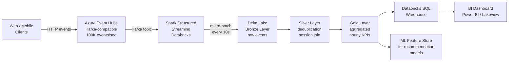
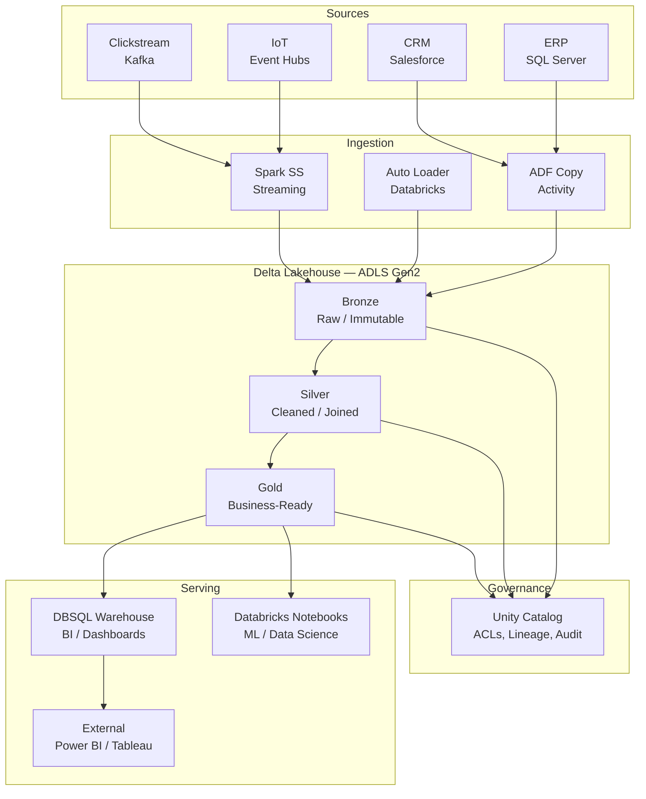
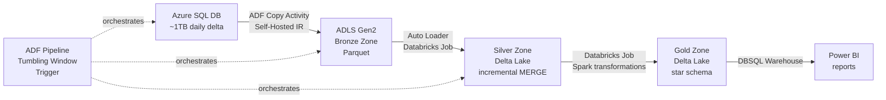
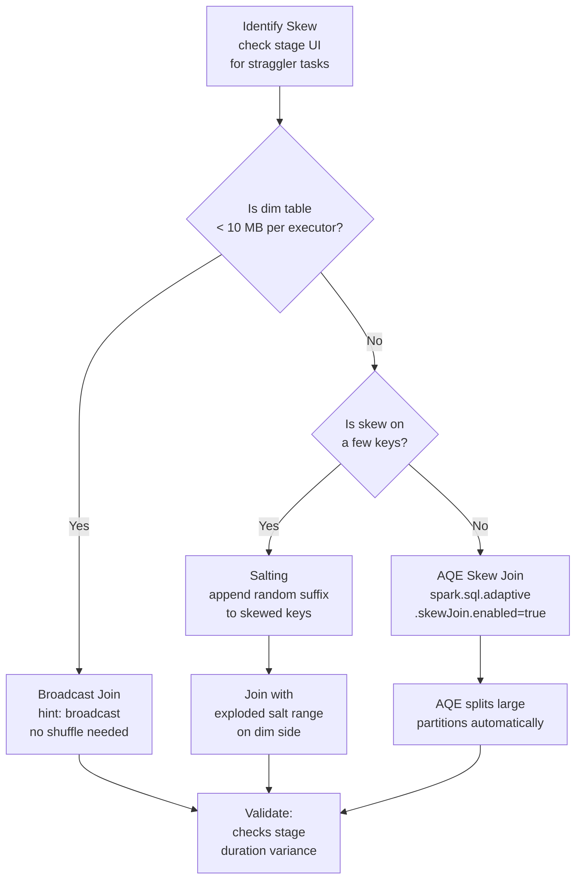
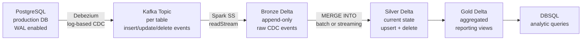
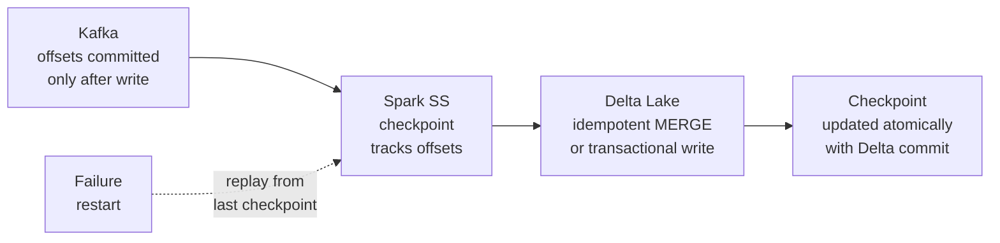

# System Design for Data Engineers

System design questions test your ability to translate business requirements into a coherent distributed architecture. Each answer below follows a consistent structure: **problem statement → clarifying questions → high-level design → deep dive → trade-offs**.

!!! tip "How to Use This Page"
    Read each design as a *template*, not a script. Interviewers will change the constraints — adapt by reasoning from first principles rather than reciting a memorised answer.

---

## 1. Real-Time Clickstream Analytics System

### Problem Statement

Design a system that ingests user clickstream events from a web application, processes them in near real-time, and serves both live dashboards and historical trend queries.

### Clarifying Questions

- What is the peak event rate? (assume 100,000 events/second at peak)
- What latency is acceptable for dashboard refresh? (assume under 30 seconds)
- Are we doing stateful aggregations (session analysis) or stateless counts?
- What cloud platform? (assume Azure)
- Who are the downstream consumers — business analysts using SQL or ML engineers?

### High-Level Design



### Deep Dive — Key Components

**Event Hubs / Kafka**

- Partition the topic by `user_id` to preserve per-user event ordering.
- Set `retention.ms` to 7 days to allow replay if the Spark consumer falls behind.
- Use consumer groups to allow multiple independent consumers (Spark streaming + audit logger) to read the same topic independently.

**Spark Structured Streaming**

- Use `readStream` from the Kafka source with `startingOffsets = "latest"` for live processing.
- Apply a **watermark** of 5 minutes on `event_timestamp` to handle late-arriving events before closing a window.
- Use `trigger(processingTime="10 seconds")` for micro-batch mode — balances latency with throughput.
- Write to Delta Lake using `outputMode("append")` for the Bronze layer.

**Medallion Layers**

- **Bronze:** Raw events with ingestion timestamp, no transformation. Append-only.
- **Silver:** Deduplicated events (MERGE on `event_id`), enriched with session boundaries.
- **Gold:** Pre-aggregated metrics (page views per minute, funnel conversion rates).

**Serving**

- Point DBSQL Warehouse at the Gold Delta tables for dashboard queries.
- Enable **Z-Ordering** on `event_date` and `page_id` for selective dashboard filters.

### Key Design Decisions

| Decision | Choice | Rationale |
|---|---|---|
| Message broker | Event Hubs (Kafka API) | Managed Kafka without ops overhead on Azure |
| Processing engine | Spark Structured Streaming | Exactly-once semantics with Delta Lake integration |
| Storage format | Delta Lake | ACID + time travel + streaming MERGE support |
| Serving layer | DBSQL Warehouse | Separates compute from the Spark streaming cluster |
| Deduplication | MERGE on event_id in Silver | Kafka at-least-once delivery can produce duplicates |

### Trade-Offs

| Trade-Off | Decision | What You Give Up |
|---|---|---|
| Micro-batch vs. true streaming (Flink) | Micro-batch (Spark SS) | Sub-second latency; gain operational simplicity |
| Stateful sessionisation in Silver | Sessionise in Silver zone | Complexity; gain replayability and debuggability |
| Pre-aggregation in Gold | Yes | Flexibility for ad-hoc queries; gain dashboard speed |

---

## 2. Enterprise Data Lakehouse

### Problem Statement

Design a central analytics platform for an enterprise with 20 source systems (ERP, CRM, IoT sensors, clickstream), 500 analyst users, and strict data governance requirements.

### Clarifying Questions

- What is the total data volume? (assume 50 TB today, growing 5 TB/month)
- Are there PII or regulated data categories requiring masking?
- What are the SLAs for different consumer tiers — dashboards vs. ad-hoc queries?
- Is there a preference for a single cloud (assume Azure)?
- Do we need to support both SQL analysts and Python/ML users?

### High-Level Design



### Deep Dive — Key Components

**Ingestion Layer**

- Use **ADF Copy Activity** for structured relational sources (ERP, CRM) with a Self-Hosted IR for on-premises connectivity.
- Use **Auto Loader** for file-based sources landing in ADLS — it incrementally processes only new files using file notifications, avoiding full directory scans.
- Use **Spark Structured Streaming** for real-time event sources (IoT, clickstream).

**Medallion Architecture**

- Bronze tables are append-only and retain full history. Never delete from Bronze.
- Silver applies data quality rules: null checks, deduplication, referential joins across domains.
- Gold exposes domain-specific aggregated views aligned to business processes (e.g., `sales_daily`, `customer_360`).

**Unity Catalog — Governance**

- Three-level namespace: `catalog.schema.table` (e.g., `prod.sales.orders`).
- Column-level masking for PII fields using dynamic views.
- Row-level security via row filters for regional data separation.
- Automatic lineage tracking from ingestion through to dashboard — no manual annotation required.

### Key Design Decisions

| Decision | Choice | Rationale |
|---|---|---|
| Storage | ADLS Gen2 | Hierarchical namespace required for analytics workloads |
| Table format | Delta Lake | ACID + schema enforcement + time travel across all layers |
| Governance | Unity Catalog | Cross-workspace, fine-grained, lineage-aware |
| Compute separation | DBSQL for BI, clusters for ETL | Prevents resource contention; independent scaling |
| CDC for relational sources | ADF + Change Tracking | Avoids full table scans on large transactional tables |

### Trade-Offs

| Trade-Off | Decision | What You Give Up |
|---|---|---|
| Single platform (Databricks) | Simpler ops, unified governance | Vendor lock-in risk |
| Medallion vs. point-to-point mart | Medallion | More zones to maintain; gain full auditability |
| Delta vs. Iceberg | Delta | Iceberg multi-engine portability; gain tighter Databricks integration |

---

## 3. 1 TB Daily Batch Pipeline with 4-Hour SLA

### Problem Statement

Design a data pipeline that ingests 1 TB of transactional data daily, applies business transformations, and makes results available in a reporting layer within 4 hours of the data cutoff.

### Clarifying Questions

- What is the source system? (assume Azure SQL Database, full table extract)
- What are the transformations? (assume joins across 5 dimension tables + aggregations)
- What is the output? (assume a star-schema fact table for Power BI)
- Is the pipeline incremental or full-load? (assume incremental with watermarking)
- What is the acceptable data freshness for consumers?

### High-Level Design



### Deep Dive — Key Components

**Ingestion (Target: 45 minutes)**

- Use a **Tumbling Window Trigger** in ADF to process the daily window with backfill capability.
- Configure **DIUs = 32** and `degreeOfCopyParallelism = 8` for the ADF Copy Activity to saturate the network link.
- Partition the source extract by a date column during copy to enable parallel reads from SQL.

**Silver Transformation (Target: 90 minutes)**

- Load the incremental Parquet files with **Auto Loader** into a Bronze Delta table.
- Apply MERGE INTO Silver using the primary key — handles late arrivals and updates gracefully.
- Use **AQE** (`spark.sql.adaptive.enabled=true`) to automatically coalesce the shuffle output after joins.

**Gold Aggregation (Target: 60 minutes)**

- Write a dimension-joined fact table to Gold using `overwrite` mode with partition pruning on `event_date`.
- Use **OPTIMIZE + Z-ORDER** on the most common filter columns (e.g., `customer_id`, `product_id`) after each daily load.

**SLA Buffer**

- Total planned runtime: ~3.25 hours → leaves 45 minutes of buffer before the 4-hour SLA.
- Alert via ADF pipeline monitoring if any stage exceeds its target duration by 20%.

### Key Design Decisions

| Decision | Choice | Rationale |
|---|---|---|
| Trigger type | Tumbling Window | Native backfill + dependency management |
| Copy parallelism | 32 DIUs, 8 parallel copies | Compress 1 TB transfer into ~45 min window |
| Silver write mode | MERGE INTO | Idempotent — safe to replay on failure |
| Gold write mode | Overwrite partition | Simpler than MERGE for aggregated fact tables |
| Query acceleration | OPTIMIZE + Z-ORDER | Reduces BI query scan costs after daily load |

### Trade-Offs

| Trade-Off | Decision | What You Give Up |
|---|---|---|
| Full extract vs. CDC | Incremental watermark | Delta detection complexity; gain smaller transfers |
| MERGE vs. INSERT OVERWRITE in Silver | MERGE | Slower writes; gain correctness on late/duplicate records |
| OPTIMIZE frequency | Daily after load | Storage cost of compaction; gain faster reads |

---

## 4. Handling Data Skew in a 10 TB Spark Join

### Problem Statement

You have a 10 TB fact table and a 500 MB dimension table. The join on `customer_id` is taking 4 hours because a small number of customers (VIPs) account for 60% of all rows.

### Clarifying Questions

- Is the skew on the build side (smaller table) or the probe side (larger table)?
- What is the skew distribution — a handful of keys or broadly uneven?
- Is the smaller table small enough to fit in executor memory?
- Can we modify the source data or only the query?

### Solutions by Scenario



**Strategy 1 — Broadcast Join**

If the dimension table is under the broadcast threshold (default 10 MB, tunable to ~200 MB):

```python
from pyspark.sql.functions import broadcast

result = fact_df.join(broadcast(dim_df), "customer_id")
```

This eliminates the shuffle entirely — the dimension table is copied to every executor.

**Strategy 2 — Salting**

For a 500 MB dimension that cannot be broadcast, apply salting to distribute skewed keys:

```python
from pyspark.sql.functions import col, concat, lit, floor, rand, explode, array

SALT_FACTOR = 10

# Add random salt to the fact table
salted_fact = fact_df.withColumn("salt", (rand() * SALT_FACTOR).cast("int")) \
                     .withColumn("salted_key", concat(col("customer_id"), lit("_"), col("salt")))

# Explode the dimension table to match all salt values
salted_dim = dim_df.withColumn("salt_range", array([lit(i) for i in range(SALT_FACTOR)])) \
                   .withColumn("salt", explode(col("salt_range"))) \
                   .withColumn("salted_key", concat(col("customer_id"), lit("_"), col("salt")))

result = salted_fact.join(salted_dim, "salted_key").drop("salt", "salted_key", "salt_range")
```

**Strategy 3 — AQE Skew Join Optimization**

Enable Adaptive Query Execution and let Spark split oversized shuffle partitions automatically:

```python
spark.conf.set("spark.sql.adaptive.enabled", "true")
spark.conf.set("spark.sql.adaptive.skewJoin.enabled", "true")
spark.conf.set("spark.sql.adaptive.skewJoin.skewedPartitionFactor", "5")
spark.conf.set("spark.sql.adaptive.skewJoin.skewedPartitionThresholdInBytes", "256m")
```

### Key Design Decisions

| Scenario | Strategy | When to Use |
|---|---|---|
| Dim table < 10 MB | `broadcast()` hint | Always — zero shuffle cost |
| Dim table 10–500 MB | Increase broadcast threshold | If executor memory allows |
| Dim table > 500 MB, few skewed keys | Salting | Manual but highly effective |
| Skew pattern unknown at write time | AQE skew join | Good default; handles dynamic skew |
| Skew on non-join aggregation | `repartition()` before groupBy | Spreads data before agg |

---

## 5. CDC Pipeline from OLTP to Analytics Store

### Problem Statement

Design a Change Data Capture pipeline that replicates changes from a production PostgreSQL database to an analytics lakehouse with less than 15-minute lag.

### Clarifying Questions

- What CDC mechanism is available — database triggers, log-based (WAL), or application-level?
- What is the transaction volume — rows changed per second?
- Are deletes important to propagate, or only inserts/updates?
- Is the target append-only or does it need to reflect the current state?

### High-Level Design



### Deep Dive

**Log-Based CDC with Debezium**

Debezium reads the PostgreSQL Write-Ahead Log (WAL) without impacting production query performance (unlike trigger-based CDC). Each row change becomes a Kafka message with:

- `op`: `"c"` (create), `"u"` (update), `"d"` (delete)
- `before`: the row state before the change
- `after`: the row state after the change
- `ts_ms`: event timestamp

**Bronze → Silver MERGE**

```python
from delta.tables import DeltaTable

silver = DeltaTable.forName(spark, "prod.silver.orders")

# Process CDC batch
silver.alias("target").merge(
    cdc_batch.alias("source"),
    "target.order_id = source.order_id"
).whenMatchedDelete(
    condition="source.op = 'd'"
).whenMatchedUpdateAll(
    condition="source.op = 'u'"
).whenNotMatchedInsertAll(
    condition="source.op = 'c'"
).execute()
```

**Exactly-Once Semantics**

- Delta Lake's ACID transactions prevent partial writes.
- Spark Structured Streaming with Delta sink uses checkpoint files to track which Kafka offsets have been committed.
- The MERGE is idempotent — re-running the same batch produces the same result.

### Key Design Decisions

| Decision | Choice | Rationale |
|---|---|---|
| CDC source | Debezium on WAL | Zero production DB impact vs. trigger-based |
| Message broker | Kafka | Durable, replayable, ordered within partition |
| Bronze write | Append-only | Full audit trail; never loses a change event |
| Silver write | MERGE INTO | Reflects current state; handles deletes correctly |
| Ordering | Kafka partition by primary key | Ensures per-row event ordering |

---

## 6. Exactly-Once Processing in a Streaming Pipeline

### Problem Statement

Explain how you would guarantee exactly-once message processing in a streaming pipeline from Kafka to Delta Lake.

### What "Exactly-Once" Actually Means

At-least-once delivery (default in most systems) can write duplicates. Exactly-once means every event is processed and written to the sink **exactly one time**, even if the pipeline fails and restarts.



### Three Layers of Exactly-Once

**Layer 1 — Kafka Source (Read Side)**

Spark Structured Streaming stores the last processed Kafka offset in a **checkpoint directory** (ADLS / S3). On restart, it resumes from the committed offset — not from the latest message.

```python
stream = spark.readStream \
    .format("kafka") \
    .option("kafka.bootstrap.servers", "broker:9092") \
    .option("subscribe", "orders") \
    .load()

query = stream.writeStream \
    .format("delta") \
    .outputMode("append") \
    .option("checkpointLocation", "abfss://checkpoints@storage.dfs.core.windows.net/orders/") \
    .table("prod.bronze.orders")
```

**Layer 2 — Delta Lake Sink (Write Side)**

Delta Lake writes are atomic — a micro-batch either fully commits or fully rolls back. The transaction log records each committed batch ID. If the same batch is written twice (after a crash), Delta detects the duplicate transaction ID and skips the second write.

**Layer 3 — Idempotent Business Logic**

Even with exactly-once delivery, business logic must be idempotent:

- Use `MERGE` with a natural key rather than `INSERT` — inserting twice creates duplicates.
- Assign a `batch_id` or `event_id` to each record and check for it in the MERGE condition.

### Key Design Decisions

| Component | Mechanism | What It Prevents |
|---|---|---|
| Kafka offset tracking | Checkpoint files | Re-reading already-processed messages |
| Delta write | Atomic transaction | Partial writes on executor failure |
| Delta idempotent sink | Transaction ID check | Duplicate micro-batch commits on retry |
| Business MERGE | MERGE on primary key | Application-level duplicate rows |

!!! warning "Exactly-Once is Not Free"
    Checkpointing adds write overhead. MERGE is slower than INSERT. In most DE workloads this is the correct trade-off — but for very high-throughput pipelines where duplicates are acceptable (e.g., raw event counts), at-least-once with downstream deduplication is a valid alternative.

---

## System Design Vocabulary Reference

This quick-reference table covers the terminology interviewers use in system design discussions. Being fluent with these terms — and knowing when to use each one — signals senior-level thinking.

| Term | Definition | When to Mention |
|---|---|---|
| **Throughput** | Data volume processed per unit time (GB/hour, events/second) | Capacity planning, bottleneck analysis |
| **Latency** | Time from event occurrence to query-visible result | SLA definition, batch vs. streaming trade-off |
| **Idempotency** | Same operation applied multiple times produces the same result | Pipeline reliability, retry design |
| **Exactly-once** | Every event processed and committed precisely one time | Streaming correctness guarantees |
| **At-least-once** | Every event processed at least once — duplicates possible | Default Kafka delivery; requires dedup |
| **At-most-once** | Each event processed zero or one time — loss possible | High-throughput telemetry with acceptable loss |
| **Backpressure** | Mechanism to slow producers when consumers fall behind | Streaming pipeline flow control |
| **Watermark** | Threshold defining how late an event can arrive before its window is closed | Stateful streaming aggregations |
| **Compaction** | Merging small files into larger ones to improve read performance | Delta OPTIMIZE, Kafka log compaction |
| **Partition key** | Column or field used to determine which partition/shard a record belongs to | Kafka ordering, Spark partitioning, Delta pruning |
| **Replication factor** | Number of copies of data stored across nodes | Fault tolerance configuration |
| **ISR** | In-Sync Replicas — Kafka replicas fully caught up to the leader | Kafka durability guarantees |
| **Checkpoint** | Durable snapshot of processing state to enable restart | Spark SS recovery, stateful stream processing |
| **Schema registry** | Centralized store for Avro/JSON/Protobuf schemas with versioning | Kafka schema evolution governance |
| **Consumer lag** | Difference between the latest offset in a Kafka topic and the last committed offset of a consumer | Pipeline health monitoring |
| **Z-Ordering** | Multi-dimensional sort order for Delta Lake files to improve multi-column predicate skipping | Delta query optimization |
| **Cardinality** | Number of distinct values in a column | Join strategy selection, partition design |
| **Fan-out** | Number of downstream consumers for a single upstream source | Kafka consumer group design |
| **Medallion** | Bronze → Silver → Gold layered data architecture | Any lakehouse design question |
| **DIU** | Data Integration Unit — ADF's unit of copy compute capacity | ADF performance tuning |

---

## Common System Design Anti-Patterns

Understanding what *not* to do is as important as knowing the right answer. These are the mistakes that immediately signal junior thinking:

**1. Reading from production databases for analytics**

Never query a production OLTP database directly for reporting. OLTP databases are optimised for transactional workloads — analytical queries cause lock contention, slow down application response times, and risk data exposure. Always build an ETL/CDC pipeline to a separate analytics store.

**2. Writing one file per event in streaming**

A common mistake when first building streaming pipelines: writing each micro-batch as a separate file. This creates millions of tiny files (the "small files problem"), which overwhelms the metadata layer and causes query plans with thousands of tasks. Use Auto Loader's `trigger(processingTime="5 minutes")` to batch writes, and run `OPTIMIZE` periodically.

**3. Using `SELECT *` from large Delta tables without predicates**

Without a `WHERE` clause on a partitioned or Z-Ordered column, Spark must read every file in the table. On a 10 TB table, this is catastrophically slow. Always push filters as close to the source as possible. Delta's data skipping statistics only activate when the query predicate matches a column that has statistics.

**4. Storing secrets in notebooks or pipeline code**

Hardcoding connection strings, passwords, or storage keys in notebooks, DAGs, or configuration files is a critical security vulnerability. Always retrieve secrets from a secrets manager at runtime (Azure Key Vault, AWS Secrets Manager, Databricks Secret Scopes).

**5. Not accounting for late data in streaming**

Assuming all events arrive in order and on time is the most common streaming design mistake. Network delays, mobile devices coming back online, and upstream system restarts all produce late data. Always define a watermark and design your aggregation windows to accommodate realistic late arrival distributions.

**6. Skipping data quality checks**

A pipeline that runs successfully but writes bad data is worse than a pipeline that fails visibly. Silent data corruption (a null column that should never be null, a count that quietly dropped by 40%) is the hardest class of production bug. Embed data quality assertions as a first-class step in every pipeline.

!!! tip "Closing a System Design Interview"
    Always end by proactively discussing the failure modes of your design: "The main risks I see are: (1) late data handling in the streaming layer, (2) small files accumulating in the Bronze zone without scheduled OPTIMIZE, and (3) schema drift from the upstream source. Here's how I'd monitor and mitigate each..." This demonstrates ownership mindset and production engineering experience.

---

## Capacity Estimation Quick Reference

Back-of-envelope estimation is expected in system design interviews. Interviewers are not looking for precision — they are evaluating whether your instincts are calibrated to real-world scale.

### Storage Estimates

| Data Rate | Daily Volume | Annual Volume |
|---|---|---|
| 1 MB/sec | ~86 GB/day | ~31 TB/year |
| 10 MB/sec | ~860 GB/day | ~310 TB/year |
| 100 MB/sec | ~8.6 TB/day | ~3.1 PB/year |
| 1 event/user, 10M DAU, 200 bytes/event | ~2 GB/day | ~730 GB/year |
| 1 TB/day raw | ~365 TB/year raw; ~100 TB/year Parquet with 3:1 compression |

### Compute Estimates

| Scenario | Spark Cluster Suggestion | Notes |
|---|---|---|
| 100 GB daily batch, 2-hour SLA | 4–8 executors, 8 cores, 32 GB RAM each | Comfortable for ETL + star schema build |
| 1 TB daily batch, 4-hour SLA | 16–32 executors, 8 cores, 32 GB RAM each | Match DIUs in ADF copy (32 DIUs) |
| 10 TB daily batch, 8-hour SLA | 32–64 executors; consider Photon for SQL-heavy Gold layer | Monitor shuffle spill — increase memory if needed |
| 100K events/sec streaming | 8–16 Spark Structured Streaming executors; 10–20 Kafka partitions | Scale consumer group to match partition count |

### Network Throughput Rules of Thumb

- A single 10 Gbps network link saturates at ~1 GB/sec of actual throughput.
- A Spark executor with 8 cores can typically process 200–500 MB/sec of Parquet data on modern SSD-backed cloud storage.
- Cross-region data transfer in Azure / AWS costs money and adds 20–50 ms latency — keep compute in the same region as storage.

### Compression Ratios by Format

| Format | vs. Raw CSV | Notes |
|---|---|---|
| Parquet + Snappy | 3–5× smaller | Default for most analytical workloads |
| Parquet + ZSTD | 4–6× smaller | Better ratio, slightly more CPU |
| Parquet + GZIP | 5–7× smaller | Best ratio, most CPU — use for archival |
| Delta (includes Parquet) | 3–5× smaller + transaction log overhead | Transaction log is negligible vs. data size |
| Avro | ~2× smaller than JSON | Row format — not columnar; best for streaming events |

These ratios inform storage cost estimates: "1 TB of raw CSV events becomes approximately 200–300 GB in Parquet — at $0.02/GB/month on ADLS Gen2, that's $4–6/month for the hot tier."
